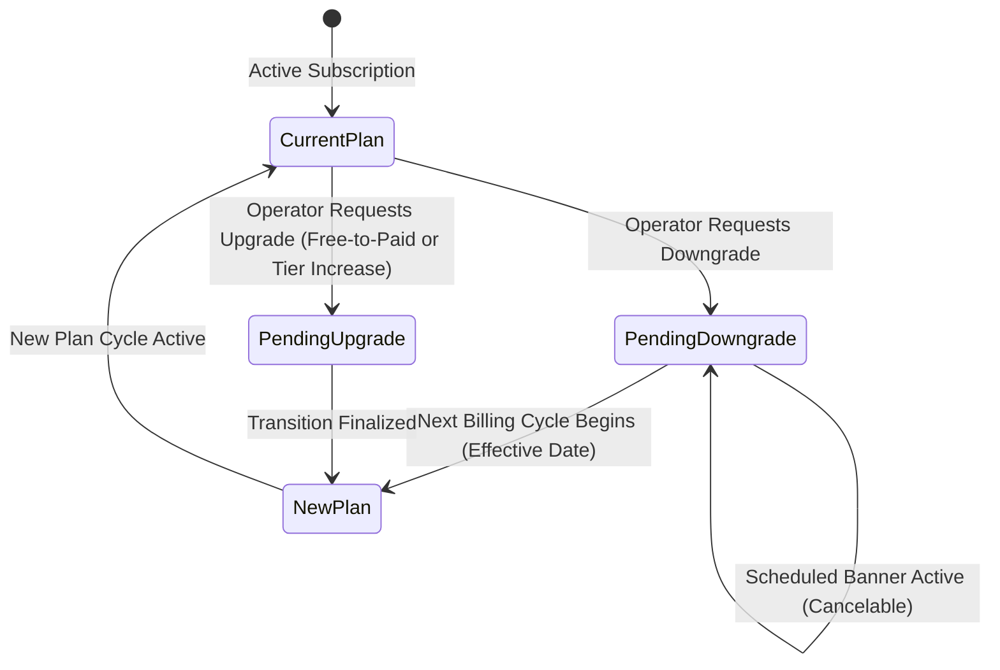
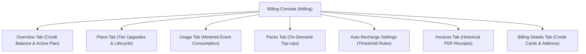

import { Callout } from "fumadocs-ui/components/callout";
import { Tab, Tabs } from "fumadocs-ui/components/tabs";

Cerebronix operates a transparent, enterprise-grade billing architecture powered by integrated subscription and usage metering engines. Through the **Billing** console (`/billing`), organizations can review subscription tiers, monitor AI and messaging credit usage, purchase top-up packs, configure automated recharge thresholds, manage corporate payment methods, and download historical invoices.

## 1. What the Capability Accomplishes

The Billing & Subscription Management suite provides:

- **Tiered Subscription Governance:** Choose between Free Evaluation, Growth, Scale, and custom Enterprise plans tailored to your operational scale.
- **Predictable Subscription Lifecycle:** Understand exactly how upgrades, downgrades, and billing cycles transition without unexpected mid-cycle disruption.
- **Consumption-Based Credit Tracking:** Monitor real-time platform credits consumed by AI reasoning, knowledge vector indexing, and WhatsApp message dispatches.
- **On-Demand Top-Up Credit Packs:** Replenish platform credits instantly to maintain uninterrupted customer service during peak shopping seasons.
- **Automated Balance Recharge:** Configure auto-recharge rules that replenish your balance when credits fall below a defined threshold.
- **Financial Audit History:** Access itemized PDF invoices with breakdown of subscription fees, usage charges, and applicable regional taxes.

## 2. Subscription Tiers & Feature Matrix

Cerebronix offers four structured plans designed for different stages of business growth:

| Feature / Resource | Free Evaluation | Growth | Scale | Enterprise |
| :--- | :--- | :--- | :--- | :--- |
| **Target Audience** | Evaluation & Prototyping | Growing Businesses & D2C | Scaling Multi-Channel Retail | High-Volume Global Brands |
| **Team Member Seats** | 1 seat | Up to 10 seats | Up to 25 seats | Custom / Unlimited |
| **Connected Data Sources** | 1 data source | Up to 10 data sources | Up to 25 data sources | Unlimited data sources |
| **Connected Channels** | 2 channels | Up to 8 channels | Unlimited channels | Unlimited channels |
| **Monthly Platform Credits** | 200 credits | 5,000 credits | 12,000 credits | Custom / Unlimited |
| **Operational Analytics** | Locked (`LockedState`) | Full 30-day analytics | Extended historical reporting | Custom reporting & exports |
| **Public API Access** | No | 60 RPM | 300 RPM | Custom / Uncapped |
| **Pricing Model** | Free Evaluation | Pricing announced at launch | Pricing announced at launch | Custom Enterprise Contract |
| **Upgrade Action** | Requires Payment Method | Self-Service Upgrade | Self-Service Upgrade | Contact Sales |

<Callout type="info" title="Commercial Plan Pricing Disclosure">
Cerebronix public tiers (Growth and Scale) feature pricing announced at commercial launch. Exact subscription fees and credit conversions are finalized upon plan selection. Enterprise tiers feature custom negotiated billing contracts.
</Callout>

## 3. The Subscription Lifecycle: Upgrades, Downgrades & Transitions

Cerebronix enforces a predictable subscription lifecycle designed to prevent accidental service disruption or billing anomalies:

### Lifecycle Transition Rules

1. **Downgrades (`downgradeNextCycle`):**
   - When an organization selects a lower plan tier, the downgrade request is submitted immediately but **becomes effective at the end of the current billing cycle**.
   - Your current plan entitlements (seats, channels, analytics access) and active credits remain fully accessible until the scheduled transition date.
   - **Seat Limit Downgrade Block (`seatsBlockDowngrade`):** If your current team roster exceeds the target plan's seat capacity (e.g., you have 8 team members on Scale and attempt to downgrade to Growth, which permits 5), the system **blocks** the downgrade until excess members are removed in `/team-members`.
2. **Upgrades (`upgradeNow`):**
   - Upgrades to higher tiers take effect immediately upon confirmation. The billing engine instantly unlocks higher resource quotas, expands team seat capacity, and enables gated features (such as Analytics).
   - In accordance with current billing platform behavior, applicable subscription fees are invoiced upon upgrade with mid-cycle proration for the remaining billing period.
3. **Payment Method Requirement (`paymentMethodRequired`):**
   - Moving from the Free Evaluation tier to any paid plan (Growth or Scale) strictly requires a valid credit/debit card on file under **Billing Details**. Attempting to select a paid plan without a payment method halts with a prompt to add payment details.
4. **Pending Plan Banner & Cancellation:**
   - While a plan change is pending, `/billing` displays an orange alert banner displaying the target plan and effective date (`pendingEffectiveAt`).
   - Operators can click **Cancel Pending Change** (`handleCancelPending`) at any time before the cycle rolls over to abort the change and remain on their current plan.
5. **Enterprise Tier (`contactSales`):**
   - Selecting the Enterprise plan opens a direct consultation request with our enterprise architecture team.

## 4. Platform Credits, Usage & Top-Up Packs

In addition to subscription seat fees, high-performance model inferences, speech transcription, and outbound WhatsApp messages consume platform usage credits.

Navigate to **Billing** -> **Tabs**:

### Credit Packs (`/billing` -> Packs Tab)

When credit reserves run low, organizations can purchase on-demand credit packs without altering their core subscription tier:
- Standard credit packs are purchased with one click using your stored payment method.
- Credits are immediately added to your active balance and never expire while your subscription remains in good standing.

### Automated Recharge (`AutoRechargeSection`)

To safeguard against sudden message delivery halts during unexpected sales surges:
- **Enable Auto-Recharge:** Toggle automated top-ups to ON.
- **Balance Threshold:** Define the minimum credit balance (e.g., *Recharge when balance falls below 1,000 credits*).
- **Recharge Amount:** Specify the top-up pack to automatically purchase when the threshold is breached.
- **Safety Limit:** Set a monthly maximum expenditure ceiling to prevent runaway billing.

## 5. Invoices & Billing Details

- **Invoices Tab (`/billing` -> Invoices):** Itemized breakdown of all completed billing cycles, subscription renewals, and credit pack purchases. Each entry includes invoice date, billing period, amount paid, and a direct PDF download link.
- **Billing Details Tab (`/billing` -> Details):** Manage corporate credit cards, debit cards, company tax registration numbers (GSTIN, VAT ID), and billing contact email addresses.

## 6. Prerequisites and Plan Restrictions

- **Plan Entitlements:**
  - **Free Evaluation:** 1,000 evaluation credits; no payment method required for initial signup.
  - **Growth Plan:** Monthly included credit allocation; self-service top-up packs; automated invoice generation.
  - **Scale Plan:** High monthly credit allowance; auto-recharge rules; volume discount pricing.
  - **Enterprise Plan:** Custom credit allocations; consolidated invoicing; net-30 / net-60 wire payment terms.
- **Required Roles:** `owner` role required to change subscription plans, add payment methods, or purchase credit packs. `admin` can review invoices and monitor usage.

## 7. Step-by-Step Customer Instructions (Apex Retail Global Example)

### Step 1: Add a Corporate Payment Method

1. Navigate to **Billing** (`/billing`) and select the **Billing Details** tab.
2. In the **Payment Methods** section, click **Add Payment Method**.
3. Enter your corporate credit card details (card number, expiration, CVC, billing zip code).
4. Enter your company VAT or GST registration identifier for tax-compliant invoicing.
5. Click **Save Payment Method**. The card displays with a green `Default` badge.

### Step 2: Upgrade from Free Evaluation to Growth Plan

1. In `/billing`, click the **Plan** tab.
2. Review available plans. Locate the **Growth** card.
3. Click **Upgrade Now**.
4. A confirmation modal appears summarizing the plan name, subscription billing terms, and seat allowance (10 seats).
5. Click **Confirm Plan Change**.
6. The card immediately updates with the green `Current Plan` badge, and Analytics access unlocks across your workspace.

### Step 3: Configure Auto-Recharge for Peace of Mind

1. In `/billing`, select the **Overview** tab.
2. Scroll to the **Auto-Recharge** section.
3. Toggle **Enable Auto-Recharge** to **ON**.
4. Set **Threshold**: `When balance drops below 500 credits`.
5. Set **Recharge Pack**: `Add 5,000 Credits Pack`.
6. Click **Save Auto-Recharge Settings**.

## 8. Expected Results & Verification

Verify that your billing and plan settings are in sync:

1. **Current Plan Badge:** Under `/billing` -> **Plan**, verify that the Growth plan displays `Current Plan`.
2. **Feature Access:** Navigate to `/analytics`. Verify that the dashboard loads all metrics rather than displaying the locked upgrade screen.
3. **Invoice Generation:** In `/billing` -> **Invoices**, confirm that an initial invoice was generated with payment status `Paid`. Download the PDF and verify corporate billing details.

## 9. Common Problems and Troubleshooting

### Issue: "Payment Method Required" Error When Upgrading
- **Root Cause:** Attempting to upgrade to a paid tier while no valid credit card is stored on the organization account.
- **Resolution:** Open the **Billing Details** tab, add a valid payment method, and retry the plan upgrade.

### Issue: "Seats Block Downgrade" Error
- **Root Cause:** The organization currently has more active team members than permitted by the lower plan tier.
- **Resolution:** Navigate to `/team-members` and remove teammates until the total count matches or falls below the target plan's seat limit. Return to `/billing` and execute the downgrade.

### Issue: Credit Balance Decreasing Rapidly
- **Root Cause:** A high-volume marketing campaign was broadcast on WhatsApp or complex multi-turn audio notes were transcribed.
- **Resolution:** Check the **Usage** tab under `/billing` to inspect metered events. Configure a higher auto-recharge threshold to maintain continuous operations.

## 10. Relevant Related Guides

- [Organization Settings & Team Roles](/docs/admin-and-billing/organization-and-team): Managing team seats and invitations.
- [Analytics & Reporting](/docs/analytics/dashboards-and-metrics): Unlocking operational reporting via the Growth tier.
- [Core Concepts: Credits, Plans & Public API](/docs/concepts/credits-plans-public-api): Understanding metering and token consumption.
- [WhatsApp Business Channel Setup](/docs/channels/whatsapp-business): Managing template messaging costs.
