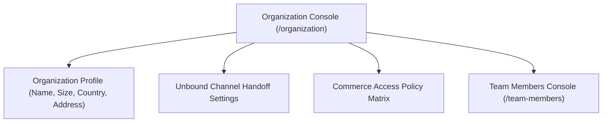
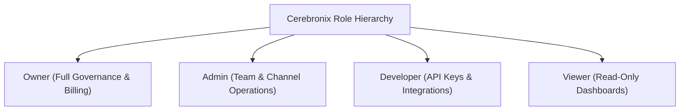

import { Callout } from "fumadocs-ui/components/callout";
import { Tab, Tabs } from "fumadocs-ui/components/tabs";

Cerebronix provides enterprise governance tools for managing multi-user organizations, enforcing role-based security policies, controlling workspace access, and managing operator seat allocations. Through the **Organization** (`/organization`) and **Team Members** (`/team-members`) consoles, administrators maintain complete oversight of company profiles, operational policies, and teammate privileges.

## 1. What the Capability Accomplishes

The Organization & Team Management suite enables administrators to:

- **Govern Workspace Identity:** Maintain official corporate metadata, billing addresses, support contact details, and organization branding.
- **Enforce Role-Based Access Control (RBAC):** Assign granular privileges across four standardized organization roles (`owner`, `admin`, `developer`, `viewer`).
- **Manage Operator Seats & Plan Capacity:** Monitor seat utilization (`seats.used` of `seats.limit`), prevent over-capacity invitations, and plan team expansion.
- **Configure Unbound Channel Handoffs:** Ensure unmanaged communication channels gracefully route customer inquiries to human operator inboxes with optional custom greetings.
- **Manage Organization-Wide Commerce Access:** Define global policies governing which roles and automated tools can modify customer carts and orders.

## 2. Organization Profile & Operational Policies

Navigate to **Organization** (`/organization`) in the navigation menu.



### Profile Attributes

- **Organization Name:** The legal business or brand entity name (e.g., `Apex Retail Global`).
- **Company Size & Industry:** Operational scale classification (e.g., `100-500 employees`, `Retail & Ecommerce`).
- **Contact Details:** Corporate support telephone number, primary email, official website, and registered corporate address.
- **Brand Assets:** Workspace logo rendered in navigation headers and customer-facing authentication emails.

### Unbound Channel Handoff Settings

When an organization receives messages on a channel that has no actively bound AI agent, the system's handoff policy governs the customer experience:
- **Silent Handoff (Default):** The conversation is placed directly into the human operator inbox (`/chat`) without sending an automated message to the customer.
- **Enabled Handoff with Custom Message:** Cerebronix immediately sends a pre-configured greeting (e.g., *"Welcome to Apex Retail Global! Our support specialists have received your message and will assist you shortly."*) before enqueuing the dialogue for human operators.

### Commerce Access Policy Matrix

Configures the organization's default security rules for ecommerce actions. Administrators can restrict high-risk operations (such as order cancellations or pricing overrides) so they require explicit operator verification rather than executing autonomously.

## 3. Team Roles & Granular Permissions (RBAC)

Navigate to **Team Members** (`/team-members`) to inspect the team roster and role assignments.



### The 4 Standard Organization Roles

| Role | Permissions & Responsibilities | Best Suited For |
| :--- | :--- | :--- |
| **`owner`** | Full organization governance. Can manage billing subscriptions, invite and demote admins, delete workspaces, and configure payment methods. At least one owner is required at all times. | Founders, C-level executives, and corporate directors. |
| **`admin`** | Operational management. Can invite and remove team members (except owners), configure communication channels, bind AI agents, manage stores, and take over customer chats. | Support managers, department heads, and operations leads. |
| **`developer`** | Technical integrations. Can generate API keys, configure webhooks, test MCP tools, manage developer endpoints, and configure external store credentials. | Technical architects, software engineers, and IT specialists. |
| **`viewer`** | Read-only observation. Can view conversation streams, inspect customer profiles, and review analytics dashboards without editing settings or replying to chats. | Auditors, business analysts, and external consultants. |

<Callout type="info" title="Single-Owner Safety Constraint">
An organization must retain at least one active `owner`. If an organization has only one owner, the system disables self-demotion and deletion for that user to prevent orphaned workspaces.
</Callout>

## 4. Seat Allocation & Plan Limits

Operator seats represent active human user accounts within your organization workspace:

- **Seat Tracking:** The header of `/team-members` displays real-time capacity:
  ```text
  Seats: 4 of 10 used
  ```
- **Unlimited Seats:** High-tier plans (Enterprise) reflect `seats.unlimited = true`.
- **Seat Limit Enforcement Gate:** When `seats.used >= seats.limit`, the **Invite Teammate** action is blocked. Attempting to send an invitation returns `seat_limit_reached`.
- **Downgrade Seat Protection:** When downgrading subscription tiers in `/billing`, Cerebronix checks whether current team members exceed the target plan's seat allowance. If so, the downgrade is blocked until excess team members are removed (`seatsBlockDowngrade`).

## 5. Prerequisites and Plan Restrictions

- **Plan Entitlements:**
  - **Free Evaluation:** 1 team seat; standard RBAC roles (`owner`, `admin`, `developer`, `viewer`).
  - **Growth Plan:** Up to 10 team seats; developer role; unbound channel handoff messaging.
  - **Scale Plan:** Up to 25 team seats; custom commerce access policies; team grouping.
  - **Enterprise Plan:** Unlimited seats; custom SAML/SSO authentication; automated SCIM provisioning; granular custom permissions.
- **Required Roles:** `owner` or `admin` permissions to invite teammates, change roles, or modify organization profiles.

## 6. Step-by-Step Customer Instructions (Apex Retail Global Example)

### Step 1: Update Organization Profile & Handoff Message

1. In the Cerebronix console, navigate to **Organization** (`/organization`).
2. Review company details:
   - **Organization Name:** `Apex Retail Global`
   - **Website:** `https://apexretail.com`
   - **Country:** `United States`
3. Scroll to **Unbound Channel Handoff Settings**.
4. Toggle **Enable Handoff Message** to **ON**.
5. In the message box, enter:
   ```text
   Thank you for reaching out to Apex Retail Global. An agent will connect with you in just a moment!
   ```
6. Click **Save Handoff Settings**.

### Step 2: Invite a Support Team Member

1. Navigate to **Team Members** (`/team-members`).
2. Review current seat usage: `3 of 5 used`.
3. Click **Invite Teammate**.
4. In the modal:
   - **Email Address:** `elena.rostova@apexretail.com`
   - **Role:** Select `admin` (or `developer` / `viewer`).
5. Click **Send Invitation**.
6. An invitation email is dispatched with a secure registration link. Seat usage increments to `4 of 5 used`.

### Step 3: Modify an Existing Teammate's Role

1. In the team members table, locate teammate `Marcus Vance`.
2. In the **Role** column dropdown, change his role from `developer` to `admin`.
3. Confirm the update. Marcus's administrative permissions activate immediately upon his next navigation.

## 7. Expected Results & Verification

Verify team management operations:

1. **Invitation Acceptance:** When the invitee clicks their email link and registers, their status in `/team-members` transitions from `Invited` to `Active`.
2. **Permission Boundary Check:** Log in with a user assigned the `viewer` role. Verify that the **Invite Teammate** button is hidden and editing options are disabled.
3. **Seat Limit Verification:** If all allocated seats are utilized, verify that the **Invite Teammate** button displays a tooltip stating that the seat limit has been reached and recommending an upgrade in `/billing`.

## 8. Common Problems and Troubleshooting

### Issue: "Seat Limit Reached" Blocks New Team Invitations
- **Root Cause:** All available seats for your active subscription tier are currently allocated.
- **Resolution:** Remove inactive team members or pending invites from `/team-members`, or navigate to `/billing` to upgrade to a higher tier with more seats.

### Issue: Cannot Remove or Demote Organization Owner
- **Root Cause:** The target user is the sole remaining `owner` of the organization.
- **Resolution:** First invite or promote another trusted team member to the `owner` role. Once the second owner is confirmed, the original owner can be demoted or removed.

### Issue: Teammate Did Not Receive Invitation Email
- **Root Cause:** Corporate spam filters intercepted the email, or a typo occurred in the address.
- **Resolution:** Ask the user to inspect their spam/junk folder. In `/team-members`, click **Resend Invitation** or revoke and re-issue the invitation.

## 9. Relevant Related Guides

- [Subscription Plans, Credits & Invoices](/docs/admin-and-billing/billing-plans-and-credits): Managing subscription tiers and seat allowances.
- [Human Takeover & Team Routing](/docs/conversations/human-takeover-and-routing): Assigning conversations to teammates.
- [Unified Omnichannel Inbox](/docs/conversations/overview-and-inbox): Operational inbox workspace for operators.
- [Developer API Keys & Webhooks](/docs/concepts/credits-plans-public-api): Managing technical access for developer accounts.
