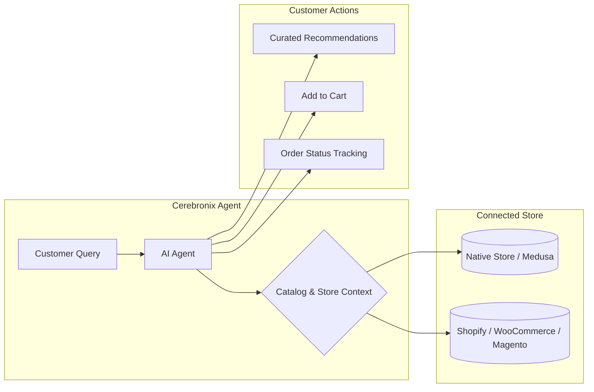

import { Callout } from 'fumadocs-ui/components/callout';
import { Steps } from 'fumadocs-ui/components/steps';
import { Tab, Tabs } from 'fumadocs-ui/components/tabs';

When an AI Agent is bound to an ecommerce store, it transitions from a generic informational assistant into a transactional shopping concierge. The agent can browse your live catalog, recommend relevant variants, check stock levels, answer product specification queries, and guide customers through order placement.

This guide explains how to bind an ecommerce store to an AI Agent in Cerebronix, configure store-specific behaviors, curate highlight collections, and apply safety controls to automated cart additions.



---

## Prerequisites and Permissions

Before binding a store to an agent, ensure you have:

1. **Role Permissions**: An organization role of `owner`, `admin`, or `developer`. Viewers cannot modify agent bindings or store integrations.
2. **Active Ecommerce Integration**: At least one active ecommerce connection configured under **Integrations** (such as Cerebronix Native Store, Shopify, WooCommerce, or Magento) with status showing connected.
3. **Indexed Product Catalog**: An active knowledge source of type `ECOMMERCE` synchronizing product titles, descriptions, variants, and pricing.

<Callout type="info">
Each agent can bind to **at most one** ecommerce store at a time. If your organization operates multiple storefronts (for example, regional stores for US and EU markets), deploy separate agents scoped to each store and route traffic through dedicated channels or phone numbers.
</Callout>

---

## Navigation

To configure store binding and ecommerce behaviors:

1. Log in to the Cerebronix SaaS console.
2. In the left navigation sidebar, click **AI Agents** (`/agents`).
3. Select the agent you want to bind (for example, *Apex Concierge*).
4. Scroll to the **Ecommerce Integration** section on the agent overview page.
5. Store-specific behavioral options (upselling, highlight collections, cart confirmation) will activate under the **Behavior** tab once a store is connected.

---

## Step-by-Step Store Binding

<Steps>
### Step 1: Connect the Ecommerce Provider
In the **Ecommerce Integration** panel:
1. Review the available connected stores. Supported providers include:
   - **Native Store** (Built-in Medusa engine)
   - **Shopify**
   - **WooCommerce**
   - **Magento**
2. Select the radio button corresponding to your active store instance.
3. Click **Save Bindings**.

```
+---------------------------------------------------------+
| Ecommerce Integration                                   |
| Connect a store to enable product catalog browsing.      |
|                                                         |
| ( ) None (Informational only)                           |
| (*) Apex Retail Global - Native Store (Connected)       |
| ( ) Apex Lifestyle - Shopify (Connected)                |
|                                                         |
| [Save Bindings]                                         |
+---------------------------------------------------------+
```

### Step 2: Configure Catalog Discovery & Highlight Collections
Navigate to the **Behavior** tab in the agent settings. Once a store is bound, the **Highlight Collections** section becomes active:
- **Highlight Collections**: Add up to 3 curated collections (e.g., *Summer New Arrivals*, *Apex Performance Essentials*, *Staff Picks*).
- **Native Store Picker**: If using Native Store, select directly from synchronized catalog collection IDs. For external platforms, provide the collection handle or identifier.
- **Default Product Collection**: Enter a fallback collection handle used when customers ask open-ended questions like "What do you sell?" without applying specific filters.

### Step 3: Configure Upsell and Search Behavior
Toggle the following catalog behavior switches based on your sales strategy:
- **Suggest Related Products (Upsell)**: When enabled, the agent proactively recommends complementary items (e.g., suggesting running socks when a customer adds road shoes to their cart).
- **Search Spell Correction Fallback**: When enabled, if an initial customer search returns zero matching catalog items due to typos or regional variations, the engine automatically applies fuzzy correction to find close matches before returning an empty response.

### Step 4: Configure Cart Confirmation Mode
Select when the agent must ask the shopper for explicit confirmation before staging items in the cart:
- `when_ambiguous` (Recommended default): Adds items immediately when the product, variant, and quantity are clear, but prompts for clarification when size, color, or style is ambiguous.
- `always`: Explicitly asks the shopper to confirm ("Shall I add the Apex Trail Runner in Size 10 to your cart?") before every addition.
- `never`: Adds items directly upon detecting purchase intent without staging intermediate confirmation prompts.

### Step 5: (Optional) Set Commerce Access Policy Overrides
Expand the **Commerce Access Policy Override** accordion if you need to restrict what transactional actions this specific agent can perform:
- Restrict checkout initiation to business hours.
- Disallow automated discount code application.
- Limit order status lookups to customers with verified phone or email authentication.

### Step 6: Save Agent Settings
Click **Save Changes** at the bottom of the page to apply your ecommerce configuration immediately to live sessions.
</Steps>

---

## Concrete Example: Apex Retail Global

Here is a verified configuration for Apex Retail Global's flagship sales concierge:

| Setting | Value | Rationale |
| :--- | :--- | :--- |
| **Bound Store** | `Apex Retail Global - Native Store` | Routes catalog search directly to the primary inventory database. |
| **Highlight Collection 1** | `Apex Trail Running 2026` (`col_trail_01`) | Surfaces the latest seasonal release during greeting or discovery. |
| **Highlight Collection 2** | `Merino Wool Base Layers` (`col_base_02`) | High-margin complementary apparel collection. |
| **Default Collection** | `featured-apparel` | Fallback category when customers initiate generic browsing. |
| **Suggest Related Products** | `Enabled` | Encourages cross-selling during sizing conversations. |
| **Search Spell Correction** | `Enabled` | Corrects common brand typos (e.g., "Apx runr" -> "Apex Runner"). |
| **Cart Confirmation Mode** | `when_ambiguous` | Fast checkout experience without guessing customer shoe sizes. |

---

## Verifying Store Binding

To verify that your store is correctly bound and responding to live catalog queries:

1. Scroll to the **Test** panel at the bottom of the agent page (`/agents/[id]#test`).
2. Type an open-ended product query:
   ```text
   What trail shoes do you recommend for wet weather?
   ```
3. **Expected Result**: The agent returns verified catalog items matching the waterproof trail criteria, complete with pricing, available sizes, and product images drawn from your store inventory.
4. Test cart staging:
   ```text
   Add the waterproof Apex Peak shoes in size 10 to my cart.
   ```
5. **Expected Result**: The agent stages the item, applies your configured confirmation mode, and provides a direct link to review the cart or proceed to checkout.

---

## Common Failures and Troubleshooting

<Callout type="warn">
**Store Disconnected**: If the bound store shows as disconnected under **Integrations**, catalog lookups will fail gracefully, and the agent will inform the customer that product availability is temporarily offline. Re-authenticate the store credentials in **Integrations** to restore connectivity.
</Callout>

### 1. Agent Reports "No Products Found" for Known Items
- **Root Cause**: The product catalog data source may not have finished its initial synchronization, or the item is unpublished in your store backend.
- **Resolution**: Navigate to **Knowledge Engine** (`/datasources`), locate your store catalog entry, and verify that the synchronization status is `Success`. If recently added, click **Re-index** to pull updated stock.

### 2. Spell Correction Billed Retries
- **Root Cause**: Search spell correction invokes an additional search pass when an exact catalog match is not found.
- **Resolution**: While helpful for end users, organizations with high search volume and tight token budgets can turn off **Search Spell Correction Fallback** if product titles are straightforward.

### 3. Agent Adds Wrong Size or Variant
- **Root Cause**: Cart confirmation mode was set to `never`, and the customer query omitted variant parameters.
- **Resolution**: Switch **Cart Confirmation Mode** to `when_ambiguous`. The agent will then pause and ask: "Which size would you prefer: 9, 10, or 11?"

---

## Related Guides

- [Knowledge Engine: Ecommerce Catalog Sync](/docs/data-sources/ecommerce-catalog-sync)
- [AI Agents: System Prompts and Behavioral Instructions](/docs/ai-agents/system-prompts-and-instructions)
- [AI Agents: External Systems and Tools](/docs/ai-agents/external-systems-and-tools)
- [AI Agents: Testing and Troubleshooting](/docs/ai-agents/testing-and-troubleshooting)
