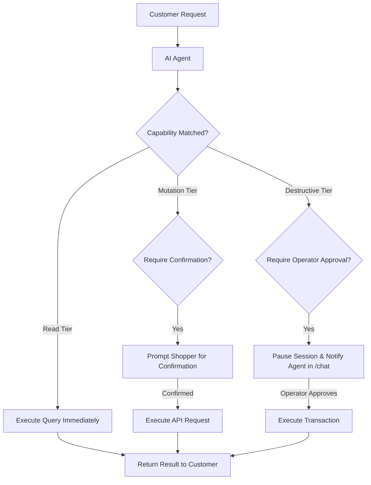

import { Callout } from 'fumadocs-ui/components/callout';
import { Steps } from 'fumadocs-ui/components/steps';
import { Tab, Tabs } from 'fumadocs-ui/components/tabs';

Beyond answering questions from static documents, Cerebronix AI Agents can execute actions in external business systems. Through the **External Systems & Tools** engine, agents can look up order statuses, create support tickets in your CRM, check inventory levels, and schedule service appointments.

To protect enterprise operations, every capability is governed by strict risk tiers, agent scoping, and optional human-in-the-loop approval gates.



---

## Prerequisites and Permissions

1. **Role Permissions**: Organization role of `owner` or `admin`. Managing external system connections, credentials, and risk tiers requires elevated administrative authority. Developers and viewers can inspect existing capabilities but cannot register new endpoints or alter credentials.
2. **Accessible API Endpoint**: A secure HTTPS endpoint accessible from Cerebronix infrastructure with valid authentication credentials.
3. **JSON Schema Definition**: A structured JSON Schema defining the input parameters required by the external API.

---

## System Kinds and Risk Tiers

### Supported System Categories

When registering an external system, you select one of six specialized categories:

| Category | Typical Integration | Use Cases |
| :--- | :--- | :--- |
| `ecommerce` | Custom commerce backends, ERPs | Live inventory checks, order status lookups, gift card balance checks. |
| `crm` | HubSpot, Salesforce, Zoho | Customer profile retrieval, lead creation, contact preference updates. |
| `ticketing` | Zendesk, Jira Service Desk, Freshdesk | Support ticket generation, priority bug escalation, status updates. |
| `hms` | Hospitality Management Systems | Room availability lookups, dining reservations, amenity requests. |
| `hrms` | Internal HR platforms | Employee directory lookups, leave balance checks (internal agents). |
| `custom` | Bespoke REST APIs | Any proprietary operational webhook or backend microservice. |

### Risk Tiers and Safety Gates

Every capability defined within an external system is assigned an explicit **Risk Tier**:

| Risk Tier | Definition | Default Safeguards |
| :--- | :--- | :--- |
| `read` | Read-only queries that do not modify state (e.g., checking return policy status or looking up product specs). | Executed automatically by the agent without interruption. |
| `operational` | Routine low-risk workflows (e.g., updating a customer's preferred delivery window or tagging a conversation). | May execute automatically or with optional customer confirmation. |
| `mutation` | State-modifying actions (e.g., creating a return label, generating a support ticket, modifying cart quantities). | Recommended with **Require Customer Confirmation** (`requireConfirmation: true`). |
| `destructive` | High-impact or irreversible transactions (e.g., issuing refunds, cancelling subscriptions, deleting account data). | Enforced with **Require Operator Approval** (`requireOperatorApproval: true`). |

---

## Navigation

To manage external systems and tool capabilities:

1. Log in to the Cerebronix SaaS console.
2. In the left navigation sidebar, click **External Systems** (`/external-systems`).
3. To view existing systems, inspect the registered system cards.
4. To add a new system, click **+ Add External System**.

---

## Step-by-Step Configuration

<Steps>
### Step 1: Register the External System
1. Click **+ Add External System**.
2. Enter the **System Name** (e.g., `Apex Global ERP`).
3. Select the **Category / Kind** (`ecommerce`, `crm`, `ticketing`, etc.).
4. Provide the **Base URL** (e.g., `https://api.apexretail.com/v1`).
5. Configure the authentication method:
   - **API Key**: Enter the header name (e.g., `X-API-Key`) and secret token.
   - **Bearer Token**: Enter the bearer JWT or static access token.
   - **Basic Auth**: Enter the username and password.
6. Click **Save System**. Credentials are securely stored and masked in the UI.

### Step 2: Define Capabilities and Operation References
Within the registered system:
1. Click **+ Add Capability**.
2. Enter a unique **Capability Key** (e.g., `check_order_status`).
3. Provide a clear **Name** and **Description**. The description is used by the agent's semantic router to determine when this tool should be invoked.
4. Specify the **Operation Ref** (e.g., `GET /orders/{order_id}`).
5. Supply the **Input Schema** in standard JSON Schema format:
   ```json
   {
     "type": "object",
     "properties": {
       "order_id": {
         "type": "string",
         "description": "The customer's 8-digit order number, e.g. ORD-98214"
       }
     },
     "required": ["order_id"]
   }
   ```

### Step 3: Configure Safety Gates and Scope
In the capability settings modal:
1. Select the **Risk Tier** (`read`, `operational`, `mutation`, or `destructive`).
2. If the operation alters customer orders or finances, toggle **Require Customer Confirmation**. The agent will ask the customer: *"Would you like me to process return label #ORD-98214 for your order?"* before executing.
3. If the operation is high-risk, toggle **Require Operator Approval**. The agent will pause the conversation, generate a proposed payload, and notify your support team in the **Chat Inbox** (`/chat`). The transaction will only fire once an operator clicks **Approve**.
4. Set **Allowed Agents**: Restrict execution to specific agents (e.g., allow *Apex Support Concierge*, but disallow *Apex Lead Generator*).
5. Set **Allowed Channels**: Restrict tool invocation to authenticated channels (e.g., Web Portal after customer login, rather than public WhatsApp).
6. Click **Save Capability**.
</Steps>

---

## Concrete Example: Apex Retail Global

Apex Retail Global connects its customer service agent to a custom fulfillment API with three distinct capabilities:

| Capability Key | Operation | Risk Tier | Safety Gate | Behavior |
| :--- | :--- | :--- | :--- | :--- |
| `lookup_tracking` | `GET /shipments/{tracking_id}` | `read` | None | Returns carrier status immediately in chat. |
| `generate_return_label` | `POST /returns` | `mutation` | `requireConfirmation` | Asks the customer to verify return reason and email before generating label. |
| `issue_courtesy_credit` | `POST /credits/apply` | `destructive` | `requireOperatorApproval` | Pauses execution and alerts a human supervisor in `/chat` to approve refund allocations over $50. |

---

## Verifying External Tool Integration

To verify that an agent correctly invokes external capabilities:

1. Navigate to **AI Agents** (`/agents`), select your configured agent, and scroll to **Test** (`#test`).
2. Trigger the tool with a realistic customer inquiry:
   ```text
   Where is my package for order ORD-44812?
   ```
3. **Expected Result**: The test panel displays the tool invocation block:
   ```json
   Invoking tool: lookup_tracking
   Arguments: { "order_id": "ORD-44812" }
   Response: { "status": "Out for delivery", "carrier": "FedEx", "eta": "2026-10-20" }
   ```
4. The agent synthesizes the response conversationally:
   ```text
   Your order ORD-44812 is currently out for delivery with FedEx and is scheduled to arrive tomorrow, October 20th.
   ```

---

## Common Failures and Troubleshooting

<Callout type="warn">
**Endpoint Timeouts**: External tools have a strict 8-second execution timeout. If your backend takes longer than 8 seconds to respond, the agent aborts the call and falls back to: *"I'm having trouble connecting to the fulfillment system right now. A support representative will assist you shortly."*
</Callout>

### 1. Agent Fails to Invoke Capability
- **Root Cause**: The capability description or agent sample questions do not sufficiently match the customer's intent.
- **Resolution**: Under **Agent Settings > General**, add 3–5 representative queries to **Sample Questions for Intent Classification** (e.g., *"track my shipment"*, *"where is my package"*). Ensure the capability description clearly defines when to trigger the tool.

### 2. Invalid Input Schema Error
- **Root Cause**: The customer omitted a required parameter (e.g., order ID), or the schema format violates JSON Schema specifications.
- **Resolution**: Ensure all required properties are declared in the `required` array. The agent will automatically prompt the customer for missing required parameters before attempting execution.

### 3. Operator Approval Never Triggered
- **Root Cause**: The capability was configured with `requireOperatorApproval: false` or the session was running in the test console.
- **Resolution**: Operator approval gates require live channel sessions connected to the **Chat Inbox** (`/chat`). In the sandbox test panel, approvals are simulated.

---

## Related Guides

- [AI Agents: System Prompts and Behavioral Instructions](/docs/ai-agents/system-prompts-and-instructions)
- [AI Agents: Ecommerce Store Binding](/docs/ai-agents/ecommerce-store-binding)
- [AI Agents: Testing and Troubleshooting](/docs/ai-agents/testing-and-troubleshooting)
- [Core Concepts: Human in the Loop & Escalation](/docs/concepts/human-in-the-loop)
