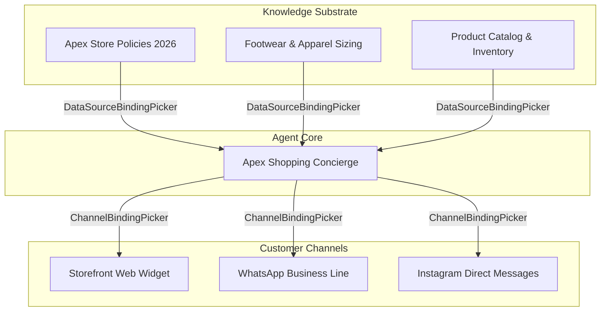

import { Callout } from 'fumadocs-ui/components/callout';
import { Steps, Step } from 'fumadocs-ui/components/steps';

Cerebronix operates on a decoupled architecture where **Knowledge Data Sources**, **AI Agents**, and **Communication Channels** exist as independent entities. To activate an agent, you must explicitly bind it to the knowledge bases it is permitted to read and the messaging channels where it is authorized to speak.

This guide explains how to manage data source associations, author sample intent classification questions, and route customer conversations across multiple channels.

---

## The Binding Architecture

- **Multi-Source Synthesis:** An agent can bind to multiple knowledge sources simultaneously. For example, when a customer asks: *"Can I exchange these trail shoes for a larger size if they don't fit?"*, the agent synthesizes answers across both the **Return Policy** document (30-day window) and the **Sizing Guide** document (recommendation to size up).
- **Omnichannel Delivery:** An agent can be bound to multiple communication channels. The same agent logic, guardrails, and knowledge are shared across your website widget and WhatsApp number.

---

## Knowledge Base Associations

In the agent editor (**AI Agents** &rarr; Select Agent &rarr; **Knowledge Base** tab):

### 1. Binding Data Sources (`DataSourceBindingPicker`)

The binding picker displays all data sources currently registered and indexed in your organization:
1. Locate the data sources relevant to this agent's functional role.
2. Check the box next to each source to grant the agent read access.
3. If an uploaded document is currently in the `in_progress` state, wait until it transitions to `Success` before expecting the agent to retrieve facts from it.

### 2. Sample Questions & Intent Classification

Beneath the data source selector, Cerebronix provides the **Sample Questions** section:

- **Purpose:** These sample questions act as semantic anchors guiding Cerebronix's intent routing classifier. They help the agent recognize the domain and topic of incoming customer inquiries.
- **Pre-Configured Examples:** Templates automatically populate standard sample questions. For example:
  - *Customer Support Agent:* "How do I return this?", "My package hasn't arrived", "Is this covered under warranty?"
  - *Sales Copilot:* "How much does this cost?", "Do you have discounts?", "Which jacket is best for winter?"
- **Adding Custom Questions:** Enter representative phrases that real customers frequently use, then click **Add Question**.

---

## Channel Routing & Unbound Channels

In the agent editor (**AI Agents** &rarr; Select Agent &rarr; **Channels** tab / `ChannelBindingPicker`):

### 1. Binding Inbound Channels

1. The channel selector lists all communication channels configured under **Channels** (`/channels`).
2. Check the box next to each channel you want this agent to handle.
3. Incoming customer messages received on checked channels are immediately routed to this agent's inference engine.

### 2. Resolving "Unbound Channel" Warnings

If you create a channel in the console but forget to bind it to an agent:
- The channel card displays an **Unbound Channel** badge.
- **Customer Impact:** Incoming messages arrive in the system but remain unanswered by AI automation, queuing in the operator inbox until a human steps in.
- **Resolution:**
  1. Open **AI Agents** (`/agents`).
  2. Select your designated agent.
  3. Under Channel Routing, check the unbound channel.
  4. Click **Save Agent**.

---

## Multi-Agent Routing Topologies

Depending on your organization's operational scale, you can choose between two common architectures:

### Topology A: Unified Brand Concierge (1:Many)
A single agent serves all customer channels:
- *Agent:* **Apex Shopping Concierge**
- *Bound Sources:* Store Policies, Sizing Guide, Product Catalog
- *Bound Channels:* Web Widget, WhatsApp, Instagram
- *Benefit:* Ensures consistent brand voice and identical answers regardless of where the customer messages.

### Topology B: Specialized Multi-Agent Division (Many:Many)
Multiple specialized agents handle distinct business functions:
- *Agent 1 (Sales Copilot):* Bound to the marketing website widget and product catalog, optimized for consultative selling.
- *Agent 2 (Support Specialist):* Bound to WhatsApp and return policy documents, optimized for rapid ticket resolution.
- *Agent 3 (Internal HR Bot):* Bound to Slack and the internal employee handbook.

---

## Step-by-Step Configuration Walkthrough

<Steps>

### Open the Agent Settings Form

1. In the Cerebronix Console, navigate to **AI Agents** (`/agents`).
2. Click on **Apex Shopping Concierge**.

### Select Knowledge Sources

1. Click the **Knowledge Base** tab.
2. In the **Data Sources** list, check:
   - `Apex Return & Shipping Policy 2026`
   - `Apex Footwear & Sizing FAQs`
3. Review the sample questions to ensure they cover common customer inquiries.

### Select Communication Channels

1. In the **Channel Routing** section, check:
   - `Apex Storefront Chat`
2. If you have connected an official WhatsApp Business number, check that channel as well.

### Save and Verify

Click **Save Agent**. The changes take effect immediately without requiring an agent restart.

</Steps>

---

## Common Failures & Troubleshooting

| Symptom | Cause | Solution |
| :--- | :--- | :--- |
| **Agent does not cite a newly added document** | The document is indexed, but its checkbox in the agent's Knowledge Base tab was not checked. | Open the agent settings and ensure the data source is actively checked in the picker. |
| **Customer sends message in chat widget but gets no reply** | The channel is unbound or bound to an inactive agent. | Verify that the channel has an active agent bound under Channel Routing. |
| **Agent gives answers from the wrong department** | Knowledge bases with overlapping or contradictory policies are bound to the same agent. | Separate conflicting documents into different data sources and bind them to distinct specialized agents. |

---

## Next Steps

- [Ecommerce Store & Catalog Binding](/docs/ai-agents/ecommerce-store-binding)
- [External Systems & Custom Tool Dispatch](/docs/ai-agents/external-systems-and-tools)
- [In-Console Testing & Operator Takeover](/docs/ai-agents/testing-and-troubleshooting)
