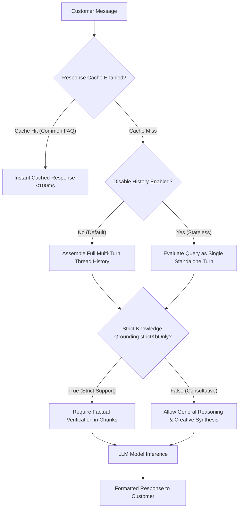

import { Callout } from 'fumadocs-ui/components/callout';
import { Steps, Step } from 'fumadocs-ui/components/steps';

Configuring the underlying model architecture and behavioral guardrails is essential for tailoring an AI agent's performance, cost, and factual precision. Cerebronix provides intuitive controls over large language model selection, strict knowledge grounding, multi-turn conversation memory, and semantic response caching.

This guide provides a comprehensive breakdown of these operational settings.

---

## Operational Guardrails & Parameters

In the agent editor (**AI Agents** &rarr; Select Agent &rarr; **Behavior** tab), the following controls govern execution:

---

## 1. Large Language Model Selection (`llmModel`)

Cerebronix supports multiple frontier LLM architectures optimized for conversational speed, reasoning depth, and cost efficiency:

- **Primary LLM Model (`llmModel`):** The default engine used for standard conversational turns, intent recognition, and knowledge retrieval synthesis.
- **Detailed LLM Model (`detailedLlmModel`):** Automatically activated when an agent is bound to data sources configured in **Detailed Mode** (`DETAILED`). When handling dense technical manuals, regulatory documentation, or complex product schematics, Cerebronix leverages this secondary, higher-parameter model to perform deep reasoning across larger chunk contexts.

---

## 2. Strict Knowledge Grounding (`strictKbOnly`)

The **Strict Knowledge Grounding** toggle is your primary defense against inaccurate, unverified AI assertions:

| Setting | Behavior | Ideal Use Cases |
| :--- | :--- | :--- |
| **Enabled (`strictKbOnly = true`)** | The model is explicitly instructed to answer **strictly and exclusively** from the verified facts present in the retrieved knowledge chunks. If an inquiry cannot be answered from the provided documents, the model declines to speculate and triggers your configured escalation protocol. | Customer support, order processing, returns, warranty claims, legal compliance, internal HR policies. |
| **Disabled (`strictKbOnly = false`)** | The model uses your knowledge base as its primary foundation, but is permitted to draw upon general reasoning capabilities to answer adjacent inquiries, brainstorm ideas, and offer consultative advice. | Inbound sales qualification, styling recommendations, creative ideation, prospective customer engagement. |

<Callout type="warn">
  **Understanding Grounding Limits:** While Strict Knowledge Grounding substantially reduces the risk of AI hallucinations by forcing the model to cite verified facts and decline ungrounded requests, no AI system is 100% immune to edge-case linguistic misinterpretations. For mission-critical legal or financial commitments, human operator oversight should always be maintained.
</Callout>

---

## 3. Conversation History Persistence (`disableHistory`)

Customer inquiries often rely on pronouns and context established in prior messages (e.g., *"What colors does it come in?"* referring to a jacket mentioned two turns earlier).

- **Default (`disableHistory = false`):** The agent retains the conversational context across multiple turns within the same customer session. It understands pronouns, tracks user preferences, and maintains conversational flow.
- **Stateless Mode (`disableHistory = true`):** The agent treats every incoming message as a completely isolated, standalone query.
  - *When to use Stateless Mode:* High-throughput automated classification bots, transactional dispatch tools, or privacy-sensitive kiosks where conversational memory across turns is explicitly undesirable.

---

## 4. Semantic Response Cache (`responseCacheEnabled`)

In high-volume customer service operations, a large percentage of incoming customer questions are identical (e.g., *"What are your store hours?"*, *"Where are you located?"*, *"How does your return policy work?"*).

When **Response Cache** is enabled:
1. **Sub-100ms Latency:** Incoming queries that closely match previously answered FAQ queries are served directly from an encrypted semantic cache.
2. **Zero Invalidation of Dynamic Data:** Cerebronix applies strict safety filters: **order statuses, customer cart contents, inventory counts, and personalized details are never cached.** Dynamic queries always bypass the cache and query live databases.
3. **Credit Savings:** Cached responses consume minimal lookup overhead, saving organization credits during traffic spikes.

---

## Configuration Walkthrough

<Steps>

### Open the Behavior Settings

1. In the Cerebronix Console, navigate to **AI Agents** (`/agents`).
2. Click on **Apex Shopping Concierge**.
3. Select the **Behavior** tab.

### Configure Model and Guardrail Switches

1. **Strict Knowledge Grounding:** Toggle **On** (recommended for customer care).
2. **Disable Conversation History:** Keep **Off** so customers can ask natural follow-up questions.
3. **Response Cache:** Toggle **On** to accelerate repetitive policy questions.
4. **LLM Model:** Select your preferred model tier from the dropdown.

### Save Agent Configuration

Click the **Save** button at the bottom of the form. Changes take effect immediately on active customer channels.

</Steps>

---

## Common Failures & Troubleshooting

| Symptom | Cause | Solution |
| :--- | :--- | :--- |
| **Agent declines to answer obvious questions** | Strict Grounding is active, but the information is missing from the connected documents. | Check your data sources under `/datasources`. Ensure the facts are clearly written in an uploaded document or FAQ entry. |
| **Agent gives outdated answers after document update** | Response cache contains stale entries. | Trigger a **Force Reindex** on the data source to invalidate outdated cached responses. |
| **Agent loses context between messages** | `disableHistory` was accidentally toggled on. | Open the Behavior tab and verify that **Disable History** is switched off. |

---

## Next Steps

- [Knowledge Base & Channel Associations](/docs/ai-agents/knowledge-and-channel-bindings)
- [Ecommerce Store & Catalog Binding](/docs/ai-agents/ecommerce-store-binding)
- [In-Console Testing & Operator Takeover](/docs/ai-agents/testing-and-troubleshooting)
