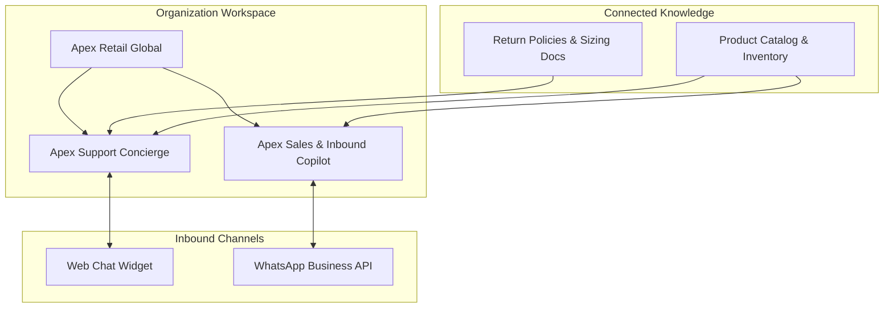

import { Callout } from 'fumadocs-ui/components/callout';
import { Steps, Step } from 'fumadocs-ui/components/steps';
import { Card, Cards } from 'fumadocs-ui/components/card';
import { CrossLink } from '@cerebronix/docs-ui';

In Cerebronix, an **AI Agent** is an autonomous conversational worker configured to handle customer inquiries, guide online shoppers, resolve support tickets, or assist internal employees. Rather than a simple chat prompt, an agent is an orchestrated system combining behavioral instructions, grounded data source retrieval, communication channel routing, and optional external tool dispatch.

This guide explains how agents operate, details the seven pre-built templates available in the **Template Gallery**, and walks through provisioning an agent for our demonstration brand, **Apex Retail Global**.

---

## Agent Architecture Overview

Every agent in Cerebronix functions as a specialized cognitive layer:



- **Domain Isolation:** Multiple agents can coexist in the same organization. For example, Apex Retail Global can deploy an *Apex Support Concierge* on its website and a *Sales Copilot* on WhatsApp.
- **Shared Knowledge:** Multiple agents can read from the same knowledge data sources while applying different personas, tones, and operational boundaries.
- **Dedicated Channel Routing:** Inbound messages on a specific channel route directly to its designated agent.

---

## The 7 Pre-Built Agent Templates

When clicking **+ New Agent**, Cerebronix provides a gallery of pre-configured templates. Each template seeds a production-grade system persona, default intent classification examples, and recommended grounding toggles:

| Template Name | Primary Use Case | Default Grounding Mode | Pre-Configured Sample Questions |
| :--- | :--- | :---: | :--- |
| **Customer Support Agent** | Order resolution, shipping status, return handling, and FAQ guidance. | Strict (`strictKbOnly = true`) | "How do I return this?", "My order hasn't arrived", "Is this covered under warranty?" |
| **Sales & Inbound Copilot** | Product discovery, recommendations, feature comparisons, and purchase guidance. | Consultative (`strictKbOnly = false`) | "Pricing", "How does this compare to X?", "Can I get a demo?", "Do you offer discounts?" |
| **HR Policy Assistant** | Internal employee inquiries regarding leave, benefits, payroll, and workplace conduct. | Strict (`strictKbOnly = true`) | "How much leave do I have?", "What is the expense policy?", "Maternity leave", "Remote work policy" |
| **Training Tutor** | Step-by-step onboarding, software tutorials, and procedural walkthroughs. | Strict (`strictKbOnly = true`) | "How do I get started?", "Where do I find...", "Walk me through this process" |
| **Product Expert** | In-depth technical specifications, sizing geometry, and compatibility inquiries. | Strict (`strictKbOnly = true`) | "Technical specifications", "Is this compatible with...", "Material details" |
| **Knowledge Assistant** | General-purpose search and document synthesis across uploaded organizational manuals. | Strict (`strictKbOnly = true`) | "Where can I find...", "What does our documentation say about...", "Summarize" |
| **Operations Coordinator** | Gathers details, drafts operational tickets, and updates CRM or external systems. | Strict (`strictKbOnly = true`) | "Log a ticket", "Update the ticket", "Create a request", "Follow up on my ticket" |

<Callout type="info">
  **Custom Agents:** You are never locked into pre-built templates. Clicking **Skip, configure manually** allows you to build an agent from a blank slate with custom instructions and settings.
</Callout>

---

## Prerequisites & Permissions

To create or configure AI agents:
1. An active Cerebronix organization workspace.
2. A user account with the **Owner**, **Admin**, or **Developer** role. (`Viewer` team members have read-only access to agent configurations).
3. At least one indexed knowledge data source or connected store is recommended before activation.

---

## Step-by-Step Walkthrough: Creating an Agent

<Steps>

### Open the AI Agents Console

1. In the [Cerebronix Console](https://cerebronix.com), ensure your active workspace is **Apex Retail Global**.
2. Click **AI Agents** (`/agents`) in the left navigation sidebar.
3. Every new workspace includes a pre-provisioned **Default Agent**. You can customize it or click the **+ New Agent** button in the upper right.

### Select a Template or Custom Path

1. Review the cards in the **Template Gallery**.
2. Select **Customer Support Agent**.
3. Cerebronix loads an inline configuration preview, automatically interpolating your organization name into the system persona.

### Configure Core Identity

1. **Agent Name:** Enter `Apex Shopping Concierge`.
2. **Description:** Enter `Assists customers with outdoor gear selection, orders, sizing, and store policies.`
3. **System Instructions (Preface):** Review and refine the pre-filled prompt:
   ```text
   You are Apex Retail Global's customer support assistant. Help customers resolve issues
   with their orders and products, answer FAQs from the knowledge base, and stay strictly
   within documented policy. If you cannot resolve an issue, say you are escalating it to
   a human gear specialist.
   ```

### Set Behavioral Guardrails

1. Keep **Strict Knowledge Grounding (`strictKbOnly`)** enabled to ensure the agent only cites verified facts from your uploaded documents.
2. Ensure **Disable Conversation History** is left unchecked so the agent retains context across multiple conversational turns.

### Bind Knowledge & Channels

1. In the **Knowledge Base Associations** section, select your verified data sources (e.g., `Apex Return & Shipping Policy 2026`).
2. In the **Channel Routing** section, check your customer-facing channel (e.g., `Apex Storefront Chat`).

### Save and Activate

Click **Save Agent**. The agent status immediately transitions to **Active** (green badge).

</Steps>

---

## Verification & Testing

To confirm the agent is properly operational:

1. Return to the **AI Agents** list (`/agents`).
2. Verify that **Apex Shopping Concierge** displays:
   - Status: **Active**
   - Data Sources: `1 Bound`
   - Channels: `1 Bound`
3. Click on the agent card, scroll to the bottom **Test** panel (`#test`), and ask:
   ```text
   What is your standard return policy?
   ```
4. Confirm that the agent responds citing your uploaded document.

---

## Common Failures & Troubleshooting

| Symptom | Root Cause | Solution |
| :--- | :--- | :--- |
| **Agent responds with generic AI knowledge** | Strict Grounding is disabled or no data source is bound. | In the agent editor, toggle **Strict Knowledge Grounding** on and verify the data source checkbox is active. |
| **"Unbound Channel" indicator in console** | A communication channel exists without an assigned agent. | Open the agent settings, navigate to Channel Routing, and check the unassigned channel. |
| **Agent does not appear in chat widget** | Channel was assigned to a different agent. | Each channel routes to exactly one primary agent. Ensure the channel is bound to the desired agent. |

---

## Related Guides

- [Crafting System Prompts & Behavioral Instructions](/docs/ai-agents/system-prompts-and-instructions)
- [Model Parameters & Strict Grounding Guardrails](/docs/ai-agents/model-parameters-and-guardrails)
- [Knowledge Base & Channel Associations](/docs/ai-agents/knowledge-and-channel-bindings)
- [In-Console Testing & Operator Takeover](/docs/ai-agents/testing-and-troubleshooting)
