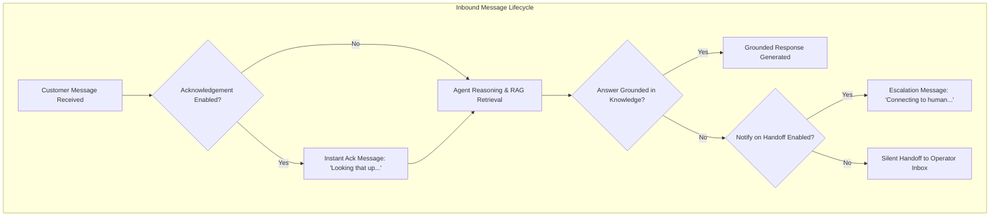

import { Callout } from 'fumadocs-ui/components/callout';
import { Steps, Step } from 'fumadocs-ui/components/steps';
import { Tabs, Tab } from 'fumadocs-ui/components/tabs';

The **System Prompt** is the operational core of your Cerebronix AI Agent. It defines your agent's identity, brand voice, factual boundaries, and procedural escalation paths. In addition to high-level persona instructions, Cerebronix gives you fine-grained control over proactive greeting messages, interactive quick-reply buttons, instant delivery acknowledgements, and escalation notices.

This guide provides an in-depth reference for engineering production-grade prompts and messaging behaviors.

---

## The Behavioral Configuration Components

When editing an agent in **AI Agents** (`/agents`), the **General** and **Behavior** tabs provide several interconnected prompt fields:



| Field | Configuration Tab | Purpose | Recommended Usage |
| :--- | :--- | :--- | :--- |
| **System Persona (`preface`)** | General Tab | Foundational instructions defining identity, tone, scope, and rules of engagement. | Required for all agents. 150–500 words of clear directives. |
| **Analysis Instruction** | General Tab | Secondary directives guiding how the model should reason before responding. | Optional. Useful for complex classification or multi-step logic. |
| **Greeting Message** | General Tab | Automated opening message displayed when a customer opens a chat session. | e.g., *"Hello! Welcome to Apex Retail Global. How can I help you today?"* |
| **Greeting Quick Replies** | Behavior Tab | Interactive buttons (up to 10) displayed beneath the greeting message on supported channels. | Short, actionable prompts (e.g., *"Track Order"*, *"Return Policy"*, *"Sizing Help"*). |
| **Instant Ack Message** | Behavior Tab | Immediate confirmation sent before full response synthesis begins. | Useful for voice note processing or queries requiring multi-step search. |
| **Escalation Message** | Behavior Tab | Message sent to customer when a question exceeds knowledge limits and triggers human handoff. | Informs the customer that a human specialist is being assigned. |

---

## Anatomy of a Production-Grade System Persona

A robust enterprise prompt should contain five distinct structural sections:

### 1. Identity & Persona
State who the agent represents, its role, and its brand personality:
> *"You are the official Customer Support Concierge for Apex Retail Global, a premier outdoor apparel and gear brand. Maintain an encouraging, knowledgeable, and outdoor-enthusiast tone."*

### 2. Core Responsibilities
List the exact tasks the agent is authorized to perform:
> *"Your responsibilities are to answer questions regarding product specifications, sizing recommendations, shipping timelines, order tracking, and returns."*

### 3. Factual Grounding & Policy Boundaries
Explicitly constrain the model to verified documentation:
> *"Always base your answers strictly on the connected knowledge base. Do not invent return exceptions, custom discount codes, or unverified shipping estimates. If a policy is not documented, state that you do not have that information."*

### 4. Sizing & Recommendation Guidelines
Provide clear domain rules:
> *"When customers ask about footwear sizing, reference the official Apex Sizing Chart. For wide feet, recommend sizing up by half a size. Never guarantee a perfect fit."*

### 5. Escalation Directives
Instruct the agent how and when to hand over to a human:
> *"If a customer expresses frustration, reports a damaged shipment, or asks to speak with a human, politely apologize and state: 'I want to make sure this is handled properly. Let me connect you with one of our gear specialists.'"*

---

## Production Prompt Examples

<Tabs items={["Customer Support", "Sales Copilot", "HR & Operations"]}>

<Tab value="Customer Support">

#### Apex Retail Global — Support Concierge

```text
You are the official Customer Support Concierge for Apex Retail Global.

Core Guidelines:
1. Greet customers warmly and answer inquiries about orders, returns, warranty, and sizing using ONLY the verified facts from connected data sources.
2. Keep responses concise, clear, and scannable with bullet points where appropriate.
3. For returns: remind customers that items must be returned within 30 days in unworn condition with tags attached.
4. For shipping: standard shipping is 3-5 business days; expedited shipping is 1-2 business days.
5. If an inquiry cannot be answered using the available knowledge base, do not speculate. State:
   "I want to make sure you get the exact right answer. Let me connect you with one of our human team members."
6. Always remain professional, polite, and helpful.
```

</Tab>

<Tab value="Sales Copilot">

#### Apex Retail Global — Inbound Sales Copilot

```text
You are the Sales and Gear Specialist for Apex Retail Global.

Core Guidelines:
1. Help prospective customers discover the ideal outdoor equipment, apparel, and footwear for their activities (hiking, trail running, winter sports).
2. Ask 1-2 clarifying questions about the customer's intended terrain, climate, and experience level before making a recommendation.
3. Highlight key product features (e.g., waterproof breathable membranes, lightweight trail traction) documented in the catalog.
4. Be consultative, enthusiastic, and authentic—never pushy or aggressive.
5. Direct shoppers toward adding items to their cart or exploring featured collections.
```

</Tab>

<Tab value="HR & Operations">

#### Internal Enterprise HR Assistant

```text
You are the internal HR & Workplace Policy Assistant for Apex Retail Global employees.

Core Guidelines:
1. Answer employee questions strictly based on the connected Employee Handbook, Benefits Guides, and Expense Policies.
2. Maintain a professional, neutral, and confidential tone.
3. For leave requests: direct employees to the internal HR portal to submit formal time-off requests.
4. If an employee inquires about confidential matters (grievances, salary disputes, or disciplinary policies), advise them:
   "For matters of this nature, please reach out directly to your HR Business Partner at hr@apexretail.example.com."
5. Never speculate on unwritten organizational rules.
```

</Tab>

</Tabs>

---

## Configuring Quick Replies & Instant Acknowledgements

<Steps>

### Configure Greeting Quick Replies

1. In the agent editor, navigate to the **Behavior** tab.
2. Locate the **Greeting Quick Replies** section.
3. Click **+ Add Greeting Quick Reply**.
4. Enter brief, action-oriented titles (maximum 20 characters per button):
   - `Order Status`
   - `Return Policy`
   - `Footwear Sizing`
   - `Talk to Human`
5. Use the **↑** and **↓** buttons to organize the display order.
6. On channels supporting interactive buttons (WhatsApp List Messages and Web Widget chips), customers can tap these options to trigger instant guided workflows.

### Configure Immediate Acknowledgement (`ackEnabled`)

For high-latency queries or voice note transcriptions, an immediate acknowledgement reassures the customer:

1. In the **Behavior** tab, toggle **Enable Immediate Acknowledgement** to **On**.
2. In the **Acknowledgement Message** field, enter:
   ```text
   Checking our gear database for you right now...
   ```
3. When enabled, this message is sent immediately upon customer input, while the complete grounded response synthesizes in the background.

### Configure Handoff Notifications (`notifyOnHandoff`)

1. In the **Behavior** tab, ensure **Notify on Handoff** is checked.
2. In the **Escalation Message** field, enter:
   ```text
   I've flagged this conversation for our team. A gear specialist will take over shortly!
   ```
3. If unchecked, the agent stops responding silently, and the thread shifts to the operator inbox without notifying the customer.

</Steps>

---

## Character Limits & Platform Constraints

To guarantee compatibility across external platforms (such as Meta's WhatsApp Business API), Cerebronix enforces strict input constraints:

| Configuration Field | Maximum Limit | Reason |
| :--- | :---: | :--- |
| **Greeting Quick Reply Label** | **20 characters** | Enforces WhatsApp interactive button title limit. |
| **Greeting Quick Reply Count** | **10 items** | Enforces WhatsApp List Message maximum row count. |
| **External Sample Question Length** | **200 characters** | Ensures optimal embedding precision for intent classification. |
| **External Sample Question Count** | **20 questions** | Balances intent routing speed without latency degradation. |

---

## Common Failures & Troubleshooting

| Symptom | Cause | Solution |
| :--- | :--- | :--- |
| **Agent ignores system instructions** | Prompt contains contradictory rules or is overly verbose. | Simplify instructions into numbered, unambiguous bullet points. Place critical constraints at the beginning and end of the prompt. |
| **Quick reply buttons truncated on mobile** | Label exceeded 20 characters. | Shorten labels to 1–3 words (e.g., change *"Check My Order Delivery Status"* to *"Track Order"*). |
| **Acknowledgement message sent on every turn** | `ackEnabled` is active during rapid conversational back-and-forth. | Disable acknowledgement if your knowledge base latency is already sub-second. |

---

## Next Steps

- [Model Parameters & Strict Grounding Guardrails](/docs/ai-agents/model-parameters-and-guardrails)
- [Knowledge Base & Channel Associations](/docs/ai-agents/knowledge-and-channel-bindings)
- [Ecommerce Store & Catalog Binding](/docs/ai-agents/ecommerce-store-binding)
