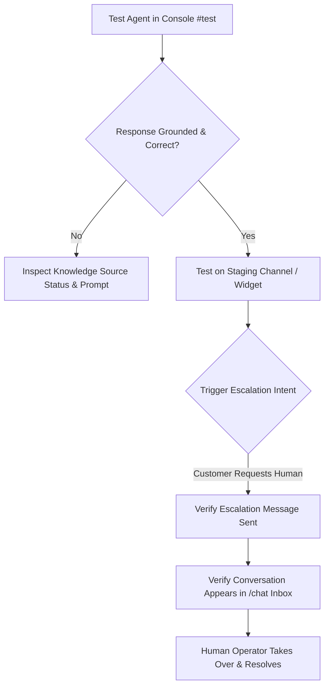

import { Callout } from 'fumadocs-ui/components/callout';
import { Steps } from 'fumadocs-ui/components/steps';
import { Tab, Tabs } from 'fumadocs-ui/components/tabs';

Before exposing an AI agent to live customers, thorough validation in a controlled environment is essential. Cerebronix provides an interactive in-console testing sandbox, full-fidelity live channel verification, and seamless human operator intervention in the **Chat Inbox**.

This guide explains how to test your agent, simulate customer inquiries, handle real-time escalations, and diagnose common operational issues.



---

## Prerequisites and Permissions

1. **Role Permissions**: All organization members (`owner`, `admin`, `developer`, `viewer`) can run test queries in the in-console testing sandbox. Only `owner`, `admin`, and `developer` roles can modify agent parameters or knowledge bindings.
2. **Configured Agent**: An active agent with at least one bound knowledge source or ecommerce store.
3. **Chat Inbox Access**: Access to `/chat` to test human handoff and operator takeover workflows.

---

## Testing Methods

Cerebronix supports two complementary testing layers:

### 1. In-Console Sandbox (`#test`)
Every agent detail page includes a dedicated **Test** panel directly beneath the configuration tabs. This panel communicates over a secure isolated WebSocket connection (`initializeTestBotSocket`), allowing you to test system prompts, knowledge retrieval, and tool calling without consuming channel messaging quotas or altering live customer threads.

### 2. Live Channel Testing
Deploy the agent to an unlisted staging channel—such as a password-protected webpage containing the Cerebronix web chat widget or a dedicated test WhatsApp Business number—to verify end-to-end network latency, rich media attachments, quick reply buttons, and live operator notifications.

---

## Navigation

- **To access the in-console sandbox**:
  1. Navigate to **AI Agents** (`/agents`).
  2. Select your agent (e.g., *Apex Shopping Concierge*).
  3. Scroll down to the **Test** section or append `#test` to the browser URL (`/agents/[id]#test`).
- **To monitor live operator handoff**:
  1. In the left navigation sidebar, click **Chat** (`/chat`).

---

## Step-by-Step Testing Workflow

<Steps>
### Step 1: Clear History and Start Fresh Session
In the **Test** panel:
1. Click **Clear History** (trash can icon) in the top-right corner of the test widget.
2. Verify that the agent emits its configured **Greeting Message** and any **Greeting Quick Replies** (e.g., *"Track an Order"*, *"Browse Catalog"*, *"Return Policy"*).

### Step 2: Validate Knowledge Grounding
Submit queries targeting facts contained in your uploaded documents or synchronized catalogs:
```text
Shopper: What is Apex Retail Global's return window for opened footwear?
```
- **Expected Outcome**: The agent quotes your return policy accurately without guessing or hallucinating facts outside the document.
- **Verification**: If citations or source documents are enabled, confirm that the retrieved chunk matches your uploaded PDF or website URL.

### Step 3: Test Guardrails and Out-of-Scope Queries
Submit a query completely unrelated to your business:
```text
Shopper: Can you write a Python script to sort a binary search tree?
```
- **Expected Outcome (with Strict Knowledge-Base Mode enabled)**: The agent declines politely using your configured escalation notice: *"I am designed to assist with Apex Retail Global products and store policies. For technical programming questions, please refer to specialized resources."*

### Step 4: Test Human Operator Escalation
Simulate customer frustration or an explicit request for human assistance:
```text
Shopper: I need to speak to a human representative immediately about my damaged delivery.
```
- **Expected Outcome**:
  1. The agent responds with your configured **Escalation Message** (e.g., *"Connecting you with an Apex customer care specialist. Please hold..."*).
  2. Open `/chat` in another browser tab.
  3. Confirm that the thread appears in the **Unassigned** or **Escalated** inbox queue with a status badge indicating `Escalated`.

### Step 5: Test Operator Takeover and Handoff Back
In the `/chat` inbox:
1. Select the escalated conversation thread.
2. Click **Take Over Conversation**. The agent mode changes from `Bot` to `Human`.
3. Send a message as an operator: *"Hello! This is Sarah from Apex Support. I see your package arrived damaged. Let me assist you right away."*
4. Confirm that the test customer receives the message from Sarah.
5. Once resolved, click **Return Control to Bot** to re-engage the automated AI agent for future queries.
</Steps>

---

## Diagnostic Matrix: Common Failures and Resolutions

| Symptom | Probable Cause | Verification & Resolution |
| :--- | :--- | :--- |
| **Agent does not respond in test sandbox** | Knowledge source still indexing or credit balance depleted. | Check **Knowledge Engine** (`/datasources`) to confirm status is `Success`. Check **Settings > Credits** to confirm credit balance is positive. |
| **Agent responds with general knowledge instead of uploaded documents** | `strictKbOnly` is disabled or knowledge source is not bound to the agent. | Under **Agent Settings > Knowledge Sources**, confirm the source checkbox is checked and saved. Under **Behavior**, toggle **Strict Knowledge-Base Mode** to `ON`. |
| **Test chat shows "Unbound Channel" warning** | Channel is active but not bound to any agent. | Navigate to **Channels** (`/channels`) or the agent's **Channel Bindings** panel and bind the channel to the agent. |
| **Catalog search returns "No items found"** | Ecommerce integration disconnected or catalog sync pending. | Open **Integrations** (`/integrations`) and verify connection status. In **Knowledge Engine**, click **Re-index** on the store catalog. |
| **Escalation does not notify team members** | `notifyOnHandoff` is disabled or team member notification preferences are muted. | In **Agent Settings > Behavior**, ensure **Notify on Handoff** is checked. Verify email notification settings under **Settings > Team**. |

---

## Best Practices for Agent Quality Assurance

<Callout type="tip">
**Golden Test Dataset**: Maintain a spreadsheet of at least 20 canonical questions covering top customer inquiries, edge cases, pricing queries, and out-of-scope prompts. Re-run these tests whenever updating system instructions or adding new knowledge documents to detect behavioral regressions.
</Callout>

1. **Test After Every Knowledge Update**: Whenever you upload a revised policy PDF or re-crawl a website, run 3–5 spot-check queries in `#test` to ensure the new embeddings have propagated to the vector index.
2. **Review Low-Confidence Sessions**: Regularly inspect resolved threads in `/chat` for conversations where customers asked repeated clarification questions. Use these insights to add **Sample Questions for Intent Classification** in the agent settings.
3. **Verify Immediate Acknowledgements**: If your agent uses complex multi-source synthesis, enable **Immediate Acknowledgement** (`ackEnabled: true`) with a message like *"Reviewing our catalog for you now..."* to prevent customer drop-off during 3–4 second generation windows.

---

## Related Guides

- [AI Agents: System Prompts and Behavioral Instructions](/docs/ai-agents/system-prompts-and-instructions)
- [AI Agents: Model Parameters and Guardrails](/docs/ai-agents/model-parameters-and-guardrails)
- [AI Agents: External Systems and Tools](/docs/ai-agents/external-systems-and-tools)
- [Core Concepts: Human in the Loop & Escalation](/docs/concepts/human-in-the-loop)
