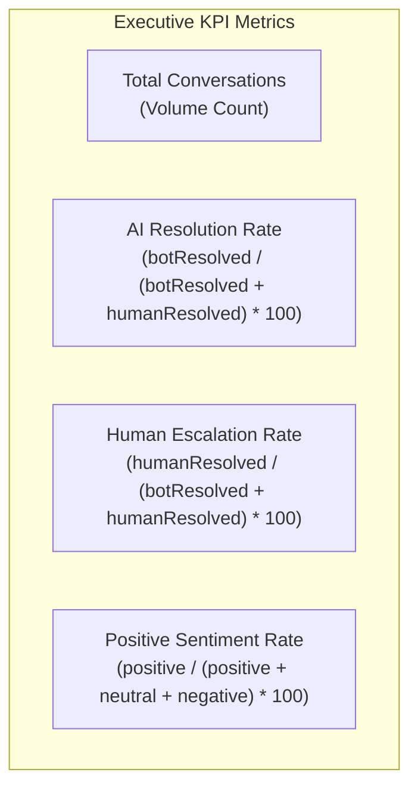
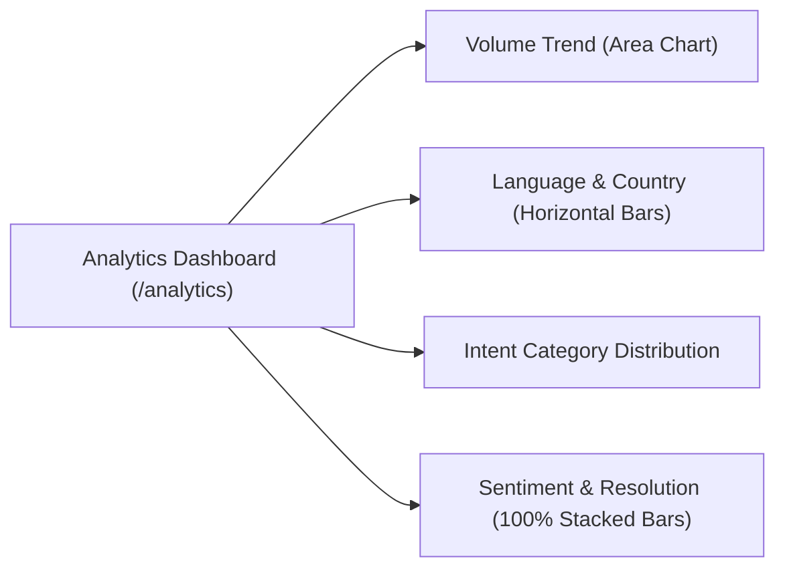

import { Callout } from "fumadocs-ui/components/callout";
import { Tab, Tabs } from "fumadocs-ui/components/tabs";

Cerebronix provides an executive analytics and operational reporting engine accessible at `/analytics`. Designed for customer service directors, ecommerce managers, and operations leads, the analytics dashboard visualizes customer interaction volumes, evaluates automated AI containment versus human escalation, tracks customer sentiment, and breaks down inquiries by language, country, and intent category.

## 1. What the Capability Accomplishes

The Analytics & Operational Reporting dashboard provides:

- **Executive KPI Monitoring:** Track top-line performance metrics at a glance, including Total Conversations, AI Resolution Rate, Human Escalation Percentage, and Positive Sentiment Ratios.
- **Volume Trend Tracking:** Visualize daily conversation trends over customizable date ranges to identify peak inquiry hours, promotional spikes, and seasonal demand.
- **AI Containment & Human Intervention Analysis:** Quantify the exact percentage of inquiries resolved autonomously by AI agents versus those requiring operator intervention.
- **Intent & Category Distribution:** Analyze customer topics categorized into Sales Inquiries, Orders & Billing, Product Support, Complaints, and General questions.
- **Linguistic & Geographic Insights:** Review demographic distributions across customer languages and geographic country origins.
- **Plan-Gated Access Control:** Enforces tier entitlements, ensuring enterprise metrics are secured for Growth plans and above.

## 2. Executive KPI Tiles & Exact Metric Calculations

At the top of the **Analytics** console (`/analytics`), four KPI summary tiles provide instantaneous operational visibility:

### Detailed Metric Definitions

1. **Total Conversations:**
   - **Definition:** The total number of unique customer conversation sessions initiated across all connected channels within the selected date range.
   - **Source:** Ingested from Chatwoot and Saastronix conversation audit logs.
2. **AI Resolution Rate (%):**
   - **Calculation Formula:** `(botResolved / (botResolved + humanResolved)) * 100`
   - **Interpretation:** The percentage of closed conversations that were fully resolved by the automated AI agent without human operator intervention. A high rate (75%–90%) indicates robust knowledge grounding and effective self-service tools.
3. **Human Escalation Rate (%):**
   - **Calculation Formula:** `(humanResolved / (botResolved + humanResolved)) * 100`
   - **Interpretation:** The percentage of conversations where a human operator intervened (via the **Take Over** button or automated escalation triggers) to resolve the inquiry.
4. **Positive Sentiment Rate (%):**
   - **Calculation Formula:** `(positive / (positive + neutral + negative)) * 100`
   - **Interpretation:** The proportion of classified conversations exhibiting positive customer sentiment based on Lexatronix NLP sentiment analysis of customer dialogue.

## 3. Reporting Visualizations & Chart Breakdowns

Below the KPI tiles, interactive charts break down operational data across multiple dimensions:

### Chart Descriptions

- **Conversation Volume Trend (Area Chart):** Displays daily volume curves over the selected time window. Identifies volume surges following marketing broadcasts or catalog launches.
- **Language Breakdown (Horizontal Bar Chart):** Ranks customer interaction volume by detected language code (e.g., `EN`, `HI`, `ES`, `DE`, `FR`).
- **Country Breakdown (Horizontal Bar Chart):** Maps customer distribution by detected country code (e.g., `US`, `IN`, `GB`, `DE`, `CA`).
- **Category / Intent Distribution (Horizontal Bar Chart):** Groups conversations into 5 standardized operational buckets:
  - `categorySalesInquiry`: Product recommendations, stock queries, pricing questions.
  - `categoryOrderAndBilling`: Order tracking, shipping ETA, payment status.
  - `categoryProductSupport`: Setup help, sizing guides, user manual queries.
  - `categoryComplaint`: Service dissatisfaction, damaged items, delivery delays.
  - `categoryGeneralOther`: Greetings, feedback, and unclassified topics.
- **Sentiment Distribution (100% Stacked Bar):** Proportional distribution across Positive (Green), Neutral (Gray), Negative (Red), and Unclassified items.
- **Resolution Distribution (100% Stacked Bar):** Proportional split between AI Resolved, Human Resolved, and Unresolved tickets.

## 4. Date Range Filtering & Time Horizons

The header of `/analytics` features date filtering controls:
- **Default Timeframe:** Automatically defaults to the preceding 30 days (`startDate = today - 29 days`, `endDate = today`).
- **Custom Date Selection:** Inputs for `From` and `To` dates.
- **Explicit Apply Control:** To prevent unnecessary backend load during date adjustments, metrics only refresh when the user clicks the **Apply** button.

## 5. Plan-Based Access Restrictions: Growth Tier Gate

Analytics is a premium reporting capability. Cerebronix enforces tier gating at both the backend API and frontend UI layers:

- **Growth, Scale & Enterprise Plans:** Full, unrestricted access to the complete `/analytics` dashboard, all KPI tiles, and custom date range filters.
- **Free Evaluation Plan:** The backend rejects queries with `403 Forbidden` (`ANALYTICS_NOT_GROWTH_TIER`). The SaaS UI renders a friendly **Locked State** screen:
  - Displays a lock icon and title: *"Upgrade to Growth to unlock Analytics"*.
  - Explains the benefits of tracking conversation volume, sentiment, and resolution rates.
  - Provides a direct call-to-action button linking to **Billing** (`/billing`).

## 6. Prerequisites and Plan Restrictions

- **Plan Entitlements:**
  - **Free Evaluation:** Basic dashboard summary; detailed analytics locked.
  - **Growth Plan:** Full 30-day historical analytics; all 6 chart breakdowns; custom date filtering.
  - **Scale & Enterprise Plans:** Extended historical reporting (up to 12 months); raw CSV data exports; custom category classification tags; scheduled executive email summaries.
- **Required Roles:** `owner`, `admin`, `developer`, or `viewer` permissions to view the analytics dashboard.

## 7. Step-by-Step Customer Instructions (Apex Retail Global Example)

### Step 1: Open the Analytics Dashboard

1. In the Cerebronix console navigation bar, click **Analytics** (`/analytics`).
2. Verify that the header displays your default 30-day date window.
3. Review the four top-line KPI tiles:
   - **Total Conversations:** `1,420`
   - **AI Resolution Rate:** `82%`
   - **Human Escalated Rate:** `18%`
   - **Positive Sentiment:** `79%`

### Step 2: Filter by a Specific Campaign Date Window

1. Suppose Apex Retail Global ran its *Fall Marathon 2026* promotional campaign between October 1 and October 15.
2. In the **Date From** input, select `2026-10-01`.
3. In the **Date To** input, select `2026-10-15`.
4. Click **Apply**.
5. The dashboard recalculates:
   - Volume trends spike during campaign launch on October 1 and 2.
   - The **Category Distribution** reveals that `Sales Inquiries` accounted for 64% of total traffic.

### Step 3: Evaluate Multilingual Demand

1. Scroll to the **Language Breakdown** chart.
2. Review the top languages servicing your customers:
   - `EN` (English): 840 conversations
   - `HI` (Hindi & Hinglish): 320 conversations
   - `ES` (Spanish): 160 conversations
   - `DE` (German): 100 conversations
3. Confirm that the regional distribution aligns with marketing spend in North America, India, and Europe.

## 8. Expected Results & Verification

Verify your analytics reporting:

1. **Resolution Math Validation:** Sum the AI Resolution Rate and Human Escalation Rate. They should equal 100% of closed resolved conversations.
2. **Sentiment Consistency:** Review high-sentiment vs. low-sentiment threads in `/chat`. Verify that complaints in the chat inbox align with spikes in the negative sentiment distribution.
3. **Real-Time Data Refresh:** After resolving a batch of customer conversations in `/chat`, return to `/analytics` and click **Apply**. Verify that the Total Conversations count increments accordingly.

## 9. Common Problems and Troubleshooting

### Issue: "Upgrade to Growth" Locked Screen Appears
- **Root Cause:** The active organization is currently on the Free Evaluation plan, which does not include advanced analytics reporting.
- **Resolution:** Click **Upgrade to Growth** or navigate to `/billing` to upgrade your subscription.

### Issue: Charts Display "No Data Available"
- **Root Cause:** The selected date range contains no recorded conversations, or channels have not yet received customer inquiries.
- **Resolution:** Expand the date range to encompass active customer periods. Send a test message on a connected channel to generate baseline data.

### Issue: Unclassified Sentiment Percentage is High
- **Root Cause:** Very short customer messages (e.g., single-word confirmations like "yes" or "ok") lack sufficient emotional valence for sentiment classification.
- **Resolution:** This is normal and expected for brief transactional exchanges. Unclassified items are isolated in gray on the stacked bar chart.

## 10. Relevant Related Guides

- [Unified Omnichannel Inbox](/docs/conversations/overview-and-inbox): Inspecting individual customer conversation threads.
- [Human Takeover & Team Routing](/docs/conversations/human-takeover-and-routing): Understanding operator assignment and escalation.
- [Organization Administration & Billing](/docs/admin-and-billing/billing-plans-and-credits): Upgrading subscription tiers to unlock Analytics.
- [AI Agents Overview & Templates](/docs/ai-agents/overview-and-templates): Configuring agent instructions to maximize autonomous resolution.
