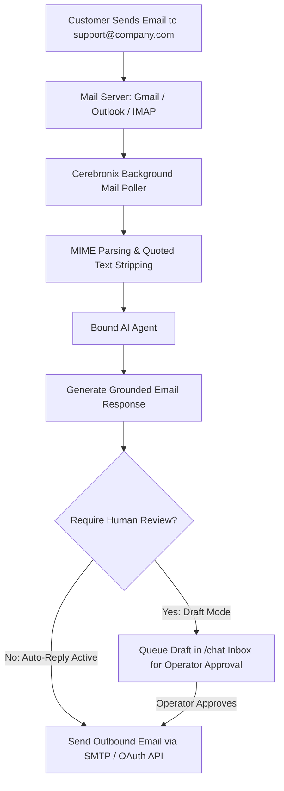

import { Callout } from 'fumadocs-ui/components/callout';
import { Steps } from 'fumadocs-ui/components/steps';
import { Tab, Tabs } from 'fumadocs-ui/components/tabs';

Email remains the predominant channel for formal customer inquiries, warranty submissions, and asynchronous support tickets. Cerebronix integrates directly with corporate mailboxes via **OAuth (Google Workspace / Microsoft 365)** or **standard IMAP/SMTP protocols**, allowing AI agents to parse incoming emails, draft knowledge-grounded responses, and maintain complete conversation histories.

This guide explains how to connect an email channel, configure polling intervals, bind an AI agent, and manage email threads in the unified `/chat` inbox.



---

## What Email Integration Enables

- **Automated Asynchronous Ticketing**: Inbound emails automatically create searchable, threaded customer conversations.
- **Smart Quoted History Stripping**: The ingestion engine removes repetitive forwarded email footers and previous thread history, ensuring the AI agent only reasons over the customer's newest inquiry.
- **OAuth & IMAP/SMTP Support**: Connect using modern single-sign-on OAuth (Gmail, Outlook) or custom mail servers (Exchange, Zimbra, Postfix).
- **Draft and Review Modes**: Choose whether agents reply automatically or stage draft responses for human operator review in `/chat`.
- **Standard Email Threading**: Outbound messages preserve standard RFC headers (`In-Reply-To`, `References`, and `Re: Subject`), maintaining intact conversation threads in customer email clients.

---

## Prerequisites and Permissions

1. **Email Account**: A dedicated support email address (e.g., `support@apexretailglobal.com`).
2. **Authentication Credentials**:
   - For Google / Microsoft: Administrative account access to approve OAuth scopes (`Mail.ReadWrite`, `Mail.Send`).
   - For Custom Servers: IMAP host/port and SMTP host/port credentials with SSL/TLS encryption.
3. **Cerebronix Permissions**: Organization role of `owner` or `admin`.

---

## Navigation

1. Log in to the Cerebronix SaaS console.
2. In the left navigation sidebar, click **Channels** (`/channels`).
3. Click **+ Add Inbox** (or navigate to `/channels/createchannel`).
4. Under **Business Channels**, select the **Email** option tile.

---

## Step-by-Step Configuration

<Tabs items={['OAuth (Gmail / Outlook)', 'Custom IMAP / SMTP']}>
  <Tab value="OAuth (Gmail / Outlook)">
    <Steps>
      ### Step 1: Select Email Provider Preset
      1. Click the **Email** card on `/channels/createchannel`.
      2. In the **Preset** dropdown, select **Google Workspace (Gmail)** or **Microsoft 365 (Outlook)**.

      ### Step 2: Sign in with Provider
      1. Click **Sign in with Google** or **Sign in with Microsoft**.
      2. A secure popup will open. Log in with your dedicated support account credentials.
      3. Approve the requested read, write, and send email scopes.

      ### Step 3: Activation
      Upon approval, Cerebronix registers the OAuth refresh token securely and transitions the channel status to **Active** (`CH_ACTIVE`).
    </Steps>
  </Tab>

  <Tab value="Custom IMAP / SMTP">
    <Steps>
      ### Step 1: Select Custom IMAP / SMTP
      1. Click the **Email** card on `/channels/createchannel`.
      2. Toggle **Use App Password / Custom IMAP/SMTP**.

      ### Step 2: Configure Inbound Settings (IMAP)
      - **Email Address**: `support@apexretailglobal.com`
      - **IMAP Host**: `imap.yourmailserver.com`
      - **IMAP Port**: `993`
      - **Security / TLS**: `SSL/TLS`
      - **Username & Password**: Enter account credentials or app-specific password.

      ### Step 3: Configure Outbound Settings (SMTP)
      - **SMTP Host**: `smtp.yourmailserver.com`
      - **SMTP Port**: `587` (or `465`)
      - **Security / TLS**: `STARTTLS` (or `SSL`)
      - **Username & Password**: Enter SMTP sending credentials.

      ### Step 4: Verify and Connect
      Click **Connect Email**. Cerebronix initiates a handshake test with both the IMAP and SMTP servers. Once validated, the channel status updates to **Active** (`CH_ACTIVE`).
    </Steps>
  </Tab>
</Tabs>

---

## Step 4: Bind an AI Agent to Email

1. In the Cerebronix console, navigate to **AI Agents** (`/agents`).
2. Select your designated agent (e.g., *Apex Customer Support Agent*).
3. Under **Channel Bindings**, check the box next to your new Email channel.
4. Click **Save Bindings**.

---

## Concrete Example: Apex Retail Global

Apex Retail Global connects its primary customer care mailbox:

| Parameter | Configuration | Purpose |
| :--- | :--- | :--- |
| **Email Address** | `support@apexretailglobal.com` | Official support address displayed on contact page. |
| **Auth Type** | Google Workspace OAuth | Secure token-based access without storing plaintext passwords. |
| **Bound Agent** | `Customer Support Agent` | Formats professional email replies with greetings, policy citations, and signatures. |
| **Handoff Mode** | Complex return escalations route to `/chat` | Human agents review and approve warranty replacement shipments. |

---

## Testing Inbound and Outbound Email

1. Using a personal email account, send an email to your connected support address:
   ```text
   Subject: Question about returning opened footwear
   Body: Hi Apex Team, I purchased the Trail Runner shoes last week and wore them on one run. Can I still return them for store credit?
   ```
2. **Verify Agent Reply**: Within 1–2 minutes (depending on mail polling intervals), check your personal email inbox. The agent will reply:
   ```text
   Subject: Re: Question about returning opened footwear
   Body: Hello, Thank you for contacting Apex Retail Global! According to our return policy, footwear must be in unworn, original condition with tags attached to qualify for a full refund...
   ```
3. **Verify Operator Thread**: In the Cerebronix console, open **Chat** (`/chat`). Confirm the email thread is visible with full subject line, customer email address, and timestamp.

---

## Common Failures and Troubleshooting

<Callout type="warn">
**App Passwords Required for 2FA**: If your email provider enforces Two-Factor Authentication (2FA), standard passwords will be rejected with an authentication error. Generate an **App-Specific Password** in your provider's security portal.
</Callout>

### 1. Ingestion Fails with "Authentication Failed (IMAP)"
- **Root Cause**: The mail server rejected the password, or "Less Secure Apps" access is disabled.
- **Resolution**: Use OAuth authentication instead of basic passwords. If using IMAP, generate an App Password in your Google or Microsoft account settings.

### 2. Outbound Replies Marked as Spam
- **Root Cause**: The sending domain lacks valid SPF, DKIM, or DMARC DNS records.
- **Resolution**: Ensure your domain's DNS includes an `SPF` record authorizing your mail server IP and configure `DKIM` signing in your email hosting settings.

### 3. Agent Replies in an Endless Loop
- **Root Cause**: An automated "Out of Office" auto-responder from a customer repeatedly triggered agent replies.
- **Resolution**: Cerebronix's email parser automatically inspects `Auto-Submitted` and `X-Autoreply` headers to suppress automated responses to auto-generated emails. Ensure your inbound mail server preserves standard RFC headers.

---

## Related Guides

- [Communication Channels: Overview & Routing](/docs/channels/overview-and-routing)
- [Website AI Chat Widget](/docs/channels/website-chat-widget)
- [AI Agents: Knowledge & Channel Bindings](/docs/ai-agents/knowledge-and-channel-bindings)
- [Core Concepts: Human in the Loop & Escalation](/docs/concepts/human-in-the-loop)
