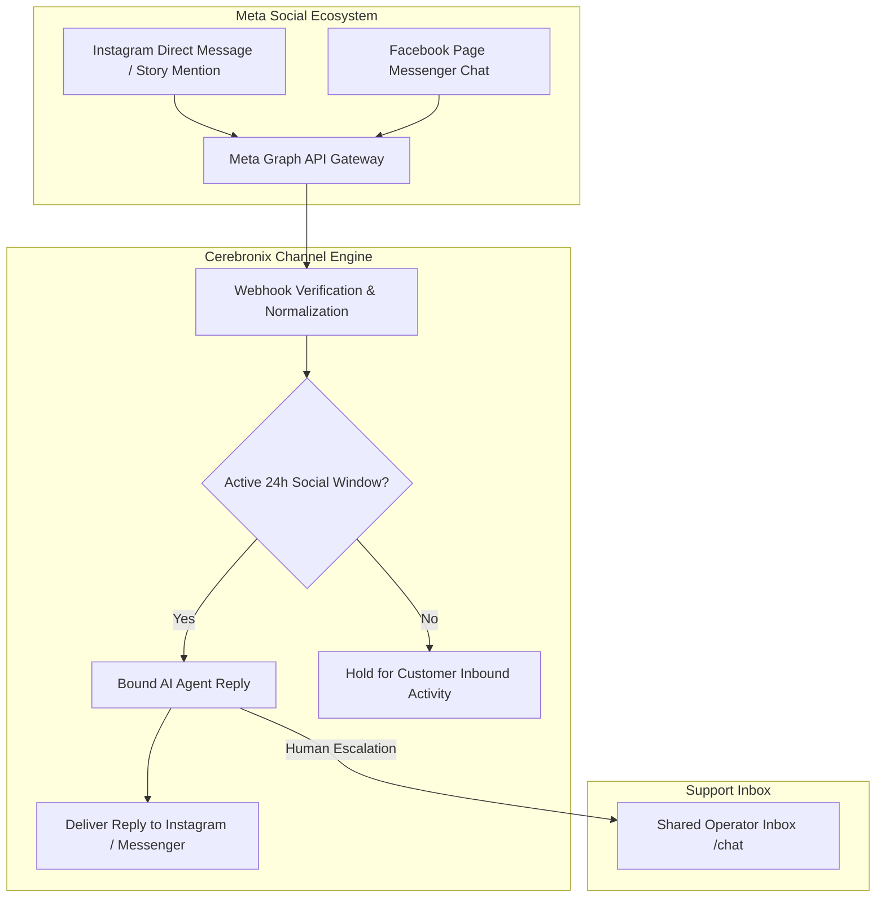

import { Callout } from 'fumadocs-ui/components/callout';
import { Steps } from 'fumadocs-ui/components/steps';
import { Tab, Tabs } from 'fumadocs-ui/components/tabs';

Social media messaging is a primary discovery and support channel for consumer brands. Through Cerebronix's official Meta Graph API integration, AI agents can respond to customer inquiries on **Instagram Direct Messages** and **Facebook Page Messenger**, answer product queries from story mentions, and route complex cases to support staff in the unified `/chat` inbox.

This guide provides instructions for connecting Facebook Pages and Instagram Professional accounts, configuring messaging permissions, binding AI agents, and managing 24-hour social messaging windows.



---

## What Social Channels Enable

- **Instagram Conversational Commerce**: Answer product inquiries, share catalog links, and recommend sizes directly within Instagram Direct.
- **Story Mention Auto-Engagement**: Proactively engage when prospective customers mention your brand in their Instagram stories.
- **Facebook Page Inbox Automation**: Automate responses on your company's official Facebook Page Messenger.
- **Unified Multichannel Threading**: Operators see Instagram and Facebook chats alongside WhatsApp and web widget conversations in the `/chat` inbox.

---

## Prerequisites and Meta Requirements

Connecting Instagram and Facebook requires meeting Meta platform prerequisites:

1. **Facebook Page**: Administrative (`Admin` or `Editor`) access to your company's Facebook Page.
2. **Instagram Professional Account**: The Instagram account must be converted to a **Business** or **Creator** account (personal accounts do not support API messaging).
3. **Linked Accounts**: The Instagram account must be linked to your Facebook Page in Meta Business Suite.
4. **"Allow Access to Messages" Enabled on Instagram**: In the Instagram mobile app:
   - Go to **Settings > Privacy > Messages**.
   - Under *Connected Tools*, toggle **Allow access to messages** to **ON**.
5. **Cerebronix Permissions**: Organization role of `owner` or `admin`.

---

## Navigation

1. Log in to the Cerebronix SaaS console.
2. In the left navigation sidebar, click **Channels** (`/channels`).
3. Click **+ Add Inbox** (or navigate to `/channels/createchannel`).
4. Under **Business Channels**, select either:
   - **Pages Messenger** (for Facebook Page chat)
   - **Instagram Business** (for Instagram Direct)

---

## Step-by-Step Configuration

<Steps>
### Step 1: Initiate Meta OAuth Authorization
1. On `/channels/createchannel`, click the **Pages Messenger** or **Instagram Business** tile.
2. You will be redirected to the secure Meta OAuth authorization portal.
3. Log in with the Facebook personal profile that manages your business pages.

### Step 2: Grant Permissions
When prompted by Meta:
1. Select the specific Facebook Pages and connected Instagram Business accounts you want to connect to Cerebronix.
2. Ensure all requested permissions are approved:
   - `pages_messaging` (Send and receive messages on Facebook Pages)
   - `instagram_manage_messages` (Manage and reply to Instagram Direct Messages)
   - `pages_manage_metadata` (Subscribe to incoming webhooks)
3. Click **Done** and return to Cerebronix.

### Step 3: Select and Activate Channel Resource
Upon redirect, the channel status will appear as **Selection Required** (`CH_SELECTION_REQUIRED`):
1. In the **Required Selection** view, locate your Facebook Page or Instagram handle.
2. Click **Select**.
3. Cerebronix registers the webhook subscriptions with Meta. The channel badge turns green (**Active** / `CH_ACTIVE`).

```
+---------------------------------------------------------+
| Required Resource Selection                             |
| Select the specific page or handle to activate:         |
|                                                         |
| [Instagram] @apexretailglobal                           |
| Status: Selection Required                              |
|                                                         |
| [Select Resource]                                       |
+---------------------------------------------------------+
```

### Step 4: Bind an AI Agent
1. Navigate to **AI Agents** (`/agents`).
2. Select your agent (e.g., *Apex Sales & Inbound Copilot*).
3. Under **Channel Bindings**, check the box next to your newly activated Instagram or Messenger channel.
4. Click **Save Bindings**.
</Steps>

---

## Meta 24-Hour Messaging Policy

Similar to WhatsApp, Meta applies a **24-Hour Standard Messaging Window** to Instagram Direct and Facebook Messenger:

- **Customer-Initiated Interaction**: When a customer sends a DM or replies to a story, a 24-hour window opens.
- **Allowed Communication**: During this window, your AI agent or human operators can send unlimited freeform conversational responses.
- **After 24 Hours**: Automated AI responses are halted by Meta policy. Outbound messages can only be sent manually by human operators utilizing approved Meta Message Tags (such as `POST_PURCHASE_UPDATE` or `CONFIRMED_EVENT_UPDATE`).

---

## Concrete Example: Apex Retail Global

Apex Retail Global operates its Instagram handle (`@apexretailglobal`) with the following workflow:

| Interaction | Trigger | Automated Action |
| :--- | :--- | :--- |
| **Direct Message** | Customer asks: *"Do you ship to Canada?"* | Agent retrieves international shipping policy and replies in under 3 seconds. |
| **Story Reply** | Customer replies to a new product reveal story. | Agent thanks the customer and shares a direct link to the product collection. |
| **Escalation** | Customer writes: *"My order hasn't arrived and tracking is stuck."* | Agent expresses empathy, triggers handoff, and alerts support team in `/chat`. |

---

## Testing Social Channels

1. Open the Instagram or Facebook mobile app using a personal account (do not test using the business page's own account).
2. Search for your business handle or page.
3. Send a test direct message:
   ```text
   Hi! What sizes do you have available in the Apex Trail Runner?
   ```
4. Confirm the agent replies on Instagram with available sizing and direct links.
5. In your Cerebronix console, open **Chat** (`/chat`) to verify the thread is displayed with the Instagram icon and customer username.

---

## Common Failures and Troubleshooting

<Callout type="warn">
**Personal Instagram Accounts**: Connecting a personal Instagram account will fail silently. Verify under your Instagram app settings that the account type is explicitly set to **Business** or **Creator**.
</Callout>

### 1. Instagram Messages Not Received in Cerebronix
- **Root Cause**: The "Allow access to messages" toggle was not enabled inside the Instagram mobile app.
- **Resolution**: Open the Instagram app on a mobile device, navigate to **Settings > Privacy > Messages**, and ensure **Allow access to messages** is switched **ON**.

### 2. Instagram Handle Not Appearing in Meta OAuth Selector
- **Root Cause**: The Instagram account is not linked to the Facebook Page in Meta Business Suite.
- **Resolution**: Open **Meta Business Suite > Settings > Business Assets > Instagram Accounts**, and link your Instagram profile to the target Facebook Page before repeating authorization.

### 3. Agent Stops Replying to Existing Threads
- **Root Cause**: The 24-hour messaging window expired without a new customer inquiry, or the Facebook Page access token was invalidated after an administrator password change.
- **Resolution**: If the token expired, click **Re-authorize** under **Channels > [Your Social Channel]**.

---

## Related Guides

- [Communication Channels: Overview & Routing](/docs/channels/overview-and-routing)
- [WhatsApp Business Cloud API](/docs/channels/whatsapp-business)
- [AI Agents: Knowledge & Channel Bindings](/docs/ai-agents/knowledge-and-channel-bindings)
- [Core Concepts: Human in the Loop & Escalation](/docs/concepts/human-in-the-loop)
