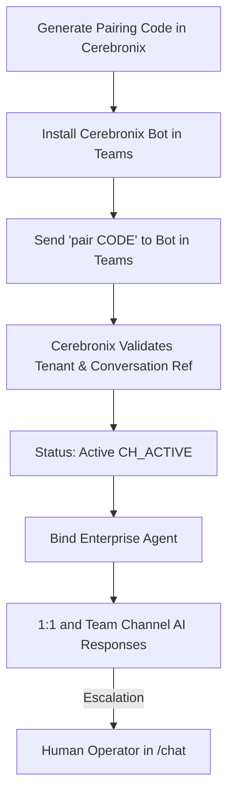

import { Callout } from 'fumadocs-ui/components/callout';
import { Steps } from 'fumadocs-ui/components/steps';
import { Tab, Tabs } from 'fumadocs-ui/components/tabs';

For organizations operating on Microsoft 365, **Microsoft Teams** is the central hub for team collaboration and workplace operations. Cerebronix provides a secure, zero-secret pairing mechanism that allows enterprise administrators to connect AI agents to Microsoft Teams without exposing Azure client secrets or managing risky credential rotations.

This guide explains how to pair Microsoft Teams with Cerebronix, configure channel routing, bind an enterprise AI agent, and troubleshoot common Microsoft 365 permissions.



---

## What Microsoft Teams Integration Enables

- **Enterprise Self-Service**: Employees ask questions regarding company policies, health benefits, IT equipment, and corporate directories directly within Teams.
- **Zero-Secret Pairing Architecture**: Teams pairs securely using an ephemeral in-Teams handshake code, ensuring no Azure application secrets or certificates touch the web browser.
- **Threaded Channel Mentions**: In team channels, mention `@Cerebronix` to invoke the agent within a dedicated thread.
- **Direct 1:1 Chats**: Employees can initiate private, confidential direct message sessions with HR or IT agents.

---

## Prerequisites and Permissions

1. **Microsoft 365 Tenant**: An active Microsoft 365 organization with Microsoft Teams enabled.
2. **Custom App Permission**: Administrative permission in Microsoft Teams Admin Center to add custom apps or sideload bot packages.
3. **Cerebronix Permissions**: Organization role of `owner` or `admin`.

---

## Navigation

1. Log in to the Cerebronix SaaS console.
2. In the left navigation sidebar, click **Channels** (`/channels`).
3. Click **+ Add Inbox** (or navigate to `/channels/createchannel`).
4. Under **Enterprise Channels**, select **Microsoft Teams**.

---

## Step-by-Step Configuration

<Steps>
### Step 1: Generate an In-Teams Pairing Code
1. On `/channels/createchannel`, click the **Microsoft Teams** card.
2. The **Teams Connect Screen** opens, generating a unique 8-character pairing code:
   ```text
   CBX-89214
   ```
3. This code is cryptographically linked to your Cerebronix organization and remains valid for **15 minutes**.

```
+---------------------------------------------------------+
| Microsoft Teams Pairing                                 |
| Connect Cerebronix without exposing Azure credentials.  |
|                                                         |
| 1. Open Microsoft Teams.                                |
| 2. Search for the Cerebronix Bot.                       |
| 3. Send the following command in chat:                  |
|                                                         |
|    pair CBX-89214                                       |
|                                                         |
| Status: Waiting for pairing handshake...                |
| [Copy Code]                                   [Cancel]  |
+---------------------------------------------------------+
```

### Step 2: Install and Message the Cerebronix Bot in Teams
1. Open your Microsoft Teams desktop or web client.
2. In the left app bar, click **Apps** and select the **Cerebronix Bot** (or upload your organization's custom app manifest package).
3. Open a direct chat with the bot.
4. Send the pairing command:
   ```text
   pair CBX-89214
   ```

### Step 3: Confirmation and Activation
Upon receiving the command:
- The Cerebronix gateway validates the pairing code against active tokens.
- Captures the Microsoft Tenant ID, Service URL, and conversation reference.
- The bot replies in Teams: *"Successfully paired with Apex Retail Global! This channel is now active."*
- In the Cerebronix console, the channel updates automatically to **Active** (`CH_ACTIVE`).

### Step 4: Bind an AI Agent to Teams
1. In the Cerebronix sidebar, click **AI Agents** (`/agents`).
2. Select your internal workplace agent (e.g., *Apex HR Policy Assistant* or *Operations Coordinator*).
3. Under **Channel Bindings**, check the box next to your new Microsoft Teams channel.
4. Click **Save Bindings**.
</Steps>

---

## Concrete Example: Apex Retail Global

Apex Retail Global deploys Microsoft Teams to automate employee policy guidance across 1,200 staff members:

| Field | Setting | Operational Outcome |
| :--- | :--- | :--- |
| **Channel Name** | `Apex Teams Workplace Help` | Shared channel servicing all corporate Microsoft 365 users. |
| **Bound Agent** | `HR Policy Assistant` | Strictly grounded in corporate employee handbook and benefits documents. |
| **Strict KB Mode** | `Enabled` | Prevents inaccurate or fabricated advice on legal or benefits matters. |
| **Channel Scoping** | General Channel & Private DMs | Employees can ask sensitive medical leave questions privately. |

---

## Testing Microsoft Teams Integration

1. In Microsoft Teams, open your direct message chat with the Cerebronix bot.
2. Send an inquiry regarding documented policies:
   ```text
   How many weeks of parental leave does Apex Retail Global provide?
   ```
3. **Expected Result**: The bot replies within 2–3 seconds with the exact policy citation from your uploaded HR handbook.
4. In the Cerebronix console, open **Chat** (`/chat`). Confirm the conversation thread appears with the Microsoft Teams badge and employee display name.

---

## Common Failures and Troubleshooting

<Callout type="warn">
**Pairing Code Expiration**: Pairing codes expire after 15 minutes. If pairing is not completed within this window, click **Generate New Code** in the Cerebronix console.
</Callout>

### 1. Bot Replies "Pairing Code Expired or Invalid"
- **Root Cause**: The code was typed after the 15-minute validity window expired, or the prefix `pair ` was omitted.
- **Resolution**: Click **Regenerate Code** in the console and ensure you send `pair [CODE]` exactly as formatted.

### 2. Teams Administrator Blocks Custom App Installation
- **Root Cause**: Microsoft 365 Tenant policy restricts non-admin users from installing custom sideloaded apps.
- **Resolution**: A Microsoft 365 Global Administrator must visit the **Microsoft Teams Admin Center > Teams apps > Manage apps**, search for the bot, and set its status to **Allowed**.

### 3. Bot Does Not Respond in Team Channels
- **Root Cause**: In multi-user team channels, bots ignore general chat to preserve privacy unless explicitly `@mentioned`.
- **Resolution**: Address the bot with `@Cerebronix [your question]` when communicating inside shared team channels.

---

## Related Guides

- [Communication Channels: Overview & Routing](/docs/channels/overview-and-routing)
- [Slack & Discord Collaboration Channels](/docs/channels/slack-and-discord)
- [AI Agents: Knowledge & Channel Bindings](/docs/ai-agents/knowledge-and-channel-bindings)
- [Core Concepts: Human in the Loop & Escalation](/docs/concepts/human-in-the-loop)
