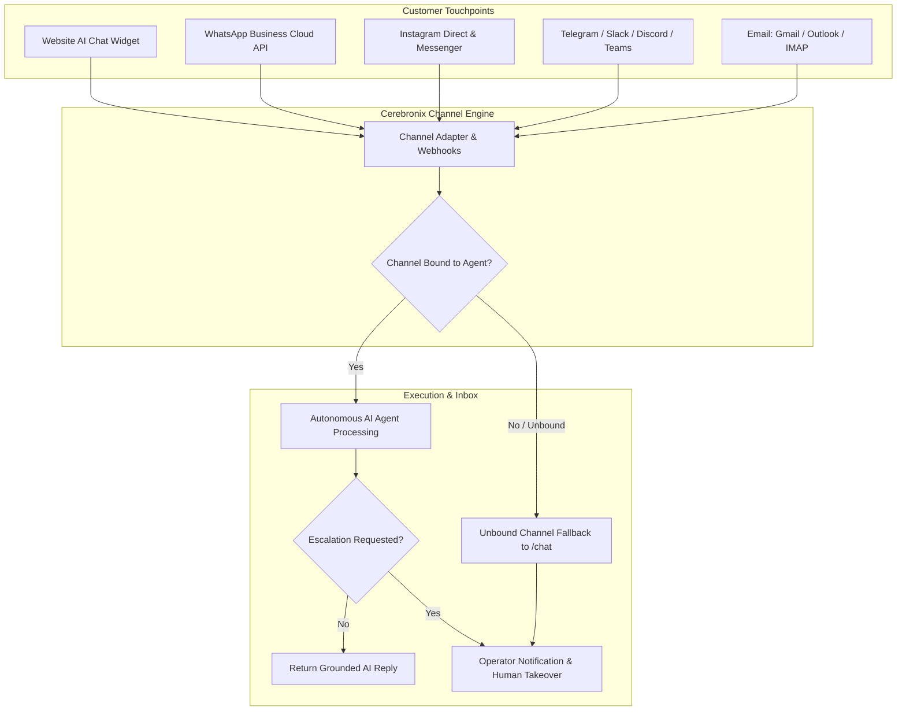

import { Callout } from 'fumadocs-ui/components/callout';
import { Steps } from 'fumadocs-ui/components/steps';
import { Tab, Tabs } from 'fumadocs-ui/components/tabs';

In Cerebronix, **Communication Channels** are the live digital touchpoints through which customers interact with your business. Rather than locking conversational AI into a website silo, Cerebronix allows you to deploy agents across messaging applications, social platforms, collaboration suites, and email.

This guide provides an architectural overview of channel connectivity, details how inbound customer inquiries are routed to AI agents, and explains how unassigned threads are managed.

---

## Supported Communication Channels Matrix

Cerebronix natively supports the following communication channels:

| Channel | Category | Authentication Method | Supported Formats | Operational Status |
| :--- | :--- | :--- | :--- | :--- |
| **Website Chat Widget** | Web / Mobile | Direct JavaScript Embed | Text, Markdown, Links, Quick Replies, Voice Notes | **Operational & Verified** |
| **WhatsApp Business** | Mobile Messaging | Meta Cloud API OAuth & PIN | Text, Media, Quick Replies, Interactive Buttons, Templates | **Operational & Verified** |
| **Instagram Direct** | Social Messaging | Meta OAuth (Instagram Graph) | Text, Quick Replies, Story Mentions, Image Attachments | **Operational & Verified** |
| **Facebook Messenger** | Social Messaging | Meta OAuth (Page Access) | Text, Quick Replies, Media Attachments | **Operational & Verified** |
| **Telegram** | Messaging App | Bot API Token (BotFather) | Text, Markdown, Inline Buttons, Commands, Groups | **Operational & Verified** |
| **Slack** | Enterprise Workplace | Slack App Workspace OAuth | Text, Blocks, Threads, Mentions | **Operational & Verified** |
| **Discord** | Community / Gaming | Discord Bot OAuth & Channel | Text, Embeds, Channel Mentions, Guild Threads | **Operational & Verified** |
| **Microsoft Teams** | Enterprise Workplace | In-Teams Bot Pairing Code | Text, Adaptive Cards, Mentions | **Operational & Verified** |
| **Email** | Asynchronous Inbox | Gmail / Outlook OAuth or IMAP | Formatted HTML, Plaintext, Thread Parsing | **Operational & Verified** |

<Callout type="info">
**Adapter Verification vs. External Account Prerequisites**:
All listed channels feature verified backend adapters, webhook handlers, and UI configuration workflows in the Cerebronix platform. Establishing live customer traffic requires valid third-party administrative credentials, approved developer applications (for Meta, Slack, and Discord), and adherence to provider-specific messaging policies.
</Callout>

### Communication Channels vs. CRM Integrations

<Callout type="warn">
**Distinguishing Channels from CRM Tools**:
Platforms like **HubSpot** are classified under **Integrations & External Systems**, not communication channels. While Cerebronix can sync customer contacts, log conversation transcripts, and create support tickets in HubSpot, it does not use HubSpot as an inbound customer chat provider. Inbound messages always arrive through one of the verified channels listed above.
</Callout>

---

## How Channel-to-Agent Routing Works

Cerebronix decouples channel endpoints from agent definitions, allowing flexible many-to-many topologies:

1. **Inbound Webhook Receipt**: A customer sends a message on WhatsApp or your website widget. The Cerebronix channel gateway decrypts and normalizes the payload.
2. **Channel Resolution**: The gateway identifies the specific channel instance (e.g., *Apex US WhatsApp Line*, `ch_98214`).
3. **Agent Binding Check**:
   - If the channel is bound to an active AI agent (e.g., *Apex Shopping Concierge*), the session payload is forwarded to the agent's reasoning engine.
   - The agent consults its bound knowledge sources, generates a grounded response, and delivers it through the originating channel adapter.
4. **Unbound Channel Handoff**: If no agent is currently bound to the channel, the gateway triggers your organization's **Unbound Channel Handoff** rule:
   - The conversation is logged directly in the **Chat Inbox** (`/chat`).
   - The thread is marked `Unassigned` or routed to a human operator queue.
   - An optional automated notice is sent to the customer: *"Thank you for contacting us. A support representative will be with you shortly."*

---

## Channel Access and Permissions

Configuring and managing communication channels requires appropriate organizational permissions:

| Action | Required Role | Notes |
| :--- | :--- | :--- |
| **Create New Channel** | `owner`, `admin` | Installing Meta, Slack, or Microsoft apps requires third-party administrative authority. |
| **Delete or Re-authorize Channel** | `owner`, `admin` | Affects all active sessions on that channel. |
| **Bind / Unbind Channel to Agent** | `owner`, `admin`, `developer` | Configured on the agent's detail page (`/agents/[id]`). |
| **Respond to Customers in Inbox (`/chat`)** | `owner`, `admin`, `developer`, `viewer` | Support staff can take over threads and message customers across all connected channels. |

---

## Navigation

- **To view all active and pending channels**: In the left sidebar, click **Channels** (`/channels`).
- **To add a new channel**: Click **+ Add Inbox** on `/channels`, or navigate to `/channels/createchannel`.
- **To configure fallback routing**: Navigate to **Organization Settings > Unbound Channel Handoff**.
- **To bind channels to an agent**: Navigate to **AI Agents** (`/agents`) -> select agent -> scroll to **Channel Bindings**.

---

## Related Guides

- [Website AI Chat Widget](/docs/channels/website-chat-widget)
- [WhatsApp Business Cloud API](/docs/channels/whatsapp-business)
- [Instagram Direct & Facebook Messenger](/docs/channels/instagram-and-messenger)
- [Telegram Bot Integration](/docs/channels/telegram)
- [Slack & Discord Community Channels](/docs/channels/slack-and-discord)
- [Microsoft Teams Integration](/docs/channels/microsoft-teams)
- [Email Ingestion & Auto-Reply](/docs/channels/email)
