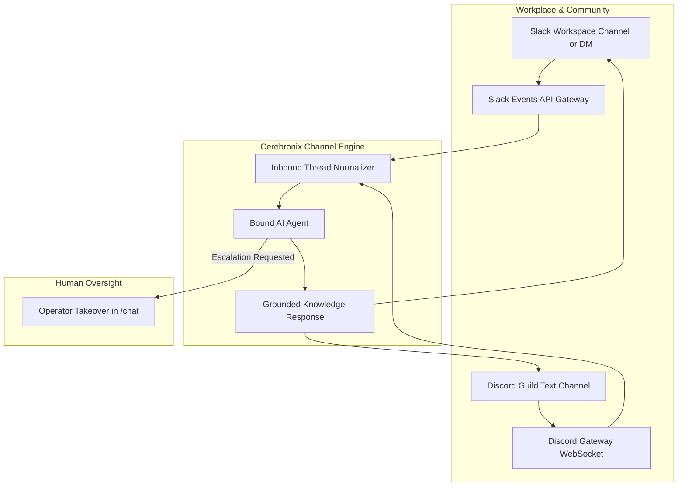

import { Callout } from 'fumadocs-ui/components/callout';
import { Steps } from 'fumadocs-ui/components/steps';
import { Tab, Tabs } from 'fumadocs-ui/components/tabs';

Modern enterprises and community-driven brands rely heavily on team collaboration platforms. Cerebronix provides native integrations for **Slack** and **Discord**, allowing organizations to embed knowledge-grounded AI agents into internal company channels, IT support workflows, and customer community servers.

This guide explains how to install Cerebronix in Slack and Discord, configure channel-level routing, bind AI agents, and manage cross-platform collaboration.



---

## What Slack and Discord Channels Enable

- **Internal IT & HR Helpdesks (Slack)**: Employees ask questions about corporate policies, health benefits, and IT hardware directly within Slack (`#it-helpdesk` or private DMs).
- **Public Community Support (Discord)**: Gamers, developers, and product enthusiasts receive immediate assistance in dedicated Discord support channels.
- **Threaded Conversations**: Agents maintain context within Slack and Discord message threads without polluting main channel chat streams.
- **Human Operator Takeover**: Support supervisors in `/chat` can intervene in Slack or Discord threads seamlessly.

---

## Prerequisites and Permissions

### For Slack:
1. **Slack Workspace Admin Access**: Permission to install third-party apps into your Slack workspace.
2. **Cerebronix Permissions**: Organization role of `owner` or `admin`.

### For Discord:
1. **Discord Server Admin Rights**: The `Manage Server` permission in the target Discord server (guild) to authorize bot installation.
2. **Dedicated Text Channel**: A pre-existing text channel in your Discord server designated for AI interactions (e.g., `#ask-ai` or `#support`).
3. **Cerebronix Permissions**: Organization role of `owner` or `admin`.

---

## Navigation

1. Log in to the Cerebronix SaaS console.
2. In the left navigation sidebar, click **Channels** (`/channels`).
3. Click **+ Add Inbox** (or navigate to `/channels/createchannel`).
4. Under **Enterprise Channels**, select either **Slack** or **Discord**.

---

## Step-by-Step Configuration

<Tabs items={['Slack Setup', 'Discord Setup']}>
  <Tab value="Slack Setup">
    <Steps>
      ### Step 1: Authorize Slack App
      1. Click the **Slack** card on `/channels/createchannel`.
      2. You will be redirected to the official Slack App Directory authorization page.
      3. In the top-right corner, confirm your target Slack workspace (e.g., *Apex Retail Global Workspace*).
      4. Review requested scopes (`chat:write`, `channels:history`, `im:history`, `app_mentions:read`).
      5. Click **Allow**.

      ### Step 2: Confirmation and Activation
      Upon returning to Cerebronix, the Slack integration automatically registers your workspace and displays status **Active** (`CH_ACTIVE`).

      ### Step 3: Invite Bot to Slack Channels
      In your Slack desktop or mobile client:
      1. Open the channel where you want the agent active (e.g., `#it-helpdesk`).
      2. Invite the bot by sending:
         ```text
         /invite @Cerebronix
         ```
    </Steps>
  </Tab>

  <Tab value="Discord Setup">
    <Steps>
      ### Step 1: Authorize Discord Bot
      1. Click the **Discord** card on `/channels/createchannel`.
      2. You will be redirected to Discord's OAuth authorization portal.
      3. Select your server from the **Add to Server** dropdown.
      4. Ensure permissions (*Send Messages*, *Read Message History*, *Embed Links*) are checked.
      5. Click **Authorize**.

      ### Step 2: Select Designated Text Channel
      Unlike Slack, Discord requires scoping the bot to a specific guild text channel:
      1. Return to Cerebronix `/channels`. The Discord channel will display status **Selection Required** (`CH_SELECTION_REQUIRED`).
      2. In the dropdown, select your desired text channel (e.g., `#apex-concierge`).
      3. Click **Save Selection**. The status updates to **Active** (`CH_ACTIVE`).
    </Steps>
  </Tab>
</Tabs>

---

## Step 4: Bind an AI Agent

Once Slack or Discord is connected:

1. In the Cerebronix sidebar, click **AI Agents** (`/agents`).
2. Select your designated agent:
   - For internal Slack: Select an *HR Policy Assistant* or *Operations Coordinator*.
   - For Discord: Select a *Product Expert* or *Customer Support Agent*.
3. Under **Channel Bindings**, check the box next to your connected Slack or Discord channel.
4. Click **Save Bindings**.

---

## Concrete Example: Apex Retail Global

Apex Retail Global operates both channels across different operational boundaries:

| Platform | Channel / Guild | Bound Agent | Target Audience |
| :--- | :--- | :--- | :--- |
| **Slack** | `#internal-ops` | `Operations Coordinator` | Internal logistics employees querying warehouse policies and shipment tracking. |
| **Discord** | `#runners-lounge` | `Product Expert` | Public running community asking technical shoe drop, arch support, and gear questions. |

---

## Testing Collaboration Channels

### Testing on Slack:
1. In Slack, send a direct message to the `@Cerebronix` bot, or mention the bot in an authorized channel:
   ```text
   @Cerebronix What is our corporate travel expense limit for domestic flights?
   ```
2. Confirm the bot replies within a threaded message quoting the corporate expense document.

### Testing on Discord:
1. In your authorized Discord channel (e.g., `#apex-concierge`), send an inquiry:
   ```text
   Does the Apex Peak 2026 fit true to size?
   ```
2. Confirm the bot posts an embedded reply with exact sizing specifications.

---

## Common Failures and Troubleshooting

<Callout type="warn">
**Channel Permission Overrides**: If the bot is unable to reply in Slack or Discord, check that the channel's private permissions have not disabled "Send Messages" or "Embed Links" for the `@Cerebronix` role.
</Callout>

### 1. Bot Remains Silent When Mentioned in Slack Channel
- **Root Cause**: The bot was installed into the workspace but was never invited to the specific channel.
- **Resolution**: In the channel, type `/invite @Cerebronix` and press Enter.

### 2. Discord Shows "Selection Required" Indefinitely
- **Root Cause**: The Discord OAuth completed, but a specific guild text channel was never selected in the Cerebronix console.
- **Resolution**: Navigate to **Channels** (`/channels`), find the Discord entry under **Required Selection**, select your target text channel from the dropdown, and click **Save**.

### 3. Rate Limiting During High Community Activity
- **Root Cause**: Discord applies strict per-channel rate limits (5 messages per 5 seconds).
- **Resolution**: For high-volume servers, configure the agent with **Semantic Response Caching** enabled under **Agent Settings > Behavior** to minimize latency.

---

## Related Guides

- [Communication Channels: Overview & Routing](/docs/channels/overview-and-routing)
- [Microsoft Teams Integration](/docs/channels/microsoft-teams)
- [AI Agents: Knowledge & Channel Bindings](/docs/ai-agents/knowledge-and-channel-bindings)
- [Core Concepts: Human in the Loop & Escalation](/docs/concepts/human-in-the-loop)
