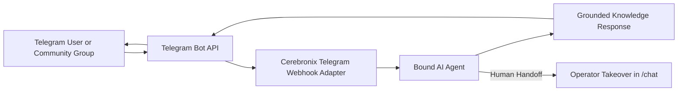

import { Callout } from 'fumadocs-ui/components/callout';
import { Steps } from 'fumadocs-ui/components/steps';
import { Tab, Tabs } from 'fumadocs-ui/components/tabs';

Telegram is a rapid, cloud-based messaging platform renowned for developer accessibility, community groups, and worldwide reach. Cerebronix integrates directly with the **Telegram Bot API**, allowing organizations to connect custom bots in seconds using an official token generated from Telegram's `@BotFather`.

This guide explains how to create a Telegram bot, connect its API token to Cerebronix, configure webhook delivery, bind an AI agent, and manage customer conversations.



---

## What Telegram Integration Enables

- **No 24-Hour Messaging Restrictions**: Unlike Meta platforms, Telegram bots can message users who have initiated a conversation without arbitrary 24-hour window expirations or paid re-engagement templates.
- **Direct 1:1 Chats and Group Communities**: Agents can operate as dedicated private support assistants or join Telegram Supergroups to assist community members when mentioned.
- **Rich Markdown Formatting**: Full support for bold headers, code snippets, inline links, and bulleted lists.
- **Streamlined Setup**: Zero developer app verification or enterprise business approval required; automated webhook verification activates immediately upon token entry.

---

## Prerequisites and Permissions

1. **Telegram Account**: A personal Telegram account to access `@BotFather`.
2. **Telegram Bot Token**: An official HTTP API bot token generated from `@BotFather`.
3. **Cerebronix Permissions**: Organization role of `owner` or `admin`.

---

## Navigation

1. Log in to the Cerebronix SaaS console.
2. In the left navigation sidebar, click **Channels** (`/channels`).
3. Click **+ Add Inbox** (or navigate to `/channels/createchannel`).
4. Under **Business Channels**, select the **Telegram** option tile.

---

## Step-by-Step Configuration

<Steps>
### Step 1: Create a Bot with @BotFather on Telegram
1. Open the Telegram app and search for the verified bot `@BotFather`.
2. Send the command:
   ```text
   /newbot
   ```
3. Follow the prompts:
   - Enter a **Display Name** for your bot (e.g., `Apex Retail Global Assistant`).
   - Enter a **Username** ending in `bot` (e.g., `ApexRetailSupportBot`).
4. `@BotFather` will generate an **HTTP API Token** formatted as:
   ```text
   123456789:ABCdefGhIJKlmNoPQRsTUVwxyZ
   ```
5. Copy this token to your clipboard.

### Step 2: Connect the Token in Cerebronix
1. In the Cerebronix console on `/channels/createchannel`, click the **Telegram** tile.
2. Paste your token into the **Telegram Bot Token** field.
3. Click **Create Channel**.

```
+---------------------------------------------------------+
| Connect Telegram Bot                                    |
| Enter your HTTP API token provided by @BotFather.       |
|                                                         |
| Bot Token: [123456789:ABCdefGhIJKlmNoPQRsTUVwxyZ     ]  |
|                                                         |
| [Cancel]                                     [Connect]  |
+---------------------------------------------------------+
```

### Step 3: Automated Webhook Verification
Upon clicking Connect, Cerebronix immediately communicates with the Telegram Bot API:
- Calls `getMe` to verify that the token belongs to an active bot.
- Registers Cerebronix's encrypted webhook URL (`/api/telegram/webhook/...`).
- Automatically transitions the channel status to **Active** (`CH_ACTIVE`).

### Step 4: Bind an AI Agent to Telegram
1. In the sidebar, navigate to **AI Agents** (`/agents`).
2. Select your agent (e.g., *Apex Customer Support Agent*).
3. Under **Channel Bindings**, check the box next to your new Telegram bot channel.
4. Click **Save Bindings**.
</Steps>

---

## Concrete Example: Apex Retail Global

Apex Retail Global deploys `@ApexRetailSupportBot` to serve international customers:

| Field | Configuration | Operational Result |
| :--- | :--- | :--- |
| **Bot Username** | `@ApexRetailSupportBot` | Easily searchable handle for mobile and desktop Telegram users. |
| **Bound Agent** | `Apex Customer Support Agent` | Answers global shipping policies, sizing charts, and return rules. |
| **Messaging Policy** | Direct 1:1 and Group Mentions | Responds instantly when tagged in VIP runner community groups. |
| **Operator Fallback** | Handoff to `/chat` | Live team members answer complex order inquiries directly in the console. |

---

## Testing the Telegram Bot

1. In the Telegram app, search for your bot's username (e.g., `@ApexRetailSupportBot`).
2. Click **Start** (or send `/start`).
3. Send a test inquiry:
   ```text
   What is your standard international shipping policy?
   ```
4. **Expected Result**: The bot replies within 1–2 seconds with accurate policy information drawn from your Cerebronix knowledge base.
5. In the Cerebronix console, open **Chat** (`/chat`). You will see the conversation thread logged with the Telegram icon and the customer's Telegram `@username`.

---

## Common Failures and Troubleshooting

<Callout type="warn">
**Bot Token Conflicts**: A Telegram bot token can only be connected to **one webhook destination** at a time. If the bot is already configured with another third-party tool, connecting it to Cerebronix will overwrite the previous webhook.
</Callout>

### 1. Connection Fails with "Invalid Telegram Bot Token"
- **Root Cause**: The token was copied with trailing whitespace, or the bot was revoked in `@BotFather`.
- **Resolution**: Re-open `@BotFather` on Telegram, send `/token`, select your bot, and copy the fresh token directly into Cerebronix.

### 2. "Bot Token Has Already Been Taken"
- **Root Cause**: Another organization within Cerebronix or another channel instance is already using this exact bot token.
- **Resolution**: Telegram tokens must be unique per channel instance. Generate a new bot in `@BotFather` or delete the duplicate channel under `/channels`.

### 3. Bot Does Not Respond in Group Chats
- **Root Cause**: Telegram bots have **Group Privacy Mode** enabled by default, preventing them from reading group messages unless directly mentioned or added as an administrator.
- **Resolution**: In `@BotFather`, send `/setprivacy`, select your bot, and set it to **Disable** if you want the bot to see all messages, or remind group members to mention `@YourBot` in their prompts.

---

## Related Guides

- [Communication Channels: Overview & Routing](/docs/channels/overview-and-routing)
- [Website AI Chat Widget](/docs/channels/website-chat-widget)
- [AI Agents: Knowledge & Channel Bindings](/docs/ai-agents/knowledge-and-channel-bindings)
- [Core Concepts: Human in the Loop & Escalation](/docs/concepts/human-in-the-loop)
