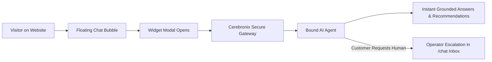

import { Callout } from 'fumadocs-ui/components/callout';
import { Steps } from 'fumadocs-ui/components/steps';
import { Tab, Tabs } from 'fumadocs-ui/components/tabs';

The **Website AI Chat Widget** is the most versatile channel in Cerebronix. It provides a lightweight, highly responsive chat interface that embeds into any website, ecommerce storefront, or web application with two lines of HTML.

This guide explains how to create and customize a chat widget, configure security origins, embed the loader script, bind an AI agent, and manage live customer sessions.



---

## What the Web Widget Enables

- **Zero Third-Party Dependencies**: No Meta or enterprise social accounts required; immediate self-service deployment.
- **Custom Visual Branding**: Configure primary theme colors, brand headers, company logos, and welcoming subtitles.
- **Voice Note Support**: Shoppers can dictate voice inquiries, with automated audio transcription and voice replies.
- **Responsive Layout**: Adapts automatically from a floating desktop drawer into an edge-to-edge mobile modal on screens under 640px.
- **Cross-Domain Origin Restrictions**: Whitelist authorized domains to prevent third-party sites from embedding your chat widget.

---

## Prerequisites and Permissions

1. **Role Permissions**: Organization role of `owner`, `admin`, or `developer`. Members with the `viewer` role can view settings and copy embed snippets.
2. **Website Access**: Administrative access to edit your website's HTML template, CMS footer, or Google Tag Manager container.
3. **HTTPS Encryption**: Target websites must use HTTPS. Browsers block secure WebSockets when initiated from insecure HTTP pages.

---

## Navigation

1. Log in to the Cerebronix SaaS console.
2. In the left navigation sidebar, click **Channels** (`/channels`).
3. Click **+ Add Inbox** (or navigate directly to `/channels/createchannel`).
4. Select the **Web Chat Widget** option tile.

---

## Step-by-Step Configuration

<Steps>
### Step 1: Create the Widget Channel
On the channel selection screen:
1. Click the **Web Chat Widget** card.
2. Enter the initial channel name (e.g., `Apex Storefront Chat`).
3. Click **Create Channel**. The system provisions a dedicated widget channel ID (e.g., `inb_98214fa7`).

### Step 2: Configure Visual Appearance and Branding
Under the widget's **Settings** tab:
- **Inbox Name**: Internal identifier displayed in the `/channels` inventory and `/chat` inbox.
- **Theme Color**: Enter your hex brand color (e.g., `#2563eb` for royal blue) or use the interactive color picker.
- **Welcome Title**: The prominent header displayed when visitors open the widget (e.g., *Hi there! How can we help you today?*).
- **Tagline**: Subheading displayed beneath the title (e.g., *Apex Retail Global • Typically replies in seconds*).

```
+---------------------------------------------------------+
| Widget Appearance Settings                              |
|                                                         |
| Inbox Name: Apex Storefront Chat                        |
| Theme Color: [#2563eb] (Blue)                           |
| Welcome Title: Welcome to Apex Retail Global!           |
| Tagline: Ask our AI concierge about products & orders.  |
|                                                         |
| [✓] Enable Voice Messaging                              |
|                                                         |
| [Save Changes]                                          |
+---------------------------------------------------------+
```

### Step 3: Configure Allowed Origins (Domain Security)
In the **Allowed Origins** field, enter each domain permitted to load your widget, separated by newlines:
```text
https://apexretailglobal.com
https://store.apexretailglobal.com
https://staging.apexretailglobal.com
```
<Callout type="warn">
If **Allowed Origins** is populated, requests originating from unlisted domains will be blocked by the server with a `403 Forbidden` CORS error. Leave this field empty only during initial local staging development.
</Callout>

### Step 4: Copy the Verified Embed Snippet
Scroll to the **Embed Code** panel. Cerebronix provides a clean asynchronous loader script:

```html
<!-- Cerebronix Web Chat Widget Embed -->
<script>
window.cerebronixWidgetConfig = {
  orgId: "org_98214a1b",
  channelId: "inb_7719c4d2",
  themeColor: "#2563eb",
  welcomeTitle: "Welcome to Apex Retail Global!",
  tagline: "Ask our AI concierge about products & orders."
};
</script>
<script src="https://chat.cerebronix.com/loader.js" async></script>
```

### Step 5: Install on Your Website
Paste the embed snippet immediately before the closing `</body>` tag of your website:
- **WordPress / WooCommerce**: Paste into `footer.php` or use an *Insert Headers and Footers* plugin.
- **Shopify**: Open **Online Store > Themes > Edit Code > theme.liquid**, and paste before `</body>`.
- **Next.js / React**: Add the script to your root `layout.tsx` or `_document.tsx` using `next/script` with `strategy="afterInteractive"`.
- **Google Tag Manager**: Create a **Custom HTML Tag**, paste the snippet, and trigger on **All Pages**.

### Step 6: Bind an AI Agent to the Widget
1. In the Cerebronix console, navigate to **AI Agents** (`/agents`).
2. Select your agent (e.g., *Apex Shopping Concierge*).
3. Under **Channel Bindings**, check the box next to `Apex Storefront Chat`.
4. Click **Save Bindings**.
</Steps>

---

## Concrete Example: Apex Retail Global

Apex Retail Global embeds the widget across its main ecommerce storefront:

| Setting | Value | Rationale |
| :--- | :--- | :--- |
| **Channel Name** | `Apex Storefront Chat` | Clear identification in the shared multi-channel operator inbox. |
| **Theme Color** | `#0f172a` (Slate Navy) | Matches Apex's primary brand navigation header. |
| **Welcome Title** | `Welcome to Apex Retail Global!` | Friendly, professional initial greeting. |
| **Voice Messaging** | `Enabled` | Allows shoppers on mobile devices to dictate product queries. |
| **Allowed Origins** | `https://apexretailglobal.com` | Prevents unauthorized third-party embeds. |
| **Bound Agent** | `Apex Shopping Concierge` | Connected to Native Store catalog and return policy documents. |

---

## Testing the Live Widget

1. Open your website in an incognito browser window.
2. Confirm the round chat launcher bubble appears in the bottom-right corner.
3. Click the launcher to open the widget modal. Verify your configured welcome title and theme color.
4. Type a test question:
   ```text
   What is your standard return policy for running shoes?
   ```
5. Confirm the agent replies within 2–3 seconds with exact policy details.
6. Open `/chat` in your Cerebronix console to confirm the test conversation appears in the operator inbox with real-time visitor metadata (browser, OS, referring page).

---

## Common Failures and Troubleshooting

<Callout type="warn">
**Ad-Blockers and Content Filters**: Strict browser extensions (e.g., uBlock Origin) may flag tracking analytics. The Cerebronix `loader.js` script contains zero third-party advertising trackers, but if local blocking occurs, ensure `chat.cerebronix.com` is whitelisted.
</Callout>

### 1. Widget Launcher Never Appears on Website
- **Root Cause**: The script was placed inside `<head>` without `async`, or a JavaScript runtime error earlier in your website script halted execution.
- **Resolution**: Move the snippet immediately before `</body>`. Open your browser's Developer Tools Console (`F12`) to verify there are no syntax errors blocking script execution.

### 2. "CORS Error / Origin Not Allowed" in Console
- **Root Cause**: The domain hosting the website does not match the domains listed in **Allowed Origins**.
- **Resolution**: In **Channels > [Your Widget] > Settings**, verify that the exact protocol and domain (including `https://` and any `www.` subdomains) are present in the **Allowed Origins** list.

### 3. Widget Displays "Channel Unbound" Notice
- **Root Cause**: The widget was created, but no AI agent was bound under **AI Agents > Channel Bindings**.
- **Resolution**: Open **AI Agents** (`/agents`), select your agent, check the widget channel, and click **Save Bindings**.

---

## Related Guides

- [Communication Channels: Overview & Routing](/docs/channels/overview-and-routing)
- [AI Agents: Knowledge & Channel Bindings](/docs/ai-agents/knowledge-and-channel-bindings)
- [AI Agents: System Prompts and Behavioral Instructions](/docs/ai-agents/system-prompts-and-instructions)
- [Core Concepts: Human in the Loop & Escalation](/docs/concepts/human-in-the-loop)
