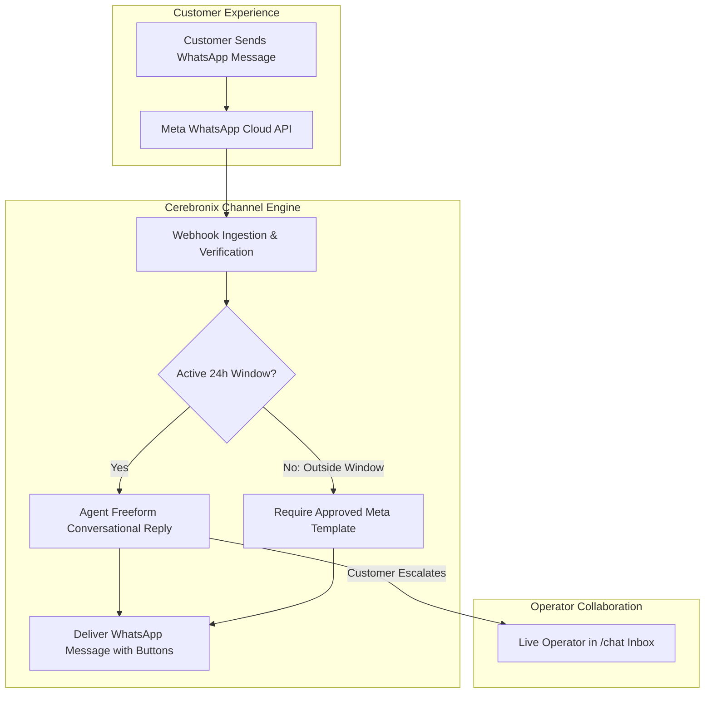

import { Callout } from 'fumadocs-ui/components/callout';
import { Steps } from 'fumadocs-ui/components/steps';
import { Tab, Tabs } from 'fumadocs-ui/components/tabs';

WhatsApp is the world's most popular messaging application, making it the premier channel for conversational commerce, customer care, and order updates. Cerebronix integrates directly with the official **Meta WhatsApp Business Cloud API**, enabling enterprise AI agents to hold natural conversations, send interactive buttons, and escalate complex threads to human operators.

This guide provides complete instructions for WhatsApp Business onboarding, WABA registration, 24-hour customer-service session management, message template approvals, and broadcast campaigns.



---

## What WhatsApp Business Enables

- **Direct Mobile Commerce**: Customers browse products, check order statuses, and ask sizing questions on their personal WhatsApp.
- **Rich Media & Interactive Elements**: Support for product images, PDF invoices, Quick Reply action buttons, and Call-to-Action URL buttons.
- **24-Hour Customer Care Sessions**: Freeform automated AI conversation during active customer-initiated messaging sessions.
- **Outbound Message Templates**: Re-engage inactive customers or send critical transactional alerts using pre-approved Meta templates.
- **Multi-Agent Shared Number**: Multiple departments can share a single verified WhatsApp phone number with automated intent classification.

---

## Prerequisites and Meta Requirements

Connecting WhatsApp requires compliance with Meta Business policies:

1. **Meta Business Account (WABA)**: An active Meta Business Manager account with verified business status.
2. **Dedicated Phone Number**: A phone number capable of receiving SMS or voice verification codes that is **not currently registered** on the standard consumer WhatsApp or WhatsApp Business mobile app. (If currently used on a mobile device, delete the account from the app settings first).
3. **Role Permissions**: Cerebronix organization role of `owner` or `admin`.
4. **Subscription Plan**: A Cerebronix plan supporting external messaging channels with positive message credit balances.

---

## Navigation

- **To connect a WhatsApp number**: In the sidebar, click **Channels** (`/channels`) -> **+ Add Inbox** -> select **WhatsApp Business**.
- **To manage message templates**: In the sidebar, click **WhatsApp Templates** (`/whatsAppTemplates`).
- **To monitor conversations**: In the sidebar, click **Chat** (`/chat`).

---

## Step-by-Step Onboarding Workflow

<Steps>
### Step 1: Initiate Meta Embedded Signup
1. Navigate to `/channels/createchannel` and click **WhatsApp Business**.
2. Click **Start WhatsApp Setup**. A Meta OAuth popup will open.
3. Log in with the Facebook account that has administrative rights over your Meta Business Manager.
4. Select or create your **Meta Business Account** (e.g., *Apex Retail Global LLC*).
5. Select or create your **WhatsApp Business Profile** (e.g., *Apex Support Concierge*).

### Step 2: Register the Phone Number
1. Enter your business phone number and select your verification method (**SMS** or **Voice Call**).
2. Enter the 6-digit one-time code received on your phone to verify number ownership.
3. Once verified, Meta returns your account to Cerebronix, displaying status **Selection Required** (`CH_SELECTION_REQUIRED`).

### Step 3: Complete WABA PIN Registration
1. In the Cerebronix console, locate your new number under the **Required Selection** banner.
2. Click **Select**. You will be directed to the registration page (`/channels/register/[channelId]`).
3. Enter your **6-Digit WhatsApp Two-Step Verification PIN**. (This PIN protects your number against unauthorized transfer; remember this code).
4. Click **Register Number**.
5. Once complete, the channel status updates to **Active** (`CH_ACTIVE`).

```
+---------------------------------------------------------+
| WhatsApp Two-Step Registration                          |
| Enter the 6-digit PIN to activate your business line.   |
|                                                         |
| PIN: [ • • • • • • ]                                    |
|                                                         |
| [Cancel]                                    [Register]  |
+---------------------------------------------------------+
```

### Step 4: Bind an AI Agent to WhatsApp
1. In the sidebar, click **AI Agents** (`/agents`).
2. Select your designated agent (e.g., *Apex Shopping Concierge*).
3. Under **Channel Bindings**, check the box next to your new WhatsApp Business line.
4. Click **Save Bindings**.
</Steps>

---

## The 24-Hour Customer-Service Window

Meta strictly enforces the **24-Hour Customer Care Window** to protect WhatsApp users from unsolicited messaging:

| Scenario | Allowed Message Types | Cost Model |
| :--- | :--- | :--- |
| **Customer Initiates Message** (Within 24 Hours) | **Freeform Conversational AI Replies**: Any text, markdown, catalog recommendation, or operator message. | Standard user-initiated service conversation rate. |
| **Outside 24-Hour Window** (User Inactive &gt; 24h) | **Approved Message Templates ONLY**: Freeform messages are rejected by Meta with error `131047`. | Business-initiated conversation rate based on template category. |

<Callout type="warn">
**Never Attempt Freeform Messages Outside 24 Hours**: Once a customer session expires (24 hours after their last inbound message), automated AI freeform responses will fail. To restart the conversation, you must send an approved Meta Message Template.
</Callout>

---

## WhatsApp Message Templates

To initiate conversations or send notifications outside the 24-hour window, you must submit structured **Message Templates** to Meta for approval.

### Template Categories
1. **Utility**: Critical operational notifications (e.g., order confirmations, shipping updates, appointment reminders).
2. **Marketing**: Promotional offers, seasonal discounts, re-engagement announcements, and product drop alerts.
3. **Authentication**: One-time passcodes and account verification codes.

### Authoring Templates in Cerebronix
1. Navigate to **WhatsApp Templates** (`/whatsAppTemplates`) and click **+ Create Template**.
2. **Name**: Lowercase alphanumeric string with underscores (e.g., `order_shipped_v1`).
3. **Category**: Select `UTILITY` or `MARKETING`.
4. **Language**: Select target language (e.g., `en_US`).
5. **Body**: Enter the message text with numbered dynamic placeholders:
   ```text
   Hi {{1}}, your Apex Retail Global order #{{2}} has shipped via {{3}}! 
   Track your delivery here: {{4}}
   ```
6. **Buttons**:
   - **Quick Replies**: Up to 3 pre-configured reply chips (e.g., *"Track Shipment"*, *"View Receipt"*).
   - **Call-to-Action**: Direct URL button or click-to-call phone number.
7. Click **Submit to Meta**. Meta typically approves utility templates within 5 minutes (marketing templates may take 1–2 hours).

---

## Broadcast Campaigns and Messaging Governance

Cerebronix enables organizations to run targeted WhatsApp broadcasts to customers who have provided explicit marketing consent:

<Callout type="important">
**Consent Requirements**: Meta requires verifiable, affirmative customer opt-in (e.g., a website checkbox during checkout: *"Receive order updates and offers via WhatsApp"*) before sending outbound marketing templates. Unsolicited broadcasts will degrade your Meta Quality Rating and result in phone number tier restrictions.
</Callout>

### Meta Messaging Limits & Quality Ratings
Meta dynamically scales outbound business-initiated messaging capacity based on phone number status, business verification, and recipient quality ratings:
- **Rolling Messaging Capacity**: Newly registered business numbers begin with standard initial daily limits (typically 250 to 1,000 unique business-initiated conversations per rolling 24-hour period).
- **Dynamic Tier Scaling**: As your business reaches its rolling limit while maintaining a `HIGH` quality rating, Meta automatically increases your messaging capacity (scaling progressively to 10k, 100k, and unlimited conversations).
- **Quality Rating Safeguards**: If recipients frequently block messages or report spam, Meta lowers the phone number status to `FLAGGED` or restricts the messaging limit. Maintaining explicit opt-in and offering clear opt-out commands (e.g. "Reply STOP to unsubscribe") is mandatory.

---

## Concrete Example: Apex Retail Global

Apex Retail Global operates its verified WhatsApp line (`+1-800-555-APEX`) with the following architecture:

| Component | Configuration | Operational Function |
| :--- | :--- | :--- |
| **Bound Agent** | `Apex Shopping Concierge` | Handles product sizing, store locations, and order status lookups. |
| **Customer Care Window** | Active 24-hour conversational mode | Shoppers receive instant catalog recommendations with images and pricing. |
| **Outbound Template** | `delivery_update_utility` | Notifies customer when parcel is out for delivery; includes Quick Reply: *"Contact Support"*. |
| **Human Escalation** | `notifyOnHandoff = true` | Alerts on-call agents in `/chat` when customers request human assistance. |

---

## Testing Inbound and Outbound WhatsApp Messages

1. Using a personal smartphone, send a WhatsApp message to your verified business line:
   ```text
   Hello! Do you have the Apex Trail Runner in stock?
   ```
2. **Verify AI Reply**: Within 2–3 seconds, the agent should reply on WhatsApp with exact catalog availability and a link to view the shoe.
3. **Verify Operator Visibility**: Open `/chat` in your Cerebronix console. The conversation thread will appear under **Active Conversations** with the WhatsApp icon badge and the customer's phone number.
4. **Test Operator Takeover**: Click **Take Over Conversation** in `/chat`, type a manual reply, and confirm it arrives on your smartphone.

---

## Common Failures and Troubleshooting

<Callout type="warn">
**Meta Quality Rating Warnings**: If customers frequently tap "Block" or "Report Spam", Meta degrades your number rating to `LOW`. Check **Channels > [Your WhatsApp Line]** for quality rating warnings.
</Callout>

### 1. Message Fails with Error 131047 ("Re-engagement Message")
- **Root Cause**: The 24-hour customer care window expired, and the agent or operator attempted to send a freeform message instead of an approved template.
- **Resolution**: Use an approved Utility or Marketing Message Template to prompt the customer to reply. Once the customer replies, the 24-hour freeform window reopens.

### 2. Status Shows "Selection Required" After Meta Auth
- **Root Cause**: The Meta Embedded Signup flow completed, but the 6-digit WABA registration PIN has not yet been submitted in Cerebronix.
- **Resolution**: Click **Select** on the channel in `/channels`, enter your 6-digit PIN, and click **Register Number**.

### 3. Number Already Registered on WhatsApp
- **Root Cause**: The phone number is currently active on a physical phone using the standard WhatsApp mobile app.
- **Resolution**: Open the WhatsApp app on the mobile device, navigate to **Settings > Account > Delete My Account**, confirm deletion, and re-run the Cerebronix registration flow.

---

## Related Guides

- [Communication Channels: Overview & Routing](/docs/channels/overview-and-routing)
- [Website AI Chat Widget](/docs/channels/website-chat-widget)
- [AI Agents: System Prompts and Behavioral Instructions](/docs/ai-agents/system-prompts-and-instructions)
- [Core Concepts: Human in the Loop & Escalation](/docs/concepts/human-in-the-loop)
