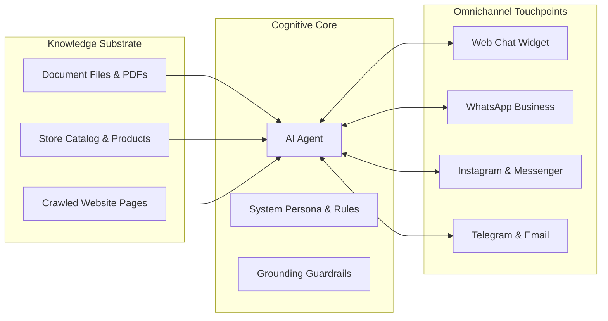
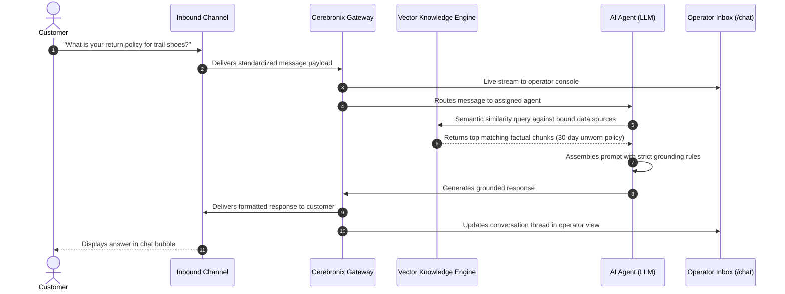
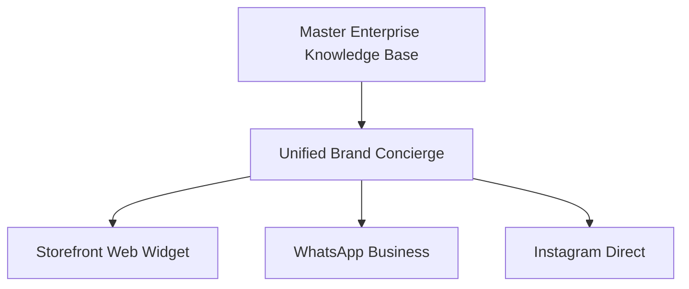
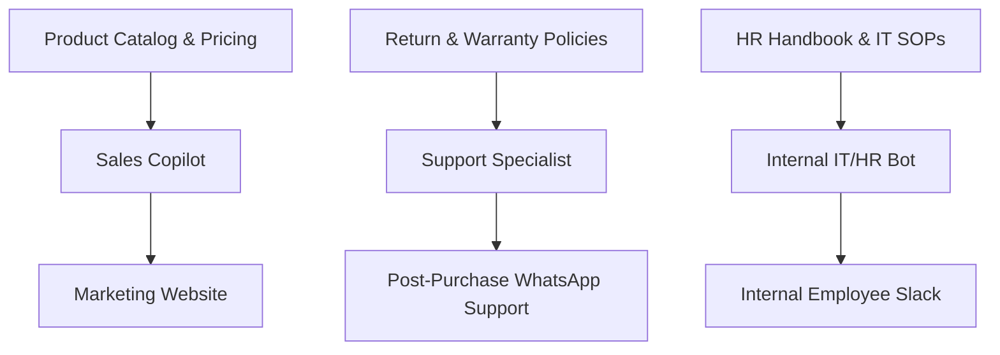

import { Callout } from 'fumadocs-ui/components/callout';
import { CrossLink } from '@cerebronix/docs-ui';

At the heart of Cerebronix is an elegant, decoupled architectural triad: **Knowledge Data Sources**, **AI Agents**, and **Communication Channels**. Understanding how these three entities interact is essential for designing scalable, brand-aligned automated experiences.

---

## 1. Knowledge Data Sources (What the Agent Knows)

A **Knowledge Data Source** represents a structured or unstructured repository of enterprise facts. In Cerebronix, data sources are decoupled from agents, meaning a single knowledge base can be shared across multiple agents, or an agent can aggregate knowledge across multiple distinct sources.

### Ingestion & Processing

When content is uploaded or connected to Cerebronix:
1. **Extraction:** Documents (PDFs, Word docs, spreadsheets) or crawled websites are parsed and stripped of irrelevant formatting.
2. **Semantic Chunking:** Text is partitioned into contextual fragments designed to fit optimal retrieval context windows.
3. **Vector Embeddings:** Each chunk is converted into high-dimensional vector representations capturing semantic meaning.
4. **Lifecycle States:** Data sources progress through clearly tracked states: `Pending` &rarr; `In Progress` &rarr; `Success` (or `Failure` if parsing issues arise).

---

## 2. AI Agents (The Cognitive Core)

An **AI Agent** is the intelligent decision-maker. It is not simply an LLM prompt; it is a configured system encompassing:

- **System Persona & Behavioral Rules:** Defines who the agent represents (e.g., *Apex Shopping Concierge*), how it greets customers, and what conversational tone it maintains.
- **Strict Grounding Guardrails (`strictKbOnly`):** When enabled, Cerebronix constrains the agent to answer strictly using retrieved factual chunks from its bound data sources. If a user asks a question not addressed in the knowledge base, the agent declines gracefully rather than hallucinating.
- **Knowledge Associations:** A explicit list of data source IDs the agent has permission to search.
- **Channel Routing:** An explicit list of messaging channels where the agent is authorized to speak.
- **Tool Bindings:** External integrations (such as looking up order status in a store or invoking an external webhook).

---

## 3. Communication Channels (Where the Customer Speaks)

A **Communication Channel** is the customer-facing interface where conversations take place. Channels isolate the complexities of external protocols (webhooks, WebSocket connections, OAuth handshakes, and third-party rate limits) from the agent logic.

Cerebronix natively supports 10 enterprise channels:
- **Web Chat Widget:** Lightweight, first-party cookie-free widget embedded via HTML snippet.
- **Meta Suite:** WhatsApp Cloud API, Instagram Direct Messaging, Facebook Messenger.
- **Team & Workspace Tools:** Slack, Discord, Microsoft Teams.
- **Direct Messaging:** Telegram Bot API, Gmail / Google Workspace Email.
- **CRM Sync:** HubSpot Conversations two-way synchronization.

---

## The End-to-End Execution Flow

When a customer sends a message into any channel, Cerebronix executes a coordinated lifecycle:

---

## Architectural Topologies

Because knowledge sources, agents, and channels are independently configured, you can build several architectural topologies:

### Topology A: Single Multi-Channel Agent (1:Many)

A single agent with unified instructions serves customers across web, WhatsApp, and social media, ensuring identical brand answers regardless of channel.

### Topology B: Specialized Multi-Agent Hub (Many:Many)

Specialized agents with tailored knowledge and security boundaries operate on their respective dedicated channels.

---

## Summary of Relationships

| Component | Can Belong to Multiple Agents? | Can Exist Without the Others? |
| :--- | :---: | :--- |
| **Knowledge Data Source** | **Yes** — Multiple agents can read from the same source. | **Yes** — Can be indexed prior to creating an agent. |
| **AI Agent** | **N/A** — Acts as the central binding hub. | **Yes** — But remains inactive until bound to at least one channel. |
| **Communication Channel** | **No** — A channel routes to one designated agent (with fallback policies). | **Yes** — But incoming messages will queue unanswered if unbound. |

---

## Developer Cross-Reference

If you are developing programmatic integrations or headless conversational workflows, explore the Developer Platform:

<CrossLink site="socs" path="/docs/current/agents-and-ask">
  Learn how to interact with agents programmatically via the Public API
</CrossLink>
