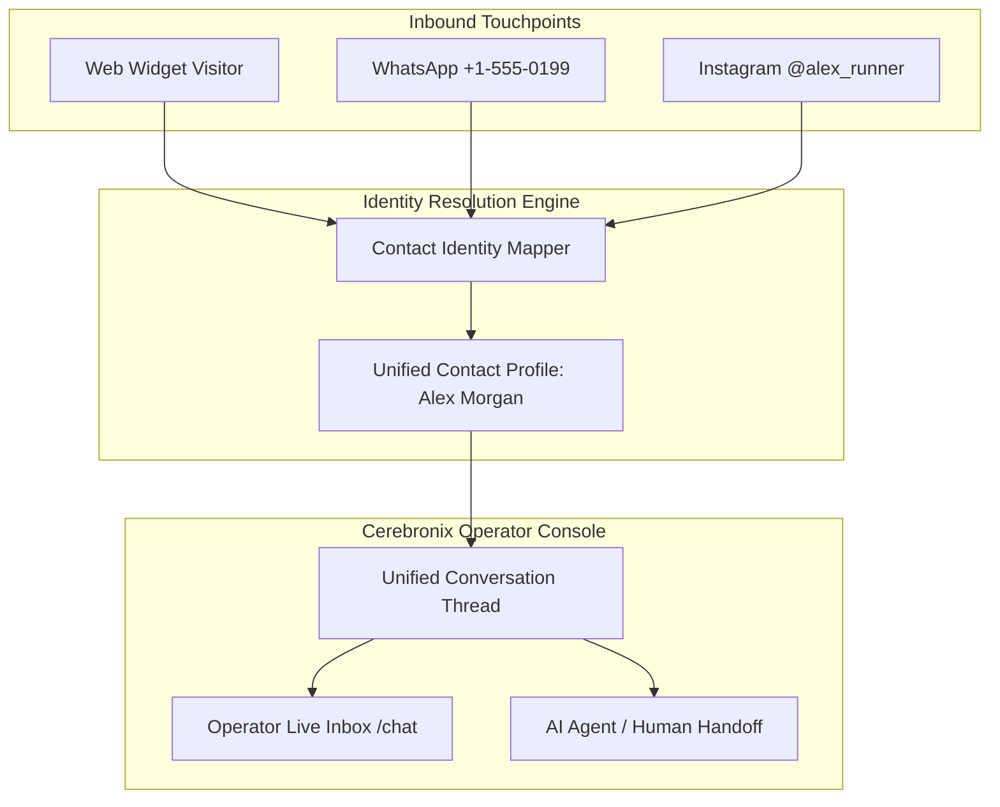

import { Callout } from 'fumadocs-ui/components/callout';
import { CrossLink } from '@cerebronix/docs-ui';

In Cerebronix, a **Conversation** is a continuous, stateful dialogue thread between a customer and your organization. Whether a customer begins an inquiry through your website chat widget, follows up via WhatsApp, or messages your Instagram profile, Cerebronix aggregates these interactions into a unified conversational record.

---

## Omnichannel Threading Architecture

Modern customer interactions rarely happen on a single platform. A customer might browse products on your website, ask questions via the web widget, and later request delivery updates over WhatsApp.

### Identity Resolution & Contact Directory

Cerebronix maintains an automated contact directory under **Contacts** (`/inboxContacts`):
- **Web Widget Visitors:** Identified initially by a secure, first-party visitor token stored in the browser's local storage.
- **Phone Channels (WhatsApp, Telegram):** Identified by E.164 normalized phone numbers (e.g., `+15550199`).
- **Social Channels (Instagram, Messenger):** Identified by platform-scoped user identifiers (PSIDs) or handles.
- **Contact Merging:** When a visitor provides an email address or phone number in chat, Cerebronix links the anonymous web session to their permanent customer record, providing operators with full historical context.

---

## Conversation Lifecycle States

Every conversation in Cerebronix transitions through three standardized operational states:

| Status | Meaning | Operator Action |
| :--- | :--- | :--- |
| **`Open`** | Active dialogue in progress. Messages are actively handled by either the AI Agent or a human operator. | Monitored in the main inbox view. Requires operator intervention if the AI agent is paused. |
| **`Snoozed`** | Conversation placed on hold (e.g., waiting for customer reply, awaiting warehouse confirmation). | Temporarily hidden from the immediate triage queue until the customer responds or a reminder fires. |
| **`Resolved`** | Customer inquiry has been successfully answered and closed. | Thread is archived from active queues. If the customer messages again, a new open session begins linked to the historical archive. |

---

## The 24-Hour Messaging Window (WhatsApp Compliance)

When communicating over official WhatsApp Business channels, Cerebronix strictly adheres to Meta's Business Policy:

1. **Customer-Initiated Window:** When a customer sends a message to your WhatsApp channel, a **24-hour customer service window** opens.
2. **Free-Form Messaging:** During this 24-hour window, your AI Agent and human operators can send unlimited free-form messages, media attachments, and interactive buttons without restriction.
3. **Window Expiration:** If 24 hours elapse without a new message from the customer, the service window closes.
4. **Re-engagement via Approved Templates:** Once closed, free-form text cannot be delivered. To re-engage the customer (e.g., sending an order delivery alert or back-in-stock notification), your team must use an **Approved WhatsApp Message Template** configured under **WhatsApp Templates** (`/whatsAppTemplates`).

<Callout type="info">
  Web Chat Widget channels do not have a 24-hour messaging restriction. Customers can resume existing sessions whenever they return to your website, provided their browser session has not expired.
</Callout>

---

## Message Attribution & Audit Trail

Within both the Operator Inbox (`/chat`) and the Developer Public API, every individual message record preserves full attribution metadata:

- **Sender Type:**
  - `CUSTOMER`: Inbound message from the end user.
  - `AGENT`: Automated response generated by your configured AI Agent.
  - `OPERATOR`: Manual response typed by a logged-in team member.
- **Operator Attribution:** Displays the specific team member's name and avatar when an operator intervenes.
- **Delivery Status:** Real-time tracking through `sent`, `delivered`, and `read` states (supported on WhatsApp and Web Widget).
- **Grounding Metadata:** Logs whether an AI response was synthesized from knowledge sources and references the matching chunk IDs for compliance auditing.

---

## Operator Inbox Features

The Cerebronix **Chat** interface (`/chat`) provides enterprise-grade customer communication management:

- **Channel Filter Pills:** Filter your view to show only WhatsApp, Web Widget, or Instagram conversations.
- **Status Tabs:** Switch between **Open**, **Snoozed**, and **Resolved** queues.
- **Conversation Search:** Search across customer names, phone numbers, email addresses, or message content.
- **Customer Sidebar:** Displays customer custom attributes, recent order history (if an ecommerce store is connected), and channel identity details.
- **One-Click Human Takeover:** Toggle the AI Agent off to take over live, and toggle back on when finished.

---

## Developer Cross-Reference

To inspect, query, or send messages into conversation threads programmatically via our REST API, see the Developer Platform:

<CrossLink site="socs" path="/docs/current/conversations">
  Explore Public Conversation Endpoints & Webhooks
</CrossLink>
