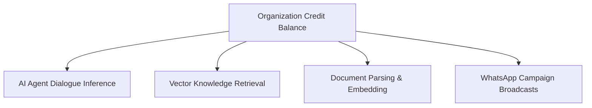

import { Callout } from 'fumadocs-ui/components/callout';
import { CrossLink } from '@cerebronix/docs-ui';

Cerebronix combines predictable subscription plans with a transparent, usage-based **Credit Ledger**. This model ensures you only pay for the computational resources your organization consumes while maintaining clear limits and guardrails against unexpected overages.

This guide explains how credits are metered, how subscription tiers differ, and how plan levels determine access to the Developer Public API.

---

## How Platform Credits Work

Every AI agent interaction, vector similarity search, and document ingestion pipeline consumes platform credits from your organization's centralized balance.



### Consumption Drivers

1. **AI Agent Conversations:** Each conversational turn between a customer and your AI Agent consumes credits based on token count and model complexity.
2. **Vector Retrieval (RAG):** Querying your high-dimensional vector index to ground customer questions consumes search credits.
3. **Knowledge Ingestion:** Parsing uploaded PDFs, spreadsheets, or crawled web pages and generating semantic vector embeddings consumes indexing credits upon upload.
4. **Outbound Messaging:** Sending proactive WhatsApp message templates or broadcast campaigns consumes messaging credits in addition to standard Meta carrier fees.

Your real-time balance and usage history can be reviewed at any time under **Billing** (`/billing`).

---

## Plan Tiers & Capability Entitlements

Cerebronix offers four subscription tiers designed to support organizations from initial prototyping through global enterprise scale:

| Plan | Target Audience | Public API Access | Team Seats | Analytics | Key Features |
| :--- | :--- | :---: | :---: | :---: | :--- |
| **Free Evaluation** | Prototyping & testing | No | 1–2 Seats | Locked | Free evaluation credits, standard web chat widget, document uploads. |
| **Growth** | Growing businesses & brands | **Yes** | 5 Seats | Full Access | Public API access (`cnx_live_`), sentiment analytics, WhatsApp Cloud API, custom branding. |
| **Scale** | High-volume commerce & multi-shift support | **Yes** | 15+ Seats | Advanced | Multi-agent routing, priority vector indexing, auto-recharge rules, phone support. |
| **Enterprise** | Global retailers & custom infrastructure | **Yes** | Custom / Unlimited | Dedicated | Custom SLA, dedicated account manager, custom webhook tools, volume credit discounts. |

---

## The Public API Entitlement Gate

Cerebronix maintains a clear separation between the **Operator Console** and the **Developer Public API**:

<Callout type="warn">
  **Public API Access Requirement:** Minting live developer API keys (`cnx_live_`) and executing automated REST or WebSocket calls against `https://public-api.cerebronix.com` requires a **Growth**, **Scale**, or **Enterprise** plan.
</Callout>

- **On Free Evaluation:** If an account on the Free Evaluation plan attempts to mint an API key or send a request to the Public API, the server returns an HTTP `403 Forbidden` with the error code:
  ```json
  {
    "error": "public_api_disabled",
    "message": "Public API access is available on Growth and higher plans. Upgrade on the Billing page."
  }
  ```
- **Unlocking Access:** Upgrading your workspace to Growth immediately unlocks the Developer page in the console, allowing you to generate bearer tokens and configure automated webhooks.

---

## Credit Top-Ups and Auto-Recharge

To ensure your customer-facing AI agents never go silent during traffic spikes:

- **Top-Up Packs:** Organizations can purchase one-time credit top-up packs directly from **Billing & Credits** (`/billing`).
- **Auto-Recharge Rules:** Administrators can configure an automated threshold rule (e.g., *"When balance falls below 500 credits, automatically recharge with 2,500 credits"*).
- **Grace Period & Depletion Alerts:** When an organization reaches 20% and 5% remaining credit thresholds, automated alerts are sent to the workspace `Owner` and `Admin` emails. If the balance reaches zero, automated AI responses pause, while human operator takeover remains fully accessible.

---

## Developer Cross-Reference

To learn how to authenticate with the Developer Public API and inspect rate limits, visit the Developer Documentation:

<CrossLink site="socs" path="/docs/current/authorization">
  View Developer API Authorization & Entitlements
</CrossLink>
