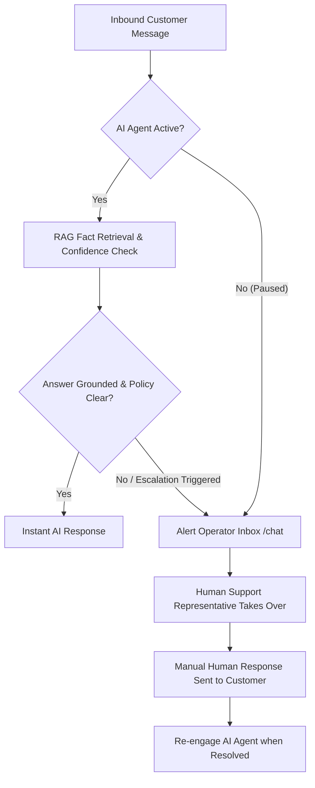

import { Callout } from 'fumadocs-ui/components/callout';

Enterprise customer service is never an "all-or-nothing" choice between 100% human support and 100% automated AI. The most effective customer operations use AI to instantly resolve high-volume, routine inquiries (order tracking, return policies, sizing questions) while seamlessly escalating complex, sensitive, or high-value issues to human team members.

Cerebronix is designed from the ground up for **Human-in-the-Loop (HITL)** collaboration.

---

## The Hybrid Support Model

---

## The Operator Takeover Mechanism

Within the Cerebronix **Chat** interface (`/chat`), every conversation contains an independent, real-time **AI Agent Active** toggle switch.

### 1. Pausing the AI Agent

When an operator opens an active conversation:
1. Locate the **AI Agent Active** toggle in the top-right toolbar.
2. Clicking the toggle changes the status to **Paused**.
3. **Immediate Effect:**
   - The AI Agent stops processing incoming messages for this specific customer thread.
   - Subsequent customer messages are displayed directly in the operator inbox with an alert badge indicating unread customer input.
   - Other conversations in the organization continue running on AI automation without interruption.

### 2. Manual Operator Messaging

With the agent paused:
- The operator types directly in the message composer.
- Rich formatting, file attachments, and direct replies are supported.
- When sent, the message is routed through the customer's active channel (whether Web Widget, WhatsApp, or Instagram) with clear operator attribution.

### 3. Re-engaging the AI Agent

Once the human operator has resolved the customer's specific issue (e.g., manually issuing an exchange or processing a special refund):
1. The operator clicks the toggle back to **Active**.
2. The AI Agent immediately resumes monitoring the thread.
3. If the customer asks a follow-up question later, the AI Agent reads the entire conversation history—including the human operator's messages—to maintain conversational context.

---

## Automated Escalation Triggers

Rather than requiring an operator to manually monitor every thread, Cerebronix supports automated escalation signals:

### 1. Keyword & Intent Escalation

System prompts can be instructed to recognize escalation phrases:
- *"I need to speak to a person"*
- *"Can I talk to a manager?"*
- *"Human agent please"*

When detected, the agent responds with an empathetic transition message:
> *"I understand! Let me connect you with one of our outdoor gear specialists right away. An operator will join this chat shortly."*

### 2. Ungrounded & Low-Confidence Thresholds

When an agent operates under **Strict Knowledge Grounding (`strictKbOnly`)**, inquiries that cannot be verified against the knowledge base are not guessed. The agent explicitly states that the request exceeds its available documentation and flags the conversation for operator triage.

### 3. Sentiment Deterioration

On Growth and Scale plans, Cerebronix continuously analyzes the sentiment of incoming customer messages. If a customer expresses repeated frustration or dissatisfaction, the thread is prioritized in the operator inbox queue.

---

## Operator Role Isolation

To maintain operational security:
- Support agents and contact center representatives should be assigned the **`Viewer`** role in [Team Members](/docs/getting-started/invite-your-team).
- `Viewer` members have full access to:
  - The live Omnichannel Inbox (`/chat`).
  - Conversation history, customer search, and contact profiles.
  - The AI Agent Pause / Takeover toggle.
  - Outbound manual messaging.
- `Viewer` members **cannot** accidentally modify system prompts, delete data sources, alter billing plans, or view sensitive API credentials.

---

## Best Practices for Human-in-the-Loop Workflows

1. **Keep System Prompts Transparent:** Customers appreciate honesty. Have your agent introduce itself as an automated assistant (e.g., *"I'm the Apex Shopping Concierge, an automated assistant for Apex Retail Global"*).
2. **Define Clear Handoff Messages:** Ensure your agent explains what is happening when escalating to a human, setting realistic expectations for wait times.
3. **Instruct Agents to Review Human Context:** Because Cerebronix preserves the full dialogue history, agents will not ask customers to repeat information that was already provided to a human operator earlier in the thread.
4. **Close Conversations Promptly:** Once an inquiry is resolved, mark the conversation as **Resolved**. This keeps your active inbox uncluttered and ensures new customer inquiries open clean sessions.
