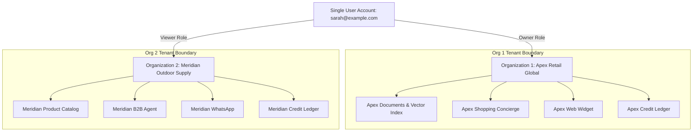

import { Callout } from 'fumadocs-ui/components/callout';
import { CrossLink } from '@cerebronix/docs-ui';

Security and strict data isolation are core principles of the Cerebronix platform. Cerebronix uses a multi-tenant workspace architecture where every **Organization** is an autonomous administrative boundary with its own data sources, AI agents, communication channels, team members, and credit ledgers.

This guide details the organization security model and the granular **Role-Based Access Control (RBAC)** matrix.

---

## Multi-Tenant Workspace Architecture

In Cerebronix:
- **Tenant Isolation:** All indexed knowledge embeddings, customer conversation histories, contact directories, and API keys are strictly partitioned by Organization ID. Data from one organization is never accessible by or commingled with another.
- **Multi-Organization Membership:** A single user account (identified by verified email) can belong to multiple organizations simultaneously (e.g., an agency managing multiple client workspaces, or an enterprise with separate regional brands).
- **Instant Workspace Switching:** Users switch between authorized organizations using the dropdown selector in the top console navigation bar without logging out.

---

## Role Definitions

Cerebronix defines four primary organizational roles:

### 1. Owner
The `owner` is the primary tenant administrator. Usually the founder, executive, or technical lead who created the organization.
- **Key Responsibilities:** Managing subscriptions, entering credit cards, transferring organization ownership, and managing executive team members.
- **Safety Protection:** Cerebronix enforces a hard system check preventing the last remaining `owner` of an organization from being deactivated or downgraded.

### 2. Admin
The `admin` manages day-to-day operations across the workspace.
- **Key Responsibilities:** Inviting and removing team members, configuring AI agents, managing data sources and channels, and reviewing team seat usage.

### 3. Developer
The `developer` role is tailored for technical team members and software engineers.
- **Key Responsibilities:** Authoring system prompts, tuning temperature and creativity sliders, connecting webhook tools, configuring external systems, and generating Public API keys (`cnx_live_`).

### 4. Viewer (Support Operator)
The `viewer` role is specifically designed for frontline customer support specialists, sales representatives, and contact center agents.
- **Key Responsibilities:** Managing conversations in the live **Chat** inbox (`/chat`), executing human operator takeover, answering customer inquiries, and reviewing customer contact profiles.
- **Security Boundary:** Viewers cannot modify agent prompts, delete data sources, alter billing plans, or view sensitive API credentials.

---

## Comprehensive Granular Permission Matrix

| Functional Area | Action / Permission | Owner | Admin | Developer | Viewer |
| :--- | :--- | :---: | :---: | :---: | :---: |
| **Workspace & Settings** | Edit organization name, timezone & currency | Yes | Yes | No | No |
| | Delete organization or transfer ownership | Yes | No | No | No |
| **Billing & Credits** | Subscribe to Growth, Scale, or Enterprise plans | Yes | No | No | No |
| | Add payment cards and download PDF invoices | Yes | View Only | No | No |
| | Purchase credit top-up packs & set auto-recharge | Yes | Yes | No | No |
| **Team Management** | Invite new team members | Yes | Yes | No | No |
| | Modify roles of existing members | Yes | Yes | No | No |
| | Deactivate team members | Yes | Yes | No | No |
| **AI Agents** | Create new agents or select templates | Yes | Yes | Yes | Read Only |
| | Modify system prompts, temperature & guardrails | Yes | Yes | Yes | Read Only |
| | Bind/unbind data sources and channels | Yes | Yes | Yes | Read Only |
| | Use the in-console testing sandbox | Yes | Yes | Yes | Yes |
| **Knowledge Engine** | Upload document files and free-text FAQs | Yes | Yes | Yes | Read Only |
| | Configure website domain crawling & verification | Yes | Yes | Yes | Read Only |
| | Trigger manual re-index or force re-index | Yes | Yes | Yes | Read Only |
| | Delete data sources | Yes | Yes | Yes | No |
| **Communication Channels** | Create web widgets, WhatsApp, or social channels | Yes | Yes | Yes | Read Only |
| | Retrieve embed scripts and configure webhooks | Yes | Yes | Yes | Read Only |
| **Conversations & Inbox** | Access live omnichannel inbox (`/chat`) | Yes | Yes | Yes | Yes |
| | Execute human operator takeover | Yes | Yes | Yes | Yes |
| | Mark conversations as Snoozed or Resolved | Yes | Yes | Yes | Yes |
| | Search and view customer contact profiles | Yes | Yes | Yes | Yes |
| **Ecommerce Engine** | Create products, variants & inventory | Yes | Yes | Yes | Read Only |
| | Manage promotions, discounts & coupon codes | Yes | Yes | Yes | Read Only |
| | View and update customer order fulfillment | Yes | Yes | Yes | Yes |
| **Developer Platform** | Mint and revoke Public API keys (`cnx_live_`) | Yes | Yes | Yes | No |
| | Configure external system webhook dispatch | Yes | Yes | Yes | No |

---

## Organization Commerce & Routing Policies

Under **Organization Settings**, administrators can configure global routing rules:

- **Store Business Hours:** Define your team's operating hours. Outside business hours, AI agents can inform customers when human operators will be available.
- **Unbound Channel Policy:** Dictates what happens when a customer sends a message into a channel that has no assigned agent (e.g., route to a default fallback agent or assign directly to the operator inbox).
- **Base Currency:** Locks the default transaction currency (e.g., `USD`, `EUR`, `CAD`) used for product catalog pricing, checkout links, and order ledgers.

---

## Developer Cross-Reference

To understand how role permissions intersect with Public API OAuth tokens and scopes, see our Developer Documentation:

<CrossLink site="socs" path="/docs/current/authorization">
  Read the Developer Public API Authorization & Scope Guide
</CrossLink>
