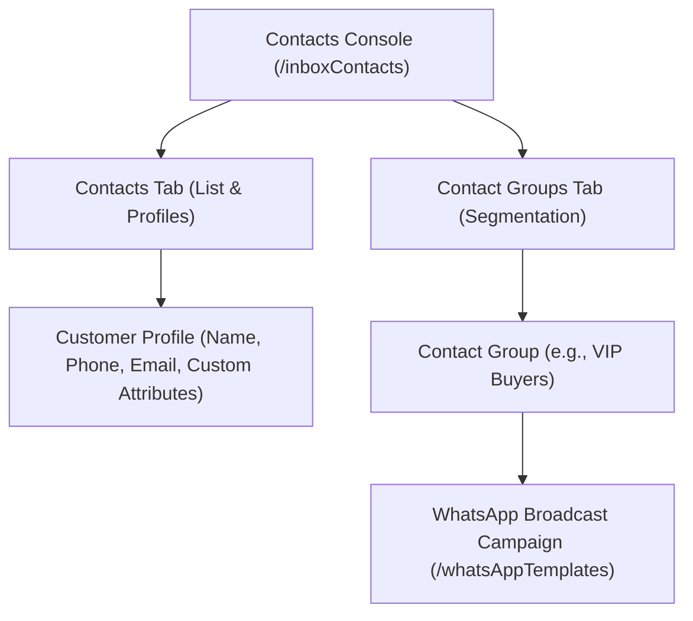
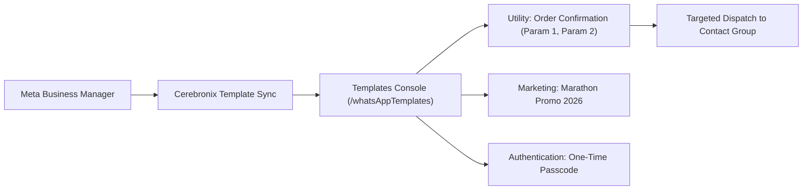

import { Callout } from "fumadocs-ui/components/callout";
import { Tab, Tabs } from "fumadocs-ui/components/tabs";

Cerebronix unites customer interaction history with active audience management. Through the **Contacts** console (`/inboxContacts`) and **WhatsApp Templates** manager (`/whatsAppTemplates`), businesses can maintain persistent customer profiles, segment audiences into targeted groups, and dispatch compliant broadcast messages using pre-approved Meta message templates.

## 1. What the Capability Accomplishes

The Contacts & Campaigns suite enables organizations to:

- **Maintain Centralized Contact Records:** Consolidate customer identities across WhatsApp, Instagram, Telegram, and Web Chat into unified contact profiles.
- **Store Custom CRM Attributes:** Track customer lifetime value, preferred shoe sizes, loyalty tiers, and billing preferences directly on contact cards.
- **Segment Audiences into Contact Groups:** Create targeted groups (e.g., *VIP Marathon Runners*, *Wholesale Accounts*, *EU Summer Shoppers*) for targeted support and communication.
- **Manage Meta-Approved WhatsApp Templates:** Ingest, inspect, and map dynamic variables for pre-approved WhatsApp message templates across Marketing, Utility, and Authentication categories.
- **Execute Compliant Broadcast Campaigns:** Broadcast targeted notifications to segmented contact groups while strictly observing Meta's 24-hour customer care policies.

## 2. Contact Profiles & Audience Segmentation

Navigate to **Contacts** (`/inboxContacts`) in the left navigation menu.



### The Two Contacts Tabs

The Contacts page organizes data into two primary views:
1. **Contacts Tab (`/inboxContacts`):** Comprehensive table of all individual customer identities, showing name, phone number, email, channel origin, and creation timestamp.
2. **Contact Groups Tab (`/inboxContacts?tab=groups`):** Group management interface for organizing contacts into static or dynamic lists. (Note: Direct navigation to `/contactGroups` automatically redirects to `/inboxContacts?tab=groups`).

### Contact Record Fields

Each contact profile includes:
- **Display Name:** Full customer name.
- **Primary Phone Number:** E.164 formatted telephone number (e.g., `+15550198234`).
- **Email Address:** Contact email for receipts and notification fallbacks.
- **Identifier:** System-generated unique identifier linking the contact across all conversation threads.
- **Country:** ISO country code detected from phone number prefix or IP address.
- **Custom Attributes:** Key-value pairs stored on the contact (e.g., `preferred_size: "10"`, `vip_status: "gold"`).

## 3. WhatsApp Message Templates (`/whatsAppTemplates`)

To broadcast outbound messages on WhatsApp outside the standard 24-hour customer service window, Meta requires pre-approved **WhatsApp Message Templates**.

Navigate to **WhatsApp Templates** (`/whatsAppTemplates`) to view connected WhatsApp numbers and their synchronized templates.



### Template Categories

- **Utility Templates:** Transactional notifications, order confirmations, shipping updates, and account alerts. These templates carry the lowest per-message fees from Meta.
- **Marketing Templates:** Promotional broadcasts, seasonal sales alerts, and product recommendations. Requires explicit opt-in from the recipient.
- **Authentication Templates:** Secure one-time password (OTP) verification codes.

### Variable Mapping & Components

Each template consists of:
- **Header:** Optional text, image, or PDF document header.
- **Body:** Message text with numbered variable placeholders (e.g., *"Hello customer_name, your order order_id has shipped!"*).
- **Footer:** Standardized small footer text (e.g., *"Apex Retail Global"*).
- **Interactive Buttons:** Quick reply buttons or call-to-action (CTA) URL buttons (e.g., `Track Package`, `Visit Website`).

## 4. Meta Policy Compliance & Opt-In Safeguards

Meta enforces strict business messaging policies on WhatsApp Business Accounts. Cerebronix incorporates automated compliance safeguards:

- **24-Hour Customer Care Window:** When a customer initiates a message, businesses have a 24-hour service window to reply with freeform conversational AI or operator text.
- **Business-Initiated Template Messages:** Outside the 24-hour window, or to initiate a new outreach, businesses can send pre-approved WhatsApp Message Templates at any time without requiring an active customer care window.
- **Customer Opt-In Requirement:** Under Meta's Business Messaging Policy, marketing and utility templates can only be dispatched to recipients who have explicitly consented to receive WhatsApp updates from your brand.
- **Meta Messaging Tiers & Throughput:** Meta throttles business-initiated template messaging across rolling 24-hour limits based on account history: Tier 1 (1,000 unique customers), Tier 2 (10,000 unique customers), Tier 3 (100,000 unique customers), and Tier 4 (Unlimited). Accounts automatically scale tiers as message volume and quality ratings remain high.
- **Automatic Degradation Safeguard:** If Meta reports phone number quality degradation (status transitions to `Flagged`), Cerebronix automatically pauses scheduled template campaigns to protect your WABA from rate-limiting or account suspension.

## 5. Prerequisites and Plan Restrictions

- **Plan Entitlements:**
  - **Free Evaluation:** Basic contact storage; inbound conversation tracking; template broadcasting not supported.
  - **Growth Plan:** Contact directory; contact groups; WhatsApp template synchronization; broadcast campaigns up to 500 recipients per campaign (`CampaignRecipientCap: 500`).
  - **Scale Plan:** High-throughput broadcasting up to 2,000 recipients per campaign (`CampaignRecipientCap: 2000`); extended audience filtering; contact export.
  - **Enterprise Plan:** Uncapped recipient volume per campaign; custom multi-WABA routing; dedicated account management.
- **Required Roles:** `owner`, `admin`, or `developer` permissions to create contact groups and dispatch WhatsApp broadcast campaigns. `viewer` role can view contacts and template catalogs in read-only mode.

## 6. Step-by-Step Customer Instructions (Apex Retail Global Example)

### Step 1: Create a Customer Contact Profile

1. Navigate to **Contacts** (`/inboxContacts`).
2. Click **New Contact** (`/inboxContacts/create`).
3. Fill in customer details:
   - **Name:** `Sarah Jenkins`
   - **Phone Number:** `+15550198234`
   - **Email:** `sarah.jenkins@example.com`
4. Under **Custom Attributes**, click **Add Attribute**:
   - Key: `running_club`
   - Value: `Austin Distance Runners`
5. Click **Save Contact**.

### Step 2: Create a Contact Group

1. On the **Contacts** page, click the **Groups** tab (`/inboxContacts?tab=groups`).
2. Click **Create Group**.
3. In the modal:
   - **Group Name:** `Apex Marathon Runners VIP`
   - **Description:** `Customers participating in regional marathon training`
4. Click **Save Group**.
5. Select the group and click **Add Members**. Select `Sarah Jenkins` and click **Add to Group**.

### Step 3: Broadcast an Order Shipment Notification Template

1. Navigate to **WhatsApp Templates** (`/whatsAppTemplates`).
2. Select your connected WhatsApp business number: `Apex US (+1 800 555 0199)`.
3. Locate the pre-approved utility template: `apex_order_shipment_v1`.
4. Review the template structure:
   ```text
   Hi {{1}}, your order {{2}} has shipped! Your tracking number is {{3}}.
   ```
5. Click **Send Template**.
6. Select target: **Contact Group** -> `Apex Marathon Runners VIP`.
7. Map template variables:
   - Variable 1 (Name): `Sarah`
   - Variable 2 (Order ID): `ord_01J8K9P4X`
   - Variable 3 (Tracking Number): `SHP-88492014US`
8. Click **Confirm & Send Broadcast**. The message dispatches immediately to all group members.

## 7. Expected Results & Verification

Verify contact and campaign execution:

1. **Contact Profile Sync:** In `/inboxContacts`, search for `Sarah Jenkins`. Click the record and verify that her profile reflects her telephone number, email, and custom attributes.
2. **WhatsApp Delivery Verification:** Verify on the recipient's phone that the template delivered with all variables dynamically substituted:
   ```text
   Hi Sarah, your order ord_01J8K9P4X has shipped! Your tracking number is SHP-88492014US.
   ```
3. **Inbox Thread Sync:** Open `/chat`. The dispatched WhatsApp broadcast appears as an outbound message in the customer's chat thread, creating a complete audit history.

## 8. Common Problems and Troubleshooting

### Issue: WhatsApp Template Dispatch Fails with "Template Paused by Meta"
- **Root Cause:** Customer feedback or low open rates caused Meta to temporarily pause the template.
- **Resolution:** Inspect the template status in Meta Business Manager. Revise the message copy to ensure value and clear opt-out instructions, then submit for re-approval.

### Issue: Contact Fails to Receive Broadcast
- **Root Cause:** The phone number is missing an international country code prefix, or the recipient has blocked the WhatsApp business number.
- **Resolution:** Verify that telephone numbers are stored in strict E.164 format (e.g., `+1...` for US, `+44...` for UK, `+91...` for India).

### Issue: CSV Bulk Upload Reports Parsing Errors
- **Root Cause:** Column headers do not match expected format (`name`, `phone`, `email`), or special characters corrupt the text file.
- **Resolution:** Use standard UTF-8 encoding. Ensure telephone numbers contain no spaces, hyphens, or parentheses.

## 9. Relevant Related Guides

- [Unified Omnichannel Inbox](/docs/conversations/overview-and-inbox): Viewing conversation streams from contact records.
- [WhatsApp Business Channel Setup](/docs/channels/whatsapp-business): Connecting your WABA account and Meta Cloud API credentials.
- [Human Takeover & Team Routing](/docs/conversations/human-takeover-and-routing): Taking over live customer inquiries.
- [Analytics & Reporting](/docs/analytics/dashboards-and-metrics): Monitoring message volume and campaign delivery metrics.
