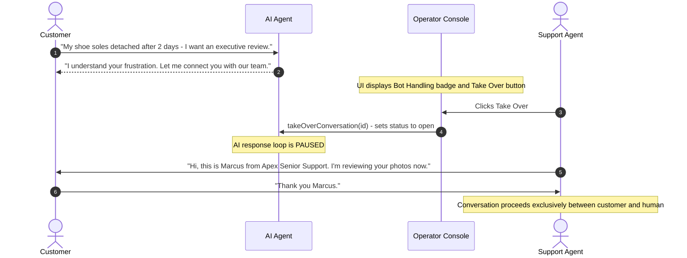
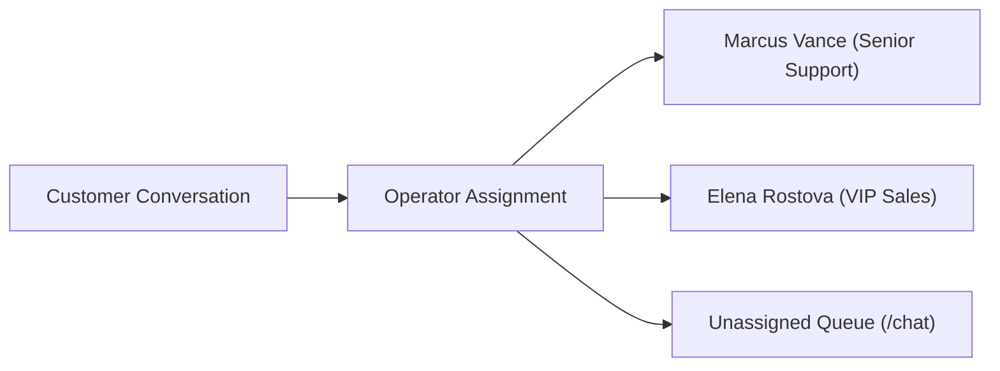

import { Callout } from "fumadocs-ui/components/callout";
import { Tab, Tabs } from "fumadocs-ui/components/tabs";

While Cerebronix AI agents resolve high volumes of routine inquiries autonomously, complex customer situations, high-value sales negotiations, and sensitive disputes require human expertise. Cerebronix provides a seamless human-in-the-loop takeover mechanism that instantly pauses the AI agent, assigns the conversation to a human operator, and equips the team with collaborative triage tools.

## 1. What the Capability Accomplishes

The Human Takeover & Routing system enables organizations to:

- **Intervene with One Click:** Transition conversations from AI control (`Pending`) to human operator control (`Open`) instantly via the **Take Over** button.
- **Pause Automated Agent Responses:** Suspend the AI response loop immediately upon operator takeover, preventing awkward simultaneous messages between human and bot.
- **Assign Operators & Queue Triage:** Route customer conversations to specific support agents and isolate assigned tickets via the `Mine` filter tab.
- **Manage Operational Statuses:** Transition conversations between `Pending`, `Open`, and `Resolved` to reflect real-time ticket lifecycles.
- **Return Conversations to AI:** Hand the conversation back to the automated AI agent once the specialized human interaction concludes.
- **Configure Unbound Channel Handoffs:** Ensure conversations on channels without active AI agents route safely to human operators with optional customer greeting messages.

## 2. Human Takeover Mechanics & Agent Pause Behavior

When an AI agent is handling a conversation, the session state is `pending` with no assigned operator (`status === "pending"` and `!assignee_id`).



### State Transitions During Takeover

1. **Before Takeover (`Pending`):**
   - The conversation card in `/chat` displays a blue `Bot Handling` badge.
   - Any message sent by the customer triggers the AI reasoning and retrieval loop.
   - The center chat header displays an orange **Take Over** action button.
2. **At Takeover (`Open`):**
   - The operator clicks **Take Over**.
   - Cerebronix dispatches `takeOverConversation`, setting `status: "open"` and assigning the active operator's user ID (`assignee_id`).
   - The AI agent's automated message processing is immediately **PAUSED**. Subsequent customer messages wait in the operator queue without automated bot replies.
3. **Returning to AI (`Return to Bot`):**
   - If the operator wishes to restore automated AI assistance, the operator unassigns themselves and resets status to `Pending`.
   - The AI agent resumes monitoring inbound messages.

## 3. Team Assignment & Filter Isolation

### Operator & Team Routing

Operators can reassign conversations to specialized colleagues or departments:
- **Assignee Selection:** Assign the conversation to any teammate in the organization with an `owner`, `admin`, `developer`, or `viewer` role.
- **Filter Isolation:** Teammates can select the `Mine` filter to view only conversations assigned to their user account, or `Unassigned` to pick up newly escalated tickets.



### Conversation Status Management

Support teams manage the dialogue lifecycle across three operational states:
- **Pending (`pending`):** Automated bot handling. Inbound customer messages trigger the AI retrieval and response loop.
- **Open (`open`):** Active human operator intervention. The AI agent is paused, and messages wait for a human response.
- **Resolved (`resolved`):** The inquiry is concluded. If the customer sends a new message later, the conversation reopens in `pending` status for the AI agent to handle.

## 4. Unbound Channel Handoff Architecture

Under **Organization** -> **Settings** (`/organization`), administrators can configure **Unbound Channel Handoff Settings**:

- **The Problem:** If a communication channel (such as a newly connected WhatsApp number) does not have an AI agent bound to it, incoming messages could go unanswered.
- **The Solution:** Cerebronix automatically creates an `open` human conversation in the inbox whenever an unbound channel receives an inquiry.
- **Handoff Message Option:**
  - **Silent Mode (Default):** The conversation is placed in the human inbox without an automated message.
  - **Configured Message Mode:** Cerebronix immediately dispatches a customized greeting (e.g., *"Thank you for contacting Apex Retail Global. Our team will be with you shortly."*) before placing the conversation in the human queue.

## 5. Prerequisites and Plan Restrictions

- **Plan Entitlements:**
  - **Free Evaluation:** Basic human takeover; 1 concurrent operator seat.
  - **Growth Plan:** Operator assignment; unbound channel handoff messaging; up to 10 team seats.
  - **Scale & Enterprise Plans:** Multi-operator workflows; high-throughput inbox handling; extended team seat limits.
- **Required Roles:** `owner`, `admin`, `developer`, or `viewer` permissions to view conversations, take over chats, and respond to customers.

## 6. Step-by-Step Customer Instructions (Apex Retail Global Example)

### Step 1: Intervene in an AI-Fronted Conversation

1. Navigate to **Chat** (`/chat`).
2. In the status filter, select **Pending** to view AI-handled dialogues.
3. Select customer `David Miller` who is inquiring about a delayed international shipment.
4. Review the conversation stream. Notice the banner: `Bot Handling — Customer is currently chatting with Apex Sales Concierge`.
5. In the top action bar, click **Take Over**.
6. The status badge immediately updates from `Pending` to `Open`, and the Take Over banner disappears. The AI agent is now paused.

### Step 2: Assign Teammate and Reply to Customer

1. In the upper-right conversation details panel, click the **Assignee** selector and assign the dialogue to `Marcus Vance`.
2. Marcus navigates to `/chat` and selects the **Mine** filter tab. The conversation is readily accessible.
3. In the message composer, type:
   ```text
   Hi David, I personally checked with our logistics hub. Your parcel cleared customs this morning and will be out for delivery tomorrow.
   ```
4. Click **Send**. The message delivers directly to David's WhatsApp.

### Step 3: Resolve the Conversation or Return to Bot

1. Once the customer's issue is resolved, click the status selector in the conversation panel and select **Resolved** (`status: "resolved"`).
2. The conversation moves to the archived queue. If David messages again in the future, the session automatically re-activates in `Pending` state for automated AI handling.

## 7. Expected Results & Verification

Verify that takeover and routing operate correctly:

1. **AI Silence Check:** After taking over (`status: "open"`), send a follow-up test message from the customer's phone: *"When tomorrow?"*
   - *Expected Behavior:* The AI agent does **not** reply. The message appears in `/chat` awaiting human response.
2. **Assignee Isolation Check:** Filter `/chat` by **Mine**. Verify that only conversations assigned to your active account are displayed.
3. **Audit Trail Verification:** In the conversation panel, verify that the assignee badge reflects `Marcus Vance` and status shows `Open`.

## 8. Common Problems and Troubleshooting

### Issue: Operator Clicks "Take Over" but Receives an Error
- **Root Cause:** Insufficient role permissions or the conversation was closed/resolved by another user simultaneously.
- **Resolution:** Verify that your account has an authorized role (`owner`, `admin`, `developer`, or `viewer`) in `/team-members`. Refresh the page to synchronize conversation state.

### Issue: AI Continues Responding After Operator Sends a Message
- **Root Cause:** The operator typed a message without clicking **Take Over**, and the backend integration did not auto-transition status from `pending` to `open`.
- **Resolution:** Always click the **Take Over** button explicitly before messaging to ensure the AI loop pause signal is dispatched.

## 9. Relevant Related Guides

- [Unified Omnichannel Inbox](/docs/conversations/overview-and-inbox): Navigation, filters, and conversation lifecycles.
- [Organization Settings & Team Roles](/docs/admin-and-billing/organization-and-team): Team member invitations, RBAC roles, and seats.
- [AI Agents Overview & Templates](/docs/ai-agents/overview-and-templates): Configuring agent instructions and automated behaviors.
- [Analytics & Reporting](/docs/analytics/dashboards-and-metrics): Measuring human intervention and resolution rates.
