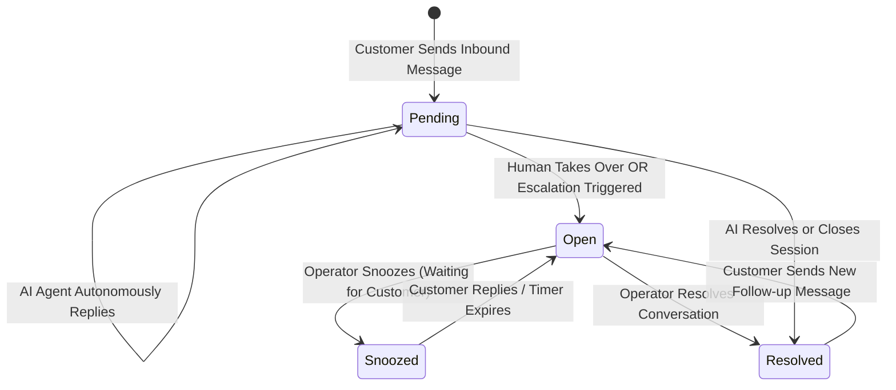
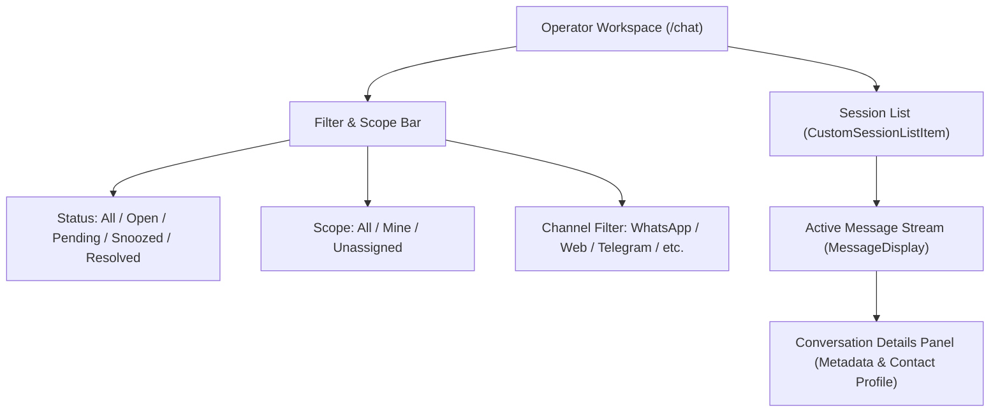

import { Callout } from "fumadocs-ui/components/callout";
import { Tab, Tabs } from "fumadocs-ui/components/tabs";

The Cerebronix Operator Inbox (`/chat`) provides customer support and sales teams with a unified, real-time workspace for managing omnichannel interactions. Whether customer inquiries originate on WhatsApp, Instagram, Telegram, Slack, Discord, Microsoft Teams, or the Website Chat Widget, operators monitor and manage all conversations from a centralized console.

## 1. What the Capability Accomplishes

The Unified Omnichannel Inbox enables organizations to:

- **Consolidate Customer Streams:** Eliminate fragmented browser tabs by routing messaging channels into a single operational interface.
- **Identify Channel Origin Instantly:** Visually distinguish whether a customer is chatting from WhatsApp, Instagram Direct, Telegram, or Web Chat via color-coded badges and icons.
- **Track Conversation Lifecycles:** Monitor the progression of conversations across standardized statuses: `Pending` (AI handling), `Open` (human operator active), `Snoozed` (waiting for customer), and `Resolved`.
- **Search & Filter at Scale:** Filter dialogues by status, assigned inbox, customer identity, or assigned operator to maintain rigorous service-level agreements (SLAs).
- **Inspect Rich Customer Metadata:** View customer phone numbers, emails, country origins, session identifiers, and custom CRM attributes in a slide-out conversation details panel.

## 2. Conversation Lifecycle & State Progression

Every conversation in Cerebronix moves through a structured state machine:

### Lifecycle Status Definitions

- **`Pending` (Bot Handling):** The conversation is actively fronted by an AI agent with no human operator assigned (`status: "pending"` and `!assignee_id`). In this state, the agent evaluates incoming messages, retrieves knowledge, and generates automated replies.
- **`Open` (Human Handling):** An operator has clicked **Take Over** or the AI agent initiated a human escalation. The automated agent loop is paused, allowing the operator to reply directly.
- **`Snoozed`:** Temporarily muted while awaiting additional customer information or external action. If the customer sends a new message, the conversation automatically reopens to `Open`.
- **`Resolved`:** The customer's inquiry has been addressed. The thread is archived from active inbox views. If the customer reaches out again, the thread reopens based on channel session retention rules.

## 3. Inbox Navigation, Filters & Search

Navigate to **Chat** (`/chat`) in the left sidebar to access the operator workspace.

### Filtering Capabilities

The inbox header includes multidimensional filtering controls:
- **Status Filter:** Select between `All`, `Open`, `Pending` (Bot Handling), `Snoozed`, and `Resolved`.
- **Conversation Scope:** Toggle between `All Conversations`, `Assigned to Me` (Mine), and `Unassigned`.
- **Channel / Inbox Filter:** Filter messages to a specific channel (e.g., *Apex US WhatsApp Support* or *Apex UK Web Widget*).
- **Real-Time Text Search:** Instantly search by customer name, phone number (`+1...`), email address, or conversation ID.

## 4. Conversation Details Panel

Clicking the info icon on any active dialogue opens the slide-out **Conversation Details Panel**:

- **Contact Profile:** Displays the customer's display name, avatar initials, telephone number, email, and ISO country badge.
- **Channel Metadata:** Channel icon, descriptive provider title (e.g., *WhatsApp Business Cloud*, *Instagram Direct Messaging*, *Telegram Bot*), and channel type badge.
- **Session Identification:** Conversation ID and Contact ID for audit tracking and cross-system correlation.
- **Quick Actions:** One-click copy buttons for telephone and email, and the **Take Over** button if currently handled by an AI agent.

## 5. Prerequisites and Plan Restrictions

- **Plan Entitlements:**
  - **Free Evaluation:** Omnichannel inbox view; up to 100 historical conversation retention; basic text search.
  - **Growth Plan:** Full status filtering (`pending`, `open`, `snoozed`, `resolved`); unlimited conversation history; operator assignments.
  - **Scale & Enterprise Plans:** Multi-inbox routing; custom SLA filters; priority real-time WebSocket syncing; audit export logs.
- **Required Roles:** `owner`, `admin`, `developer`, or `viewer` permissions to view the inbox and participate in customer conversations.

## 6. Step-by-Step Customer Instructions (Apex Retail Global Example)

### Step 1: Filter for Bot-Handled Inquiries

1. Open the Cerebronix console and click **Chat** (`/chat`) in the navigation bar.
2. In the inbox filter dropdown, select **Status** -> **Pending** (`statusFilter: "pending"`).
3. The conversation list filters to display all threads currently handled autonomously by the AI agent (`Apex Sales Concierge`).
4. Notice that each pending card displays a `Bot Handling` badge indicating that AI is responding to the customer.

### Step 2: Search for a Specific Customer

1. In the search input at the top of the conversation list, enter `Sarah Jenkins` (or her phone number `+15550198234`).
2. The list instantly filters to matching customer sessions across all connected channels.
3. Click the conversation to load the live message thread in the center pane.

### Step 3: Inspect Customer Origin & Metadata

1. Review the conversation header to confirm the channel badge (e.g., green `WhatsApp Business Cloud` badge).
2. Click the **Details** button in the upper-right corner of the chat pane.
3. The **Conversation Details Panel** opens on the right side:
   - Verify customer phone: `+1 (555) 019-8234`
   - Verify country tag: `US`
   - Verify Contact ID: `#cust_882`

## 7. Expected Results & Verification

Verify that your omnichannel inbox reflects live conversation states:

1. **Inbound Test Message:** Send a test WhatsApp message from a mobile device: *"Hi Apex, do you ship to Canada?"*
2. **Real-Time Ingestion:** Within 1 second, the message appears in `/chat` with a `Pending` status and `WhatsApp Business Cloud` icon.
3. **AI Autonomous Reply:** The AI agent responds automatically with shipping policy details. The thread remains in `Pending`.
4. **Status Filter Verification:** Switch the status filter to `Open`. The conversation disappears from the view, confirming it is correctly isolated under `Pending`.

## 8. Common Problems and Troubleshooting

### Issue: New Messages Do Not Appear in Real Time
- **Root Cause:** WebSocket connection interrupted or browser tab lost authentication state.
- **Resolution:** Check your network connection. A page refresh re-authenticates the session and reconnects the WebSocket event stream.

### Issue: Customer Phone Numbers Display as "Not Available"
- **Root Cause:** The channel (e.g., Web Chat Widget or Telegram) does not mandate phone number entry upon session creation.
- **Resolution:** Telegram identifies users via usernames; Web Chat identifies users via session tokens. If phone numbers are required, configure a pre-chat form on the Web Chat Widget under `/channels`.

### Issue: Resolved Conversations Cluttering the Inbox
- **Root Cause:** The status filter is set to `All`.
- **Resolution:** Set the status filter to `Open` or `Pending` to hide completed threads from active operator views.

## 9. Relevant Related Guides

- [Human Takeover & Agent Routing](/docs/conversations/human-takeover-and-routing): Taking over conversations from AI and assigning operators.
- [Contact Management & WhatsApp Campaigns](/docs/conversations/contacts-and-campaigns): Customer profiles, segmentation groups, and template broadcasts.
- [Communication Channels Overview](/docs/channels/overview-and-routing): Setting up channel inboxes and webhook routing.
- [Analytics & Operational Reporting](/docs/analytics/dashboards-and-metrics): Tracking conversation volume and resolution metrics.
