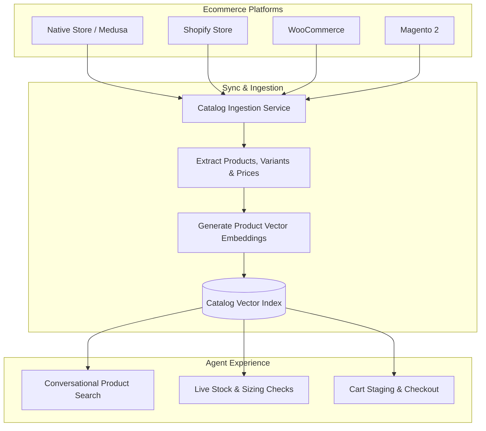

import { Callout } from 'fumadocs-ui/components/callout';
import { Steps } from 'fumadocs-ui/components/steps';
import { Tab, Tabs } from 'fumadocs-ui/components/tabs';

For retail and consumer brands, the product catalog is the most critical knowledge source. When an ecommerce catalog is synchronized with Cerebronix, AI agents can answer inventory questions, recommend complementary products, check size availability, and assist customers through checkout.

This guide explains how to connect and synchronize catalogs from Cerebronix Native Store, Shopify, WooCommerce, and Magento, and how catalog vectors are indexed for conversational search.



---

## Supported Ecommerce Platforms

Cerebronix provides native connectors for leading global commerce engines:

| Platform | Integration Method | Synchronized Fields | Real-Time Sync Support |
| :--- | :--- | :--- | :--- |
| **Native Store** | Built-in Medusa engine | Titles, handles, descriptions, collections, variants, prices, inventory levels, media. | Instant internal database sync. |
| **Shopify** | OAuth App Installation | Products, options, variant SKUs, inventory status, prices, collection taxonomy. | Webhook-driven incremental updates. |
| **WooCommerce** | REST API (v3) Credentials | Product titles, short descriptions, categories, attributes, variations, stock status. | Webhook & periodic poll. |
| **Magento 2** | REST API Bearer Token | Catalog products, configurable attributes, categories, tier pricing, inventory. | Scheduled batch & on-demand sync. |

---

## Prerequisites and Permissions

1. **Role Permissions**: Organization role of `owner` or `admin`. Developers can initiate manual catalog re-indexing.
2. **Active Integration**: The target store must first be connected under **Integrations** (`/integrations`).
3. **Published Products**: Only active, published products are indexed. Draft, archived, or hidden items are automatically excluded.

---

## Navigation

To create and manage an ecommerce catalog data source:

1. Log in to the Cerebronix SaaS console.
2. In the left navigation sidebar, click **Knowledge Engine** (`/datasources`).
3. Click **+ Add Data Source**.
4. In the source type selection modal, locate the **Ecommerce** section and select your connected store platform.

---

## Step-by-Step Configuration

<Steps>
### Step 1: Connect the Ecommerce Platform in Integrations
If you haven't already connected your store:
1. Navigate to **Integrations** (`/integrations`).
2. Locate your platform card (e.g., *Shopify*, *WooCommerce*, or *Native Store*).
3. Complete authentication:
   - **Shopify**: Enter your `.myshopify.com` store domain and approve OAuth permissions.
   - **WooCommerce**: Provide your Store URL, Consumer Key, and Consumer Secret.
   - **Magento**: Enter your Base URL and Integration Access Token.
   - **Native Store**: Integrated automatically with one click.
4. Confirm the integration badge displays `Connected`.

### Step 2: Create the Ecommerce Data Source
1. Navigate to **Knowledge Engine** (`/datasources`) and click **+ Add Data Source**.
2. Select your connected platform tile.
3. If multiple store instances are connected (e.g., separate US and UK Shopify stores), select the specific store instance you wish to index.
4. Provide a descriptive name (e.g., `Apex Retail Global - US Catalog`).

```
+---------------------------------------------------------+
| Connect Ecommerce Catalog                               |
| Selected Platform: Shopify                              |
| Store Instance: Apex Retail US (apex-us.myshopify.com)  |
|                                                         |
| Source Name: Apex Retail Global - US Catalog            |
| Description: Live products, variants, and inventory.    |
|                                                         |
| [Sync Full Catalog]                                     |
+---------------------------------------------------------+
```

### Step 3: Initial Catalog Ingestion
Click **Create Data Source**. The ingestion pipeline begins:
- **Product Normalization**: Formats product titles, descriptions, and tags into structured markdown blocks.
- **Variant Flattening**: Indexes distinct SKU combinations (e.g., *Size 10 / Waterproof / Black*) with real-time stock levels.
- **Collection Tagging**: Attaches collection identifiers to allow scoped category browsing.
- **Status Progression**: The source status transitions from `In Progress` to `Success`.

### Step 4: Bind to AI Agents
To allow agents to access this catalog:
1. Navigate to **AI Agents** (`/agents`) -> select your agent.
2. Under **Knowledge Sources**, check the box for your ecommerce data source and click **Save Bindings**.
3. Under **Ecommerce Integration**, select the corresponding connected store to enable cart actions and checkout features.
</Steps>

---

## Concrete Example: Apex Retail Global

Apex Retail Global connects its primary Native Store catalog:

| Metric / Setting | Value | Customer Impact |
| :--- | :--- | :--- |
| **Total Products Indexed** | 480 active products | All current seasonal apparel, footwear, and equipment are searchable. |
| **Total Variants** | 2,140 SKU variants | Shoppers can ask for specific size, width, and color availability. |
| **Sync Mechanism** | Automatic inventory sync | Out-of-stock items are marked unavailable in real time, preventing failed orders. |
| **Bound Agent** | *Apex Shopping Concierge* | Agent recommends matching socks and accessories based on catalog tags. |

---

## Catalog Synchronization and Freshness

Cerebronix maintains catalog freshness through two complementary mechanisms:

1. **Real-Time Webhooks**: When a product price changes, an item goes out of stock, or a new product is published in your store backend, your platform sends an instant webhook to Cerebronix, updating the vector index within seconds.
2. **Manual Full Re-Index**: If significant batch updates or catalog reorganizations occur, navigate to **Knowledge Engine** (`/datasources`), find your store source, click `...`, and select **Re-index**. This triggers a full reconciliation sweep of all products.

---

## Common Failures and Troubleshooting

<Callout type="warn">
**Store Credential Expiration**: If you rotate API keys in WooCommerce or uninstall the Shopify app, synchronization will fail and mark the data source as `Failure`. Re-authorize the store under **Integrations** to resume synchronization.
</Callout>

### 1. New Products Not Appearing in Agent Recommendations
- **Root Cause**: The product was saved as a draft, or the webhook delivery failed due to network transient errors.
- **Resolution**: Confirm the product is set to `Active / Published` in your store backend. In Cerebronix, open `/datasources` and trigger a manual **Re-index**.

### 2. Discontinued Items Still Being Recommended
- **Root Cause**: The product was archived rather than deleted, and its inventory status remained positive.
- **Resolution**: Set the inventory quantity to 0 or unpublish the product. Trigger a **Re-index** to purge zero-inventory items if your agent is configured to skip out-of-stock variants.

### 3. Agent Confuses Regional Stores
- **Root Cause**: An agent was bound to an EU catalog data source while connected to a US checkout integration.
- **Resolution**: Ensure the bound **Knowledge Source** and the bound **Ecommerce Integration** point to the exact same store instance.

---

## Related Guides

- [Knowledge Engine: Overview and Sources](/docs/data-sources/overview-and-sources)
- [Knowledge Engine: Indexing Lifecycle and Status Management](/docs/data-sources/indexing-lifecycle-and-status)
- [AI Agents: Ecommerce Store Binding](/docs/ai-agents/ecommerce-store-binding)
- [AI Agents: Testing and Troubleshooting](/docs/ai-agents/testing-and-troubleshooting)
