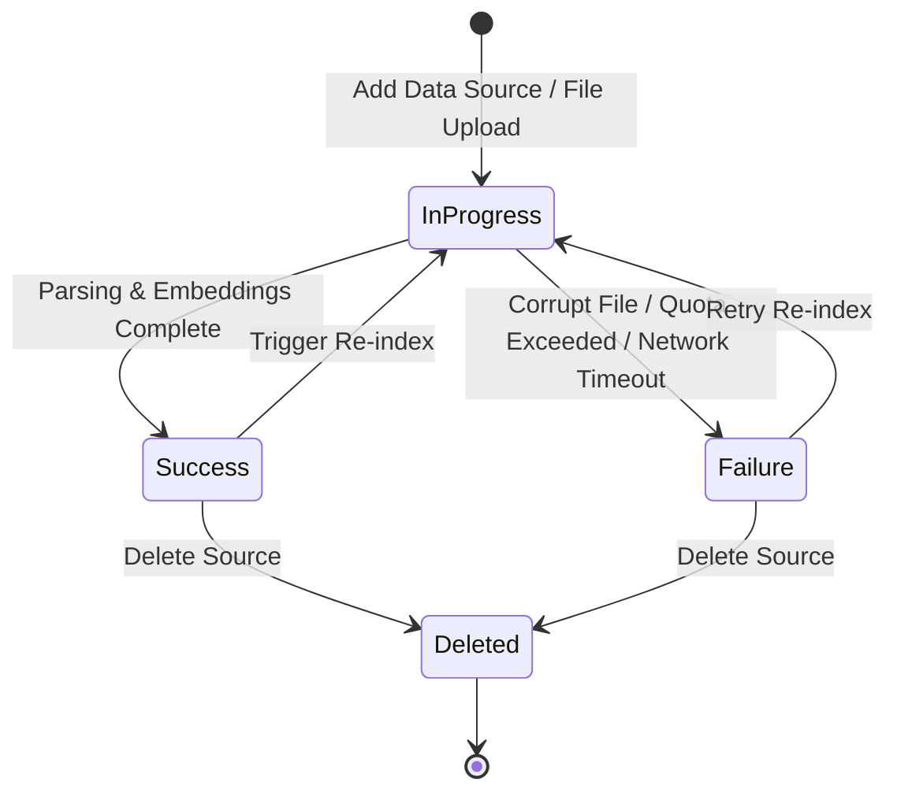

import { Callout } from 'fumadocs-ui/components/callout';
import { Steps } from 'fumadocs-ui/components/steps';
import { Tab, Tabs } from 'fumadocs-ui/components/tabs';

Every document, website crawl, Q&A entry, and catalog synchronized with Cerebronix passes through an automated ingestion and indexing lifecycle. Understanding these lifecycle states enables administrators to monitor ingestion health, trigger updates, and resolve synchronization failures promptly.

This guide explains the indexing lifecycle states, how to trigger manual and full re-indexing, what happens when knowledge sources are deleted, and how plan quotas affect ingestion.



---

## Indexing Status Definitions

In the Cerebronix console, every data source displays a real-time status badge:

| Status Badge | Technical State | Meaning | Live Agent Behavior |
| :--- | :--- | :--- | :--- |
| **In Progress** | `in_progress` | The ingestion worker is actively downloading files, parsing HTML, generating chunks, and computing vector embeddings. | The agent relies on previously indexed vectors until the new index finishes. |
| **Success** | `success` | Ingestion is complete. Vectors are active and searchable across all bound AI agents. | The agent queries the latest updated knowledge base immediately. |
| **Failure** | `failure` | Ingestion was halted due to parsing errors, invalid credentials, or quota depletion. | The agent cannot retrieve data from this source until the error is resolved. |

---

## Prerequisites and Permissions

1. **Role Permissions**: Organization role of `owner`, `admin`, or `developer`. Members with the `viewer` role can view status badges and logs but cannot trigger re-indexing or delete sources.
2. **Sufficient Plan Quotas**: Active subscription with remaining document pages or URL crawl allocations.

---

## Navigation

1. Log in to the Cerebronix SaaS console.
2. In the left navigation sidebar, click **Knowledge Engine** (`/datasources`).
3. The inventory table displays each source's name, type, item count, last synchronized timestamp, and current status badge.

---

## Managing Source Operations

### 1. Manual Re-Indexing (Incremental)
When source files or online web pages change, trigger an incremental re-index:
1. In the **Knowledge Engine** list, find the target source.
2. Click the actions menu (`...`) on the right side of the row.
3. Select **Re-index**.
4. The status badge will change to **In Progress** while the system inspects updated content and replaces modified vector embeddings.

### 2. Full Index Rebuild
If you suspect semantic discrepancies or have made sweeping structural alterations to your website taxonomy:
1. Click the actions menu (`...`) and select **Force Re-index**.
2. Cerebronix purges all existing vector chunks associated with this source ID and reconstructs the index from scratch.
3. During a full rebuild, agents temporarily decline queries requiring this source if **Strict Knowledge-Base Mode** is active.

### 3. Deleting a Knowledge Source
To permanently remove a knowledge source:
1. Click the actions menu (`...`) and select **Delete**.
2. Confirm the deletion prompt.
3. **Cascade Impact**: The source is immediately purged from the vector database and unlinked from all bound AI agents.

<Callout type="warn">
**Agent Behavior After Knowledge Deletion**: If an agent was bound exclusively to the deleted source and has no other knowledge sources attached, it will no longer possess company-specific grounding. Under `strictKbOnly: true`, it will politely decline customer inquiries. Always ensure active agents retain at least one valid knowledge source.
</Callout>

---

## Quota Depletion and Indexing Halts

Each Cerebronix subscription plan includes a specific allowance for indexed pages, documents, and crawling frequencies:

- **Approaching Limit**: When your organization reaches 85% of your plan's document capacity, a yellow warning banner appears on the **Dashboard** and **Knowledge Engine** pages.
- **Quota Depleted**: When 100% capacity is reached, new document uploads and website crawls are blocked, and scheduled re-crawls are paused. In-progress jobs will fail with an `Account Quota Exceeded` error badge.
- **Resolution**: Delete obsolete documents or upgrade your subscription tier under **Settings > Billing & Plans**.

---

## Concrete Example: Apex Retail Global

Apex Retail Global manages seasonal transition for its footwear catalog and policy documents:

```
+--------------------------------------------------------------------------+
| Knowledge Engine                                      [+ Add Data Source] |
+--------------------------------------------------------------------------+
| Name                      | Type      | Pages | Last Synced | Status      |
+---------------------------+-----------+-------+-------------+-------------+
| Apex Global Policies 2026 | FILE      | 14    | 2 hours ago | [✓ Success] |
| Apex Help Center FAQ      | WEBSITE   | 86    | Yesterday   | [✓ Success] |
| Fall Footwear Catalog     | ECOMMERCE | 480   | 10 mins ago | [✓ Success] |
| Summer Loyalty Archive    | FREE_TEXT | 2     | 4 mos ago   | [Delete]    |
+--------------------------------------------------------------------------+
```

1. **Delete**: Apex deletes the obsolete *Summer Loyalty Archive* source to recover quota.
2. **Re-index**: Apex triggers **Re-index** on *Apex Help Center FAQ* following an online policy rewrite.
3. **Verify**: Apex verifies the badge shifts from `In Progress` to `Success` within 3 minutes.

---

## Common Failures and Troubleshooting

<Callout type="warn">
**Inspecting Error Details**: Click on any source showing a red `Failure` badge to view the diagnostic modal, including HTTP status codes, parser error messages, and failed URL traces.
</Callout>

### 1. Ingestion Fails with "Network Timeout (504)"
- **Root Cause**: The external website or ecommerce store took longer than 60 seconds to serve pages to the crawler.
- **Resolution**: Ensure your hosting provider is not throttling crawler requests. Whitelist Cerebronix crawler IPs and re-run the crawl during low-traffic off-peak hours.

### 2. Status Stuck in "In Progress" for Over 30 Minutes
- **Root Cause**: An extraordinarily large PDF (e.g., hundreds of pages of uncompressed high-resolution images) or a circular link loop on a crawled website.
- **Resolution**: Cancel the crawl, inspect your website crawl depth rules, and exclude recursive paths like `/calendar/*` or `/archive/*`.

### 3. Source Shows "Success" but Agent Returns Outdated Information
- **Root Cause**: Semantic response caching (`responseCacheEnabled`) returned a previously cached answer generated before the re-indexing completed.
- **Resolution**: Clear history in the `#test` panel or wait for the cache TTL (1 hour) to expire. Alternatively, disable **Semantic Response Caching** under **Agent Settings > Behavior** while iterating on rapid policy changes.

---

## Related Guides

- [Knowledge Engine: Overview and Sources](/docs/data-sources/overview-and-sources)
- [Knowledge Engine: Document and File Uploads](/docs/data-sources/document-and-file-uploads)
- [Knowledge Engine: Website Crawling and Verification](/docs/data-sources/website-crawling-and-verification)
- [AI Agents: Model Parameters and Guardrails](/docs/ai-agents/model-parameters-and-guardrails)
