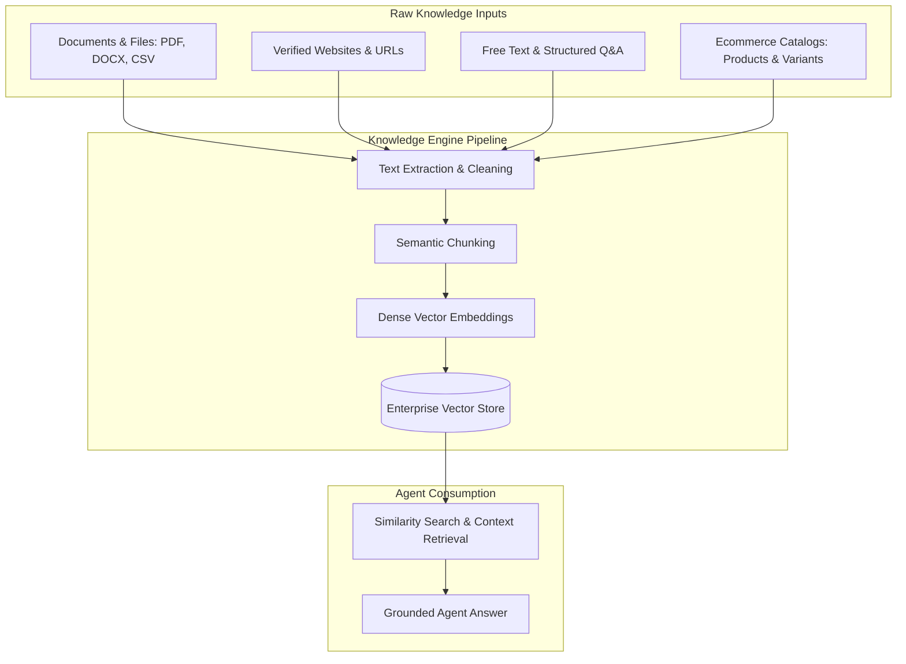

import { Callout } from 'fumadocs-ui/components/callout';
import { Steps } from 'fumadocs-ui/components/steps';
import { Tab, Tabs } from 'fumadocs-ui/components/tabs';

The Cerebronix **Knowledge Engine** serves as the factual brain of your customer-facing AI agents. Rather than relying on generic, potentially outdated model memory, agents query your organization's synchronized knowledge base to deliver accurate, verifiable answers grounded in your business data.

This guide provides an overview of the Knowledge Engine architecture, details currently supported knowledge sources, and clarifies source availability and enterprise prerequisites.

---

## Supported Knowledge Sources

Cerebronix categorizes data sources into fully supported self-serve types, enterprise connector types, and unsupported formats:

| Knowledge Source Type | Ingestion Method | Supported Formats | Update Frequency |
| :--- | :--- | :--- | :--- |
| **Documents & Files** | Direct S3 Upload via Presigned URL | `.pdf`, `.docx`, `.doc`, `.xlsx`, `.xls`, `.csv` | On-demand file upload or replacement. |
| **Verified Websites** | Automated Crawler with domain verification | Public HTTPS web pages and sitemaps | Scheduled crawl or on-demand re-index. |
| **Free Text & Q&A** | Direct Console Input | Markdown text, Question-Answer pairs | Instant upon saving. |
| **Ecommerce Catalogs** | Automated Integration Sync | Cerebronix Native Store, Shopify, WooCommerce, Magento | Automated synchronization and manual re-index. |

### Enterprise Cloud Connectors

<Callout type="warn">
**Enterprise Connector Prerequisites**:
- **Microsoft SharePoint**: Connecting SharePoint requires global Microsoft 365 Tenant Administrator consent and Azure AD App registration. OneDrive is not an independent connector; personal OneDrive accounts are not supported.
- **Google Drive**: Requires Google Workspace domain-wide delegation or enterprise OAuth credentials configured in your Cerebronix environment.
- Cloud connectors that have not completed enterprise security authorization will not synchronize data. Organizations requiring cloud drive synchronization should contact Cerebronix Enterprise Support for assistance.
</Callout>

### Unsupported Formats Notice

<Callout type="info">
**Video & Audio Ingestion**: Video transcription (such as YouTube or Vimeo ingestion) and raw audio processing are currently **not supported** for self-serve RAG indexing. All knowledge ingested into Cerebronix must be provided as text documents, verified website URLs, or structured catalog data.
</Callout>

---

## How Grounding and Retrieval Work

When an agent receives a customer inquiry:

1. **Embedding Generation**: The inquiry is converted into a dense vector embedding representing its semantic intent.
2. **Similarity Search**: The Knowledge Engine scans all knowledge sources bound to the agent, retrieving the top most relevant chunks.
3. **Context Injection**: The retrieved text chunks are injected into the agent's prompt context.
4. **Constrained Generation**: The agent synthesizes an answer strictly from the retrieved evidence. If **Strict Knowledge-Base Mode** is active, the agent declines to answer if the evidence is insufficient, substantially reducing hallucination risk.

---

## Prerequisites and Permissions

To create and manage knowledge sources:

1. **Role Permissions**: Organization role of `owner`, `admin`, or `developer`. Members with the `viewer` role can inspect knowledge sources but cannot upload files, initiate re-crawls, or delete sources.
2. **Available Document Quota**: Your organization must have remaining document pages or URL quotas under your current subscription plan.
3. **Verified Domain Ownership**: For website crawling, you must have administrative access to add a `<meta>` verification tag or upload a `/.well-known/` verification file to the target domain.

---

## Navigation

To access the Knowledge Engine:

1. Log in to the Cerebronix SaaS console.
2. In the left navigation sidebar, click **Knowledge Engine** (`/datasources`).
3. You will see an inventory of all active knowledge sources, their ingestion types, and their current synchronization status (`Success`, `In Progress`, or `Failure`).
4. To create a new source, click **+ Add Data Source**.

---

## Next Steps

Explore the detailed configuration guides for each supported source type:

- [Document and File Uploads](/docs/data-sources/document-and-file-uploads)
- [Website Crawling and Verification](/docs/data-sources/website-crawling-and-verification)
- [Free Text and Q&A](/docs/data-sources/free-text-and-qa)
- [Ecommerce Catalog Sync](/docs/data-sources/ecommerce-catalog-sync)
- [Indexing Lifecycle and Status Management](/docs/data-sources/indexing-lifecycle-and-status)
