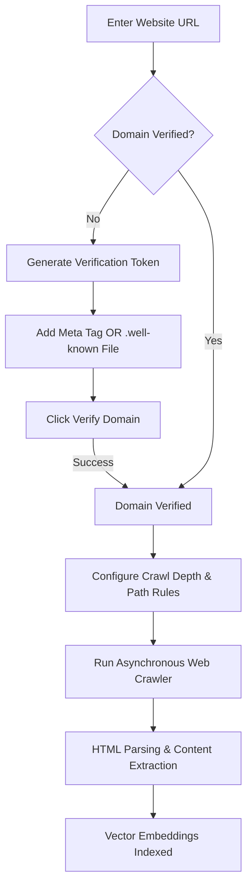

import { Callout } from 'fumadocs-ui/components/callout';
import { Steps } from 'fumadocs-ui/components/steps';
import { Tab, Tabs } from 'fumadocs-ui/components/tabs';

The Cerebronix Website Crawler enables AI agents to index online knowledge bases, help center articles, product documentation, and public company websites. To protect web integrity and prevent unauthorized scraping, Cerebronix requires **mandatory domain verification** before indexing external web domains.

This guide explains how to verify domain ownership, configure crawling rules, manage re-crawl schedules, and troubleshoot crawl errors.



---

## Mandatory Domain Verification

<Callout type="warn">
**Why Domain Verification is Required**: Cerebronix enforces strict domain verification to ensure agents only crawl websites owned or administratively managed by your organization. Attempting to crawl unverified third-party websites without proof of ownership is blocked by the platform.
</Callout>

You can verify your domain using either of two methods:

### Method A: HTML `<meta>` Tag (Recommended for CMS & Storefronts)
Add a unique verification `<meta>` tag to the `<head>` section of your website's home page:
```html
<meta name="cerebronix-site-verification" content="cbx_verify_98214fa7c89e4b2d" />
```

### Method B: `/.well-known/` Verification File (Recommended for Custom Servers)
Host a plaintext file containing your verification token at the standard well-known location on your primary domain:
```text
https://yourdomain.com/.well-known/cerebronix-verification.txt
```

---

## Prerequisites and Permissions

1. **Role Permissions**: Organization role of `owner` or `admin`. Developers can initiate re-crawls on already verified domains.
2. **Administrative Website Access**: Access to modify website HTML `<head>` tags or deploy files to the web server's public root directory.
3. **Publicly Accessible URL**: Target web pages must be reachable over public HTTPS. Internal intranet sites behind enterprise VPNs require custom network configuration.

---

## Navigation

1. Log in to the Cerebronix SaaS console.
2. In the left navigation sidebar, click **Knowledge Engine** (`/datasources`).
3. Click **+ Add Data Source**.
4. In the source type selection modal, select the **Website** option tile.

---

## Step-by-Step Configuration

<Steps>
### Step 1: Enter Domain and Check Verification Status
1. Enter your website URL (e.g., `https://apexretailglobal.com`).
2. If the domain is already verified for your organization, the system proceeds directly to crawl configuration.
3. If the domain is unverified, the console displays your unique **Verification Token** and instructions for Method A and Method B.

### Step 2: Implement and Confirm Verification
1. Add the `<meta>` tag to your website header or upload the `/.well-known/cerebronix-verification.txt` file to your server.
2. Return to the Cerebronix console and click **Verify Domain**.
3. Cerebronix performs an immediate HTTP lookup. Once detected, the domain status changes to a green **Verified** badge.

### Step 3: Configure Crawling Parameters
Define the crawling boundaries to ensure the agent focuses on relevant informational content:
- **Seed URLs**: Add specific starting URLs (e.g., `https://apexretailglobal.com/help`, `https://apexretailglobal.com/policies`).
- **Crawl Depth**:
  - `Level 1`: Crawls only the specified seed pages.
  - `Level 2`: Crawls the seed pages and all pages directly linked from them (recommended for knowledge bases).
  - `Level 3`: Deep recursive crawl across up to three levels of links.
- **Path Include Patterns**: Whitelist specific paths (e.g., `/faq/*`, `/help/*`, `/about/*`).
- **Path Exclude Patterns**: Blacklist dynamic or transactional routes that should never be indexed (e.g., `/checkout/*`, `/cart/*`, `/account/*`, `/search/*`).

```
+---------------------------------------------------------+
| Website Crawl Settings                                  |
| Target: https://apexretailglobal.com                     |
| Status: [✓ Verified]                                    |
|                                                         |
| Seed URL: https://apexretailglobal.com/faq               |
| Crawl Depth: Level 2 (Seed + 1 hop)                     |
|                                                         |
| Include Patterns: /faq/*, /policies/*                   |
| Exclude Patterns: /cart/*, /checkout/*, /account/*       |
|                                                         |
| [Start Crawl]                                           |
+---------------------------------------------------------+
```

### Step 4: Launch Crawl and Monitor Progress
Click **Create Data Source**. The crawler will navigate your site asynchronously:
- Non-content markup (headers, navigation menus, cookie banners, footers) is automatically stripped.
- Core textual content is converted to markdown chunks and indexed.
- Monitor the source card in `/datasources`. When complete, the page count and status `Success` will be displayed.
</Steps>

---

## Concrete Example: Apex Retail Global

Apex Retail Global indexes its online customer help center while preventing checkout paths from polluting the knowledge base:

| Parameter | Configuration | Purpose |
| :--- | :--- | :--- |
| **Domain** | `https://apexretailglobal.com` | Verified via `<meta name="cerebronix-site-verification" ... />`. |
| **Seed URLs** | `https://apexretailglobal.com/help-center` | Primary documentation and FAQ hub. |
| **Crawl Depth** | `Level 2` | Captures individual category and question pages linked from the hub. |
| **Include Filter** | `/help-center/*`, `/shipping-info/*` | Restricts indexing to support materials. |
| **Exclude Filter** | `/checkout/*`, `/cart/*`, `/account/*` | Disregards cart sessions and user-specific account portals. |

---

## Re-Crawling and Content Freshness

Websites evolve as policies and product specs change. Cerebronix supports two re-crawl workflows:

1. **Manual On-Demand Re-Crawl**: In the Knowledge Engine (`/datasources`), find your website source, click the actions menu (`...`), and select **Re-index**. The crawler fetches the latest HTML, updates modified chunks, and purges deleted pages from the vector store.
2. **Automated Scheduled Re-Crawl**: Configure weekly or monthly background re-indexing under the source settings to keep help articles continuously synchronized.

---

## Common Failures and Troubleshooting

<Callout type="warn">
**Bot Protection and Cloudflare Challenges**: If your website uses aggressive bot detection (such as Cloudflare Turnstile or Akamai Bot Manager), the crawler may receive a `403 Forbidden` response. Whitelist the Cerebronix crawler IP range or User-Agent header in your WAF settings.
</Callout>

### 1. Verification Fails to Detect Token
- **Root Cause**: The verification tag is loaded via client-side JavaScript rather than rendered in the server-side HTML response, or caching layers (CDNs) have not purged the old page.
- **Resolution**: Ensure the `<meta>` tag is in the initial HTML document payload, purge your CDN cache, and retry verification. Alternatively, use the static `/.well-known/cerebronix-verification.txt` file.

### 2. Crawler Returns 0 Pages Indexed
- **Root Cause**: The website's `robots.txt` disallows all bots, or path exclude patterns inadvertently matched the seed URL.
- **Resolution**: Check `https://yourdomain.com/robots.txt` for `Disallow: /` directives. Review your path filter rules to ensure seed paths are explicitly allowed.

### 3. Navigation Menus Repeated Across Answers
- **Root Cause**: Custom web templates without standard HTML5 semantic tags (`<main>`, `<article>`) caused the boilerplate stripper to retain navigation bars.
- **Resolution**: Wrap help center content in semantic `<main>` or `<article>` tags in your CMS template to guide the parser.

---

## Related Guides

- [Knowledge Engine: Overview and Sources](/docs/data-sources/overview-and-sources)
- [Knowledge Engine: Document and File Uploads](/docs/data-sources/document-and-file-uploads)
- [Knowledge Engine: Indexing Lifecycle and Status Management](/docs/data-sources/indexing-lifecycle-and-status)
- [AI Agents: Knowledge and Channel Bindings](/docs/ai-agents/knowledge-and-channel-bindings)
