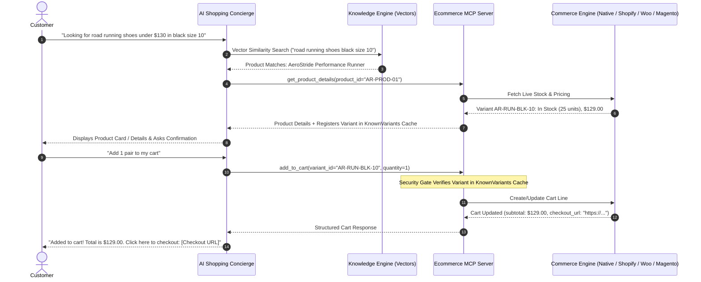
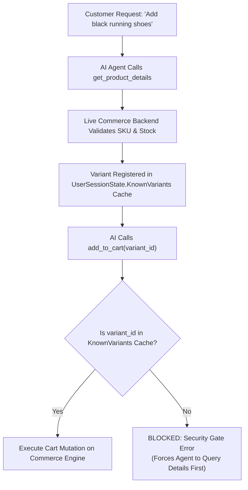

import { Callout } from "fumadocs-ui/components/callout";
import { Tab, Tabs } from "fumadocs-ui/components/tabs";

Cerebronix transforms passive digital catalogs into active conversational shopping experiences. Deployed across messaging channels such as WhatsApp, Instagram, and the Web Chat Widget, AI shopping concierges assist customers with tailored product discovery, side-by-side comparisons, explicit variant resolution, and direct cart management, concluding with secure one-click checkout permalinks.

## 1. What the Capability Accomplishes

The Conversational Commerce engine provides:

- **Semantic Product Discovery:** Understands customer intent and natural-language shopping criteria (e.g., *"I need lightweight trail shoes for muddy conditions under $150"*), querying vector embeddings rather than relying on brittle keyword matching.
- **Strict Variant & Inventory Grounding:** Clarifies ambiguous option choices (size, color, width) before executing cart operations, preventing erroneous purchases.
- **Architectural Security Gates:** Validates product variants through the `KnownVariants` session cache, blocking hallucinated or arbitrary SKU manipulation.
- **Omnichannel Presentation Normalization:** Renders rich visual cards with photography and interactive buttons on Web Chat Widgets, while delivering clean, compliant formatted text with direct permalinks on messaging platforms like WhatsApp and Instagram.
- **Conversational Cart Operations:** Enables customers to add items, modify quantities, remove lines, and apply promotional coupon codes via natural-language dialogue.
- **Direct Checkout Permalinks:** Generates authenticated, instant-checkout URLs that transport the customer directly to the merchant's secure hosted payment gateway.

## 2. End-to-End Conversational Shopping Workflow

The conversational shopping interaction follows a disciplined multi-step validation cycle:



## 3. Grounding & The `KnownVariants` Security Gate

A fundamental risk in AI-assisted ecommerce is model hallucination—an agent inventing non-existent SKU IDs, applying arbitrary discounts, or guessing variants that are out of stock.

Cerebronix eliminates this risk through a mandatory two-tier defense:



### The Variant Resolution Gate

1. **Option Clarification Prompt:** If a customer asks to *"add the AeroStride runner"* without specifying a size or color, the agent is instructionally constrained from guessing. It must inspect `ProductVariant.Options` and prompt the buyer:
   ```text
   The AeroStride Performance Runner comes in Matte Black and Arctic White, in sizes 9, 10, and 11. Which color and size would you prefer?
   ```
2. **`KnownVariants` Cache Verification:** When `get_product_details` executes, retrieved variants are cached in `UserSessionState.KnownVariants` for the active conversation.
3. **Cart Operation Gate:** When the agent calls `add_to_cart` or `modify_cart`, the MCP server verifies that the target `variant_id` is present in the session cache. Any call using an unverified ID is rejected with an error instructing the agent to look up the item first.

## 4. Channel Rendering Differences: Web Widget vs. Messaging Channels

Because different communication channels support different UI capabilities, Cerebronix normalizes message delivery:

<Tabs items={["Web Chat Widget & API", "WhatsApp, Instagram & Messenger"]}>
  <Tab value="Web Chat Widget & API">
    ### Rich Interactive Cards (`Channel::WebWidget` & `Channel::Api`)

    On web chat widgets and mobile SDK integrations, products render as rich visual components:
    - **High-Resolution Photography:** Embedded directly from `https://cdn.prod.cerebronix.com` or platform CDNs.
    - **Structured Specification Pills:** Badges displaying category, variant options, and live stock availability.
    - **Interactive Buttons:** Quick-action CTA buttons (e.g., `Add to Cart`, `View Details`, `Select Size`).
    - **In-Drawer Checkout:** Seamless checkout trigger within the chat drawer.
  </Tab>
  <Tab value="WhatsApp, Instagram & Messenger">
    ### Formatted Text & Authentic Permalinks

    Meta business messaging APIs do not support arbitrary web-based HTML/CSS cards in standard conversational streams. Cerebronix formats output into clean, compliant text:
    - **Formatted Product Blocks:** Uses bolding, emojis, and bullet points for clean legibility.
    - **Authentic Storefront Permalinks:** Storefront product links routing directly to your merchant product catalog (e.g., illustrative placeholder `https://store.apexretail.example.com/products/aerostride-runner`).
    - **Direct Checkout URLs:** Authenticated, single-click checkout links allowing customers to finalize payments in their mobile browser.
  </Tab>
</Tabs>

## 5. Cart Actions & Confirmation Modes

The Cerebronix Ecommerce MCP server exposes standardized tools to the AI agent loop:

- **`add_to_cart(variant_id, quantity)`:** Adds a verified variant line item to the customer's cart. Creates a new cart session if one does not exist.
- **`modify_cart(variant_id, quantity)`:** Updates line item quantities or sets quantity to `0` to remove an item.
- **`get_cart()`:** Retrieves the current cart state, line items, applied discounts, subtotal, and direct checkout URL.
- **`apply_promo_code(code)`:** Validates and attaches a promotional coupon code to the cart session.

### Agent Confirmation Modes

Merchants configure how aggressively agents verify customer intent before modifying carts:

| Mode | Behavior | Best Suited For |
| :--- | :--- | :--- |
| **`when_ambiguous` (Default)** | Immediately adds items if color, size, and quantity are unambiguous. Prompts for confirmation only when specifications are incomplete. | Fast, conversational mobile checkouts with minimal friction. |
| **`always`** | Always summarizes the item, variant, price, and quantity, requiring an explicit *"Yes, add it"* before executing `add_to_cart`. | High-ticket luxury goods, customized items, or wholesale orders. |
| **`never`** | Autonomously executes cart actions on any detected intent without confirmation prompts. | Specialized automated ordering bots and programmatic API channels. |

## 6. Checkout Link Generation

Once a cart session is active, Cerebronix generates a secure, authenticated checkout permalink:

- **Native Store:** Direct checkout link pointing to the store's Stripe/PayU checkout session.
- **Shopify:** Authentic Shopify Storefront checkout URL (e.g., `https://apex-retail.myshopify.com/cart/c/h1b2c3...`).
- **WooCommerce:** Storefront cart redirect URL with pre-populated line items and session token.
- **Magento:** Guest cart checkout URL pre-loaded with line items.

<Callout type="info" title="Cart Abandonment Recovery">
If a customer adds items to their cart but does not complete checkout within 2 hours, Cerebronix's in-process `ReminderWorker` can dispatch an automated recovery nudge on compliant channels (e.g., WhatsApp within the 24-hour customer service window), inviting the customer to complete their order.
</Callout>

## 7. Prerequisites and Plan Restrictions

- **Plan Entitlements:**
  - **Free Evaluation:** Basic conversational product discovery; manual cart links.
  - **Growth Plan:** Full conversational cart operations (`add_to_cart`, `modify_cart`); automatic variant grounding; rich Web Chat Widget cards.
  - **Scale & Enterprise Plans:** Multi-store agent routing; abandoned cart recovery nudges; custom confirmation modes; priority MCP execution.
- **Required Roles:** `owner`, `admin`, or `developer` permissions to bind ecommerce integrations and configure confirmation policies.

## 8. Step-by-Step Customer Instructions (Apex Retail Global Example)

### Step 1: Bind Ecommerce Integration to Your Agent

1. Navigate to **AI Agents** (`/ai-agents`) and select `Apex Sales Concierge`.
2. Scroll to the **Ecommerce Integration** section.
3. Select your connected store (e.g., `Apex Retail Global (marketronix)` or `Apex US (shopify)`).
4. Under **Knowledge Sources**, ensure the catalog vector source is checked.
5. In **Agent System Instructions**, add your store policy guidelines:
   ```text
   You are the shopping concierge for Apex Retail Global. Assist customers with finding products, recommending sizes, and creating carts. Always confirm shoe sizes before adding items to the cart.
   ```
6. Click **Save Changes**.

### Step 2: Test Conversational Cart Creation in Agent Preview

1. Open the **Test Agent** drawer on the right side of the screen.
2. Type:
   ```text
   Hi, I'm training for a marathon and need high-mileage road shoes. What do you recommend?
   ```
3. The agent recommends the `AeroStride Performance Runner` with price and features.
4. Type:
   ```text
   I'll take them in Matte Black, size 10.
   ```
5. The agent executes `get_product_details`, validates the variant in the `KnownVariants` cache, executes `add_to_cart`, and responds:
   ```text
   I've added 1 pair of AeroStride Performance Runners in Matte Black (Size 10) to your cart!
   Subtotal: $129.00.
   Click here to proceed to checkout: https://store.apexretail.example.com/checkout?cart=cart_01J8...
   ```
6. In your own connected storefront environment, navigate to the generated checkout permalink to verify that the checkout session opens with the exact variant and price pre-loaded (example domains shown in tutorials are illustrative placeholders, not functioning websites).

## 9. Expected Results & Verification

Verify your conversational commerce setup:

1. **Variant Grounding Check:** In chat, ask to buy an impossible combination (e.g., *"Add the AeroStride shoe in Neon Green size 14"*).
   - *Expected Behavior:* Agent responds that Neon Green / Size 14 is not available and lists the supported colors and sizes.
2. **Security Gate Check:** Verify in application audit logs that no `add_to_cart` tool calls execute without an antecedent `get_product_details` call in the same conversation session.
3. **Cart Line Modification:** In chat, say: *"Actually, change that to 2 pairs."*
   - *Expected Behavior:* Agent calls `modify_cart(quantity=2)`, updating the subtotal to $258.00.

## 10. Common Problems and Troubleshooting

### Issue: Agent Adds Wrong Variant to Cart
- **Root Cause:** Confirmation mode was set to `never` or system instructions did not emphasize clarifying ambiguous options.
- **Resolution:** Change confirmation mode to `when_ambiguous` or `always`. Update Agent System Instructions: *"Never assume variant selections; ask the customer to clarify color and size if omitted."*

### Issue: Checkout Link Produces Empty Cart on Storefront
- **Root Cause:** Cart session cookie or token expired, or storefront domain differs from the API domain configured in the integration card.
- **Resolution:** Verify the `store_url` configured in `/integrations`. For Shopify, ensure the customer is using modern browser settings that do not block cross-domain session cookies.

### Issue: Web Chat Widget Shows Text Links Instead of Product Cards
- **Root Cause:** Chat channel metadata was not identified as `Channel::WebWidget`.
- **Resolution:** Ensure the chat widget snippet includes the appropriate channel identifier and that the widget SDK is updated to the latest release.

## 11. Relevant Related Guides

- [Ecommerce Platform Overview & Architecture](/docs/ecommerce/overview-and-architecture): Architecture and the 4-step setup chain.
- [Native Store Management](/docs/ecommerce/native-store-management): Catalog structure, variants, and stock allocations.
- [Order Tracking & Self-Service](/docs/ecommerce/order-tracking-and-self-service): Post-purchase order lookups and cancellation safeguards.
- [Pricing, Promotions & Regions](/docs/ecommerce/pricing-promotions-and-regions): Promotions and coupon code validation.
