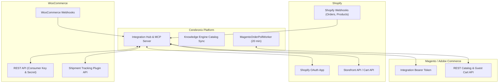
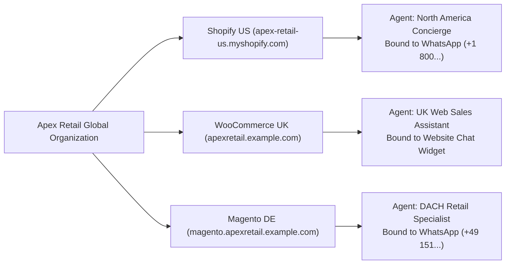

import { Callout } from "fumadocs-ui/components/callout";
import { Tab, Tabs } from "fumadocs-ui/components/tabs";

Cerebronix connects natively to existing ecommerce platforms, enabling organizations to deploy conversational AI shopping concierges without migrating their core commerce backend. With support for Shopify, WooCommerce, and Magento (Adobe Commerce), Cerebronix synchronizes product catalogs, tracks real-time inventory, executes cart operations, and generates direct checkout links across conversational messaging channels.

## 1. What the Capability Accomplishes

External Store Integrations allow organizations to:

- **Connect Existing Commerce Engines:** Ingest catalogs, variants, pricing, and stock levels from existing enterprise stores with zero catalog re-entry.
- **Support Multi-Store Architectures:** Connect multiple independent store instances (e.g., US Shopify Store and UK WooCommerce Store) within the same organization.
- **Route Channels to Specific Stores:** Bind specific messaging numbers or chat widgets to dedicated store backends (e.g., North American WhatsApp number routes to the US store; European Instagram channel routes to the EU store).
- **Normalize Conversational Commerce Tools:** Provide AI agents with uniform MCP tool abstractions (`add_to_cart`, `modify_cart`, `list_orders`, `track_shipment`) regardless of the underlying platform API differences.
- **Generate Authentic Storefront Permalinks:** Deliver clickable product and checkout links routing directly to the merchant's live domain.

## 2. Platform Connection Architectures

Each external platform employs distinct authentication models, webhook capabilities, and synchronization protocols:



### Provider Matrix Overview

| Feature | Shopify | WooCommerce | Magento (Adobe Commerce) |
| :--- | :--- | :--- | :--- |
| **Authentication** | OAuth 2.0 (`.myshopify.com` domain) | Manual API Key (`ck_...`) & Secret (`cs_...`) | Manual Bearer Token (`integration_token`) |
| **Catalog Sync** | Real-time Webhooks + Periodic Sync | Real-time Webhooks + REST API | REST API + 20-min Polling Worker |
| **Product Permalinks** | Live Shopify domain handles | Storefront permalinks | URL rewrite catalog paths |
| **Cart & Checkout** | Storefront Cart API + Checkout URL | REST Cart API + Cart Redirect URL | Guest Cart API + Checkout Permalink |
| **Shipment Tracking** | Shopify Fulfillment Tracking | WooCommerce Shipment Tracking Plugin | Order shipment polling |
| **Order Cancellation** | Shopify Admin Order Cancel API | WooCommerce Order Update API | Magento Order Management Cancel API |

## 3. Platform Configuration Workflows

Navigate to **Integrations** (`/integrations`) in the Cerebronix operator console.

<Tabs items={["Shopify", "WooCommerce", "Magento"]}>
  <Tab value="Shopify">
    ### Connecting Shopify

    Shopify uses OAuth 2.0 authentication.

    1. In `/integrations`, locate the **Shopify** card.
    2. Click **Connect**.
    3. Enter your **Shop Domain** (e.g., `apex-retail-us.myshopify.com`).
    4. You are redirected to the Shopify Admin consent screen.
    5. Review the requested permissions:
       - `read_products`, `read_inventory`
       - `read_orders`, `write_orders`
       - `read_fulfillments`
       - `write_cart_sessions`
    6. Click **Install App**. Upon callback, the integration displays status `CONNECTED`.

    <Callout type="info" title="Shopify App Store Direct Install">
    Organizations installing via the official Cerebronix Shopify App can launch the installation directly from the Shopify App Store. The store domain is automatically detected and linked to your active organization.
    </Callout>
  </Tab>
  <Tab value="WooCommerce">
    ### Connecting WooCommerce

    WooCommerce uses REST API Consumer Key and Consumer Secret credentials.

    1. In your **WordPress / WooCommerce Admin**, navigate to:
       `WooCommerce` -> `Settings` -> `Advanced` -> `REST API`.
    2. Click **Add Key**:
       - **Description:** `Cerebronix Conversational Commerce`
       - **User:** Select an admin user with store management rights.
       - **Permissions:** `Read/Write`.
    3. Copy the generated **Consumer Key** (`ck_...`) and **Consumer Secret** (`cs_...`).
    4. In Cerebronix, navigate to `/integrations` and locate the **WooCommerce** card.
    5. Click **Connect** and fill in:
       - **Store URL:** `https://apexretail.example.com` (illustrative placeholder or your live WooCommerce domain)
       - **Consumer Key:** `ck_58a4...`
       - **Consumer Secret:** `cs_91b2...`
    6. Click **Save Credentials**.

    <Callout type="tip" title="WooCommerce Shipment Tracking">
    To enable real-time carrier tracking for WooCommerce orders, install the official **WooCommerce Shipment Tracking** plugin. Cerebronix automatically queries this plugin's REST API during customer tracking inquiries.
    </Callout>
  </Tab>
  <Tab value="Magento">
    ### Connecting Magento (Adobe Commerce)

    Magento connects via an Integration Bearer Token.

    1. In your **Magento Admin Panel**, navigate to:
       `System` -> `Extensions` -> `Integrations`.
    2. Click **Add New Integration**:
       - **Name:** `Cerebronix AI Engine`
       - In the **API** tab, grant permissions for `Catalog`, `Sales`, `Shipments`, and `Carts`.
    3. Click **Save** and then click **Activate**.
    4. Copy the **Access Token** (Bearer token).
    5. In Cerebronix, navigate to `/integrations` and locate the **Magento** card.
    6. Click **Connect** and input:
       - **Store URL:** `https://magento.apexretail.example.com` (illustrative placeholder or your live Magento host)
       - **Integration Token:** The copied Bearer access token.
    7. Click **Save Credentials**.

    <Callout type="warning" title="Magento Background Polling & Egress Allowlisting">
    Magento does not possess an out-of-the-box webhook pipeline for order state transitions. Cerebronix runs an in-process background worker (`MagentoOrderPollWorker`) that polls connected Magento stores every 20 minutes (batch size 200). If your Magento environment enforces firewall IP allowlists, ensure Cerebronix outbound egress IPs are allowlisted.
    </Callout>
  </Tab>
</Tabs>

## 4. Multi-Instance Store Connections & Routing

Cerebronix supports **multi-instance integrations** for external platforms (`shopify`, `woocommerce`, and `magento`). While an organization operates exactly one native Cerebronix store, merchants can connect multiple independent external store instances (e.g., US Shopify Store and UK WooCommerce Store) within the same organization workspace.



### Multi-Store Operational Rules

- **Dedicated Catalog Indexing:** Each external store instance creates an independent data source under `/datasources`. Catalog items are tagged with their specific store instance ID in the vector database.
- **Agent-to-Store Binding:** In `/ai-agents/[id]`, agents bind to exactly one ecommerce integration instance. This enforces clear operational separation: agents servicing US customers query US pricing, inventory, and checkout links without cross-pollination from European store catalogs.
- **Channel Routing:** Communication channels (WhatsApp numbers, Instagram accounts, Web Chat widgets) bind to specific AI agents under `/channels`, completing the routing chain.

## 5. Integration Lifecycle & Health Monitoring

The **Integrations** console (`/integrations`) monitors connection health with visual status indicators:

- **`CONNECTED` (Green):** API credentials are valid, webhooks/polling workers are operational, and catalog synchronization is active.
- **`PAYMENT_ISSUE` (Amber):** The external store platform reported an account billing problem (e.g., Shopify store frozen or billing past due). Cerebronix pauses automated business-initiated notifications until the account returns to good standing.
- **`EXPIRED` (Red):** The OAuth token or API key has expired or was revoked in the merchant admin panel. Re-authorization is required.
- **`ERROR` (Red):** The store endpoint returned persistent HTTP 5xx errors or network timeouts during synchronization attempts.

### Disconnecting or Re-Authorizing an Instance

To modify or remove a store instance:
1. In `/integrations`, click **Manage Instances** on the provider card.
2. Click **Re-authorize** to refresh expired OAuth credentials or update API keys.
3. Click **Disconnect** to sever the integration.
4. *Safety Guard:* Disconnecting a store warns if any AI agents are currently bound to that instance. Rebind affected agents to prevent customer interruption.

## 6. Prerequisites and Plan Restrictions

- **Plan Entitlements:**
  - **Free Evaluation:** 1 connected store instance; manual catalog re-indexing.
  - **Growth Plan:** Up to 3 store instances; automated webhooks; conversational cart and checkout permalinks.
  - **Scale & Enterprise Plans:** Unlimited store instances; multi-instance agent routing; automated 20-minute Magento polling worker; dedicated webhook scaling.
- **Required Roles:** `owner`, `admin`, or `developer` permissions to add, re-authorize, or disconnect store integrations. `viewer` role can inspect integration statuses in read-only mode.

## 7. Step-by-Step Customer Instructions (Apex Retail Global Example)

### Step 1: Connect Apex Retail US Shopify Store

1. Log into Cerebronix and navigate to **Integrations** (`/integrations`).
2. Locate the **Shopify** card and click **Connect**.
3. In the **Shop Domain** field, enter `apex-retail-global.myshopify.com`.
4. Click **Connect to Shopify**.
5. Log into Shopify Admin, review the permissions, and click **Install App**.
6. You are redirected back to Cerebronix, where the Shopify card now displays `CONNECTED` with store name `Apex Retail Global US`.

### Step 2: Index the Shopify Catalog in Data Sources

1. Navigate to **Data Sources** (`/datasources`).
2. Click **Add Data Source** and select **Shopify**.
3. Select the connected store: `Apex Retail Global US`.
4. Set source name: `Apex US Shopify Catalog`.
5. Click **Save & Ingest**. The Knowledge Engine ingests all active Shopify products, tags variants with their Shopify GIDs, and completes vector indexing.

### Step 3: Bind the Store to the North America Sales Agent

1. Navigate to **AI Agents** (`/ai-agents`) and select `Apex NA Sales Concierge`.
2. Scroll to **Ecommerce Integration**.
3. Under the radio options, select `Apex Retail Global US (shopify)`.
4. Under **Knowledge Sources**, check `Apex US Shopify Catalog`.
5. Click **Save Changes**.

## 8. Expected Results & Verification

Verify that your external store is functioning properly:

1. **Integration Status:** In `/integrations`, verify the Shopify instance displays a green `CONNECTED` badge.
2. **Catalog Verification:** Under `/datasources`, verify `Apex US Shopify Catalog` displays `SYNCED` with the exact product count from your Shopify admin.
3. **Conversational Product Query:** In the agent test chat:
   ```text
   Do you have the Carbon Velocity Jacket in Navy Medium?
   ```
4. **Agent Response Verification:** The agent queries Shopify, confirms live inventory, and replies:
   ```text
   Yes, the Carbon Velocity Jacket in Navy (Size Medium) is in stock for $149.00 (SKU: APX-JKT-NVY-M). We have 8 units ready to ship from our US fulfillment hub. Would you like me to create a cart for you?
   ```
5. **Checkout URL Verification:** Ask: *"Yes, please add it and give me the checkout link."*
   The agent calls `add_to_cart` and generates an authentic Shopify checkout permalink:
   ```text
   https://apex-retail-global.myshopify.com/cart/c/h1b2c3...
   ```

## 9. Common Problems and Troubleshooting

### Issue: Shopify Redirects to Error During OAuth
- **Root Cause:** The entered shop domain was incorrect (e.g., entered custom domain `apexretail.example.com` instead of the `.myshopify.com` handle), or the user lacks admin installation privileges in Shopify.
- **Resolution:** Always use the permanent `.myshopify.com` subdomain when initiating OAuth. Ensure you are logged into Shopify with Store Owner or Staff Administrator permissions.

### Issue: WooCommerce Webhook Sync Fails
- **Root Cause:** WordPress permalinks are set to "Plain", or an aggressive security/caching plugin (e.g., Cloudflare, Wordfence) is blocking incoming Cerebronix webhooks.
- **Resolution:** In WordPress Admin, set `Settings` -> `Permalinks` to `Post name`. Allowlist Cerebronix webhook IP addresses in Wordfence or Cloudflare WAF.

### Issue: Magento Products Stale or Stock Out of Sync
- **Root Cause:** The 20-minute background poll has not yet fired, or Magento API token permissions do not include `Magento_Catalog::products`.
- **Resolution:** Check `/datasources` and trigger a manual re-index. In Magento Admin, inspect `System` -> `Integrations` -> `Cerebronix AI Engine` and confirm that Resource Access is set to `All` or includes full catalog privileges.

## 10. Relevant Related Guides

- [Ecommerce Platform Overview & Architecture](/docs/ecommerce/overview-and-architecture): Multi-store architecture and 4-step setup chain.
- [Conversational Shopping & Cart](/docs/ecommerce/conversational-shopping-and-cart): Conversational cart creation, variant resolution, and checkout generation.
- [Order Tracking & Self-Service](/docs/ecommerce/order-tracking-and-self-service): Post-purchase order lookups and shipment tracking.
- [Native Store Management](/docs/ecommerce/native-store-management): Built-in Cerebronix store setup.
