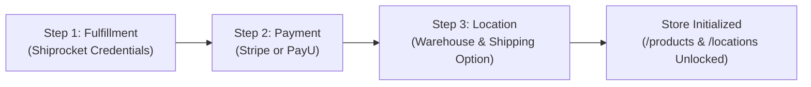
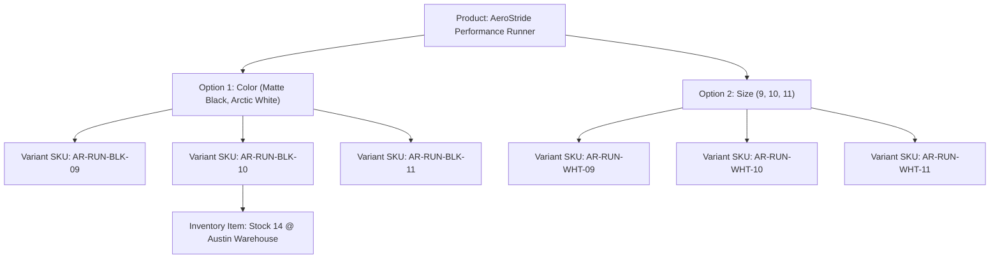

import { Callout } from "fumadocs-ui/components/callout";
import { Tab, Tabs } from "fumadocs-ui/components/tabs";

Cerebronix includes an enterprise native store engine directly integrated into the operator console. Organizations can launch a complete digital storefront without requiring third-party ecommerce subscriptions. The native store engine handles catalog hierarchical structures, complex variant matrices, multi-warehouse inventory levels, and real-time stock allocation.

## 1. What the Capability Accomplishes

The Native Store management suite allows organizations to:

- **Launch a Turnkey Storefront:** Complete initial store setup in minutes through a guided onboarding wizard covering fulfillment, payment processing, and inventory locations.
- **Manage Hierarchical Catalogs:** Organize products into nested categories (e.g., *Apparel > Footwear > Performance Running*) and promotional collections (e.g., *Summer Marathon 2026*).
- **Structure Complex Variant Matrices:** Define multi-dimensional product options (e.g., Size, Color, Width) with independent SKUs, barcodes, pricing tiers, and stock allocations.
- **Track Real-Time Multi-Location Inventory:** Distribute stock across multiple physical warehouses or retail outlets, track reserved inventory during active checkouts, and prevent overselling.
- **Maintain Grounded AI Sales Data:** Ensure AI agents quote accurate specifications, available variant combinations, and real-time stock quantities.

## 2. Store Setup Wizard & Store Settings

Before adding products, every new native store must complete the mandatory **Store Setup Wizard** (`/setup-wizard`). This wizard ensures that payment gateways, fulfillment integrations, and inventory locations are valid before items are made available for sale.



### The 3 Wizard Steps

1. **Step 1: Fulfillment Integration:** Input your **Shiprocket** account email and password to enable automated shipping label generation, rate calculation, and dispatch tracking.
2. **Step 2: Payment Gateway:** Connect a direct vendor payment gateway. Sellers connect their own merchant account (e.g., Stripe Secret Key or PayU Merchant Key and Salt) so customer payments deposit directly into the merchant's account.
3. **Step 3: Location & Shipping:** Specify the primary fulfillment location (warehouse address, postal code, and country) and link a default shipping option (standard courier or express delivery).

<Callout type="info" title="Store Setup Enforcement Gate">
If any step of the wizard is incomplete, all routes under `/e-com` automatically redirect to `/setup-wizard`. Once completed, the wizard becomes a no-op and standalone management screens under `/locations`, `/payment-details`, and `/store` remain open for ongoing edits.
</Callout>

### Store Settings (`/store`)

Once initialized, navigate to **Ecommerce** -> **Store** (`/store`) to manage global parameters:
- **Store Name & Handle:** Public storefront brand name (e.g., `Apex Retail Global`).
- **Default Currency:** Default transaction currency (e.g., `USD`, `EUR`, `INR`).
- **Timezone:** Operational timezone for order timestamps and promotional schedules.
- **Order Cancellation Policy:** Self-service toggle enabling customers to cancel unfulfilled orders via conversational AI.

## 3. Product Catalog & Variant Management

Navigate to **Ecommerce** -> **Products** (`/products`) to view and manage your catalog.

### Product Structure & Data Model

Each product record includes:
- **General Information:** Title, Subtitle, Description (rich text/markdown), Handle (URL slug), and Status (`Draft` or `Published`).
- **Media Gallery:** Primary thumbnail and high-resolution product photography stored on the high-performance media CDN (`https://cdn.prod.cerebronix.com`).
- **Organize:** Primary Category and associated Collections.
- **Options & Variants:** Up to 3 option axes (e.g., *Color*, *Size*, *Material*).
- **Attributes:** Weight, Dimensions (Length, Width, Height), HS Code, Country of Origin, and Customs Value.



### Categories vs. Collections

- **Categories (`/categories`):** Hierarchical taxonomy for navigation and filtering. Categories support parent-child nesting (e.g., `Footwear` -> `Men's Running`).
- **Collections (`/collections`):** Flat merchandising groupings for marketing campaigns or seasonal highlights (e.g., `Fall 2026 Collection`, `Best Sellers Under $100`).

## 4. Multi-Location Inventory & Stock Allocation

Navigate to **Ecommerce** -> **Store** -> **Locations & Shipping** (`/locations`) and **Inventory** (`/inventory`).

### Stock Management Concepts

- **Stock Locations (`/locations`):** Physical fulfillment centers (e.g., *Austin Distribution Center*, *Frankfurt Hub*). Each location defines a service zone and connects to specific shipping options.
- **Inventory Items (`/inventory`):** Each distinct variant SKU maps to an inventory item tracking stock quantities per location:
  - **Stocked Quantity:** Total physical units available on warehouse shelves.
  - **Reserved Quantity:** Units currently held in active customer shopping carts or pending checkout payment.
  - **Available Quantity:** `Stocked Quantity - Reserved Quantity`. AI agents only quote the available quantity to prospective buyers.
- **Stock Reservation Expiration:** Active shopping cart reservations automatically expire after a configurable grace period (default 2 hours) if checkout is not completed, releasing inventory back to available stock.

## 5. Prerequisites and Plan Restrictions

- **Plan Entitlements:**
  - **Free Evaluation:** Up to 50 active products, 1 warehouse location.
  - **Growth Plan:** Up to 500 active products, 3 warehouse locations, Shiprocket integration.
  - **Scale & Enterprise Plans:** Unlimited products and variants, multi-location stock routing, custom regional pricing, and automated inventory sync.
- **Required Roles:** `owner`, `admin`, or `developer` to modify store settings, configure payment credentials, and manage products, categories, and inventory.

## 6. Step-by-Step Customer Instructions: Creating a Product (Apex Retail Global Example)

### Step 1: Create Categories and Collections

1. Navigate to **Ecommerce** -> **Products** -> **Categories** (`/categories`).
2. Click **New Category**.
3. Enter **Category Name**: `Performance Footwear`.
4. Handle: `performance-footwear`.
5. Click **Save Category**.

### Step 2: Create the Product with Multiple Variants

1. Navigate to **Ecommerce** -> **Products** (`/products`).
2. Click **New Product** in the upper right.
3. In the **General Details** tab:
   - **Title:** `AeroStride Performance Runner`
   - **Subtitle:** `Breathable lightweight carbon-plate road running shoe`
   - **Handle:** `aerostride-performance-runner`
   - **Description:** `Engineered with high-rebound responsive foam and dual-density carbon fiber plating for distance endurance.`
4. In the **Organize** tab:
   - Select **Category**: `Performance Footwear`.
5. In the **Options** section:
   - Click **Add Option**: Option Title: `Color`, Values: `Matte Black`, `Arctic White`.
   - Click **Add Option**: Option Title: `Size`, Values: `9`, `10`, `11`.
6. In the **Variants** table:
   - Cerebronix automatically generates 6 variant combinations (`2 colors x 3 sizes`).
   - For variant `Matte Black / Size 10`:
     - **SKU:** `AR-RUN-BLK-10`
     - **Price (USD):** `$129.00`
     - **Price (EUR):** `€119.00`
     - **Manage Inventory:** Toggle ON.
7. Click **Save Product**.

### Step 3: Allocate Inventory Stock

1. Navigate to **Ecommerce** -> **Inventory** (`/inventory`).
2. Search for `AR-RUN-BLK-10`.
3. Select **Austin Distribution Center**.
4. Set **In Stock Quantity**: `25`.
5. Click **Update Stock**.

## 7. Expected Results & Verification

Verify that your new product and variants are active:

1. **Catalog Status:** Under `/products`, verify `AeroStride Performance Runner` displays status `Published` with 6 active variants.
2. **Inventory Verification:** Under `/inventory`, verify `AR-RUN-BLK-10` displays `Available: 25, Reserved: 0`.
3. **Data Source Indexing:** Navigate to `/datasources`, find the Marketronix data source, and trigger a sync. Confirm the sync log shows:
   ```text
   Synced product: AeroStride Performance Runner (6 variants, 25 units available for SKU AR-RUN-BLK-10)
   ```
4. **Agent Conversational Verification:** In the AI Agent test chat:
   - Ask: *"Do you have the AeroStride runner in black size 10?"*
   - Agent response:
     ```text
     Yes! The AeroStride Performance Runner in Matte Black (Size 10) is in stock. We have 25 pairs available for $129.00. Would you like me to reserve a pair in your cart?
     ```

## 8. Common Problems and Troubleshooting

### Issue: Cannot Access `/products` or `/locations` (Redirected to `/setup-wizard`)
- **Root Cause:** One or more steps of the Store Setup Wizard (Fulfillment, Payment, or Location) are incomplete.
- **Resolution:** Open `/setup-wizard`, verify that your Shiprocket account, Stripe/PayU gateway, and default warehouse location are configured. Complete the missing step until the progress bar reaches 100%.

### Issue: Variants Show "Out of Stock" in Agent Conversations
- **Root Cause:** Product variants were created with "Manage Inventory" enabled, but stock was never allocated to a location.
- **Resolution:** Navigate to `/inventory`, select the affected SKU, assign it to a physical location, and add a positive stock quantity.

### Issue: Product Images Not Displaying in Chat
- **Root Cause:** Images were linked via an insecure HTTP URL or local development path not accessible by public CDNs.
- **Resolution:** Upload product photography directly through the Cerebronix media manager. Images will be automatically optimized and hosted on `https://cdn.prod.cerebronix.com`.

## 9. Relevant Related Guides

- [Ecommerce Platform Overview & Architecture](/docs/ecommerce/overview-and-architecture): The 4-step configuration sequence and provider matrix.
- [Orders, Fulfillment & Returns](/docs/ecommerce/orders-fulfillment-and-returns): Processing customer orders and managing shipping options.
- [Pricing, Promotions & Regions](/docs/ecommerce/pricing-promotions-and-regions): Multi-currency regions, taxes, and promotional discount campaigns.
- [Conversational Shopping & Cart](/docs/ecommerce/conversational-shopping-and-cart): Conversational product search and checkout link generation.
