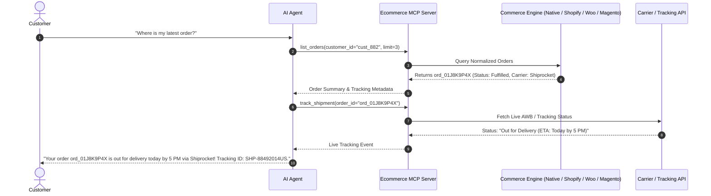
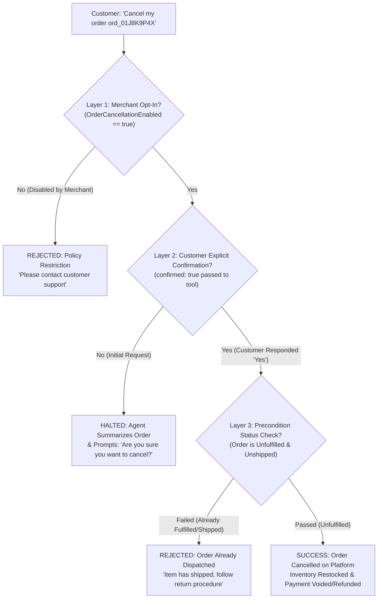
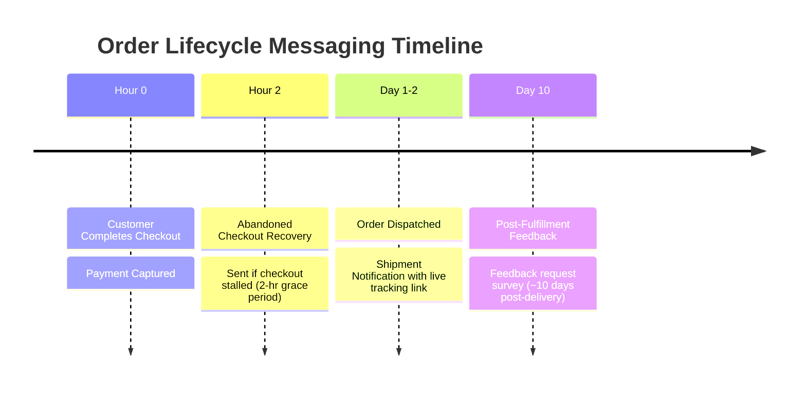

import { Callout } from "fumadocs-ui/components/callout";
import { Tab, Tabs } from "fumadocs-ui/components/tabs";

Post-purchase inquiries—such as *"Where is my order?"* and *"Can I cancel my purchase?"*—account for up to 60% of ecommerce customer support volume. Cerebronix provides comprehensive conversational self-service capabilities that empower AI agents to resolve shipping inquiries, track packages, reorder past purchases, and safely process cancellations while strictly enforcing merchant authorization and inventory safeguards.

## 1. What the Capability Accomplishes

The Post-Purchase Self-Service suite enables:

- **Conversational Order Lookups (`list_orders`):** Customers can ask *"What have I ordered recently?"* and receive a clean summary of their active and historical orders.
- **Real-Time Shipment Tracking (`track_shipment`):** Live carrier status lookups across Shiprocket, Shopify Fulfillment, WooCommerce Shipment Tracking, and Magento couriers.
- **Instant One-Click Reordering (`reorder`):** Re-adds all items from a past purchase into a fresh cart, verifying real-time stock availability and flagging any discontinued lines.
- **In-Chat Promo Applications (`apply_promo_code`):** Evaluates and attaches discount codes during reordering or checkout recovery dialogues.
- **3-Layer Order Cancellation Safety Gate (`cancel_order`):** High-stakes order cancellation protected by merchant opt-in, explicit customer confirmation, and order-state preconditions.
- **Automated Lifecycle Notifications:** Proactive order shipment alerts, gentle cart-recovery nudges (after 2-hour grace period), and delayed customer feedback requests (~10 days post-fulfillment).

## 2. Conversational Order Tracking & Lookups

When a customer initiates an inquiry regarding their purchase history, the AI agent uses the `list_orders` and `track_shipment` tools to retrieve verified platform data.



### Provider Tracking Integration Mechanics

- **Native Store:** Queries Shiprocket API or internal carrier records to return real-time checkpoints.
- **Shopify:** Ingests fulfillment tracking objects attached to the order.
- **WooCommerce:** Queries the official WooCommerce Shipment Tracking plugin REST endpoint.
- **Magento (Adobe Commerce):** Ingests shipment tracking records polled via the 20-minute background worker (`MagentoOrderPollWorker`).

## 3. The 3-Layer Order Cancellation Safety Gate

Order cancellation carries immediate financial and inventory consequences. Uncontrolled cancellation tools can trigger unintended refunds, race conditions with warehouse pickers, and inventory corruption.

Cerebronix implements a strict **Three-Layer Safety Gate** for the `cancel_order` tool. All three checks must pass before an order cancellation executes:



### The 3 Safety Layers Explained

1. **Layer 1: Merchant Organization Opt-In (`OrderCancellationEnabled`):**
   - The merchant must explicitly enable self-service order cancellation under **Ecommerce** -> **Store Settings** (`/store`).
   - By default, this setting is **OFF**. If disabled, any cancellation request triggers an agent response explaining that self-service cancellations are not permitted and routing the inquiry to human support.
2. **Layer 2: Explicit Customer Confirmation (`confirmed: true`):**
   - The AI agent cannot execute `cancel_order` on the customer's first message.
   - The agent is instructionally mandated to summarize the order (Order ID, total amount, items) and ask for explicit confirmation:
     ```text
     Are you sure you want to cancel order ord_01J8K9P4X (AeroStride Performance Runner - $129.00)? Please reply 'Yes, cancel it' to confirm.
     ```
   - Only when the customer explicitly affirms does the agent invoke `cancel_order(order_id, confirmed=true)`.
3. **Layer 3: Precondition State Check (`NormalizedOrderStatus`):**
   - Before executing the cancellation API call on the underlying commerce platform (Native Store, Shopify, WooCommerce, or Magento), Cerebronix checks the live fulfillment state.
   - If the order has already advanced to `Fulfilled`, `Shipped`, or `Delivered`, the tool call is rejected with `ErrPreconditionFailed`. The agent informs the customer that the parcel has already left the warehouse and guides them to the standard return policy.

## 4. One-Click Reordering (`reorder`)

The `reorder` tool allows customers to repeat past purchases effortlessly:

1. **Past Order Evaluation:** The customer asks: *"Can I get the same running shoes I ordered last month?"*
2. **Line Item Extraction:** The agent identifies the prior order and extracts all constituent variant SKUs.
3. **Live Inventory Verification:** The agent queries `get_product_details` for each item, confirming they remain active and in stock.
4. **Fresh Cart Allocation:** Available items are bundled into a new cart session, and a new checkout permalink is generated.
5. **Out-of-Stock Transparency:** If any item from the previous order is out of stock or discontinued, the agent explicitly informs the buyer and creates a cart containing only the available lines.

## 5. Automated Post-Purchase Lifecycle Messaging

Cerebronix includes an in-process background engine (`ReminderWorker`) that drives automated customer lifecycle touchpoints:



### Lifecycle Touchpoints

- **Order Shipment Notification:** Dispatched immediately upon courier pickup across all supported messaging channels (WhatsApp, Webhook, SMS). Contains the tracking number and direct tracking link.
- **Abandoned Checkout Recovery Nudge:** If a customer initiates a cart session that stalls before payment, a gentle recovery nudge is scheduled after a 2-hour grace period.
- **Post-Fulfillment Feedback Request:** Sent approximately 10 days after order fulfillment. Research indicates that immediate feedback requests perform poorly; a 10-day delay gives the customer adequate time to experience the product.

<Callout type="info" title="WhatsApp 24-Hour Messaging Compliance">
All automated business-initiated notifications comply strictly with Meta's 24-hour customer care window. Messages dispatched outside the 24-hour window utilize pre-approved WhatsApp Utility templates. If Meta reports an account eligibility or payment issue on the merchant's WhatsApp Business Account, Cerebronix automatically pauses outbound messaging to protect account standing.
</Callout>

## 6. Prerequisites and Plan Restrictions

- **Plan Entitlements:**
  - **Free Evaluation:** Basic manual order tracking lookups.
  - **Growth Plan:** Automated shipment tracking lookups; one-click reordering; standard post-purchase alerts.
  - **Scale & Enterprise Plans:** Full 3-layer order cancellation gate; automated 10-day feedback requests; 2-hour checkout recovery nudges; multi-carrier tracking integrations.
- **Required Roles:** `owner`, `admin`, or `developer` permissions to enable the `OrderCancellationEnabled` policy toggle under store settings.

## 7. Step-by-Step Customer Instructions (Apex Retail Global Example)

### Step 1: Enable Order Cancellation in Store Settings

1. In the Cerebronix console, navigate to **Ecommerce** -> **Store** (`/store`).
2. Scroll to the **Customer Self-Service Policies** section.
3. Locate the toggle: **Allow Conversational Order Cancellation**.
4. Switch the toggle to **ON**.
5. Click **Save Settings**. The `OrderCancellationEnabled` flag is now active.

### Step 2: Test Order Tracking in Live Agent Chat

1. Open the AI test chat drawer for `Apex Sales Concierge`.
2. Type:
   ```text
   Hi, what's the status of my order ord_01J8K9P4X?
   ```
3. The agent calls `track_shipment` and responds:
   ```text
   Your order ord_01J8K9P4X has been fulfilled from our Austin Distribution Center and is currently in transit with Standard Ground Shipping. The tracking number is SHP-88492014US.
   ```

### Step 3: Test the 3-Layer Cancellation Flow

1. In the same conversation, type:
   ```text
   Actually, I made a mistake. Please cancel that order.
   ```
2. **Layer 2 Verification:** The agent does *not* immediately cancel. It responds:
   ```text
   I can help you cancel order ord_01J8K9P4X for the AeroStride Performance Runner ($129.00). Are you sure you want to cancel this order? Please confirm by replying 'Yes, cancel it'.
   ```
3. Type:
   ```text
   Yes, cancel it.
   ```
4. **Layer 3 Verification:** The agent calls `cancel_order(order_id="ord_01J8K9P4X", confirmed=true)`.
   - If the order has *not shipped*:
     ```text
     Order ord_01J8K9P4X has been successfully cancelled. Your payment of $129.00 has been refunded to your original payment method, and inventory has been released.
     ```
   - If the order has *already shipped*:
     ```text
     I was unable to cancel order ord_01J8K9P4X because it has already shipped from our warehouse. Once you receive the package, you can initiate a return through our standard return portal.
     ```

## 8. Expected Results & Verification

Verify your self-service configuration:

1. **Policy Enforcement Check:** Temporarily toggle **Allow Conversational Order Cancellation** to **OFF** in `/store`. In chat, ask to cancel an unfulfilled order.
   - *Expected Behavior:* Agent responds: *"Self-service order cancellation is currently disabled. Please contact customer support at support@apexretail.com for assistance."*
2. **One-Click Reorder Check:** In chat, say: *"Reorder my last purchase."*
   - *Expected Behavior:* Agent calls `reorder`, verifies stock, and responds with a fresh cart and checkout permalink.
3. **Audit Trail Verification:** In `/orders`, open the cancelled order record and verify that the event timeline logs:
   ```text
   Order cancelled via AI Agent conversational self-service (Confirmed by customer: Yes)
   ```

## 9. Common Problems and Troubleshooting

### Issue: Cancellation Fails with "Precondition Failed"
- **Root Cause:** The order was marked as `Fulfilled` or `Shipped` by the warehouse team moments before the customer confirmed cancellation.
- **Resolution:** This is intended safety behavior. Explain to the customer that the package has departed the warehouse and provide instructions on initiating a return once delivered.

### Issue: Customer Requests Reorder but Some Items are Missing
- **Root Cause:** One or more variant SKUs from the past order are currently out of stock or have been archived.
- **Resolution:** The agent informs the customer which specific items were omitted due to stock unavailability and provides a cart link for the available items.

### Issue: WhatsApp Tracking Updates Paused
- **Root Cause:** Meta reported a payment issue or policy alert on the connected WhatsApp Business Account, triggering Cerebronix's automatic disable safety valve.
- **Resolution:** Check your Meta Business Manager account standing and billing settings. Once resolved, re-enable business-initiated messaging under `/channels/whatsapp`.

## 10. Relevant Related Guides

- [Ecommerce Platform Overview & Architecture](/docs/ecommerce/overview-and-architecture): End-to-end architecture and setup chain.
- [Orders, Fulfillment & Returns](/docs/ecommerce/orders-fulfillment-and-returns): Warehouse operations and carrier integrations.
- [Conversational Shopping & Cart](/docs/ecommerce/conversational-shopping-and-cart): Conversational cart management and checkout permalinks.
- [External Store Integrations](/docs/ecommerce/external-store-integrations): Connecting Shopify, WooCommerce, and Magento stores.
