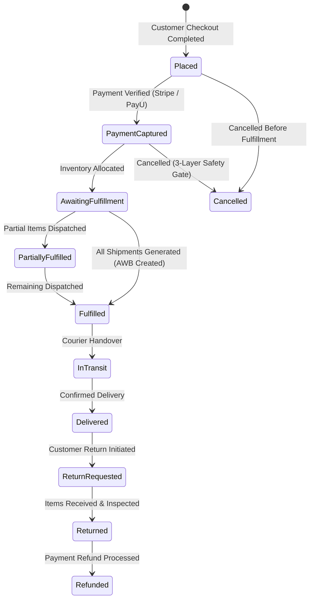

import { Callout } from "fumadocs-ui/components/callout";
import { Tab, Tabs } from "fumadocs-ui/components/tabs";

Cerebronix provides a robust order management and fulfillment pipeline for native stores. Merchants can track purchase orders, generate shipping labels via integrated carrier networks, manage fulfillment tracking, and handle customer return requests while keeping conversational AI agents synchronized with real-time order states.

## 1. What the Capability Accomplishes

The Orders & Fulfillment suite provides:

- **Unified Order Tracking:** Comprehensive oversight of customer purchases, payment confirmations, fulfillment statuses, and tracking numbers.
- **Automated Carrier Fulfillment:** Native integration with **Shiprocket** for automated airway bill (AWB) generation, courier assignment, and shipping label printing.
- **Granular Shipping Profiles:** Definition of flat-rate or calculated shipping options bound to specific stock locations and regional service zones.
- **Customer Identity Management:** Historical purchase tracking, customer group classification (e.g., *VIP Buyers*, *Wholesale*), and CRM profile synchronization.
- **Return & Refund Operations:** Standardized refund reason codes, return authorization tracking, and return policy compliance.
- **Conversational Synchronization:** AI agents immediately reflect order state changes (e.g., from *Processing* to *Shipped*), providing accurate answers during conversational tracking inquiries.

## 2. Order Lifecycle & Status Progression

Every order flows through distinct financial and fulfillment state machines:



### Order Status Fields

When viewing orders under **Ecommerce** -> **Orders** (`/orders`), each record displays:
- **Order ID:** Unique identifier (e.g., `ord_01J8K9P4X...`).
- **Date & Time:** Timestamp of order placement in store timezone.
- **Customer:** Name, email, shipping address, and phone number.
- **Payment Status:** `Pending`, `Captured`, `Partially Refunded`, or `Refunded`.
- **Fulfillment Status:** `Not Fulfilled`, `Partially Fulfilled`, `Fulfilled`, `Shipped`, or `Delivered`.
- **Total Amount:** Currency-denominated total including subtotal, taxes, shipping, and applied promotional discounts.

<Callout type="info" title="Draft Orders Architectural Notice">
In the Cerebronix native store engine, draft orders are reserved for administrative back-office operations. Seller-scoped direct creation of draft orders is restricted (routes under `/draft-orders` automatically redirect to `/orders`). All conversational shopping checkouts flow through standard customer order placement.
</Callout>

## 3. Shipping Options & Service Zones

Shipping rules are configured under **Ecommerce** -> **Store** -> **Locations & Shipping** (`/locations`).

### Shipping Architecture

- **Stock Location Binding:** Every shipping option is tied to a specific stock location (fulfillment warehouse). If an order contains items stocked across multiple locations, the system evaluates available options per location.
- **Service Zones:** Geographic boundaries (countries, states, or postal code prefixes) eligible for fulfillment.
- **Pricing Calculation:**
  - **Flat Rate:** Fixed shipping fee (e.g., `$9.99 Standard Shipping`).
  - **Free Shipping Thresholds:** Automatic zero-cost delivery when order total exceeds a specified value (e.g., *Free shipping on orders over $100*).
  - **Carrier-Calculated Rates:** Live rate fetching via Shiprocket based on parcel weight, package dimensions, and destination postal code.

## 4. Fulfillment Integration: Shiprocket

Cerebronix natively integrates with **Shiprocket** to automate shipping logistics across 25,000+ pin codes and multiple courier partners (Delhivery, FedEx, Blue Dart, DTDC, etc.).

### Fulfillment Details Setup (`/fulfillment-details`)

Merchants configure their carrier credentials directly in the Cerebronix console:
- **API Email:** The registered Shiprocket account email.
- **API Password:** Account authentication password.

When an order reaches `PaymentCaptured`, the merchant can trigger one-click fulfillment:
1. Cerebronix calls Shiprocket to allocate the optimal courier partner based on cost and delivery speed.
2. An Airway Bill (AWB) number is generated and attached to the Cerebronix order record.
3. Shipping labels and packing slips are immediately available for PDF download.
4. The order status advances to `Fulfilled` with live tracking links.

## 5. Returns, Refund Reasons & Claims

Managing customer returns and post-purchase issues is handled under **Ecommerce** -> **Store** -> **Refund Reasons** (`/refund-reasons`).

### Refund Reason Codes

Standardized return reason codes ensure accurate audit trails and financial reporting:
- `DAMAGED_IN_TRANSIT`: Packaging or product arrived damaged.
- `DEFECTIVE_PRODUCT`: Manufacturing defect or functional issue.
- `WRONG_ITEM_SHIPPED`: Incorrect size, color, or item fulfilled.
- `SIZE_NOT_FITTING`: Customer requested size exchange or return.
- `CUSTOMER_REMORSE`: Customer changed mind within return policy window.

<Callout type="warning" title="Operational Scope of Returns">
In multi-tenant vendor environments, return reasons are managed at the platform level (vendor-scoped create/edit buttons are restricted to ensure reporting consistency). Merchants can view all platform refund reason codes under `/refund-reasons` and apply them to customer return claims.
</Callout>

## 6. Prerequisites and Plan Restrictions

- **Plan Entitlements:**
  - **Free Evaluation:** Manual order fulfillment tracking; basic flat-rate shipping.
  - **Growth Plan:** Shiprocket automated fulfillment; customer groups; automated shipment tracking notifications.
  - **Scale & Enterprise Plans:** Multi-carrier routing, return merchandise authorization (RMA) workflows, automated tracking updates via WhatsApp, and carrier dispute resolution.
- **Required Roles:** `owner`, `admin`, or `developer` to update order fulfillment states, configure shipping carriers, and manage return policies. `viewer` role can inspect order statuses in read-only mode.

## 7. Step-by-Step Customer Instructions (Apex Retail Global Example)

### Step 1: Configure a Shipping Option

1. Navigate to **Ecommerce** -> **Store** -> **Locations & Shipping** (`/locations`).
2. Select **Austin Distribution Center**.
3. Under **Shipping Options**, click **Add Shipping Option**.
4. Configure details:
   - **Title:** `Standard Ground Shipping (3-5 Business Days)`
   - **Price Type:** `Flat Rate`
   - **Amount:** `$8.50`
   - **Eligible Regions:** `North America (USD)`
5. Click **Save Shipping Option**.

### Step 2: Fulfill a Customer Order

1. Navigate to **Ecommerce** -> **Orders** (`/orders`).
2. Click on order `ord_01J8K9P4X` placed by customer `Sarah Jenkins`.
3. Verify **Payment Status** is `Captured` ($137.50).
4. In the order summary, click **Create Fulfillment**.
5. Select the fulfillment location: `Austin Distribution Center`.
6. Select items to fulfill: `1x AeroStride Performance Runner (Matte Black / Size 10)`.
7. Choose carrier: **Shiprocket** (or select **Manual Carrier** and input carrier name and tracking number).
8. Click **Confirm Fulfillment**. The status immediately transitions to `Fulfilled`, and the tracking number is logged.

### Step 3: Process a Return Request

1. In the order detail view for `ord_01J8K9P4X`, navigate to the **Returns & Claims** tab.
2. Click **Initiate Return**.
3. Select the returned line item (`AeroStride Performance Runner`).
4. Select **Refund Reason**: `SIZE_NOT_FITTING`.
5. Enter return notes: `Customer requesting size 10.5 exchange; item received in original packaging`.
6. Click **Approve Return**. The order status updates, and a refund credit is generated for the Stripe/PayU gateway.

## 8. Expected Results & Verification

Verify that your order fulfillment and tracking are fully synchronized:

1. **Order Detail Screen:** Under `/orders/ord_01J8K9P4X`, verify that **Fulfillment Status** displays `Fulfilled` with courier tracking ID `SHP-88492014US`.
2. **AI Agent Live Tracking:** In the AI test chat, simulate a customer query:
   ```text
   Can you tell me the shipping status for order ord_01J8K9P4X?
   ```
3. **Agent Response Verification:**
   ```text
   Your order ord_01J8K9P4X has been fulfilled from our Austin Distribution Center and is currently in transit with Standard Ground Shipping. Your tracking number is SHP-88492014US.
   ```
4. **Customer Profile Update:** Navigate to `/customers` and verify that `Sarah Jenkins` reflects updated total lifetime value (LTV) and 1 completed order.

## 9. Common Problems and Troubleshooting

### Issue: Shiprocket AWB Generation Fails
- **Root Cause:** Incomplete customer shipping address (e.g., missing postal code or phone number) or expired Shiprocket credentials.
- **Resolution:** Verify the shipping address format in the order details. In `/fulfillment-details`, re-enter your Shiprocket account credentials and verify account balance.

### Issue: Customer Inquires About Order but Agent Reports "Order Not Found"
- **Root Cause:** The customer is chatting from a phone number or email address that does not match the billing/shipping record of the order.
- **Resolution:** The AI agent requires matching customer verification before disclosing order details to prevent data leakage. Ask the customer to provide the order ID along with their registered email address or billing zip code.

### Issue: Shipping Option Does Not Appear at Checkout
- **Root Cause:** The shipping option is tied to a warehouse location that does not stock the items in the customer's cart, or the customer's shipping address falls outside the service zone.
- **Resolution:** Verify stock levels under `/inventory` for the ordered variants at the location bound to that shipping option.

## 10. Relevant Related Guides

- [Native Store Management](/docs/ecommerce/native-store-management): Catalog setup, options, variants, and stock locations.
- [Pricing, Promotions & Regions](/docs/ecommerce/pricing-promotions-and-regions): Payment gateway configuration and tax rules.
- [Order Tracking & Self-Service](/docs/ecommerce/order-tracking-and-self-service): Conversational order tracking, reordering, and cancellation gates.
- [External Store Integrations](/docs/ecommerce/external-store-integrations): Connecting Shopify, WooCommerce, and Magento stores.
