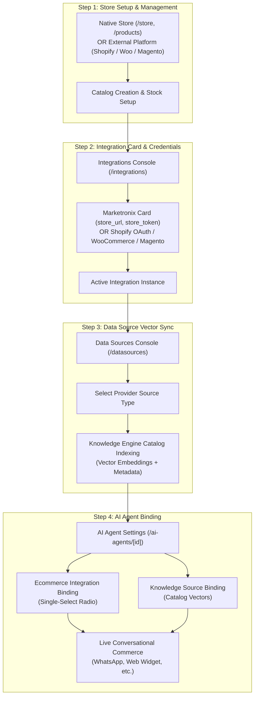

import { Callout } from "fumadocs-ui/components/callout";
import { Tab, Tabs } from "fumadocs-ui/components/tabs";

Cerebronix unites enterprise product catalogs, real-time inventory management, and omnichannel conversational commerce into a single operational architecture. Whether running the built-in Native Store or synchronizing existing catalogs from Shopify, WooCommerce, or Magento, businesses can deploy AI shopping concierges across messaging channels such as WhatsApp, Instagram, and the Web Chat Widget.

This guide details the system architecture, provider support matrix, multi-store isolation model, and the mandatory 4-step configuration sequence required to link catalogs to AI agents.

## 1. What the Capability Accomplishes

The Cerebronix Ecommerce engine provides:

- **Unified Catalog Abstraction:** A common schema across Native Store, Shopify, WooCommerce, and Magento catalogs for products, multi-variant SKUs, categories, and inventory.
- **Semantic Product Discovery:** Knowledge Engine vector indexing that enables AI agents to understand natural-language shopping requests (e.g., *"Show me breathable running shoes under $120"*).
- **Live Inventory & Pricing Grounding:** Real-time stock validation preventing agents from recommending out-of-stock items or quoting stale prices.
- **Conversational Cart & Checkout:** Frictionless conversational cart creation, item modification, promo code application, and direct storefront checkout URL generation.
- **Post-Purchase Self-Service:** Customer order tracking, shipment lookups, reordering, and controlled order cancellation with multi-layer authorization gates.
- **Multi-Instance Routing:** Independent binding between specific store instances and distinct AI agents or messaging channels (e.g., US WhatsApp channel routes to US Shopify store; UK Web Widget routes to UK Native Store).

## 2. High-Level Architecture & The 4-Step Configuration Sequence

Connecting an ecommerce catalog to conversational AI requires a deliberate 4-step operational chain. Cerebronix does not perform speculative automatic store bindings; each layer is intentionally configured to preserve security boundaries and multi-store separation.



<Callout type="info" title="Preservation of Marketronix Integration Flow">
The Marketronix integration card under `/integrations` was deliberately restored in Phase B1. An organization operates **one native Cerebronix store** (`marketronixStoreId`). While the restored card in `/integrations` supports manual credential entry (`store_url` and `store_token`), connecting a native store via the **Data Sources** console (`/datasources`) automatically links the organization's native store using internal authorization tokens. Both configuration paths are fully supported.
</Callout>

### Step Sequence Breakdown

1. **Step 1: Store Creation & Management (`/e-com` or `/store`):** Establish store settings, default currency, direct merchant payment gateways (Stripe, PayU), fulfillment credentials (Shiprocket), locations, and publish products with variant options. Each organization operates a single native store backend.
2. **Step 2: Integration Configuration (`/integrations` or `/datasources`):** For Native Store, connecting an ecommerce data source under `/datasources` automatically provisions the integration instance. Alternatively, operators can configure the restored **Marketronix** integration card under `/integrations` with the store URL and publishable token. For external providers (Shopify, WooCommerce, Magento), operators connect instances directly under `/integrations`.
3. **Step 3: Catalog Vector Synchronization (`/datasources`):** Ingest product titles, descriptions, categories, and variant attributes into vector embeddings in the Knowledge Engine.
4. **Step 4: AI Agent Binding (`/ai-agents/[id]`):** In the target AI agent settings:
   - In **Ecommerce Integration**, select the connected store instance via the single-select radio picker.
   - In **Knowledge Sources**, check the synchronized ecommerce catalog data source.

## 3. Platform & Provider Capability Matrix

Not all ecommerce platforms share identical API capabilities or webhook architectures. Cerebronix normalizes capabilities across platforms while honoring provider-specific constraints:

| Capability | Native Store (Marketronix) | Shopify | WooCommerce | Magento (Adobe Commerce) |
| :--- | :--- | :--- | :--- | :--- |
| **Connection Type** | Auto via Data Sources OR Manual (`store_url` + `store_token`) | OAuth 2.0 (App Store / Domain) | Manual (Consumer Key & Secret) | Manual (Integration Bearer Token) |
| **Multi-Instance Support** | Single native store per organization | Yes (Multiple Shopify stores) | Yes (Multiple Woo stores) | Yes (Multiple Magento stores) |
| **Catalog Vector Search** | Real-time vector embeddings | Real-time vector embeddings | Real-time vector embeddings | Real-time vector embeddings |
| **Real-Time Webhooks** | Native event pipeline | Shopify App Webhooks | WooCommerce Webhooks | Background Polling (`MagentoOrderPollWorker` 20 min) |
| **Product Permalinks** | Direct storefront URL | Native `.myshopify.com` / Custom domain | Storefront product permalink | Storefront product rewrite URL |
| **Rich Visual Cards** | Web Chat Widget & Direct API | Web Chat Widget & Direct API | Web Chat Widget & Direct API | Web Chat Widget & Direct API |
| **Messaging Channel Cards** | Formatted text + permalink | Formatted text + permalink | Formatted text + permalink | Formatted text + permalink |
| **Conversational Cart** | Full support (`add_to_cart`) | Full support (Storefront Cart API) | Full support (WooCommerce Cart API) | Full support (Guest Cart API) |
| **Checkout Link Generation** | Direct checkout session URL | Direct checkout permalink | Direct cart/checkout redirect URL | Guest checkout redirect URL |
| **Order Inquiries** | Supported (`list_orders`) | Supported (`list_orders`) | Supported (`list_orders`) | Supported (`list_orders`) |
| **Shipment Tracking** | Carrier tracking integration | Shopify Fulfillment tracking | WooCommerce Shipment Tracking API | Carrier tracking via order polling |
| **Order Cancellation** | 3-Layer Safe Gate | 3-Layer Safe Gate | 3-Layer Safe Gate | 3-Layer Safe Gate |
| **Promo Code Application** | Native promotion engine | Native discount codes | WooCommerce coupon engine | Magento sales rule coupon codes |

## 4. Prerequisites and Plan Restrictions

- **Plan Entitlements:**
  - **Free Evaluation:** 1 connected store instance; standard conversational product discovery; manual catalog re-indexing.
  - **Growth Plan:** Up to 3 store instances; automated webhook catalog updates; conversational cart and checkout links.
  - **Scale & Enterprise Plans:** Unlimited store instances; multi-channel store routing; advanced 3-layer order cancellation; automated post-purchase lifecycle messaging (shipment tracking, feedback requests).
- **Access Roles:** Requires `owner`, `admin`, or `developer` permissions to add or modify integration credentials and update agent bindings.

## 5. Cerebronix UI Navigation Map

The operator console organizes ecommerce across distinct operational zones:

- **Store & Catalog Operations:** Navigate to **Ecommerce** (`/e-com` or `/store`) in the left navigation sidebar. Sub-items include:
  - **Settings (`/store`):** Default currency, timezone, store profile, and self-service order cancellation toggle.
  - **Locations & Shipping (`/locations`):** Inventory fulfillment warehouses, service zones, and shipping options.
  - **Payment Details (`/payment-details`):** Vendor direct gateways (Stripe, PayU).
  - **Refund Reasons (`/refund-reasons`):** Return policies and return reason codes.
  - **Products (`/products`):** Catalog list, product builder, options, variants, categories (`/categories`), and collections (`/collections`).
  - **Promotions (`/promotions`):** Coupon codes, percentage discounts, and marketing campaigns (`/campaigns`).
  - **Orders (`/orders`):** Customer order records, fulfillment statuses, customer groups (`/customerGroups`), and profiles (`/customers`).
- **Integrations Console:** Navigate to **Integrations** (`/integrations`) to configure external providers and the Native Store (Marketronix) credential card.
- **Data Sources:** Navigate to **Data Sources** (`/datasources`) to create and sync the catalog knowledge base.
- **AI Agent Settings:** Navigate to **AI Agents** (`/ai-agents`) -> Select Agent -> Scroll to **Ecommerce Integration** and **Knowledge Sources**.

## 6. Step-by-Step Customer Setup Workflow

### Step 1: Initial Store Setup (Apex Retail Global Example)

1. Open the Cerebronix console and select **Apex Retail Global** from the organization switcher.
2. In the navigation sidebar, click **Ecommerce** (`/e-com`).
3. If this is a new native store, the **Store Setup Wizard** (`/setup-wizard`) initiates:
   - **Step 1 (Fulfillment):** Connect Shiprocket credentials (`email` and `password`).
   - **Step 2 (Payment):** Connect Stripe API credentials or PayU keys.
   - **Step 3 (Location & Shipping):** Confirm the default warehouse address and shipping profile.
4. Once completed, navigate to **Products** (`/products`) and create your initial products and variants.

### Step 2: Configure the Marketronix Integration Card

1. Navigate to **Integrations** (`/integrations`).
2. Locate the **Marketronix** card in the provider grid.
3. Click **Connect** (or **Manage Instances** if instances already exist).
4. Enter the required parameters:
   - **Store URL:** `https://apexretail.marketronix.cerebronix.com` (or your internal store endpoint).
   - **Store Token:** Your publishable store API token.
5. Click **Save Credentials**. The status updates to `CONNECTED`.

### Step 3: Index the Catalog into Data Sources

1. Navigate to **Data Sources** (`/datasources`).
2. Click **Add Data Source** and select **Marketronix** (or your external platform provider).
3. Provide a data source label (e.g., `Apex Retail Global Catalog`).
4. Click **Start Sync**. The Knowledge Engine crawls all active products, formats metadata into markdown chunks, and embeds them into the vector database.

### Step 4: Bind the Store to Your AI Agent

1. Navigate to **AI Agents** (`/ai-agents`) and click **Edit** on your customer concierge agent (e.g., `Apex Sales Concierge`).
2. Scroll to the **Ecommerce Integration** section.
3. Select your connected store instance from the single-select radio group.
4. Scroll to **Knowledge Sources** and check `Apex Retail Global Catalog`.
5. Click **Save Changes** in the header.

## 7. Expected Results & Verification

Once configured, verify the end-to-end integration:

1. **Verify Integration Status:** Under `/integrations`, ensure the Marketronix card displays a green `CONNECTED` badge.
2. **Verify Data Source Sync:** Under `/datasources`, verify the catalog data source displays `INDEXED` with a non-zero document count.
3. **Verify Agent Tool Registry:** In the agent preview drawer or test chat, ask:
   ```text
   What athletic footwear do you have available in size 10?
   ```
4. **Expected AI Response:** The agent queries the Knowledge Engine vector store, identifies matches, verifies inventory levels, and responds:
   ```text
   Apex Retail Global offers the AeroStride Performance Runner in Matte Black (Size 10) for $129.00. We currently have 14 units in stock. Would you like me to add this to your cart?
   ```
5. **Verify Product Permalink:** Ask: *"Can you share the link for that shoe?"* The agent generates a direct clickable link to the storefront product page.

## 8. Common Problems and Troubleshooting

### Issue: Agent Claims Products Do Not Exist Despite Being in Catalog
- **Root Cause:** The Data Source sync has not completed or the catalog was not bound to the agent.
- **Resolution:** Check `/datasources` to ensure the vector index shows `SYNCED`. In `/ai-agents/[id]`, confirm that the catalog data source checkbox is selected.

### Issue: "Integration Not Bound" Warning During Chat
- **Root Cause:** The agent has knowledge source access but lacks the active **Ecommerce Integration** binding required to execute MCP tools (`add_to_cart`, `list_orders`).
- **Resolution:** Open `/ai-agents/[id]`, select the connected store instance in the **Ecommerce Integration** radio group, and click **Save Changes**.

### Issue: Magento Store Orders or Stock Not Updating Immediately
- **Root Cause:** Magento stores do not emit webhooks to Cerebronix. Synchronization relies on the in-process `MagentoOrderPollWorker` running on a 20-minute cycle.
- **Resolution:** Wait for the 20-minute worker tick, or manually trigger a catalog re-index under `/datasources`. Ensure Cerebronix egress IPs are allowlisted in Magento firewall rules.

## 9. Relevant Related Guides

- [Native Store Management](/docs/ecommerce/native-store-management): Store settings, catalog creation, variants, and inventory tracking.
- [External Store Integrations](/docs/ecommerce/external-store-integrations): Connecting Shopify, WooCommerce, and Magento stores.
- [Conversational Shopping & Cart](/docs/ecommerce/conversational-shopping-and-cart): Conversational product search, variant resolution, cart operations, and checkout link generation.
- [Order Tracking & Self-Service](/docs/ecommerce/order-tracking-and-self-service): Post-purchase order lookups, shipment tracking, and the 3-layer cancellation safety gate.
