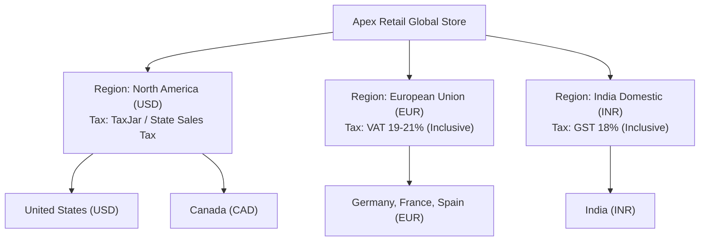
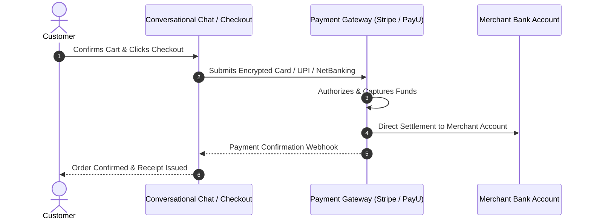
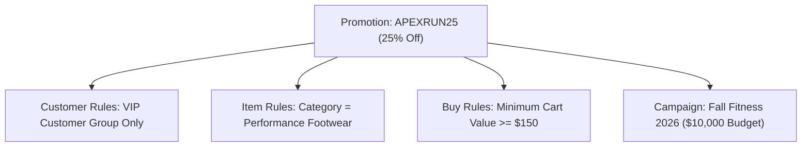

import { Callout } from "fumadocs-ui/components/callout";
import { Tab, Tabs } from "fumadocs-ui/components/tabs";

Cerebronix enables global commerce through flexible regional pricing, automated tax calculations, direct merchant payment processing, and granular promotional discount engines. Whether running targeted holiday sales campaigns or offering customer-group discounts, merchants retain complete control over pricing structures and margin rules across international markets.

## 1. What the Capability Accomplishes

The Pricing, Promotions & Regions engine allows merchants to:

- **Configure Multi-Currency Regions:** Define distinct geographic operating zones (e.g., North America, European Union, India) with native currency formatting and regional tax rules.
- **Process Direct Merchant Payments:** Connect your own **Stripe** or **PayU** accounts so that customer transaction revenues deposit directly into your business bank account without intermediary platform escrow.
- **Engineer Dynamic Discount Promotions:** Create coupon codes with percentage discounts, fixed-amount deductions, or automated free shipping.
- **Establish Granular Qualification Rules:** Restrict discounts using Buy Rules (e.g., *Buy 2 pairs of shoes, get 20% off*), Item Rules (specific categories or SKUs), and Customer Rules (new customers or VIP customer groups).
- **Manage Marketing Campaigns & Budgets:** Group individual promotional codes under overarching marketing campaigns with hard spend budgets and automated start/end dates.
- **Ground AI Promotional Execution:** Enable AI agents to dynamically evaluate cart eligibility and apply promo codes directly within live chat conversations.

## 2. Multi-Currency Regions & Tax Rules

Navigate to **Ecommerce** -> **Regions** (`/regions`) to view geographic operational zones.



### Regional Configuration Concepts

- **Currency Code:** The ISO currency code used for product pricing, checkout totals, and customer receipts (e.g., `USD`, `EUR`, `INR`, `GBP`).
- **Country Mappings:** The list of destination countries belonging to this operational region. A customer entering a shipping address within Germany is automatically priced and taxed according to the European Union region.
- **Tax Rate & Tax Providers:** Regional tax rates (e.g., 20% VAT in the UK, state-level sales tax in the US). Prices can be configured as **Tax-Inclusive** (common in Europe and India) or **Tax-Exclusive** (standard in North America).

<Callout type="info" title="Region Edit Access Note">
In multi-tenant SaaS environments, global region creation and country definitions are managed at the platform organization tier to prevent tax classification conflicts across sellers. Merchants can view all active regions and assign location-specific shipping options to these regions.
</Callout>

## 3. Direct Payment Gateways: Stripe & PayU

Navigate to **Ecommerce** -> **Store** -> **Payment Details** (`/payment-details`).

### Direct Merchant Payout Architecture

Cerebronix operates on a **Direct Merchant Payout** architecture. Rather than routing customer funds through a centralized marketplace escrow or payout delay pipeline, sellers connect their own gateway accounts. Customer payments deposit immediately into the merchant's merchant account:



### Supported Payment Gateways

<Tabs items={["Stripe", "PayU"]}>
  <Tab value="Stripe">
    **Stripe Integration (`/payment-details/stripe/create`):**
    - **Publishable Key:** Frontend public token (`pk_live_...` or `pk_test_...`) used to tokenize credit/debit card information securely in the browser.
    - **Secret Key:** Backend private key (`sk_live_...` or `sk_test_...`) used to capture payments and process refunds.
    - **Supported Methods:** Major credit and debit cards (Visa, Mastercard, Amex), Apple Pay, Google Pay, and localized bank rails (SEPA, iDEAL).
  </Tab>
  <Tab value="PayU">
    **PayU Integration (`/payment-details/payu/create`):**
    - **Merchant Key:** PayU merchant identifier.
    - **Merchant Salt:** Cryptographic signature salt used to verify transaction hash integrity.
    - **Supported Methods:** UPI (Unified Payments Interface), Net Banking, RuPay cards, Wallets, and EMI options optimized for the Indian subcontinent.
  </Tab>
</Tabs>

## 4. Promotions & Discount Engine

Navigate to **Ecommerce** -> **Promotions** (`/promotions`).

### Promotion Structure

Each promotion record comprises:
- **Promotion Code:** The alphanumeric coupon code customers or AI agents enter in checkout (e.g., `SUMMER20`, `WELCOME10`).
- **Discount Type:**
  - **Percentage Discount:** Deducts a percentage from qualifying items (e.g., `20% off`).
  - **Fixed Amount Discount:** Deducts a specific currency value from the subtotal (e.g., `$25.00 off`).
  - **Free Shipping:** Waives shipping fees for orders meeting eligibility thresholds.
- **Usage Limits:**
  - **Total Usage Limit:** Maximum number of times the promotion can be redeemed globally across all customers (e.g., *First 500 customers only*).
  - **Per-Customer Limit:** Maximum redemptions per unique customer account (e.g., *1 redemption per email*).
- **Validity Dates:** Mandatory start timestamp and optional expiration timestamp.



### Qualification Rules

- **Buy Rules (`/promotions/[id]/edit-buy-rules`):** Conditions required to activate the promotion (e.g., *Minimum order subtotal must equal or exceed $100*, or *Cart must contain at least 2 items*).
- **Item Rules (`/promotions/[id]/edit-item-rules`):** Specific products, collections, or categories eligible for the discount. Prevents sitewide discounts from eroding margins on clearance or high-cost inventory.
- **Customer Rules (`/promotions/[id]/edit-customer-rules`):** Limits eligibility to specific customer groups (e.g., *Wholesale Partners*, *Loyalty Tier Gold*) or first-time purchasers.

## 5. Marketing Campaigns & Budgets

Navigate to **Ecommerce** -> **Promotions** -> **Campaigns** (`/campaigns`).

### Campaign Architecture

Campaigns allow marketing and finance leads to coordinate multi-channel discount initiatives:
- **Campaign Name:** Descriptive marketing title (e.g., `Black Friday 2026 Marathon`).
- **Promotional Budget:** Maximum monetary discount liability permitted for the campaign (e.g., `$15,000.00`).
- **Budget Tracking:** Cerebronix tracks the cumulative discount amount granted across all associated promo codes. Once the budget limit is reached, all child promotions automatically deactivate to prevent unexpected margin loss.
- **Scheduling:** Automated campaign launch and shutdown timestamps synchronized with marketing email and WhatsApp broadcast schedules.

## 6. Prerequisites and Plan Restrictions

- **Plan Entitlements:**
  - **Free Evaluation:** 1 active promotion code; standard percentage and fixed-amount discounts.
  - **Growth Plan:** Up to 25 active promotions; customer group rules; PayU and Stripe gateway support.
  - **Scale & Enterprise Plans:** Unlimited promotions; campaign spend budgets; multi-currency pricing tiers; dynamic AI promo code suggestions.
- **Required Roles:** `owner`, `admin`, or `developer` to create promotions, link payment credentials, and adjust campaign budgets. `viewer` role can view promotions and pricing rules in read-only mode.

## 7. Step-by-Step Customer Instructions (Apex Retail Global Example)

### Step 1: Connect Stripe Payment Details

1. Navigate to **Ecommerce** -> **Store** -> **Payment Details** (`/payment-details`).
2. Click **Connect Stripe** (`/payment-details/stripe/create`).
3. Enter your **Stripe Publishable Key**: `pk_live_51P8...`
4. Enter your **Stripe Secret Key**: `sk_live_51P8...`
5. Click **Save Gateway Credentials**. The payment status displays `Active`.

### Step 2: Create a Promotional Campaign with Budget

1. Navigate to **Ecommerce** -> **Promotions** -> **Campaigns** (`/campaigns`).
2. Click **Create Campaign**.
3. Configure campaign parameters:
   - **Name:** `Apex Fall Marathon 2026`
   - **Campaign Budget:** `$5,000.00`
   - **Currency:** `USD`
   - **Start Date:** `2026-10-01 00:00:00`
   - **End Date:** `2026-11-15 23:59:59`
4. Click **Save Campaign**.

### Step 3: Create a Targeted Promotion Code

1. Navigate to **Ecommerce** -> **Promotions** (`/promotions`).
2. Click **New Promotion**.
3. In **General Details**:
   - **Promotion Code:** `MARATHON20`
   - **Type:** `Percentage`
   - **Value:** `20%`
   - **Link to Campaign:** Select `Apex Fall Marathon 2026`.
4. In **Buy Rules**:
   - Set **Minimum Subtotal**: `$100.00`.
5. In **Item Rules**:
   - Select **Category**: `Performance Footwear`.
6. Click **Save Promotion**.

## 8. Expected Results & Verification

Verify your promotional pricing and conversational execution:

1. **Promotion Listing:** Under `/promotions`, verify `MARATHON20` displays status `Active` with a 20% discount rate linked to campaign `Apex Fall Marathon 2026`.
2. **Conversational Promo Evaluation:** In the AI test chat, simulate a customer checkout inquiry:
   ```text
   I have two pairs of AeroStride runners in my cart totaling $258. Can I use promo code MARATHON20?
   ```
3. **Agent Response Verification:** The AI agent executes the `apply_promo_code` tool, evaluates eligibility against the $100 minimum and footwear category, and responds:
   ```text
   Promo code MARATHON20 has been applied successfully! You've received a 20% discount (-$51.60), bringing your new subtotal to $206.40. Would you like to proceed to checkout?
   ```
4. **Campaign Budget Deduction:** Check `/campaigns/Apex Fall Marathon 2026` to verify that cumulative spend reflects the discount utilization.

## 9. Common Problems and Troubleshooting

### Issue: Promo Code Fails with "Conditions Not Met"
- **Root Cause:** Cart subtotal is below the minimum threshold or the cart contains items excluded by item rules.
- **Resolution:** Review the Buy Rules and Item Rules under `/promotions/[id]`. The AI agent explains the shortfall to the customer (e.g., *"MARATHON20 requires a minimum footwear purchase of $100.00"*).

### Issue: Stripe Payments Rejected During Checkout
- **Root Cause:** Invalid or test-mode API keys configured in a production environment, or mismatched currency settings between the region and Stripe account.
- **Resolution:** Verify under `/payment-details` that you are using live Stripe keys (`pk_live_...` and `sk_live_...`). Ensure your Stripe merchant account has settlement enabled for the region's currency.

### Issue: Promotion Stops Working Mid-Campaign
- **Root Cause:** The campaign budget limit was reached, or the total usage limit on the promotion was exhausted.
- **Resolution:** Open `/campaigns`, review the budget spend bar, and increase the campaign budget if additional promotional allowance is approved.

## 10. Relevant Related Guides

- [Native Store Management](/docs/ecommerce/native-store-management): Catalog setup, options, variants, and stock locations.
- [Orders, Fulfillment & Returns](/docs/ecommerce/orders-fulfillment-and-returns): Order processing and fulfillment workflows.
- [Conversational Shopping & Cart](/docs/ecommerce/conversational-shopping-and-cart): Conversational cart creation and checkout link generation.
- [Order Tracking & Self-Service](/docs/ecommerce/order-tracking-and-self-service): Post-purchase order lookups and cancellation safeguards.
