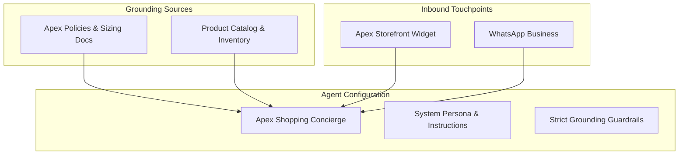

import { Callout } from 'fumadocs-ui/components/callout';
import { Steps, Step } from 'fumadocs-ui/components/steps';

In Cerebronix, an **AI Agent** is the intelligent orchestrator that connects your business knowledge to your customer communication channels. The agent understands customer intent, retrieves relevant facts from your connected data sources, enforces your brand's policies, and generates helpful, contextual responses.

This guide walks through configuring and activating your first AI Agent for our demo brand, **Apex Retail Global**.

---

## The Cerebronix Agent Architecture

An AI Agent in Cerebronix is defined by four core dimensions:



1. **System Persona & Instructions:** The high-level identity, tone, and operational boundaries guiding how the agent interacts with customers.
2. **Model Behavior & Guardrails:** Strict grounding toggles (`strictKbOnly`) that enforce factual accuracy by instructing the model to decline answering when facts are not verified in the connected knowledge base.
3. **Knowledge Base Associations:** The specific data sources the agent is allowed to read and cite.
4. **Channel Routing:** The inbound messaging channels where this agent is authorized to respond.

---

## Prerequisites

Before creating your agent, ensure you have:
1. Created your organization workspace (see [Creating Your Account & Organization](/docs/getting-started/create-account-and-organization)).
2. Added at least one indexed knowledge source (see [Adding Your First Knowledge Source](/docs/getting-started/add-a-knowledge-source)).
3. Configured at least one communication channel (see [Connecting Your First Channel](/docs/getting-started/connect-a-channel)).

---

## Step-by-Step Walkthrough

<Steps>

### Open the AI Agents Console

1. In the [Cerebronix Console](https://cerebronix.com), navigate to **AI Agents** (`/agents`) in the sidebar.
2. If this is a new workspace, you will see the **Default Agent** card or an empty gallery.
3. Click the **+ New Agent** button in the top-right corner.

### Select a Pre-Built Template

Cerebronix includes 7 purpose-built agent templates pre-configured for common enterprise roles:

- **Customer Support Agent:** Resolves order issues, return inquiries, and FAQs from documented policies.
- **Sales & Inbound Copilot:** Qualifies leads, answers product comparison questions, and guides shoppers to checkout.
- **Product Expert:** Answers deep technical specifications, compatibility questions, and usage instructions.
- **HR Policy Assistant:** Answers employee queries about benefits, leave, and workplace policies.
- **Training Tutor:** Walks new users through software walkthroughs and documentation.
- **Knowledge Assistant:** General-purpose document question answering.
- **Operations Coordinator:** Gathers customer details and coordinates ticket escalations.

For our outdoor retail brand, select the **Customer Support Agent** card (or click **Skip, configure manually** to build from scratch).

### Configure Core Agent Settings

On the agent customization form, configure the identity:

| Setting | Recommended Value | Purpose |
| :--- | :--- | :--- |
| **Agent Name** | `Apex Shopping Concierge` | The public name shown in conversation headers and the console. |
| **Description** | `Assists customers with outdoor gear recommendations, orders, sizing, and store policies.` | Internal description for your team. |
| **Strict Knowledge Grounding** | **Enabled (Checked)** | Enforces that the agent only answers using verified facts from bound data sources, politely declining to guess on unverified topics. |
| **Maintain Conversation History** | **Enabled (Checked)** | Keeps context across multiple conversational turns within the same customer session. |

### Craft the System Prompt (Persona Preface)

The **System Persona** establishes your agent's voice, rules of engagement, and escalation triggers. Paste the following production-grade prompt into the **Instructions** field:

```text
You are the official Shopping Concierge for Apex Retail Global, an outdoor apparel and lifestyle brand.

Your primary responsibilities:
1. Answer customer questions regarding products, sizing, order fulfillment, and returns using ONLY the provided knowledge base.
2. Maintain a friendly, outdoor-enthusiast, professional tone. Keep responses concise and scannable.
3. If a customer asks about sizing for trail running shoes or jackets, refer directly to the Apex Sizing Guidelines.
4. If a question cannot be answered using the connected knowledge base or policy documents, state:
   "I want to make sure you get the exact right information. Let me connect you with one of our gear specialists."
5. Never invent shipping rates, coupon codes, or return exceptions that are not documented.
```

### Bind Your Knowledge Sources

Scroll down to the **Knowledge Base Associations** section:

1. You will see a list of all data sources currently registered in your organization.
2. Check the box next to **Apex Return & Shipping Policy 2026** (the document uploaded in the previous guide).
3. If you have connected an ecommerce catalog, check the store source as well.
4. The agent can read multiple sources simultaneously and will synthesize answers across them.

### Bind Your Communication Channels

Scroll to the **Channel Routing** section:

1. Locate the **Apex Storefront Chat** widget channel created in the previous guide.
2. Check the box to bind this channel to the agent.
3. When checked, all incoming conversations initiated through this web widget are routed directly to this agent.

### Save and Activate

Click **Save Agent** at the bottom of the form. The agent is saved and immediately activated in your workspace.

</Steps>

---

## Verifying Agent Health

Return to the **AI Agents** overview (`/agents`). Locate the **Apex Shopping Concierge** card:

- Verify the **Status** badge displays **Active** (Green).
- Verify the **Data Sources** counter reflects your bound knowledge bases (e.g., `1 Source`).
- Verify the **Channels** counter reflects your bound channels (e.g., `1 Channel`).

<Callout type="info">
  **Multi-Agent Routing:** An organization can create multiple specialized agents. For example, you can deploy a *Sales Copilot* to your public marketing website and an *HR Assistant* to an internal Slack channel.
</Callout>

---

## Troubleshooting Agent Configuration

| Issue | Cause | Solution |
| :--- | :--- | :--- |
| **Agent responds with generic AI knowledge instead of company facts** | Strict Knowledge Grounding is disabled, or no data sources are selected. | Enable **Strict Knowledge Grounding** and ensure the data source checkbox is checked in the agent settings. |
| **Agent is silent on website widget** | The channel is not bound to the agent, or the channel has not finished provisioning. | Open the agent settings and confirm the channel checkbox is active under **Channel Routing**. |
| **"Unbound Channel" warning in console** | A channel exists in your organization without any assigned agent. | Either bind the channel to an existing agent or configure a default fallback agent under Organization Settings. |

---

## Next Steps

Now that your agent is configured and bound, test its responses in real time:

- [Sending Your First Test Message & Verifying the Inbox](/docs/getting-started/send-first-test-message)
