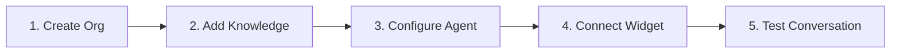

This quickstart guide takes you from an empty account to a functioning, knowledge-grounded AI agent deployed on a live web chat widget.

Follow these five sequential steps to configure your environment using our demo business profile, **Apex Retail Global**:



---

<Steps>

### Step 1: Create Your Account & Organization Workspace

1. Navigate to [`cerebronix.com/registration`](https://cerebronix.com/registration).
2. Enter your first name, last name, business email, and secure password. Accept the terms of service and click **Sign Up**.
3. Check your email inbox for your 6-digit verification code. Enter the code on the verification screen and submit.
4. On the **Register Organization** screen, configure your primary business workspace:
   - **Organization Name:** Enter `Apex Retail Global` (or your company name).
   - **About:** Enter `Outdoor apparel and lifestyle retail`.
   - **Industry & Size:** Select `Retail & E-commerce` and your team size.
   - **Country & Currency:** Select your country and default currency (e.g., `USD`).
5. Click **Complete Setup**. The platform provisions your workspace and opens your dashboard with 200 Free Evaluation platform credits.

### Step 2: Add Your First Knowledge Source

To ensure your AI agent provides accurate, factual answers about your business, upload a reference document or crawl your public website:

1. In the left navigation sidebar, click **Data Sources** (`/datasources`).
2. Click **+ Add Data Source**.
3. Select **File Upload**:
   - Drag and drop a product manual, FAQ document, or return policy PDF (or select **Website** and enter your public documentation URL).
   - Enter a descriptive title, such as `Apex Store Policies & FAQ`.
4. Click **Upload & Process**.
5. The indexing pipeline will process your document. Wait a few moments until the status badge transitions to **`Success`**.

### Step 3: Configure Your AI Agent

Now configure the agent persona and bind it to your newly indexed knowledge source:

1. In the sidebar, click **AI Agents** (`/agents`).
2. Your organization starts with a pre-created **Default Agent**. Click **Edit** (or click **+ New Agent** to create one from the Template Gallery).
3. Set your agent persona:
   - **Agent Name:** `Apex Shopping Concierge`
   - **System Prompt Instructions:**
     ```markdown
     You are the friendly, helpful shopping assistant for Apex Retail Global.
     Always answer customer questions using the verified knowledge sources provided.
     If a policy or product specification is not in your knowledge base, politely
     offer to connect the customer with a human support specialist.
     Keep responses concise, polite, and professional.
     ```
4. Scroll to **Knowledge Data Sources** and check the box next to `Apex Store Policies & FAQ`.
5. Click **Save Agent Changes**.

### Step 4: Connect the Web Chat Widget Channel

To make the agent accessible to visitors, connect a Web Chat Widget:

1. In the sidebar, click **Channels** (`/channels`).
2. Click **Create Channel**.
3. Under **Business Channels**, select **Web Chat Widget**:
   - **Channel Name:** `Storefront Chat Widget`
   - **Theme Color:** Choose a primary color matching your brand (e.g., `#2563EB`).
   - **Welcome Title:** `Hi there! How can we help you today?`
   - **Tagline:** `Ask us about products, sizing, or store policies.`
4. Click **Create Channel**.
5. Return to **AI Agents**, open your `Apex Shopping Concierge` agent, and under **Channel Bindings**, ensure `Storefront Chat Widget` is selected.

### Step 5: Test the Live Conversation

Verify that your agent is correctly retrieving information from your knowledge source:

1. In the sidebar, navigate to **AI Agents** -> open `Apex Shopping Concierge` -> click the **Test** tab on the right side of the screen.
2. Type a question based on your uploaded document:
   ```text
   What is your standard return window and policy?
   ```
3. Verify that the agent replies immediately with the exact facts from your document.
4. Next, open the **Chat** operator inbox (`/chat`) from the sidebar. You will see your test thread logged with full conversation metadata, timestamp, and active status.

</Steps>

---

## Expected Results & Next Steps

When you complete this quickstart:
- Your organization workspace is active.
- Your knowledge base is indexed in the vector database.
- Your AI agent is grounded and bound to a web widget.
- Conversations stream in real time to the operator inbox.

### Recommended Next Steps

- [Embed the Web Chat Widget on your website](/docs/getting-started/connect-a-channel)
- [Connect WhatsApp Business or Social Channels](/docs/guides/channels-whatsapp)
- [Invite your support team and assign roles](/docs/getting-started/invite-your-team)
- [Explore the Core Architecture Concepts](/docs/concepts/agents-knowledge-channels)
