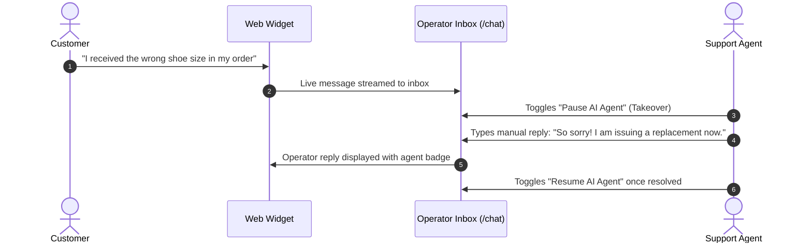

import { Callout } from 'fumadocs-ui/components/callout';
import { Steps, Step } from 'fumadocs-ui/components/steps';
import { Tabs, Tab } from 'fumadocs-ui/components/tabs';

Before rolling out an AI agent to real customers, thorough validation ensures that your system prompt, knowledge base retrieval, and escalation workflows function as intended.

Cerebronix offers two testing environments:
1. **The In-Console Sandbox (`AgentTestPanel`):** An isolated testing playground within the agent configuration screen for rapid prompt and retrieval iteration.
2. **The Live Embedded Web Widget:** A real-world end-to-end test verifying network delivery, visual rendering, and operator inbox synchronization.

This guide walks through testing your **Apex Shopping Concierge** agent across both environments.

---

## Prerequisites

Before testing:
1. Ensure your knowledge source status is **Success** (Green) in [Data Sources](/docs/getting-started/add-a-knowledge-source).
2. Ensure your agent is **Active** with the data source and channel bound in [AI Agents](/docs/getting-started/create-or-bind-an-ai-agent).
3. Confirm that your organization has active platform credits under **Billing** (`/billing`).

---

## Testing Modality 1: In-Console Sandbox

The quickest way to validate prompt changes and knowledge retrieval without deploying to a live site is the built-in sandbox.

<Steps>

### Open the Agent Test Panel

1. In the [Cerebronix Console](https://cerebronix.com), click **AI Agents** (`/agents`) in the sidebar.
2. Click on your agent card (**Apex Shopping Concierge**).
3. Scroll to the bottom of the page to locate the **Test** panel (`#test`).

### Run Test Conversations

Type test inquiries into the sandbox message bar:

<Tabs items={["Policy Grounding", "Ungrounded Edge Case", "Product Sizing"]}>

<Tab value="Policy Grounding">

#### Test 1: Verified Document Grounding

**Input:**
```text
What is your return policy for trail running shoes?
```

**Expected Agent Response:**
> At Apex Retail Global, items can be returned within 30 days of purchase in unworn condition with original tags attached. Return shipping is free within North America.

*Verification:* The agent cites the exact 30-day window and condition rules from your uploaded document rather than generic internet return policies.

</Tab>

<Tab value="Ungrounded Edge Case">

#### Test 2: Guardrail & Out-of-Scope Handling

**Input:**
```text
Can you explain how to replace a car transmission?
```

**Expected Agent Response:**
> I can only assist with questions regarding Apex Retail Global outdoor products, orders, sizing, and store policies. Let me connect you with one of our specialists if you need help with your order.

*Verification:* The agent respects the `strictKbOnly` setting and system prompt, refusing to hallucinate on out-of-scope topics.

</Tab>

<Tab value="Product Sizing">

#### Test 3: Sizing Recommendations

**Input:**
```text
Do the Summit Trail Shoes fit true to size?
```

**Expected Agent Response:**
> Summit Trail Shoes generally fit true to size. If you have wider feet, we recommend sizing up by half a size for maximum comfort on the trail.

*Verification:* The agent accurately pulls sizing guidance from your uploaded FAQ data source.

</Tab>

</Tabs>

### Clear History Between Iterations

To test how the agent behaves in a clean, fresh session without prior context, click the **Clear History** button at the top of the test panel.

</Steps>

---

## Testing Modality 2: Live Storefront Web Widget

Once the sandbox responses look great, verify the customer-facing experience in your web browser.

<Steps>

### Open the Test Webpage

1. Open the website page where you embedded the Cerebronix script snippet (or load a local HTML test file with the script tag).
2. Click the circular chat launcher button in the bottom-right corner.
3. Verify that the header displays your configured title (**Apex Shopping Concierge**) and tagline with the `#2563EB` royal blue branding.

### Send a Customer Message

1. In the chat window, type:
   ```text
   Hi! How long do I have to return an order?
   ```
2. Send the message.
3. Observe the response latency and verify that the agent replies promptly with the verified 30-day policy.

</Steps>

---

## Verifying the Omnichannel Operator Inbox

Every conversation initiated across any channel appears live in the **Chat** interface (`/chat`). This is where your team monitors automated conversations and steps in when needed.

<Steps>

### Open the Operator Inbox

1. In the Cerebronix Console, click **Chat** (`/chat`) in the left sidebar.
2. In the conversation list, locate the new active thread. You will see:
   - Channel icon: **Web Widget** badge.
   - Visitor identifier or customer name.
   - The recent exchange between the customer and **Apex Shopping Concierge**.

### Practice Human Operator Takeover

When a customer requires personalized assistance or requests a human agent:



1. Click on the conversation thread to view the full dialogue transcript.
2. In the top-right header of the conversation pane, locate the **AI Agent Active** toggle switch.
3. Toggle the switch to **Disabled (Paused)**.
   - A banner appears: *"AI Agent paused for this conversation. You are now responding directly to the customer."*
4. In the operator message box, type:
   ```text
   Hello! I'm taking over from our automated assistant. Let me check your order details right away.
   ```
5. Click **Send**.
6. Switch back to your customer web widget window—the message appears immediately, designated as coming from a human representative.
7. Once the issue is resolved, toggle the switch back to **Active** so the AI agent resumes handling subsequent questions.

</Steps>

---

## Troubleshooting Inquiries

| Symptom | Cause | Solution |
| :--- | :--- | :--- |
| **Sandbox shows a connection error** | WebSocket initialization failure or network interruption. | Refresh the page and ensure your browser allows persistent WebSocket connections. |
| **Agent responds: "I cannot find information about that..."** | The data source finished with an error or is not selected in the agent's bindings. | Check **Data Sources** (`/datasources`) to ensure status is `Success`, then edit the agent to ensure the source is checked. |
| **Conversation does not appear in `/chat`** | You are looking at a different organization workspace. | Verify that the top organization switcher matches the `data-org-id` embedded on your site. |
| **Credits deducted per message** | Expected behavior. | Cerebronix operates on a metered model where model tokens and vector retrieval consume credits. Review your ledger under **Billing** (`/billing`). |

---

## Next Steps

With your agent fully tested and functional, invite your colleagues to collaborate in your workspace:

- [Inviting Your Team & Assigning Roles](/docs/getting-started/invite-your-team)
