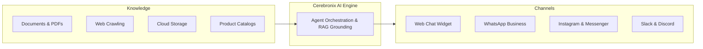

Cerebronix is a unified enterprise conversational AI and automation platform. It empowers businesses to connect their internal knowledge, deploy intelligent AI agents across digital communication channels, deliver personalized customer support, and automate conversational commerce workflows.

Rather than stitching together separate point solutions for knowledge management, chatbot builders, messaging inboxes, and catalog synchronizers, Cerebronix provides a single, cohesive operator interface backed by an enterprise-grade AI orchestration pipeline.

## The Four Core Pillars of Cerebronix

Cerebronix is built upon four interconnected functional pillars designed to automate repetitive business conversations while preserving accuracy and brand voice:

### 1. Unified Knowledge Engine
Turn unstructured business data into verified AI intelligence. Connect PDFs, Word documents, text files, CSV spreadsheets, product catalogues, public websites, and enterprise repositories. Cerebronix parses, chunks, and indexes your content into high-performance vector databases for sub-second, strictly grounded factual retrieval.

### 2. Autonomous & Supervised AI Agents
Configure domain-specific AI agents tailored to distinct business functions: customer care, sales qualification, employee onboarding, or ecommerce shopping concierges. Define customized system instructions, behavioral personas, model creativity settings, and strict compliance guardrails without writing code.

### 3. Omnichannel Customer Engagement
Engage your customers wherever they choose to interact. Deploy agents natively across 10 communication channels, including:
- **Web Chat Widget:** Lightweight, customizable chat bubble for public websites and web apps.
- **Social Messaging:** WhatsApp Business Cloud API, Instagram Direct Messages, and Facebook Pages Messenger.
- **Messaging Apps:** Telegram bots.
- **Workplace Collaboration:** Slack workspaces, Discord servers, and Microsoft Teams.
- **Business Systems:** Email channels (Gmail/Workspace) and HubSpot Conversations.

### 4. Conversational Commerce
Bridge customer inquiries directly to transactions. Connect native Cerebronix-hosted stores or synchronize external ecommerce platforms (Shopify, WooCommerce, Magento). AI agents can browse product catalogs in real time, compare item variants, verify stock availability, manage shopping carts, and generate secure checkout links directly in conversation threads.

---

## Who Uses Cerebronix?

Cerebronix serves diverse teams across growing organizations and enterprise brands:

| Persona | Primary Use Case | Key Platform Surfaces |
| :--- | :--- | :--- |
| **Business Owners & Operators** | Automate high-volume customer inquiries, drive 24/7 sales recommendations, and view high-level business analytics. | Dashboard, Analytics, Billing |
| **Customer Support Leaders** | Manage incoming conversation queues, configure human-in-the-loop escalation rules, and monitor agent resolution rates. | Chat (Inbox), Contacts, AI Agents |
| **Ecommerce Managers** | Manage product catalogs, multi-variant SKUs, regional shipping rules, inventory levels, and promotional discounts. | Ecommerce (`/products`, `/orders`, `/promotions`) |
| **Marketing Teams** | Segment customer contact lists, manage approved WhatsApp message templates, and execute broadcast notification campaigns. | WhatsApp Templates, Contact Groups |
| **Developers & System Architects** | Integrate Cerebronix with internal CRM backends, configure custom API webhooks, and utilize Model Context Protocol (MCP) endpoints. | Developer Portal, Integrations, External Systems |

---

## Platform Orientation: Console vs. Developer Portal

Cerebronix provides two complementary environments to support non-technical operators and engineering teams alike:

| Surface | Target Audience | Access URL | Core Functions |
| :--- | :--- | :--- | :--- |
| **Cerebronix Console** | Business owners, support operators, ecommerce managers, and administrators. | [cerebronix.com](https://cerebronix.com) | Visual configuration of organizations, agents, knowledge sources, communication channels, inbox handovers, and billing. |
| **Developer Platform** | Software engineers, DevOps leads, and technical architects. | [developer.cerebronix.com](https://developer.cerebronix.com) | Interactive OpenAPI specifications, REST API references, webhook event signatures, and Model Context Protocol (MCP) integration. |

<Callout type="info">
  **Ready to get started?** Continue to the [Quickstart Guide](/docs/getting-started/quickstart-guide) to set up your workspace and launch your first live AI agent.
</Callout>

<CrossLink site="socs" path="/docs/current/overview">
  Explore the Developer Platform Architecture
</CrossLink>
