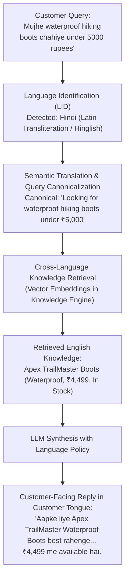

import { Callout } from "fumadocs-ui/components/callout";
import { Tab, Tabs } from "fumadocs-ui/components/tabs";

Cerebronix operates a global multilingual conversational engine that eliminates language barriers across customer support and digital sales. Powered by its advanced multilingual AI pipeline, agents understand queries across 22+ official Indian languages and major international languages, cross-reference knowledge documents regardless of source language, and respond accurately in the customer's native tongue or transliterated script (e.g., Hinglish, Tanglish).

## 1. What the Capability Accomplishes

The Multilingual AI engine provides:

- **Automatic Language Identification (LID):** Detects customer language on the very first incoming message without requiring the user to select language options or menus.
- **Cross-Language Knowledge Retrieval:** Ingests documentation in English (or any primary corporate language) and retrieves semantically relevant answers when customers ask questions in Spanish, German, Hindi, Tamil, or Japanese.
- **Native & Transliterated Indic Support:** Understands Indic languages written either in their native scripts (Devanagari, Tamil, Telugu, Kannada, etc.) or in Romanized/Latin transliterated phonetic text (Hinglish, Tanglish, Kanglish).
- **Flexible Response-Language Configuration:** Configures agents to either mirror the customer's detected language dynamically or lock responses to an official corporate language.
- **Code-Switching Resilience:** Seamlessly processes conversations where customers mix multiple languages in a single sentence (e.g., *"Is item ka delivery time kitna hai?"*).

## 2. The Multilingual AI Architecture

The Cerebronix pipeline processes multilingual interactions through a multi-stage semantic normalization architecture:



### The 4 Processing Stages

1. **Language Identification (LID):** Inbound text is evaluated by high-confidence language classifiers. If classification confidence is low or ambiguous, the pipeline either falls back to the conversation's established language context or triggers a natural language clarification prompt.
2. **Canonical Query Normalization:** For transliterated queries (e.g., Hinglish), the query is normalized into semantic concepts for vector search.
3. **Cross-Language Vector Search:** The Knowledge Engine embedding space maps semantically equivalent concepts across languages into overlapping vector clusters. English product manuals, return policies, and FAQs are immediately discoverable by non-English queries without requiring manual document translations.
4. **Target Language Synthesis:** The agent synthesizes retrieved facts into grammatically natural responses in the customer's preferred language.

## 3. Supported Languages & Indic Transliteration

Cerebronix supports a wide spectrum of global and regional languages:

| Tier | Languages Supported | Script Support |
| :--- | :--- | :--- |
| **Tier 1 (Major Global)** | English, Spanish, French, German, Portuguese, Italian, Japanese, Mandarin Chinese, Arabic | Native alphabets and character sets |
| **Tier 2 (Indic National & Regional)** | Hindi, Bengali, Tamil, Telugu, Marathi, Gujarati, Kannada, Malayalam, Punjabi, Odia | Native Indic scripts + Romanized Transliteration (Hinglish, Tanglish, etc.) |
| **Tier 3 (Extended Global)** | Dutch, Polish, Turkish, Korean, Vietnamese, Thai, Indonesian | Native scripts |

<Callout type="info" title="Indic Script Transliteration Support">
Millions of mobile messaging users type Indian languages using Latin keyboards (e.g., typing *"kya return policy hai"* instead of *"क्या रिटर्न पॉलिसी है"*). Cerebronix natively indexes phonetic transliterations, eliminating the need for rigid spelling matches.
</Callout>

## 4. Agent Response-Language Policies

In **AI Agents** -> Select Agent -> **Language Policies**, administrators configure how the agent communicates:

- **Mirror Customer Language (Default & Recommended):** The agent automatically replies in the exact language and script detected from the customer's latest message. If the customer switches from English to Spanish mid-conversation, the agent immediately switches to Spanish.
- **Enforce Primary Organization Language:** The agent always responds in the organization's primary language (e.g., English), regardless of the customer's input language, while still understanding the customer's foreign-language query.
- **Multilingual Script Locking:** Enforces standard native script output (e.g., requiring standard Devanagari Hindi responses even if the customer asked in Hinglish) to maintain formal corporate presentation.

## 5. Prerequisites and Plan Restrictions

- **Plan Entitlements:**
  - **Free Evaluation:** Tier 1 global languages; English-only knowledge base retrieval.
  - **Growth Plan:** Full Tier 1 and Tier 2 language support; automated Language Identification (LID); dynamic language mirroring.
  - **Scale & Enterprise Plans:** Full Tier 1, 2, and 3 coverage; advanced Indic transliteration; custom domain terminology dictionaries; cross-language vector fine-tuning.
- **Required Roles:** `owner`, `admin`, or `developer` to modify agent language policies and knowledge retrieval configurations. `viewer` role can test agents in sandbox mode.

## 6. Step-by-Step Customer Instructions (Apex Retail Global Example)

### Step 1: Configure Agent Language Policy

1. Navigate to **AI Agents** (`/ai-agents`) and select `Apex Global Concierge`.
2. Scroll to the **Language & Localization** section.
3. Set **Language Policy**: `Mirror Customer Language (Dynamic)`.
4. In **Supported Languages**, verify that `English`, `Hindi`, `Spanish`, and `German` are enabled.
5. In **System Instructions**, add localization guidelines:
   ```text
   Respond politely in the customer's detected language. When communicating in Indic languages, maintain a professional and welcoming tone.
   ```
6. Click **Save Changes**.

### Step 2: Test Cross-Language Knowledge Retrieval

1. Open the **Test Agent** preview drawer on the right.
2. In English, Apex Retail Global's return policy states: *"Items can be returned within 30 days of delivery in original packaging."*
3. Test a query in Spanish:
   ```text
   ¿Cuál es la política de devoluciones si los zapatos no me quedan bien?
   ```
4. **Agent Response Verification:** The agent queries the English knowledge base, extracts the 30-day policy, and responds in fluent Spanish:
   ```text
   Nuestra política de devoluciones le permite devolver cualquier artículo dentro de los 30 días posteriores a la entrega, siempre que se encuentre en su embalaje original. ¿Desea que le ayude a iniciar una devolución?
   ```

### Step 3: Test Indic Transliteration (Hinglish)

1. In the same test chat, submit a transliterated Hindi query:
   ```text
   AeroStride shoes ka delivery time kya hai Mumbai me?
   ```
2. **Agent Response Verification:** The agent recognizes the query, consults the shipping options for India, and replies in natural Hinglish:
   ```text
   AeroStride Performance Runner Mumbai me standard shipping ke saath 3 se 5 business days me deliver ho jaata hai. Kya aap order place karna chahte hain?
   ```

## 7. Expected Results & Verification

Verify your multilingual setup:

1. **Language Detection Audit:** In `/chat`, view the customer conversation details panel. Verify that the **Detected Language** badge reflects `ES` (Spanish) or `HI` (Hindi).
2. **Knowledge Accuracy:** Confirm that facts quoted in non-English responses (prices, dates, return periods) match the canonical English documentation verbatim.
3. **Analytics Integration:** Under `/analytics`, inspect the **Language Breakdown** horizontal bar chart. Verify that conversation counts are accurately categorized under their respective language codes (`en`, `es`, `hi`, `de`).

## 8. Common Problems and Troubleshooting

### Issue: Agent Misidentifies Short Messages (e.g., "Hi", "OK")
- **Root Cause:** Very short messages (under 3 words) lack sufficient character variety for high-confidence language classification.
- **Resolution:** Cerebronix relies on the conversation's historical language context for short utterances. The agent will continue in the established conversation language until a clear linguistic shift occurs.

### Issue: Agent Translates Brand Names Incorrectly
- **Root Cause:** The LLM attempts to translate proprietary product names literally (e.g., translating "AeroStride" into local words).
- **Resolution:** In Agent System Instructions, add a protected term rule: *"Never translate brand or model names (e.g., AeroStride, Apex Retail, CloudPacer); always keep them in their original branded form."*

### Issue: Technical Terms Distorted in Indic Languages
- **Root Cause:** Excessive formal script translation for modern digital terms (e.g., translating "password" or "email" into obscure classical terms).
- **Resolution:** In the agent instructions, specify: *"Use natural, contemporary conversational phrasing with common loanwords for technical terms (e.g., use 'password' and 'account' rather than archaic classical terms)."*

## 9. Relevant Related Guides

- [Voice Messaging & Transcription](/docs/multilingual-and-voice/voice-messaging-and-transcription): Ingesting and transcribing customer voice notes.
- [AI Agents Overview & Templates](/docs/ai-agents/overview-and-templates): Core agent configuration and instructions.
- [Knowledge Engine Data Sources](/docs/data-sources/overview-and-sources): Indexing documentation for cross-language search.
- [Analytics & Reporting](/docs/analytics/dashboards-and-metrics): Tracking language distribution and regional volume.
