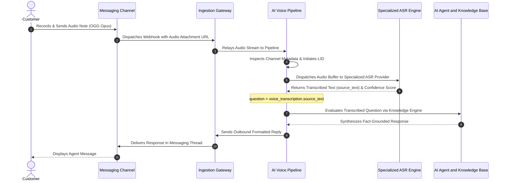

import { Callout } from "fumadocs-ui/components/callout";
import { Tab, Tabs } from "fumadocs-ui/components/tabs";

Millions of mobile messaging users communicate via voice notes rather than typed text. Cerebronix provides an asynchronous voice messaging pipeline that receives incoming audio messages across channels like WhatsApp and Telegram, automatically transcribes speech into text using specialized automatic speech recognition (ASR) providers, grounds the inquiry in your enterprise knowledge base, and delivers clear responses.

<Callout type="warning" title="Critical Capability Distinction: Voice Messaging vs. Live Voice Calling">
Cerebronix processes **asynchronous voice notes (audio messages)** sent within messaging conversations (e.g., recorded WhatsApp voice memos or Telegram audio notes). It is **not** an interactive full-duplex VoIP telephony PBX or live phone call answering service. Customers send an audio clip; the system transcribes, processes, and responds within the messaging thread.
</Callout>

## 1. What the Capability Accomplishes

The Voice Messaging & Transcription engine provides:

- **Asynchronous Audio Note Ingestion:** Ingests recorded voice notes and audio attachments from channels such as WhatsApp, Telegram, and Web Chat without dropping audio payloads.
- **High-Accuracy Speech-to-Text (ASR):** Routes audio to specialized transcription models tailored to linguistic origin (e.g., specialized Indic speech models for Indian dialects vs. global models for Western languages).
- **Automated Language Clarification:** Handles noisy or ambiguous audio recordings gracefully, prompting the user for clarification before executing expensive model operations.
- **Uniform Agent Pipeline Integration:** Injects transcribed speech directly into the existing Knowledge Engine and agent reasoning loop, maintaining identical tool execution and safety safeguards as typed queries.
- **Multi-Codec Normalization:** Automatically decodes and normalizes diverse messaging audio codecs, including OGG Opus, MP3, WAV, and AAC.

## 2. End-to-End Voice Note Processing Pipeline

Incoming voice messages flow through a disciplined transcription and grounding sequence in the Cerebronix voice architecture:



### The 4 Pipeline Stages

1. **Attachment Ingestion & Format Normalization:** Cerebronix ingests the inbound audio payload (e.g., an OGG Opus voice memo from WhatsApp), verifies attachment integrity, and streams the buffer to the voice processing engine.
2. **Speech Recognition Processing:** Based on channel regional context and language hints, Cerebronix automatically routes audio to specialized speech recognition models:
   - **Indic & Regional Languages:** High-fidelity regional speech models covering 22+ languages and dialects with phonetic accuracy.
   - **Global Languages:** High-accuracy speech models optimized for English, European, and East Asian languages.
3. **Transcription & Confidence Evaluation:** The speech engine returns the transcribed text along with an acoustic confidence score. If background noise renders the transcription ambiguous, the system triggers a gentle clarification prompt rather than acting on garbled words.
4. **Knowledge Retrieval & Execution:** The transcribed text is assigned as the active conversational question (`question = voice_transcription.source_text`). The AI agent proceeds with standard semantic vector retrieval, tool calls, and cart actions.

## 3. Supported Audio Codecs & Channel Behaviors

Different communication platforms package voice notes in distinct container formats:

| Channel | Audio Format / Codec | Typical Duration Limits | Behavior |
| :--- | :--- | :--- | :--- |
| **WhatsApp Business** | OGG container with Opus audio | Up to 2 minutes recommended | Rendered as native green voice note waveforms in chat |
| **Telegram Bot** | OGG Opus / MP3 voice message | Up to 2 minutes recommended | Processed as voice memo stream |
| **Web Chat Widget** | WebM / WAV audio recording | Up to 60 seconds | Browser microphone recording via MediaRecorder API |
| **Slack / MS Teams** | MP3 / AAC / WAV file attachment | Up to 5 MB file size | Ingested as uploaded audio attachment |

<Callout type="info" title="Audio Length Recommendations">
For optimal response times and transcription accuracy, voice messages should ideally stay within 10 to 60 seconds. Recordings longer than 3 minutes are subject to transcription timeout thresholds.
</Callout>

## 4. Voice Transcription Response Delivery

Once speech is transcribed, the AI agent evaluates the customer's request and prepares a response:

- **Standard Text Reply (Default):** The agent delivers a structured, legible text response directly beneath the customer's voice note in the messaging thread. This allows the customer to review specifications, prices, links, and buttons without needing to listen to a return audio file in public settings.
- **Original Audio Preservation:** The original audio file is permanently preserved in the operator inbox (`/chat`). Support agents can click the audio player in the timeline to hear the customer's actual voice, tone, and inflection.
- **Transcript Logging:** The transcribed text is logged in the conversation history with an audio badge, ensuring full keyword searchability in the inbox.

## 5. Prerequisites and Plan Restrictions

- **Plan Entitlements:**
  - **Free Evaluation:** Audio notes disabled or limited to manual operator listening.
  - **Growth Plan:** Automated ASR transcription for major languages; voice note processing on WhatsApp and Web Chat; standard transcription limits.
  - **Scale & Enterprise Plans:** High-throughput transcription pipeline; 22+ regional dialect coverage; acoustic noise reduction; priority transcription queues.
- **Required Roles:** `owner`, `admin`, or `developer` to configure voice messaging channels and agent response policies.

## 6. Step-by-Step Customer Instructions (Apex Retail Global Example)

### Step 1: Enable Voice Ingestion on Your WhatsApp Channel

1. Navigate to **Channels** (`/channels`) and select your WhatsApp integration.
2. In the channel configuration drawer, verify that **Media Ingestion** is enabled.
3. Confirm that audio formats (`audio/ogg`, `audio/mpeg`, `audio/wav`) are allowed.
4. Click **Save Settings**.

### Step 2: Test Inbound Voice Note Processing

1. Open WhatsApp on a smartphone and message your Apex Retail Global business number.
2. Tap and hold the microphone icon to record a 15-second voice memo:
   ```text
   "Hi there, I'm looking for the AeroStride runner in black size 10. Can you tell me if you have it in stock in Mumbai and how much it costs?"
   ```
3. Send the voice note.

### Step 3: Verify Automated Transcription & Reply

1. Within 3 to 5 seconds, the AI agent replies with a formatted WhatsApp message:
   ```text
   Hi! Thanks for your message.
   Yes, the AeroStride Performance Runner in Matte Black (Size 10) is currently in stock for ₹10,499. Standard delivery to Mumbai takes 3 to 5 business days.
   Would you like me to send you the direct checkout link?
   ```
2. Open the Cerebronix console and navigate to **Chat** (`/chat`).
3. Select the conversation with your phone number.
4. Verify that the incoming message displays both the audio player and the transcribed text:
   ```text
   🎙️ [Voice Note 0:15]: "Hi there, I'm looking for the AeroStride runner in black size 10. Can you tell me if you have it in stock in Mumbai and how much it costs?"
   ```

## 7. Expected Results & Verification

Verify your voice messaging operations:

1. **Audio Playback in Console:** In `/chat`, click **Play** on the customer's voice note. The audio should play clearly through your browser speakers.
2. **Transcript Search:** In the `/chat` search bar, search for a word spoken only in the audio memo (e.g., *"Mumbai"*). The conversation should appear in the search results, proving that voice notes are fully indexed.
3. **Linguistic Accuracy:** If the customer speaks Hindi or regional dialects in the voice note, verify that speech recognition accurately captures the phrasing without dropping dialect markers.

## 8. Common Problems and Troubleshooting

### Issue: Voice Note Received but AI Does Not Respond
- **Root Cause:** Background noise rendered transcription confidence below acceptable thresholds, or the audio file exceeded maximum size limits (over 16 MB).
- **Resolution:** Check `/chat` to inspect the transcript. If transcription failed due to noise, the agent automatically dispatches a polite text prompt: *"I couldn't quite hear that audio clearly. Could you please send that again or type your question?"*

### Issue: Accents or Dialects Misinterpreted
- **Root Cause:** Inbound channel regional configuration was misaligned.
- **Resolution:** Verify in `/channels` that the phone number is correctly tagged with its geographic region (e.g. India / +91), ensuring Cerebronix routes audio through the localized regional speech model.

### Issue: WhatsApp Discards Outbound Audio Replies
- **Root Cause:** Outbound audio files were encoded with unsupported sample rates or bitrates.
- **Resolution:** Cerebronix standardizes on text replies for customer clarity. Outbound voice notes are only dispatched on channels with explicit voice synthesis enabled.

## 9. Relevant Related Guides

- [Multilingual AI & Indic Support](/docs/multilingual-and-voice/multilingual-ai-and-languages): Language detection, transliteration, and translation.
- [Unified Omnichannel Inbox](/docs/conversations/overview-and-inbox): Reviewing voice memos in the operator chat console.
- [WhatsApp Business Channel Setup](/docs/channels/whatsapp-business): Configuring webhook settings for media attachments.
- [AI Agents Overview & Templates](/docs/ai-agents/overview-and-templates): Configuring agent instructions and reasoning rules.
