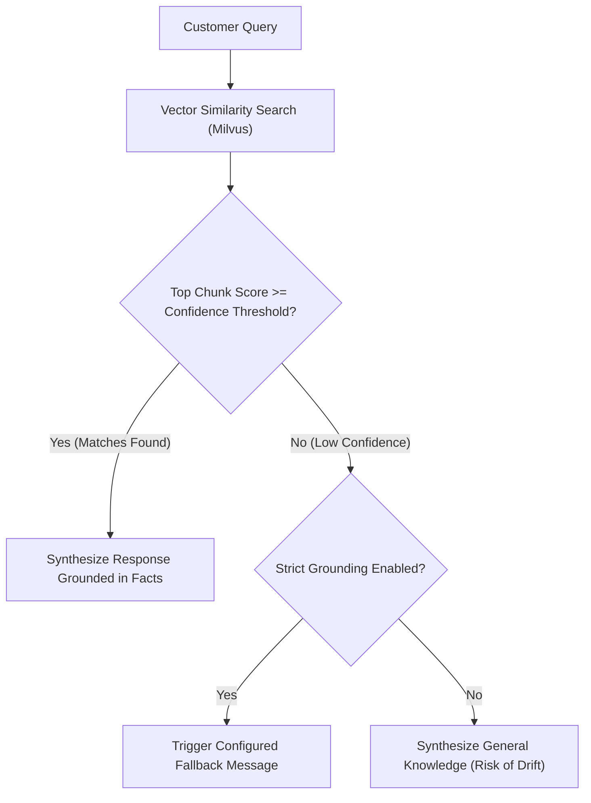

import { Callout } from "fumadocs-ui/components/callout";
import { Steps } from "fumadocs-ui/components/steps";

When an AI agent provides generic responses, states that it cannot answer a question, or replies in an unintended tone, the issue is typically rooted in knowledge grounding thresholds, prompt instruction phrasing, or unlinked data source bindings.

This guide details systematic diagnostic workflows for fine-tuning agent behavior and ensuring accurate, grounded customer responses.

## 1. Quick Diagnostic Summary

| Symptom | Probable Cause | Action |
| :--- | :--- | :--- |
| **Agent responds: "I don't have enough information to answer that"** | Query does not meet vector similarity threshold, or knowledge source not bound | Bind relevant data source under `/ai-agents`, or lower strictness threshold |
| **Agent quotes outdated product prices or specifications** | Knowledge base was updated but not re-indexed | Navigate to `/data-sources` and trigger **Re-index** on the affected source |
| **Agent ignores formatting instructions or persona rules** | Conflicting system instructions or excessively high temperature | Refine prompt instructions and lower temperature slider to `0.2`–`0.4` |
| **Agent answers correctly in test sandbox but fails on WhatsApp** | Channel not bound, or WhatsApp 24h customer care session expired | Bind WhatsApp channel under `/ai-agents`, or send an approved message template |
| **Agent hallucinates answers outside company documentation** | Strict knowledge grounding disabled, or instructions allow external knowledge | Enable **Strict Grounding** and add explicit fallback instructions |

## 2. Diagnosing Knowledge Grounding & Fallback Triggers

Cerebronix AI agents operate on a strict Retrieval-Augmented Generation (RAG) pipeline. Inbound customer queries are converted to vector embeddings, matched against indexed documents in the Knowledge Engine, and provided to the language model as context.



### Issue: Agent Frequently Responds with Fallback Messages

The customer asks a valid question about your return policy, but the agent replies:
```text
I apologize, but I do not have enough verified information in our company documents to answer that question. Let me connect you with an operator.
```

#### Root Cause
1. **Unbound Data Source:** The document containing the return policy exists in **Knowledge Engine** (`/data-sources`), but the agent has not been granted access to it under its **Bindings**.
2. **Indexing Incomplete:** The document was recently uploaded and is still in `PENDING` or `INDEXING` state.
3. **Chunk Semantic Distance:** The customer's phrasing differs significantly from the wording in the document, resulting in a similarity score below the agent's confidence threshold.

#### Diagnostic & Resolution Steps

<Steps>
### Step 1: Verify Agent Data Source Bindings
1. Navigate to **AI Agents** (`/ai-agents`) and click on your active agent (e.g., `Apex Sales Concierge`).
2. Scroll to the **Bindings** section.
3. Under **Connected Data Sources**, verify that the relevant document or website data source has a checkmark.
4. If unchecked, check the box and click **Save Bindings**.

### Step 2: Check Indexing Status
1. Navigate to **Knowledge Engine** (`/data-sources`).
2. Locate the source document (e.g., `Apex_Return_Policy_2026.pdf`).
3. Verify that the status shows green **Active** (`READY`).
4. If the status is `FAILED` or `INDEXING`, see [Knowledge & Indexing Troubleshooting](/docs/troubleshooting/knowledge-and-indexing).

### Step 3: Test Query in the Agent Sandbox
1. Return to **AI Agents** (`/ai-agents`) -> `Apex Sales Concierge`.
2. Open the **Test Agent** drawer on the right.
3. Submit the exact query the customer asked.
4. Click **Inspect Context** (if enabled in developer view) to view which document chunks were retrieved.
5. If the relevant policy section is missing from retrieved chunks, adjust the document's section headings or add a clear FAQ entry under **Add Knowledge** -> **Text Snippet**.
</Steps>

---

## 3. Prompt Instruction Conflicts & Creativity Tuning

### Issue: Agent Ignores System Instructions or Brand Persona

Your prompt instructs the agent to always mention shipping options, but it frequently omits this information.

#### Root Cause
- **Instruction Contradictions:** Long, multi-paragraph prompts often contain contradictory instructions (e.g., *"Keep answers under 2 sentences"* conflicting with *"Always list all 5 shipping methods and prices"*).
- **Temperature Setting Too High:** High temperature values (`0.8`–`1.0`) introduce creative randomness, causing the model to deviate from structured prompt rules.

#### Resolution Steps

1. In the agent configuration drawer under **System Instructions**, restructure your guidelines using numbered markdown lists:
   ```markdown
   ### Core Persona & Objective
   You are the virtual shopping assistant for Apex Retail Global. Assist customers with product recommendations and order inquiries.

   ### Response Rules
   1. Answer using ONLY facts found in the attached knowledge base.
   2. When recommending shoes, always ask for the customer's preferred size and running terrain.
   3. Always conclude product inquiries by offering to share a checkout link.
   4. If you cannot find the requested information, offer human support handoff.
   ```
2. Navigate to **Model Parameters**.
3. Adjust the **Temperature** slider:
   - For transactional, factual, and ecommerce agents: Set to **`0.2` – `0.3`**.
   - For conversational sales and greeting agents: Set to **`0.4` – `0.5`**.
   - Avoid values above `0.7` for customer service agents.
4. Click **Save Agent Settings** and test in the sandbox.

---

## 4. Hallucinations & Factual Deviations

### Issue: Agent Generates Fictitious Information

The agent invents discounts or promises delivery dates not supported by your systems.

#### Root Cause
- **Strict Grounding Disabled:** The agent is operating in permissive mode, allowing the underlying foundational model to complete answers using general internet training data.
- **Negative Guidance Missing:** The system prompt lacks explicit constraints forbidding external assumptions.

#### Resolution Steps

1. In **AI Agents** (`/ai-agents`), locate **Grounding & Guardrails**.
2. Toggle **Strict Grounding Mode** to **ON**.
3. In the system prompt, append an explicit guardrail clause:
   ```text
   CRITICAL SAFETY CONSTRAINT:
   Never invent coupon codes, warranty lengths, or shipping delivery dates. If an exact date or promotion code is not explicitly stated in the retrieved context, state: "I don't have that promotion on file, but I can check with our support team."
   ```
4. Save and re-test in the sandbox.

---

## 5. Sandbox vs. Live Channel Discrepancies

If an agent answers accurately in the console test sandbox but fails when messaging over WhatsApp, Instagram, or Web Chat:

1. **Check Channel Binding:** Verify that the live communication channel is checked under **Channel Bindings** in `/ai-agents`.
2. **Inspect Conversation State in `/chat`:** Look up the conversation in the inbox. If the conversation status is `Open` (human operator takeover active), the AI agent's response loop is paused. Hand the conversation back to AI by resetting status to `Pending`.
3. **Review Inbound Message Length:** Audio voice memos longer than your plan's clip ceiling or images containing unparseable handwritten text may fail ASR or OCR normalization before reaching the agent.

---

## 6. Related Documentation

- [AI Agents Overview & Templates](/docs/ai-agents/overview-and-templates): Best practices for prompt engineering.
- [System Prompts & Instructions](/docs/ai-agents/system-prompts-and-instructions): Structuring high-performance agent prompts.
- [Retrieval-Augmented Generation (RAG) Concepts](/docs/concepts/rag-and-grounding): Understanding vector search mechanics.
