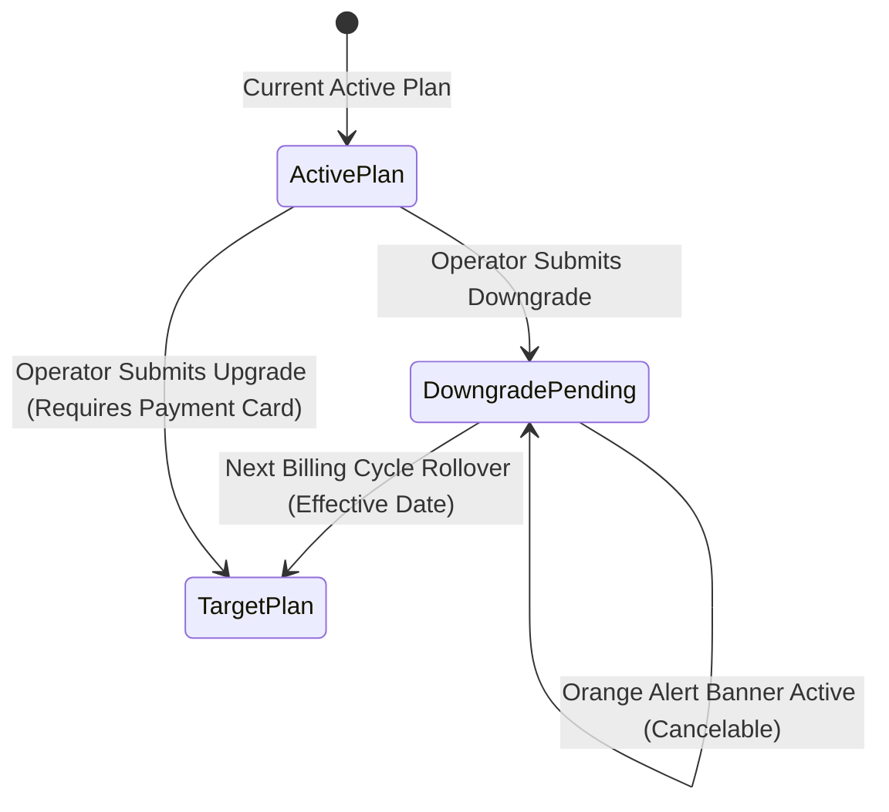

import { Callout } from "fumadocs-ui/components/callout";
import { Steps } from "fumadocs-ui/components/steps";

Cerebronix provides transparent subscription management and credit metering powered by Saastronix and Lago. When upgrading tiers, modifying seat allocations, or managing usage balances, understanding billing lifecycle rules prevents unexpected service interruptions.

This guide provides step-by-step diagnostic procedures for resolving billing, credit, and subscription change issues.

## 1. Quick Diagnostic Summary

| Symptom | Probable Cause | Action |
| :--- | :--- | :--- |
| **Upgrade blocked with "Payment Method Required"** | Free-to-paid plan change requires a stored credit card | Open `/billing` -> **Billing Details** and add a valid payment card |
| **Downgrade blocked with `seatsBlockDowngrade`** | Current team members exceed target plan seat capacity | Deactivate excess teammates in `/team-members` before downgrading |
| **AI agent abruptly stops responding on Free tier** | Free Evaluation credit balance exhausted (hard-stop policy) | Upgrade to Growth or Scale plan to restore automated reasoning |
| **Scheduled plan downgrade needs to be cancelled** | Target plan change is queued for next cycle rollover | In `/billing`, click **Cancel Pending Change** in the orange banner |
| **Auto-recharge did not trigger when credits ran low** | Auto-recharge toggle is OFF or monthly safety spend ceiling reached | Review threshold rules and safety ceiling under `/billing` -> Overview |

## 2. Plan Changes & Subscription Transitions



### Issue 1: "Payment Method Required" Error When Upgrading

When attempting to select the Growth or Scale plan from the Free Evaluation tier, the modal halts with:
```text
Payment method required. Please add a valid payment method under Billing Details before upgrading.
```

#### Root Cause
To establish a direct billing relationship and support automated invoice collection with tax compliance, Cerebronix requires a valid credit or debit card on file before activating any paid tier.

#### Resolution Steps

<Steps>
### Step 1: Open Billing Details
1. Navigate to **Billing** (`/billing`).
2. Click the **Billing Details** tab on the far right.

### Step 2: Add Corporate Payment Card
1. Under **Payment Methods**, click **Add Payment Method**.
2. Enter your card details, billing address, and optional corporate tax ID (GSTIN or VAT ID).
3. Click **Save Payment Method**.
4. Confirm that the card displays with a green `Default` badge.

### Step 3: Complete Plan Upgrade
1. Click the **Plan** tab.
2. Select your target plan (e.g., **Growth**).
3. Click **Upgrade Now** and confirm the plan selection.
4. The upgrade activates immediately with prorated billing for the remainder of the billing cycle.
</Steps>

---

### Issue 2: "Seats Block Downgrade" (`seatsBlockDowngrade`)

An organization on the Scale tier (25 seats) attempts to downgrade to the Growth tier (10 seats), but the system rejects the change with:
```text
Cannot downgrade plan: Active seated members (14) exceed the target plan limit (10). Deactivate members first.
```

#### Root Cause
To protect team members from abrupt account suspensions, Cerebronix verifies that your active user roster does not exceed the target plan's seat capacity before accepting a downgrade request (`refuseIfSeatsExceedTarget`).

#### Resolution Steps

<Steps>
### Step 1: Audit Team Roster
1. Navigate to **Team Members** (`/team-members`).
2. Count the active members (e.g., 14 members).

### Step 2: Deactivate Excess Members
1. Identify 4 users who no longer require active operator access.
2. Click their actions menu (`...`) and select **Deactivate Member**.
3. Confirm that the seat counter displays `Seats: 10 of 25 used`.

### Step 3: Resubmit Downgrade in Billing
1. Return to **Billing** (`/billing`) -> **Plan** tab.
2. Select **Growth** and click **Downgrade Plan**.
3. The downgrade request is accepted and queued for the end of your current billing period.
</Steps>

---

### Issue 3: Cancelling a Scheduled Plan Change

An organization requested a plan downgrade earlier in the month, but now wishes to retain their existing tier.

#### Resolution Steps
1. Navigate to **Billing** (`/billing`).
2. Notice the orange banner at the top of the console:
   ```text
   Scheduled Plan Change: Downgrade to Growth effective on Nov 1, 2026.
   ```
3. Click the **Cancel Pending Change** button (`handleCancelPending`) on the right side of the banner.
4. The pending scheduled change is aborted immediately. Your existing plan and entitlements continue without interruption.

---

## 3. Platform Credits & Overage Policies

### Issue: AI Agent Stops Responding Due to Credit Exhaustion

The AI agent suddenly stops replying to customer inquiries across all channels, while human operators can still message normally in `/chat`.

#### Root Cause
Every AI model inference, speech transcription, and knowledge vector search consumes platform usage credits:
- **Free Evaluation Tier (`hard_stop`):** Free accounts receive 200 evaluation credits. When the balance hits 0, AI reasoning loops halt immediately to prevent unexpected costs.
- **Paid Tiers (`pay_as_you_go`):** Growth and Scale plans support pay-as-you-go overage. Continued usage accrues on your account and is invoiced at the end of the billing period.

#### Resolution Steps
1. Navigate to **Billing** (`/billing`) -> **Overview** tab.
2. Inspect the **Credit Balance** widget.
3. If your balance is depleted, choose one of two solutions:
   - **Purchase On-Demand Credit Pack:** Open the **Packs** tab and click **Buy Pack** (e.g., *5,000 Credits Pack*). Credits are credited to your balance instantly.
   - **Upgrade to a Paid Tier:** Moving from Free to Growth unlocks 5,000 monthly credits and pay-as-you-go overage protection.

---

## 4. Auto-Recharge Troubleshooting

### Issue: Auto-Recharge Did Not Trigger Automatically

Your balance dropped below your threshold, but automated top-up credits were not added.

#### Root Cause
1. **Safety Ceiling Reached:** Under auto-recharge settings, your configured monthly maximum expenditure ceiling was reached, preventing further automatic charges.
2. **Card Authorization Failure:** The default credit card on file was declined by the issuing bank due to fraud filters or expiration.

#### Resolution Steps
1. Navigate to **Billing** (`/billing`) -> **Overview** tab -> **Auto-Recharge**.
2. Verify that **Enable Auto-Recharge** is toggled ON.
3. Check the **Monthly Safety Cap**. If the monthly expenditure limit was reached, adjust the ceiling or manually purchase a one-time pack.
4. Open the **Billing Details** tab. If your stored card shows an alert, update the card details or provide an alternative payment method.

---

## 5. Related Documentation

- [Subscription Plans, Usage Credits & Billing Lifecycle](/docs/admin-and-billing/billing-plans-and-credits): Complete billing and credit specifications.
- [Organization Settings, Team Roles & Seat Management](/docs/admin-and-billing/organization-and-team): Managing operator seats and invites.
- [Core Concepts: Credits, Plans & Public API](/docs/concepts/credits-plans-public-api): Understanding metering and token consumption.
