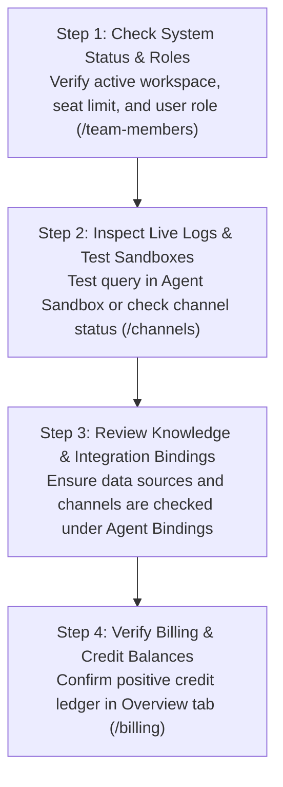

import { Callout } from "fumadocs-ui/components/callout";
import { Tab, Tabs } from "fumadocs-ui/components/tabs";
import { CrossLink } from "@cerebronix/docs-ui";

When an AI agent behaves unexpectedly, a customer conversation does not route as anticipated, or a third-party channel integration reports delivery errors, resolving the issue quickly requires a structured diagnostic workflow.

This Troubleshooting Hub provides a comprehensive, domain-oriented reference for identifying symptoms, isolating root causes, and executing verified remediation steps across all Cerebronix subsystems.

## 1. Fast Diagnostic Matrix

Use the matrix below to match your operational symptom to the corresponding diagnostic guide:

| Functional Area | Common Symptom | Likely Root Cause | Diagnostic Guide |
| :--- | :--- | :--- | :--- |
| **Authentication & Access** | Team invitee cannot accept link or sees empty dashboard | Unverified email, cached account state, or seat capacity ceiling | [Account & Organization Troubleshooting](/docs/troubleshooting/account-and-organization) |
| **RBAC Permissions** | Operator cannot take over conversation or edit settings | Role restriction (`viewer` cannot edit; non-owners cannot change billing) | [Account & Organization Troubleshooting](/docs/troubleshooting/account-and-organization) |
| **AI Responses** | Agent replies "I don't know" or quotes outdated product info | Knowledge base not bound, re-index required, or strict grounding filter | [Agent & Response Troubleshooting](/docs/troubleshooting/agent-and-responses) |
| **Hallucination Protection**| Agent provides generic advice instead of company policy | Low search confidence score or missing knowledge documentation | [Agent & Response Troubleshooting](/docs/troubleshooting/agent-and-responses) |
| **Knowledge Engine** | Web crawler stuck on "Indexing" or PDF document rejected | Blocked robots.txt, file size limit exceeded (>50MB), or unsupported format | [Knowledge & Indexing Troubleshooting](/docs/troubleshooting/knowledge-and-indexing) |
| **WhatsApp Business** | Messages outside 24h window fail with error `131047` | Freeform text sent after 24h window; approved template message required | [Channels & Webhooks Troubleshooting](/docs/troubleshooting/channels-and-webhooks) |
| **Channel Connectivity** | WhatsApp status displays `Selection Required` | WABA 6-digit registration PIN has not been entered | [Channels & Webhooks Troubleshooting](/docs/troubleshooting/channels-and-webhooks) |
| **Web Chat Widget** | Chat widget does not appear on storefront | Missing DOM container script, domain origin mismatch, or CSP block | [Channels & Webhooks Troubleshooting](/docs/troubleshooting/channels-and-webhooks) |
| **Ecommerce & Carts** | Agent cannot add item to customer cart | Product variant ID missing, stock unavailable, or store unlinked | [Ecommerce & Cart Troubleshooting](/docs/troubleshooting/ecommerce-and-cart) |
| **Order Tracking** | Customer order lookup returns "Order not found" | External customer ID mismatch or order placed outside active lookup window | [Ecommerce & Cart Troubleshooting](/docs/troubleshooting/ecommerce-and-cart) |
| **Billing & Credits** | Plan upgrade blocked with "Payment Method Required" | No stored corporate credit card under Billing Details | [Billing & Subscriptions Troubleshooting](/docs/troubleshooting/billing-and-subscriptions) |
| **Plan Downgrades** | Downgrade blocked with `seatsBlockDowngrade` | Active team roster exceeds target plan seat allowance | [Billing & Subscriptions Troubleshooting](/docs/troubleshooting/billing-and-subscriptions) |

## 2. Standard Customer Triage Workflow

Before initiating an administrative ticket, execute this 4-step triage sequence:

### 1. Workspace Identity & Role Verification
Verify that your active workspace matches the target organization in the top navigation dropdown. In multi-organization setups, ensuring your session is scoped to the correct tenant (e.g., `Apex Retail Global`) is essential. Confirm your user account holds the required role (`owner`, `admin`, `developer`, or `viewer`) under **Team Members** (`/team-members`).

### 2. Sandbox Isolation
Before troubleshooting live channels, test the scenario in the **Test Agent** sandbox under **AI Agents** (`/ai-agents`). If the agent produces the correct answer in the sandbox, the issue is isolated to the communication channel (e.g., WhatsApp window restrictions or widget embedding), not the agent's core knowledge base.

### 3. Binding Verification
Ensure the relevant data sources, ecommerce stores, and communication inboxes are explicitly bound to the agent under **AI Agents** -> **Agent Settings** -> **Bindings**. Newly connected channels or stores do not route traffic until checked and saved.

### 4. Credit & Quota Checks
Review the organization credit balance under **Billing** (`/billing`). If your balance is exhausted on a Free Evaluation tier (hard-stop overage policy), automated AI reasoning loops halt immediately until credits are topped up or a paid tier is activated.

## 3. Dedicated Troubleshooting Guides

For detailed, step-by-step diagnostic procedures, select the domain-specific guide below:

- **[Account, Team & Organization Setup](/docs/troubleshooting/account-and-organization):** Resolving invitation link expiration, email verification delays, seat capacity ceilings, and multi-tenant switching issues.
- **[AI Agents & Unexpected Responses](/docs/troubleshooting/agent-and-responses):** Diagnosing strict knowledge grounding triggers, prompt instruction conflicts, temperature tuning, and fallback behaviors.
- **[Knowledge Ingestion & Vector Indexing](/docs/troubleshooting/knowledge-and-indexing):** Resolving website crawler blocks, PDF parsing errors, indexing timeouts, and cross-language vector retrieval mismatches.
- **[Communication Channels & Webhooks](/docs/troubleshooting/channels-and-webhooks):** Troubleshooting Meta WhatsApp Embedded Signup, 24-hour service windows, Telegram bot tokens, Slack event subscriptions, and Web Chat widget embedding.
- **[Ecommerce, Cart Operations & Order Tracking](/docs/troubleshooting/ecommerce-and-cart):** Remedying catalog synchronization gaps, product variant selection, checkout URL generation, and carrier tracking failures.
- **[Billing, Usage Credits & Subscription Lifecycle](/docs/troubleshooting/billing-and-subscriptions):** Navigating plan upgrades, next-cycle downgrade scheduling, seat downgrade blocks, payment method validation, and auto-recharge settings.

## 4. Public API & Developer Cross-Reference

If your team is building custom integrations, managing webhooks, or calling the Cerebronix Public API directly, consult our developer documentation for technical error codes and audit specifications:

<CrossLink site="socs" path="/docs/current/errors-rate-limits-audit">
  Public API Errors, Rate Limits & Audit Logs
</CrossLink>
