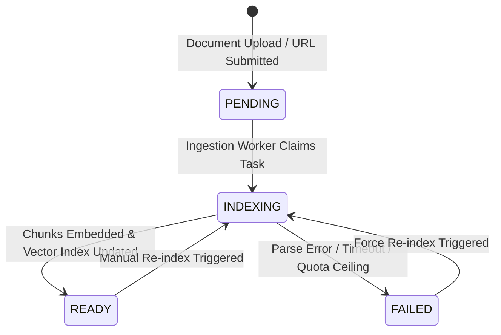

import { Callout } from "fumadocs-ui/components/callout";
import { Steps } from "fumadocs-ui/components/steps";

The Cerebronix Knowledge Engine processes unstructured corporate documentation, website domains, and product catalogs into high-dimensional vector embeddings stored in the Knowledge Engine vector index. When knowledge ingestion stalls or documents fail to index, AI agents cannot access verified facts.

This guide provides step-by-step diagnostic workflows for resolving indexing errors across documents, websites, and catalog sync pipelines.

## 1. Quick Diagnostic Summary

| Symptom | Probable Cause | Action |
| :--- | :--- | :--- |
| **Website crawler finishes with 0 pages indexed** | Site protected by Cloudflare bot wall, blocked `robots.txt`, or client-side JavaScript SPA | Provide sitemap XML URL, verify domain ownership, or upload static HTML/PDF export |
| **Document upload fails with "File rejected"** | File exceeds 50MB ceiling, contains password encryption, or uses unsupported format | Remove password encryption, compress file under 50MB, or convert to standard PDF/DOCX |
| **Data source stuck on `INDEXING` state (>30 mins)** | Pipeline worker processing large media files or queue backlog | Click **Re-index** -> **Force Full Re-index** to restart extraction |
| **Search retrieves incorrect section of large PDF** | Missing structural Markdown headers or chunk size too broad | Format document with clear H1/H2 headings before upload |
| **Agent cannot find content in newly added document** | Document indexed but not bound to the active agent | Open `/ai-agents` -> **Agent Settings** -> **Bindings** and check the data source |

## 2. Ingestion Lifecycle & Status Codes

In **Knowledge Engine** (`/data-sources`), every source transitions through defined operational states:



- **`PENDING`:** The file or URL is queued for worker processing. Under normal conditions, processing begins within 10–30 seconds.
- **`INDEXING`:** Document text is being extracted, normalized, chunked into semantic segments, and converted to vector embeddings.
- **`READY`:** Vector embeddings are stored and active. The source is immediately searchable by bound AI agents.
- **`FAILED`:** An extraction or parsing exception occurred. Click the status badge to view the customer error detail.

---

## 3. Troubleshooting Website Crawlers

### Issue: Crawler Reports "Crawled 0 Pages" or Stalls

You submit your documentation URL (e.g., `https://help.apexretail.com`), but after several minutes the data source reports `FAILED` or shows 0 indexed pages.

#### Root Cause
1. **Robots.txt Exclusion:** Your server's `robots.txt` explicitly disallows automated user agents from accessing the `/help` path.
2. **Bot Protection & Cloudflare Turnstile:** Cloudflare, Akamai, or AWS WAF blocks the Cerebronix crawler with a 403 Forbidden or captcha challenge.
3. **Pure Single-Page Applications (SPA):** The target website relies on heavy client-side JavaScript frameworks (React/Vue/Angular) without Server-Side Rendering (SSR). If the page requires complex user interaction to render content, standard crawlers capture only empty HTML wrappers.

#### Diagnostic & Resolution Steps

<Steps>
### Step 1: Inspect Robots.txt
1. In your browser, open `https://yourdomain.com/robots.txt`.
2. Check whether your crawler or wildcards (`User-agent: *`) disallow documentation paths:
   ```text
   Disallow: /docs/
   Disallow: /knowledge-base/
   ```
3. If present, update your web server rules to allow access for the Cerebronix crawler.

### Step 2: Use an XML Sitemap
1. Rather than providing a bare root URL, specify your XML sitemap URL under **Knowledge Engine** -> **Add Source** -> **Website**:
   ```text
   https://help.apexretail.com/sitemap.xml
   ```
2. The crawler ingests all URLs listed in the sitemap directly, bypassing dynamic menu navigation.

### Step 3: Fallback to Direct Document Upload
1. If your site is strictly protected by internal WAF policies, export your documentation pages as PDF or Markdown files.
2. Upload the files directly under **Add Knowledge** -> **Upload Documents**. File uploads bypass network firewalls entirely.
</Steps>

---

## 4. Troubleshooting Document & PDF Ingestion

### Issue: "Upload Failed — File Exceeds Maximum Size"

Attempting to upload a product catalog or technical manual displays:
```text
File exceeds maximum permitted size of 50MB.
```

#### Root Cause
Cerebronix enforces a 50MB per-file upload ceiling to maintain low-latency vector indexing. Large PDFs containing uncompressed high-resolution images or print-ready graphics often exceed this limit.

#### Resolution Steps
1. Open the PDF in Adobe Acrobat, Preview, or an online optimization utility.
2. Save as **Optimized PDF** or **Reduced Size PDF** (downsample embedded graphics to 150 DPI).
3. If the document remains over 50MB, split the document into logical sections (e.g., *Apex_Catalog_Volume_1.pdf* and *Apex_Catalog_Volume_2.pdf*).
4. Upload each file individually. Bound agents query across all files seamlessly.

---

### Issue: Scanned PDFs Fail with Empty Text (`Parse Error`)

You upload a PDF invoice or scanned warranty sheet, but the data source completes with 0 extracted characters.

#### Root Cause
The uploaded PDF contains bitmap images of scanned pages rather than selectable digital text, and your plan tier does not include optical character recognition (OCR) processing.

#### Resolution Steps
1. Run the document through an OCR pre-processor to generate an embedded text layer before uploading.
2. Verify that text can be highlighted and copied in a standard PDF viewer.
3. Re-upload the processed PDF.

---

## 5. Force Re-indexing & Vector Synchronization

When you make extensive revisions to an existing data source (e.g., updating return policies or seasonal pricing), the existing vector embeddings must be synchronized.

### How to Execute a Clean Re-index

1. Navigate to **Knowledge Engine** (`/data-sources`).
2. Locate the modified source.
3. Click the **Actions** menu (`...`) on the right side of the row.
4. Select **Force Re-index**:
   - **Incremental Re-index:** Checks for changed files or modified web timestamps.
   - **Force Full Re-index:** Purges all existing vector chunks in the index and re-parses the document from scratch.
5. Wait for the status badge to transition from `INDEXING` back to green `READY`.
6. Open `/ai-agents` and test the updated facts in the agent sandbox.

---

## 6. Plan Quotas & Storage Limits

Review your subscription plan entitlements under **Billing** (`/billing`) if new data sources are rejected:

- **Free Evaluation:** 1 connected data source; up to 50,000 indexed characters.
- **Growth Plan:** Up to 10 connected data sources; up to 2,500,000 indexed characters.
- **Scale Plan:** Up to 25 connected data sources; up to 15,000,000 indexed characters.
- **Enterprise Plan:** Unlimited data sources and vector capacity.

If you reach your plan's data source limit, either delete obsolete sources in `/data-sources` or upgrade your subscription in `/billing`.

---

## 7. Related Documentation

- [Knowledge Data Sources Overview](/docs/data-sources/overview-and-sources): Supported file formats and guidelines.
- [Indexing Lifecycle & Status Verification](/docs/data-sources/indexing-lifecycle-and-status): Detailed state machine specifications.
- [Ecommerce Catalog Sync](/docs/data-sources/ecommerce-catalog-sync): Troubleshooting product sync pipelines.
