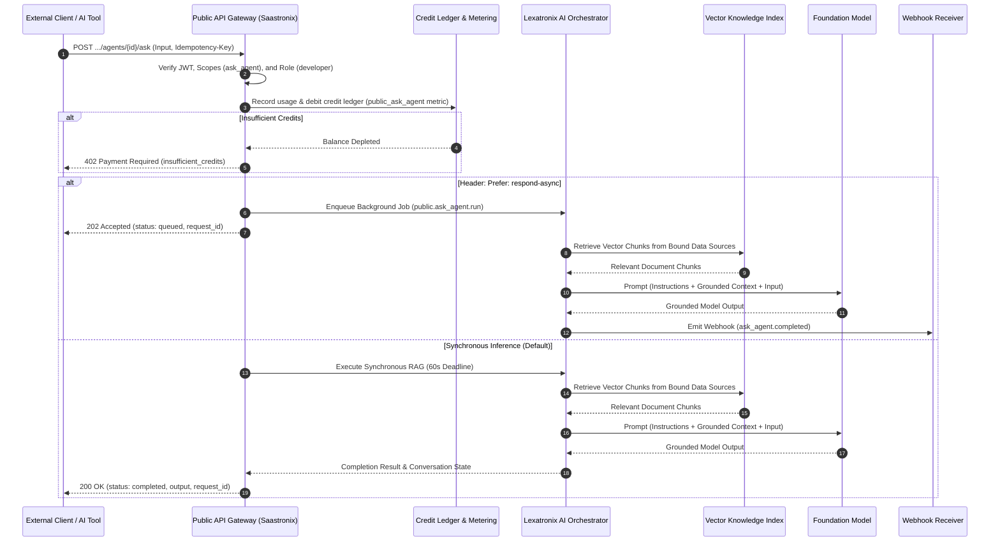

import { Callout } from "fumadocs-ui/components/callout";
import { Tab, Tabs } from "fumadocs-ui/components/tabs";

The Cerebronix AI Agent APIs enable third-party applications, custom support platforms, CRM systems, and developer automation suites to programmatically orchestrate autonomous conversational agents. Developers can configure agent personas, bind vector knowledge bases, attach agents to communication channels, and trigger direct Retrieval-Augmented Generation (RAG) inference via `POST /v1/organizations/{org_id}/agents/{agent_id}/ask`.

All agent and inference endpoints are organization-scoped, strictly isolated by tenant, and hosted under `https://public-api.cerebronix.com/v1/organizations/{organization_id}`.

---

## Agent Architecture & Inference Pipeline

When an application invokes direct inference (`ask_agent`), Cerebronix coordinates between the Public Gateway, the Lexatronix AI Orchestration Engine, vector knowledge stores, and the real-time credit ledger:



---

## Endpoint Matrix & Role-Based Access Control

All agent operations enforce strict Organization-level multi-tenancy, OAuth2 scopes, and role hierarchies:

| Endpoint | HTTP Method | Required Scope | Minimum Role | Rate Limit (RPM) | Verification Level |
| :--- | :--- | :--- | :--- | :--- | :--- |
| `/v1/organizations/{org_id}/agents` | `GET` | `agents:read` | `viewer` | Plan Base (120/300) | `[Runtime-Tested]` |
| `/v1/organizations/{org_id}/agents` | `POST` | `agents:write` | `developer` | Plan Base (120/300) | `[Contract-Tested]` |
| `/v1/organizations/{org_id}/agents/{id}` | `GET` | `agents:read` | `viewer` | Plan Base (120/300) | `[Code-Verified]` |
| `/v1/organizations/{org_id}/agents/{id}` | `PATCH` | `agents:write` | `developer` | Plan Base (120/300) | `[Contract-Tested]` |
| `/v1/organizations/{org_id}/agents/{id}/data_sources` | `POST` | `agents:write` | `developer` | Plan Base (120/300) | `[Contract-Tested]` |
| `/v1/organizations/{org_id}/channels` | `GET` | `agents:read` | `viewer` | Plan Base (120/300) | `[Runtime-Tested]` |
| `/v1/organizations/{org_id}/channels/{id}` | `GET` | `agents:read` | `viewer` | Plan Base (120/300) | `[Code-Verified]` |
| `/v1/organizations/{org_id}/channels/{id}` | `PATCH` | `agents:write` | `developer` | Plan Base (120/300) | `[Contract-Tested]` |
| `/v1/organizations/{org_id}/agents/{id}/ask` | `POST` | `ask_agent` | `developer` | Plan AI Limit (20/60/Uncapped) | `[Runtime-Tested]` |

<Callout type="info">
  **Plan Entitlements Required:** Access to all agent and inference endpoints requires an active subscription with the `public_api` entitlement enabled (Growth, Scale, or Enterprise). Free Evaluation tiers do not permit programmatic agent orchestration.
</Callout>

---

## Public Agent Schema

The Public Agent resource exposes high-level agent parameters while encapsulating internal orchestrator implementation details (such as internal protobuf descriptors, MongoDB object identifiers, or raw prompt prefix structures):

### Schema Properties

| Field | Type | Description |
| :--- | :--- | :--- |
| **`id`** | `string` | The unique hex-encoded identifier of the agent (`24-character hex`). |
| **`name`** | `string` | The display name of the agent (e.g., `Customer Concierge`). Required on creation. |
| **`description`** | `string` | Optional operational description or internal summary of the agent's function. |
| **`status`** | `string` | Operational state: `active` (default), `draft`, or `disabled`. |
| **`instructions`** | `string` | System prompt guidelines defining the agent's operational persona, guardrails, and tone. Clamped to a maximum of **1,000 characters**. |
| **`data_source_ids`** | `array of strings` | List of vector knowledge data source IDs bound to this agent for RAG retrieval. |

#### Example Agent Representation
```json
{
  "id": "67123456789abcdef0123456",
  "name": "Billing Support Specialist",
  "description": "Handles subscription changes, refund inquiries, and invoice explanations",
  "status": "active",
  "instructions": "You are a professional billing concierge. Respond warmly and concisely. Ground all answers in bound pricing sheets and policy documents. If the user asks for a human, initiate a handoff.",
  "data_source_ids": [
    "67123456789abcdef0123477",
    "67123456789abcdef0123488"
  ]
}
```

---

## 1. List Organization Agents

Retrieve all configured agents within the authenticated organization.

```http
GET https://public-api.cerebronix.com/v1/organizations/{organization_id}/agents
```

### Request Headers
- `Authorization: Bearer <ACCESS_TOKEN>` (requires scope `agents:read`, minimum role `viewer`)

<Tabs items={["cURL", "TypeScript", "Python"]}>
```bash tab="cURL"
curl -sS "https://public-api.cerebronix.com/v1/organizations/$ORG_ID/agents" \
  -H "Authorization: Bearer $ACCESS_TOKEN"
```

```typescript tab="TypeScript"
import axios from 'axios';

async function listAgents(orgId: string, token: string) {
  const response = await axios.get(
    `https://public-api.cerebronix.com/v1/organizations/${orgId}/agents`,
    {
      headers: { Authorization: `Bearer ${token}` }
    }
  );
  return response.data.agents;
}
```

```python tab="Python"
import requests

def list_agents(org_id: str, token: str):
    url = f"https://public-api.cerebronix.com/v1/organizations/{org_id}/agents"
    response = requests.get(url, headers={"Authorization": f"Bearer {token}"})
    response.raise_for_status()
    return response.json().get("agents", [])
```
</Tabs>

#### Response (`200 OK`)
```json
{
  "agents": [
    {
      "id": "67123456789abcdef0123456",
      "name": "Billing Support Specialist",
      "description": "Handles customer billing inquiries",
      "status": "active",
      "instructions": "Be brief, accurate, and empathetic.",
      "data_source_ids": ["67123456789abcdef0123477"]
    }
  ]
}
```

---

## 2. Create an Agent

Provision a new agent with customized behavior, persona instructions, and operational status.

```http
POST https://public-api.cerebronix.com/v1/organizations/{organization_id}/agents
```

### Request Headers
- `Authorization: Bearer <ACCESS_TOKEN>` (requires scope `agents:write`, minimum role `developer`)
- `Content-Type: application/json`

### Request Body
```json
{
  "name": "Technical Support Concierge",
  "description": "First-line troubleshooter for API errors and SDK integration issues",
  "status": "active",
  "instructions": "You are Cerebronix Technical Support. Analyze stack traces and error codes provided by developers. Cite documentation sections verbatim when explaining API error payloads."
}
```

<Callout type="warn">
  **Instruction Clamping:** The backend enforces a strict **1,000-character upper limit** on `instructions`. Any text exceeding 1,000 characters is deterministically clamped to the first 1,000 characters without raising a validation failure. Keep your behavioral guidelines concise.
</Callout>

<Tabs items={["cURL", "TypeScript", "Python"]}>
```bash tab="cURL"
curl -sS -X POST "https://public-api.cerebronix.com/v1/organizations/$ORG_ID/agents" \
  -H "Authorization: Bearer $ACCESS_TOKEN" \
  -H "Content-Type: application/json" \
  -d '{
    "name": "Technical Support Concierge",
    "description": "First-line troubleshooter",
    "status": "active",
    "instructions": "Provide concise, code-grounded explanations."
  }'
```

```typescript tab="TypeScript"
async function createAgent(orgId: string, name: string, instructions: string, token: string) {
  const response = await axios.post(
    `https://public-api.cerebronix.com/v1/organizations/${orgId}/agents`,
    { name, status: 'active', instructions },
    {
      headers: {
        Authorization: `Bearer ${token}`,
        'Content-Type': 'application/json'
      }
    }
  );
  return response.data;
}
```

```python tab="Python"
def create_agent(org_id: str, name: str, instructions: str, token: str):
    url = f"https://public-api.cerebronix.com/v1/organizations/{org_id}/agents"
    payload = {"name": name, "status": "active", "instructions": instructions}
    headers = {"Authorization": f"Bearer {token}", "Content-Type": "application/json"}
    response = requests.post(url, json=payload, headers=headers)
    response.raise_for_status()
    return response.json()
```
</Tabs>

#### Response (`201 Created`)
Emits webhook event `agent.created` and records an immutable audit log entry.
```json
{
  "id": "67123456789abcdef0123499",
  "name": "Technical Support Concierge",
  "description": "First-line troubleshooter",
  "status": "active",
  "instructions": "Provide concise, code-grounded explanations.",
  "data_source_ids": []
}
```

---

## 3. Retrieve Agent Details

Fetch the full configuration of a specific agent.

```http
GET https://public-api.cerebronix.com/v1/organizations/{organization_id}/agents/{agent_id}
```

#### Response (`200 OK`)
```json
{
  "id": "67123456789abcdef0123499",
  "name": "Technical Support Concierge",
  "description": "First-line troubleshooter",
  "status": "active",
  "instructions": "Provide concise, code-grounded explanations.",
  "data_source_ids": ["67123456789abcdef0123477"]
}
```

---

## 4. Update Agent Configuration & Instructions

Update mutable agent fields including `name`, `description`, `status`, and system prompt `instructions`.

```http
PATCH https://public-api.cerebronix.com/v1/organizations/{organization_id}/agents/{agent_id}
```

### Request Body
All fields are optional. Only provided fields will be updated:
```json
{
  "name": "Senior Technical Support Concierge",
  "instructions": "Always include cURL reproduction examples when diagnosing 4xx client errors.",
  "status": "active"
}
```

<Tabs items={["cURL", "TypeScript", "Python"]}>
```bash tab="cURL"
curl -sS -X PATCH "https://public-api.cerebronix.com/v1/organizations/$ORG_ID/agents/$AGENT_ID" \
  -H "Authorization: Bearer $ACCESS_TOKEN" \
  -H "Content-Type: application/json" \
  -d '{
    "instructions": "Always include cURL reproduction examples when diagnosing 4xx client errors."
  }'
```

```typescript tab="TypeScript"
async function updateAgentInstructions(orgId: string, agentId: string, instructions: string, token: string) {
  const response = await axios.patch(
    `https://public-api.cerebronix.com/v1/organizations/${orgId}/agents/${agentId}`,
    { instructions },
    {
      headers: {
        Authorization: `Bearer ${token}`,
        'Content-Type': 'application/json'
      }
    }
  );
  return response.data;
}
```

```python tab="Python"
def update_agent_instructions(org_id: str, agent_id: str, instructions: str, token: str):
    url = f"https://public-api.cerebronix.com/v1/organizations/{org_id}/agents/{agent_id}"
    payload = {"instructions": instructions}
    headers = {"Authorization": f"Bearer {token}", "Content-Type": "application/json"}
    response = requests.patch(url, json=payload, headers=headers)
    response.raise_for_status()
    return response.json()
```
</Tabs>

#### Response (`200 OK`)
Emits webhook event `agent.updated`.
```json
{
  "id": "67123456789abcdef0123499",
  "name": "Senior Technical Support Concierge",
  "status": "active",
  "instructions": "Always include cURL reproduction examples when diagnosing 4xx client errors.",
  "data_source_ids": ["67123456789abcdef0123477"]
}
```

---

## 5. Bind Knowledge Sources to an Agent

Attach or detach vector knowledge data sources to grant the agent contextual domain grounding during conversational dialogue or direct inference.

```http
POST https://public-api.cerebronix.com/v1/organizations/{organization_id}/agents/{agent_id}/data_sources
```

### Request Body
Supports incremental addition (`add`) and removal (`remove`) of data source IDs in a single atomic update:
```json
{
  "add": [
    "67123456789abcdef0123511",
    "67123456789abcdef0123522"
  ],
  "remove": [
    "67123456789abcdef0123477"
  ]
}
```

<Tabs items={["cURL", "TypeScript", "Python"]}>
```bash tab="cURL"
curl -sS -X POST "https://public-api.cerebronix.com/v1/organizations/$ORG_ID/agents/$AGENT_ID/data_sources" \
  -H "Authorization: Bearer $ACCESS_TOKEN" \
  -H "Content-Type: application/json" \
  -d '{
    "add": ["67123456789abcdef0123511"],
    "remove": []
  }'
```

```typescript tab="TypeScript"
async function bindKnowledgeSources(
  orgId: string,
  agentId: string,
  addIds: string[],
  removeIds: string[],
  token: string
) {
  const response = await axios.post(
    `https://public-api.cerebronix.com/v1/organizations/${orgId}/agents/${agentId}/data_sources`,
    { add: addIds, remove: removeIds },
    {
      headers: {
        Authorization: `Bearer ${token}`,
        'Content-Type': 'application/json'
      }
    }
  );
  return response.data;
}
```

```python tab="Python"
def bind_knowledge_sources(org_id: str, agent_id: str, add_ids: list, remove_ids: list, token: str):
    url = f"https://public-api.cerebronix.com/v1/organizations/{org_id}/agents/{agent_id}/data_sources"
    payload = {"add": add_ids, "remove": remove_ids}
    headers = {"Authorization": f"Bearer {token}", "Content-Type": "application/json"}
    response = requests.post(url, json=payload, headers=headers)
    response.raise_for_status()
    return response.json()
```
</Tabs>

#### Response (`200 OK`)
```json
{
  "id": "67123456789abcdef0123499",
  "name": "Senior Technical Support Concierge",
  "status": "active",
  "instructions": "Always include cURL reproduction examples when diagnosing 4xx client errors.",
  "data_source_ids": [
    "67123456789abcdef0123511",
    "67123456789abcdef0123522"
  ]
}
```

---

## 6. Channel Discovery & Agent-Channel Bindings

Cerebronix links inbound communication channels (WhatsApp Business, Web Chat Widgets, Telegram, SMS) to specific autonomous agents. When an inbound message arrives on a channel, the bound agent handles the conversation automatically.

### List Organization Channels
```http
GET https://public-api.cerebronix.com/v1/organizations/{organization_id}/channels
```

#### Response (`200 OK`)
```json
{
  "channels": [
    {
      "id": "67123456789abcdef0123601",
      "provider": "whatsapp",
      "channel": "whatsapp",
      "display_value": "+14155552671",
      "status": "connected",
      "last_checked_at": "2026-10-19T22:30:00Z",
      "agent_id": "67123456789abcdef0123499"
    },
    {
      "id": "67123456789abcdef0123602",
      "provider": "chat_widget",
      "channel": "web",
      "display_value": "Production E-Commerce Widget",
      "status": "connected",
      "agent_id": ""
    }
  ]
}
```

### Bind an Agent to a Channel
To route inbound traffic to an agent, update the channel's `agent_id`:

```http
PATCH https://public-api.cerebronix.com/v1/organizations/{organization_id}/channels/{channel_id}
```

#### Request Body
```json
{
  "agent_id": "67123456789abcdef0123499"
}
```

<Callout type="info">
  **Detaching an Agent:** To detach an agent from a channel without deleting the channel integration, submit `{"agent_id": ""}`. Inbound messages on unbound channels remain in the queue as unassigned conversations for manual operator pickup.
</Callout>

#### Response (`200 OK`)
Emits webhook event `channel.updated`.
```json
{
  "id": "67123456789abcdef0123602",
  "provider": "chat_widget",
  "channel": "web",
  "display_value": "Production E-Commerce Widget",
  "status": "connected",
  "agent_id": "67123456789abcdef0123499"
}
```

---

## 7. Direct Agent Inference (`ask_agent`)

The `ask_agent` API provides direct, programmatic execution of an agent's grounded intelligence without requiring an ongoing chat channel session or user conversation thread. It is designed for backend integrations, automated triage bots, customer portal search boxes, and IDE assistant tooling.

```http
POST https://public-api.cerebronix.com/v1/organizations/{organization_id}/agents/{agent_id}/ask
```

### Request Headers

| Header | Type | Description |
| :--- | :--- | :--- |
| **`Authorization`** | `string` | `Bearer <ACCESS_TOKEN>` (Must possess scope `ask_agent` and minimum role `developer`). |
| **`Content-Type`** | `string` | `application/json`. |
| **`Idempotency-Key`** | `string` | Optional UUID key ensuring duplicate submissions within a short window return the cached response. |
| **`Prefer`** | `string` | Optional. Setting `Prefer: respond-async` triggers asynchronous execution and immediate `202 Accepted` response. |

### Request Body Parameters

| Parameter | Type | Required | Description |
| :--- | :--- | :--- | :--- |
| **`input`** | `string` | **Yes** | The user prompt or inquiry to be answered. Cannot be blank. |
| **`conversation_id`** | `string` | No | Optional conversation ID. If provided, prior dialogue history within this conversation is factored into the model context. If omitted, an ephemeral conversation context is generated. |
| **`contact_id`** | `string` | No | Optional customer contact ID to associate with the interaction for personalization and analytics. |

---

### Synchronous Execution (`200 OK`)

By default (without the `Prefer: respond-async` header), `ask_agent` executes synchronously under a **60-second gateway timeout**:

<Tabs items={["cURL", "TypeScript", "Python"]}>
```bash tab="cURL"
curl -sS -X POST "https://public-api.cerebronix.com/v1/organizations/$ORG_ID/agents/$AGENT_ID/ask" \
  -H "Authorization: Bearer $ACCESS_TOKEN" \
  -H "Content-Type: application/json" \
  -H "Idempotency-Key: 9b1deb4d-3b7d-4bad-9bdd-2b0d7b3dcb6d" \
  -d '{
    "input": "What are your enterprise SLA guarantees for API uptime?",
    "conversation_id": "67123456789abcdef0123888"
  }'
```

```typescript tab="TypeScript"
import axios from 'axios';
import { v4 as uuidv4 } from 'uuid';

interface AskResponse {
  request_id: string;
  output: string;
  conversation_id: string;
  status: 'completed' | 'queued';
}

async function askAgent(
  orgId: string,
  agentId: string,
  prompt: string,
  token: string,
  conversationId?: string
): Promise<AskResponse> {
  const response = await axios.post<AskResponse>(
    `https://public-api.cerebronix.com/v1/organizations/${orgId}/agents/${agentId}/ask`,
    {
      input: prompt,
      conversation_id: conversationId
    },
    {
      headers: {
        Authorization: `Bearer ${token}`,
        'Content-Type': 'application/json',
        'Idempotency-Key': uuidv4()
      },
      timeout: 65000 // Client timeout slightly higher than server 60s deadline
    }
  );
  return response.data;
}
```

```python tab="Python"
import uuid
import requests

def ask_agent(org_id: str, agent_id: str, prompt: str, token: str, conversation_id: str = None) -> dict:
    url = f"https://public-api.cerebronix.com/v1/organizations/{org_id}/agents/{agent_id}/ask"
    payload = {
        "input": prompt,
    }
    if conversation_id:
        payload["conversation_id"] = conversation_id

    headers = {
        "Authorization": f"Bearer {token}",
        "Content-Type": "application/json",
        "Idempotency-Key": str(uuid.uuid4())
    }

    response = requests.post(url, json=payload, headers=headers, timeout=65)
    response.raise_for_status()
    return response.json()
```
</Tabs>

#### Response (`200 OK`)
```json
{
  "request_id": "9b1deb4d-3b7d-4bad-9bdd-2b0d7b3dcb6d",
  "output": "According to the Cerebronix Service Level Agreement, Enterprise plans include a 99.95% monthly uptime guarantee for the Public REST and Real-Time WebSocket APIs, backed by service credit remedies.",
  "conversation_id": "67123456789abcdef0123888",
  "status": "completed"
}
```

---

### Asynchronous Execution (`202 Accepted`)

For complex reasoning tasks, broad knowledge retrieval, or high-throughput batch workloads where client connections cannot remain open for up to 60 seconds, include the `Prefer: respond-async` HTTP header:

```http
POST https://public-api.cerebronix.com/v1/organizations/{organization_id}/agents/{agent_id}/ask
Prefer: respond-async
```

<Tabs items={["cURL", "TypeScript", "Python"]}>
```bash tab="cURL"
curl -sS -X POST "https://public-api.cerebronix.com/v1/organizations/$ORG_ID/agents/$AGENT_ID/ask" \
  -H "Authorization: Bearer $ACCESS_TOKEN" \
  -H "Content-Type: application/json" \
  -H "Prefer: respond-async" \
  -d '{
    "input": "Summarize all compliance differences between SOC2 and ISO27001 from our security manuals."
  }'
```

```typescript tab="TypeScript"
async function askAgentAsync(orgId: string, agentId: string, prompt: string, token: string) {
  const response = await axios.post(
    `https://public-api.cerebronix.com/v1/organizations/${orgId}/agents/${agentId}/ask`,
    { input: prompt },
    {
      headers: {
        Authorization: `Bearer ${token}`,
        'Content-Type': 'application/json',
        'Prefer': 'respond-async'
      }
    }
  );
  return response.data; // { request_id: "...", status: "queued" }
}
```

```python tab="Python"
def ask_agent_async(org_id: str, agent_id: str, prompt: str, token: str) -> dict:
    url = f"https://public-api.cerebronix.com/v1/organizations/{org_id}/agents/{agent_id}/ask"
    headers = {
        "Authorization": f"Bearer {token}",
        "Content-Type": "application/json",
        "Prefer": "respond-async"
    }
    response = requests.post(url, json={"input": prompt}, headers=headers)
    response.raise_for_status()
    return response.json()
```
</Tabs>

#### Initial Gateway Response (`202 Accepted`)
The job is published immediately to the NATS cluster topic `public.ask_agent.run`:
```json
{
  "request_id": "e4a2c567-89ab-4cde-0123-456789abcdef",
  "status": "queued"
}
```

#### Completion Webhook (`ask_agent.completed`)
When the background worker finishes vector retrieval and model generation, Cerebronix dispatches the `ask_agent.completed` webhook event to all subscribed webhook endpoints:

```json
{
  "id": "evt_01923456789a",
  "type": "ask_agent.completed",
  "created_at": "2026-10-19T22:31:15Z",
  "organization_id": "67123456789abcdef0123456",
  "data": {
    "request_id": "e4a2c567-89ab-4cde-0123-456789abcdef",
    "agent_id": "67123456789abcdef0123499",
    "conversation_id": "67123456789abcdef0123999"
  }
}
```

<Callout type="info">
  **No Polling Endpoint Required:** Cerebronix does not offer an async status polling endpoint. External applications receive completion notifications via the signed `ask_agent.completed` webhook event or may inspect the resulting conversation transcript via `GET /conversations/{conversation_id}/messages`.
</Callout>

---

## Credit Consumption & Rate Limits

Direct inference is an entitlement-gated, metered operation:

1. **Credit Ledger Debits:** Each invocation of `ask_agent` records usage against the `public_ask_agent` billable metric and debits credits from the organization's credit pool according to plan rates and billing rules. Standard rates are managed dynamically via Lago rate catalogs.
2. **Depleted Credits (`402 Payment Required`):** If the organization's credit balance is depleted and overage billing is not authorized, the API immediately halts execution:
   ```json
   {
     "error": "insufficient_credits"
   }
   ```
3. **Plan-Based Concurrency & Rate Limits:**
   - **Growth Plan:** 20 Requests Per Minute (RPM) for `ask_agent`.
   - **Scale Plan:** 60 Requests Per Minute (RPM) for `ask_agent`.
   - **Enterprise Plan:** Custom, uncapped burst limits configured per contractual agreement.
   - If exceeded, the gateway returns HTTP `429 Too Many Requests` (`{"error": "rate_limited"}`).

---

## Validation Errors & HTTP Status Codes

| HTTP Status | Error Code (`error`) | Cause & Resolution |
| :--- | :--- | :--- |
| `400 Bad Request` | `invalid_request` | The `input` prompt was empty, whitespace-only, or the payload could not be parsed as valid JSON. |
| `401 Unauthorized` | `missing_actor` / `invalid_token` | Missing, malformed, or expired Bearer JWT token. |
| `402 Payment Required` | `insufficient_credits` | Organization platform credit balance is exhausted. Top up credits via billing console or upgrade subscription. |
| `403 Forbidden` | `missing_scope` | Token lacks the `ask_agent` or `agents:write` scope. Request a new token with appropriate scopes. |
| `403 Forbidden` | `insufficient_role` | The API Key role is `viewer`. Mutating actions and inference require role `developer`. |
| `403 Forbidden` | `public_api_disabled` | The organization's subscription plan does not have programmatic API access enabled. |
| `404 Not Found` | `agent_not_found` | The requested `agent_id` does not exist or belongs to a different organization. |
| `429 Too Many Requests` | `rate_limited` | The request rate exceeded the plan's `ask_agent_rpm` quota. Implement exponential backoff. |
| `503 Service Unavailable` | `unavailable` | The Lexatronix AI orchestration engine is temporarily unreachable or the gateway is undergoing maintenance. |
