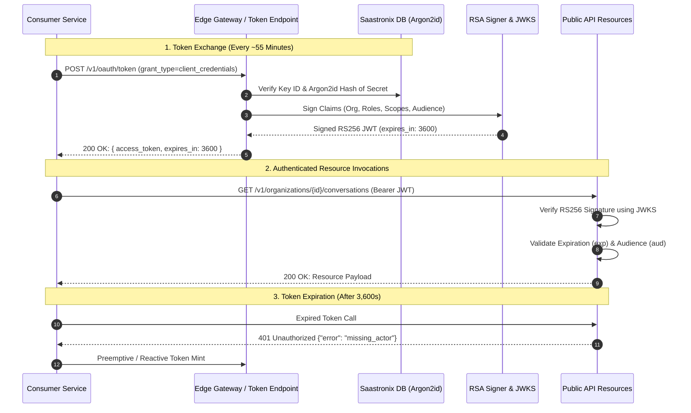

import { Callout } from "fumadocs-ui/components/callout";
import { Tab, Tabs } from "fumadocs-ui/components/tabs";

The Cerebronix Public Platform enforces a two-tier authentication architecture:
1. **Long-Lived API Keys:** Stored securely by the client system and used exclusively to authenticate against the token endpoint.
2. **Short-Lived RS256 Bearer Tokens:** Asymmetric JSON Web Tokens (JWTs) exchanged via OAuth 2.0 and passed in the `Authorization: Bearer` header on all operational endpoints.

---

## Architecture & Token Lifecycle



---

## 1. API Keys & Storage Security

API keys are minted exclusively through the SaaS Console under **Developer Settings** (`/developer`).

- **Key ID (`client_id`):** A standard UUIDv4 identifier used to look up the key record (e.g., `019234a5-6789-7abc-def0-123456789abc`).
- **Key Secret (`client_secret`):** A cryptographically secure random string prefixed with `cnx_live_` (e.g., `cnx_live_9f8e7d6c5b4a3210fedcba9876543210`).
- **Cryptographic Storage:** Secrets are hashed using **Argon2id** before storage in the backend database. Cerebronix cannot retrieve or recover a secret once generated. If lost, the key must be revoked and replaced.

---

## 2. OAuth 2.0 Token Exchange (`/v1/oauth/token`)

To obtain a Bearer JWT, submit a `POST` request to the token endpoint:

```http
POST https://public-api.cerebronix.com/v1/oauth/token
```

The endpoint supports three standard encoding formats:

### Supported Request Formats

<Tabs items={["HTTP Basic Auth (Recommended)", "Form URL-Encoded", "JSON Body"]}>
```bash tab="HTTP Basic Auth (Recommended)"
curl -sS -X POST https://public-api.cerebronix.com/v1/oauth/token \
  -u "$KEY_ID:$KEY_SECRET" \
  -H "Content-Type: application/x-www-form-urlencoded" \
  -d "grant_type=client_credentials"
```

```bash tab="Form URL-Encoded"
curl -sS -X POST https://public-api.cerebronix.com/v1/oauth/token \
  -H "Content-Type: application/x-www-form-urlencoded" \
  -d "grant_type=client_credentials" \
  -d "client_id=$KEY_ID" \
  -d "client_secret=$KEY_SECRET"
```

```bash tab="JSON Body"
curl -sS -X POST https://public-api.cerebronix.com/v1/oauth/token \
  -H "Content-Type: application/json" \
  -d '{
    "grant_type": "client_credentials",
    "client_id": "'"$KEY_ID"'",
    "client_secret": "'"$KEY_SECRET"'"
  }'
```
</Tabs>

### Successful Token Response
```http
HTTP/1.1 200 OK
Content-Type: application/json; charset=utf-8

{
  "access_token": "eyJhbGciOiJSUzI1NiIsImtpZCI6IjY5YTY4NTV...",
  "token_type": "Bearer",
  "expires_in": 3600,
  "scope": "conversations:read conversations:write contacts:read agents:read"
}
```

---

## 3. JWT Anatomy & Claims

Tokens minted by the Cerebronix Public Platform are **RS256 signed JSON Web Tokens**:

### JWT Header
```json
{
  "alg": "RS256",
  "kid": "69a68550",
  "typ": "JWT"
}
```
- `alg`: Always `RS256` (RSA Signature with SHA-256).
- `kid`: Key identifier corresponding to the active public key in the JWKS.

### JWT Payload Claims
```json
{
  "iss": "https://public-api.cerebronix.com",
  "sub": "019234a5-6789-7abc-def0-123456789abc",
  "aud": [
    "cerebronix-public-api"
  ],
  "exp": 1792398000,
  "iat": 1792394400,
  "org_id": "67123456789abcdef0123456",
  "actor_type": "api_key",
  "actor_id": "019234a5-6789-7abc-def0-123456789abc",
  "client_id": "019234a5-6789-7abc-def0-123456789abc",
  "roles": [
    "developer"
  ],
  "scopes": [
    "conversations:read",
    "conversations:write",
    "agents:read"
  ]
}
```

| Claim | Type | Description |
| :--- | :--- | :--- |
| `org_id` | string | Unique identifier of the tenant organization. Must strictly match path parameter `{organization_id}`. |
| `actor_type` | string | Always `api_key` for server-to-server credentials. |
| `actor_id` | string | ID of the authenticated API key record. |
| `roles` | array | Assigned organization role (`owner`, `admin`, `developer`, or `viewer`). |
| `scopes` | array | Specific functional permissions authorized for this key. |
| `aud` | array | Intended audience (`cerebronix-public-api`, `cerebronix-public-mcp`, or `cerebronix-public-ws`). |
| `exp` | integer | Unix timestamp representing token expiration (exactly 1 hour after issuance). |

---

## 4. Target Audiences & MCP Audience Request

By default, access tokens are minted with audience `cerebronix-public-api`, authorizing requests to all public REST routes.

When integrating with the **Model Context Protocol (MCP)** endpoint (`POST /mcp`), the token must include audience `cerebronix-public-mcp`. Request this explicitly by supplying the `audience` parameter during token exchange:

```bash
curl -sS -X POST https://public-api.cerebronix.com/v1/oauth/token \
  -u "$KEY_ID:$KEY_SECRET" \
  -d "grant_type=client_credentials" \
  -d "audience=cerebronix-public-mcp"
```

---

## 5. JWKS Key Verification & Rotation

Cerebronix publishes its public RSA verification keys in JSON Web Key Set format:

```http
GET https://public-api.cerebronix.com/.well-known/jwks.json
```

```json
{
  "keys": [
    {
      "kty": "RSA",
      "use": "sig",
      "alg": "RS256",
      "kid": "69a68550",
      "n": "v3bQ8...",
      "e": "AQAB"
    }
  ]
}
```

The gateway dynamically validates tokens against the matching `kid`. During scheduled key rotations, the JWKS advertises both old and new public keys to allow seamless in-flight verification without downtime.

---

## 6. Token Expiration, Caching & Renewal

<Callout type="info">
  **No Refresh Tokens for Client Credentials:** Standard OAuth 2.0 `client_credentials` grants do not issue refresh tokens. While `offline_access` exists in the platform scope registry for OAuth 2.1 specification compatibility, public API clients renew access tokens by re-authenticating with their `client_id` and `client_secret`.
</Callout>

### Recommended Production Caching Pattern

```typescript
class CerebronixAuthClient {
  private keyId: string;
  private keySecret: string;
  private cachedToken: string | null = null;
  private expiresAt: number = 0;

  constructor(keyId: string, keySecret: string) {
    this.keyId = keyId;
    this.keySecret = keySecret;
  }

  async getToken(): Promise<string> {
    const now = Math.floor(Date.now() / 1000);
    
    // Preemptively refresh when 5 minutes (300s) remain
    if (this.cachedToken && this.expiresAt - now > 300) {
      return this.cachedToken;
    }

    const credentials = Buffer.from(`${this.keyId}:${this.keySecret}`).toString('base64');
    const response = await fetch('https://public-api.cerebronix.com/v1/oauth/token', {
      method: 'POST',
      headers: {
        'Authorization': `Basic ${credentials}`,
        'Content-Type': 'application/x-www-form-urlencoded',
      },
      body: 'grant_type=client_credentials',
    });

    if (!response.ok) {
      throw new Error(`Token exchange failed: HTTP ${response.status}`);
    }

    const data = await response.json();
    this.cachedToken = data.access_token;
    this.expiresAt = now + data.expires_in;
    return this.cachedToken;
  }
}
```

---

## 7. Zero-Downtime Credential Rotation

When rotating API keys in production:

1. **Mint Secondary Key:** In the Console under `/developer`, create a new API key with the identical role and scopes.
2. **Deploy New Credentials:** Update your consumer application or secrets manager with the new Key ID and Secret.
3. **Verify Traffic:** Monitor application logs to confirm token exchanges succeed with the new key.
4. **Revoke Old Key:** In the Console, delete the old key. Revoked keys immediately fail authentication with `401 invalid_client`. In-flight tokens minted prior to revocation expire naturally within 60 minutes.
