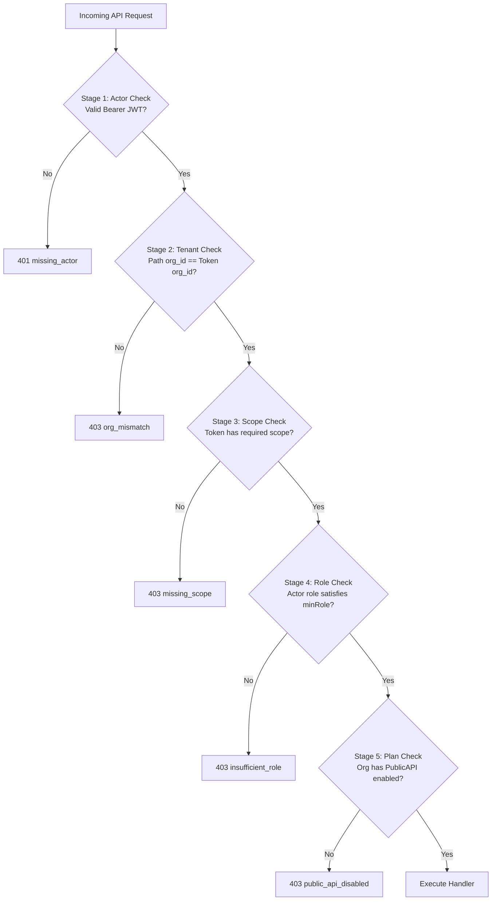
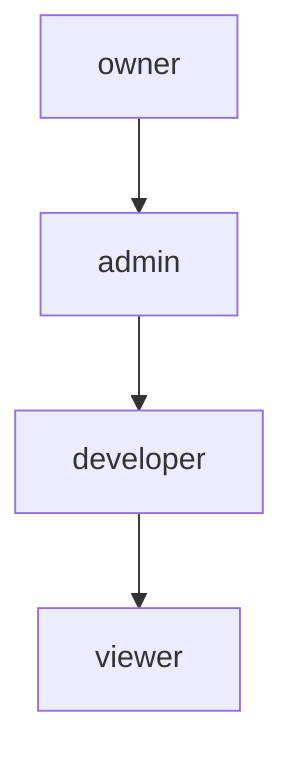

import { Callout } from "fumadocs-ui/components/callout";

Every request entering the Cerebronix Public Platform is evaluated against a **four-stage authorization gate** before execution. All four stages must pass; a failure at any stage immediately halts request processing with an explicit HTTP status and machine-readable error code.

---

## The Four-Stage Authorization Pipeline



---

## 1. Tenant Isolation & Organization Boundaries

Cerebronix strictly enforces cryptographic multi-tenant isolation. 

- Every public API resource belongs to an organization identified by a 24-character hex ID (e.g., `67123456789abcdef0123456`).
- Resource routes require `{organization_id}` as the primary path parameter:
  ```http
  GET /v1/organizations/{organization_id}/conversations
  ```
- **The Boundary Rule:** The `organization_id` in the URL path must **strictly match** the `org_id` embedded in the cryptographically verified JWT claims.
- If a client attempts to query or mutate resources belonging to another organization, the gateway returns:
  ```json
  {
    "error": "org_mismatch"
  }
  ```

---

## 2. Organization Role Hierarchy (Ory Keto RBAC)

API keys are minted with an organizational role evaluated via Ory Keto:



| Role | Permitted Actions | Minimum Requirement For |
| :--- | :--- | :--- |
| **`owner`** | Complete administrative and write authority across all organization resources. | Full access across all public endpoints. |
| **`admin`** | Operational management, team configuration, billing inspection, and write operations. | Inherits all permissions of `developer` and `viewer`. |
| **`developer`** | Standard integration role. Authorized to create, update, and delete operational data (conversations, contacts, templates, campaigns, data sources, agents). | Minimum required role for all mutating endpoints (`POST`, `PATCH`, `DELETE`). |
| **`viewer`** | Read-only inspection role. Permitted to execute `GET` queries only. | Minimum required role for read endpoints (`GET`). |

<Callout type="warn">
  **Role vs. Scope Enforcement:** Possessing the `developer` or `admin` role is a **necessary but not sufficient** condition for writing. The token must ALSO contain the specific scope for the resource being modified. A `developer` token lacking `contacts:write` cannot create contacts.
</Callout>

### Team Member Invites & Administrative Access
Organization owners and administrators can invite team members and assign roles (e.g., inviting developers or support operators) through the SaaS Console under **Organization Settings > Team Members**. Once an invite is accepted, team members with the `admin` or `owner` role can mint and rotate API keys.

---

## 3. The 19 Grantable Platform Scopes

When creating an API key in the SaaS Console, administrators explicitly grant one or more scopes from the 19 supported platform permissions:

| Scope Name | Category | Minimum Role | Endpoints Authorized | Description |
| :--- | :--- | :--- | :--- | :--- |
| **`conversations:read`** | Messaging | `viewer` | `GET .../conversations`<br/>`GET .../conversations/{id}`<br/>`GET .../messages`<br/>`POST .../ws_tickets` | Read conversation threads, inspect messages, and mint operator WebSocket tickets. |
| **`conversations:write`** | Messaging | `developer` | `POST .../messages`<br/>`POST .../handoff`<br/>`POST .../resolve` | Send agent or operator replies, trigger human operator handoff, and resolve conversations. |
| **`contacts:read`** | CRM | `viewer` | `GET .../contacts`<br/>`GET .../contacts/{id}` | Search customer records, filter by country/city/language, and inspect profiles. |
| **`contacts:write`** | CRM | `developer` | `POST .../contacts`<br/>`PATCH .../contacts/{id}`<br/>`DELETE .../contacts/{id}` | Create new customer profiles, update contact attributes, and remove records. |
| **`groups:read`** | CRM | `viewer` | `GET .../contact_groups`<br/>`GET .../contact_groups/{id}` | Inspect customer segmentation groups. |
| **`groups:write`** | CRM | `developer` | `POST .../contact_groups`<br/>`PATCH .../contact_groups/{id}`<br/>`DELETE .../contact_groups/{id}`<br/>`POST .../members`<br/>`DELETE .../members` | Manage contact groups and add/remove individual customer members. |
| **`whatsapp:send`** | Outreach | `developer` | `GET .../whatsapp/templates`<br/>`POST .../whatsapp/templates/{name}/send` | List Meta-approved HSM templates and dispatch individual template messages to verified contacts. |
| **`campaigns:write`** | Outreach | `developer` | `POST .../campaigns`<br/>`GET .../campaigns/{id}` | Schedule and trigger outbound broadcast campaigns targeted at contact groups. |
| **`agents:read`** | AI Agents | `viewer` | `GET .../agents`<br/>`GET .../agents/{id}`<br/>`GET .../channels`<br/>`GET .../channels/{id}` | Inspect AI agent configurations, prompt instructions, and channel routing bindings. |
| **`agents:write`** | AI Agents | `developer` | `POST .../agents`<br/>`PATCH .../agents/{id}`<br/>`POST .../data_sources`<br/>`PATCH .../channels/{id}` | Create AI agents, modify system instructions, bind knowledge bases, and link communication channels. |
| **`ask_agent`** | AI Inference | `developer` | `POST .../agents/{id}/ask` | Execute direct RAG inference against deployed agents (supports synchronous and asynchronous execution). |
| **`datasources:read`** | Knowledge | `viewer` | `GET .../data_sources`<br/>`GET .../data_sources/{id}` | List indexed knowledge sources and inspect sync status. |
| **`datasources:write`** | Knowledge | `developer` | `POST .../data_sources`<br/>`PATCH .../data_sources/{id}`<br/>`DELETE .../data_sources/{id}`<br/>`POST .../index` | Create text/URL knowledge sources, trigger re-indexing jobs, and delete sources. |
| **`analytics:read`** | Reporting | `viewer` | `GET .../analytics/summary` | Query operational analytics, resolution times, deflection rates, and message volume. |
| **`billing:read`** | Billing | `viewer` | `GET .../billing/balance`<br/>`GET .../billing/entitlements`<br/>`GET .../billing/transactions` | Read credit balance, inspect plan limits, and list ledger debits. |
| **`webhooks:read`** | Webhooks | `viewer` | `GET .../webhook_subscriptions`<br/>`GET .../webhook_subscriptions/{id}` | Inspect registered webhook URLs, subscribed event types, and delivery status. |
| **`webhooks:write`** | Webhooks | `developer` | `POST .../webhook_subscriptions`<br/>`PATCH .../webhook_subscriptions/{id}`<br/>`DELETE .../webhook_subscriptions/{id}`<br/>`POST .../rotate_secret` | Register webhook delivery endpoints, update event subscriptions, and rotate HMAC secrets. |
| **`mcp`** | Protocol | `developer` | `POST /mcp` | Authorize Model Context Protocol JSON-RPC 2.0 tool execution. |
| **`offline_access`** | Protocol | `viewer` | Reserved | OAuth 2.1 specification compatibility scope. Refresh token exchange is not implemented for client credentials. |

---

## 4. Plan Entitlements & Platform Credits

Even if an API key has the required role and scopes, the organization must be on an eligible subscription tier and maintain sufficient platform credits:

- **Growth Plan:** Public API enabled (60 RPM general, 20 RPM `ask_agent`, 500 campaign recipients).
- **Scale Plan:** Public API enabled (300 RPM general, 60 RPM `ask_agent`, 2,000 campaign recipients).
- **Enterprise Plan:** Public API enabled (Uncapped / Custom RPM, custom campaign recipients).
- **Free & Starter Plans:** Public API disabled. Returns `403 public_api_disabled`.

### Metered Usage & Credits Authorization
Endpoints executing AI inference (such as direct inference via `POST .../agents/{id}/ask`) verify that the organization has active platform credits available in its credit ledger balance. If an organization on a hard-stop policy exhausts its monthly credits, the gateway refuses execution with HTTP 402 Payment Required (`insufficient_credits`).

---

## 5. Authorization Failure Responses

When an authorization check fails, the API returns HTTP 403 Forbidden with one of the following canonical error codes:

```json
{
  "error": "missing_scope"
}
```

```json
{
  "error": "insufficient_role"
}
```

```json
{
  "error": "org_mismatch"
}
```

```json
{
  "error": "public_api_disabled"
}
```
